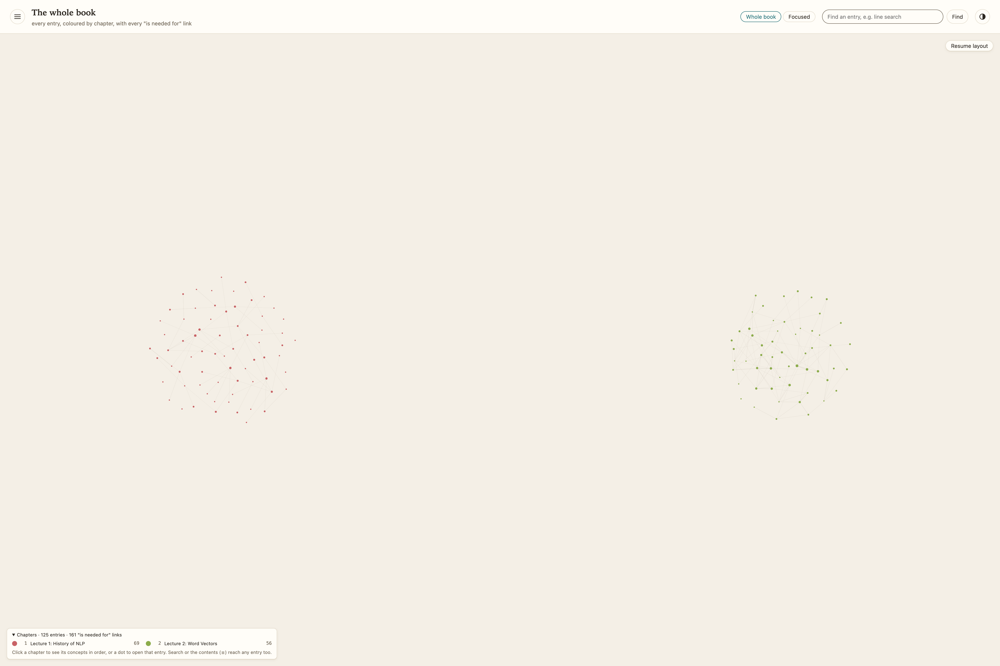

# Stanford CS224N: Natural Language Processing with Deep Learning

Recitation-style notes for Stanford's CS224N, following the **Winter 2026** offering (instructors Diyi Yang and Yejin Choi), one lecture at a time. Each lecture has a section leader's notes, written from the lecture's slides, readings and assignment, and a concept map of every idea it teaches, with the links between them. The course's maps together make up a course knowledge graph.

*The course knowledge graph in metamatx's whole-course view, covering 2 of 19 lectures so far: 125 entries (91 concepts and 34 background notes) with 161 "is needed for" links, coloured by lecture (Lecture 1 red, 69 entries; Lecture 2 green, 56). Each lecture forms its own cluster: where Lecture 2 builds on Lecture 1, its map says so in the entries' text ("Taught in", "Extends") rather than as links. The picture is refreshed as each lecture is published.*

## What the course teaches, and in what order

CS224N opens with the history of NLP, then builds the deep-learning basics: word vectors, backpropagation, language models and RNNs, and transformers. It goes on to the methods of the LLM era: pretraining, post-training, efficient adaptation, agents and retrieval, evaluation and reasoning. Guest lectures cover tokenization and multilinguality, interpretability and multimodality, and the course closes with social impact and the open questions of 2026.

## The offering, and why this one

These notes follow the Winter 2026 schedule at [web.stanford.edu/class/cs224n](https://web.stanford.edu/class/cs224n/), the newest offering with a published syllabus (checked November 2026). Each lecture uses the newest published materials, labelled with their offering, and every paper the lecture names, labelled with its original and fetched dates. The repository is kept current: when the course is taught again, the lectures are brought up to date in place, and earlier versions stay in the history. Lecture videos for Winter 2026 are on Canvas for enrolled students only. The most recent public recordings are the [Spring 2024 playlist](https://www.youtube.com/playlist?list=PLoROMvodv4rOaMFbaqxPDoLWjDaRAdP9D), which follows an earlier syllabus.

The course's materials are copied beside the lecture they belong to for personal educational use. They are published openly by the course, and each is listed below with its original URL and offering.

Syllabus: Winter 2026. Last updated: 9 November 2026.

## Lectures

| # | Lecture | Notes | Concept map | Materials (source, offering) |
|---|---|---|---|---|
| 1 | History of NLP (Tue Jan 6) | [Notes](lectures/01-history-of-nlp/README.md) | [Map](lectures/01-history-of-nlp/concept-map.md) · [interactive page](lectures/01-history-of-nlp/concept-map.html) | [Intro slides](lectures/01-history-of-nlp/materials/cs224n-2026-lecture01-intro.pdf) ([original](https://web.stanford.edu/class/cs224n/slides_w26/cs224n-2026-lecture01-intro.pdf), W26); [History slides](lectures/01-history-of-nlp/materials/cs224n-2026-lecture01-history.pdf) ([original](https://web.stanford.edu/class/cs224n/slides_w26/cs224n-2026-lecture01-history.pdf), W26); [Assignment 1 notebook](lectures/01-history-of-nlp/materials/a1/exploring_word_vectors.ipynb) ([original zip](https://web.stanford.edu/class/cs224n/assignments_w26/a1.zip), W26); reading: Manning, ["Human Language Understanding & Reasoning"](https://www.amacad.org/publication/daedalus/human-language-understanding-reasoning), *Dædalus* 2022 |
| 2 | Word Vectors (Thu Jan 8) | [Notes](lectures/02-word-vectors/README.md) | [Map](lectures/02-word-vectors/concept-map.md) · [interactive page](lectures/02-word-vectors/concept-map.html) | [Slides](lectures/02-word-vectors/materials/cs224n-2026-lecture02-wordvecs.pdf) ([original](https://web.stanford.edu/class/cs224n/slides_w26/cs224n-2026-lecture02-wordvecs.pdf), W26); [notes 1](lectures/02-word-vectors/materials/cs224n_winter2023_lecture1_notes_draft.pdf) ([original](https://web.stanford.edu/class/cs224n/readings/cs224n_winter2023_lecture1_notes_draft.pdf), W23 draft); [notes 2](lectures/02-word-vectors/materials/cs224n-2019-notes02-wordvecs2.pdf) ([original](https://web.stanford.edu/class/cs224n/readings/cs224n-2019-notes02-wordvecs2.pdf), W19); suggested readings: [word2vec](https://arxiv.org/abs/1301.3781), [negative sampling](https://arxiv.org/abs/1310.4546), [GloVe](https://aclanthology.org/D14-1162/), [Levy et al. 2015](https://aclanthology.org/Q15-1016/), [Schnabel et al. 2015](https://aclanthology.org/D15-1036/); additional: [Arora et al. 2016](https://aclanthology.org/Q16-1028/), [Arora et al. 2018](https://aclanthology.org/Q18-1034/), [Yin & Shen 2018](https://arxiv.org/abs/1812.04224) |
| 3 | Backpropagation and Neural Network Basics (Tue Jan 13) | not yet published | — | — |
| 4 | Language Models and RNNs (Thu Jan 15) | not yet published | — | — |
| 5 | Transformers (Tue Jan 20) | not yet published | — | — |
| 6 | Final Projects: Custom and Default; Practical Tips (Thu Jan 22) | not yet published | — | — |
| 7 | Pretraining (Scaling, Systems, Data) (Tue Jan 27) | not yet published | — | — |
| 8 | Post-training (RLHF, SFT, DPO) (Thu Jan 29) | not yet published | — | — |
| 9 | Efficient Adaptation (Prompting + PEFT) (Tue Feb 3) | not yet published | — | — |
| 10 | Agents, Tool Use, and RAG (Thu Feb 5) | not yet published | — | — |
| 11 | Benchmarking and Evaluation (Tue Feb 10) | not yet published | — | — |
| 12 | Reasoning 1 (Thu Feb 12) | not yet published | — | — |
| 13 | Reasoning 2 (Tue Feb 17) | not yet published | — | — |
| 14 | Guest Lecture: Tokenization and Multilinguality (Thu Feb 19) | not yet published | — | — |
| 15 | Guest Lecture: Interpretability (Tue Feb 24) | not yet published | — | — |
| 16 | Social and Broader Impacts of NLP (Risks) (Thu Feb 26) | not yet published | — | — |
| 17 | Guest Lecture: Multimodality (Tue Mar 3) | not yet published | — | — |
| 18 | Guest Lecture: Tinker and LoRA Without Regret (Thu Mar 5) | not yet published | — | — |
| 19 | Open Questions in NLP 2026 (Tue Mar 10) | not yet published | — | — |

The course knowledge graph is described for metamatx in [`metamatx-manifest.json`](metamatx-manifest.json).
