# How NLP Got Here: Four Bets on What Language Is

Lecture 1 of CS224N (Winter 2026) is a history lecture, and an unusually useful one. Its single learning goal is to "understand the paradigm shifts in NLP and how our assumptions about language shape what is possible in each era" (intro slide 2). Each era of the field placed a bet on what language *is*: a code to crack, a set of rules to write down, a pile of statistics to count, or a space of vectors to learn. Every bet decided what its systems could and could not do. These notes follow the lecture's two decks in order: the course introduction by Diyi Yang and Yejin Choi, and Christopher Manning's guest lecture on the history. They add the assigned reading (Manning's 2022 *Dædalus* essay) and Assignment 1, which goes out the same day. There is no public recording of this lecture, so everything here comes from the slides, the reading and the assignment. The sources, all Winter 2026: the [intro deck](materials/cs224n-2026-lecture01-intro.pdf) (cited "intro slide N"), the [history deck](materials/cs224n-2026-lecture01-history.pdf) ("history slide N"), Manning's ["Human Language Understanding & Reasoning"](https://www.amacad.org/publication/daedalus/human-language-understanding-reasoning) (*Dædalus* 151(2), 2022, cited by page), and [Assignment 1](materials/a1/exploring_word_vectors.ipynb). Papers used in the asides are linked where they first appear.

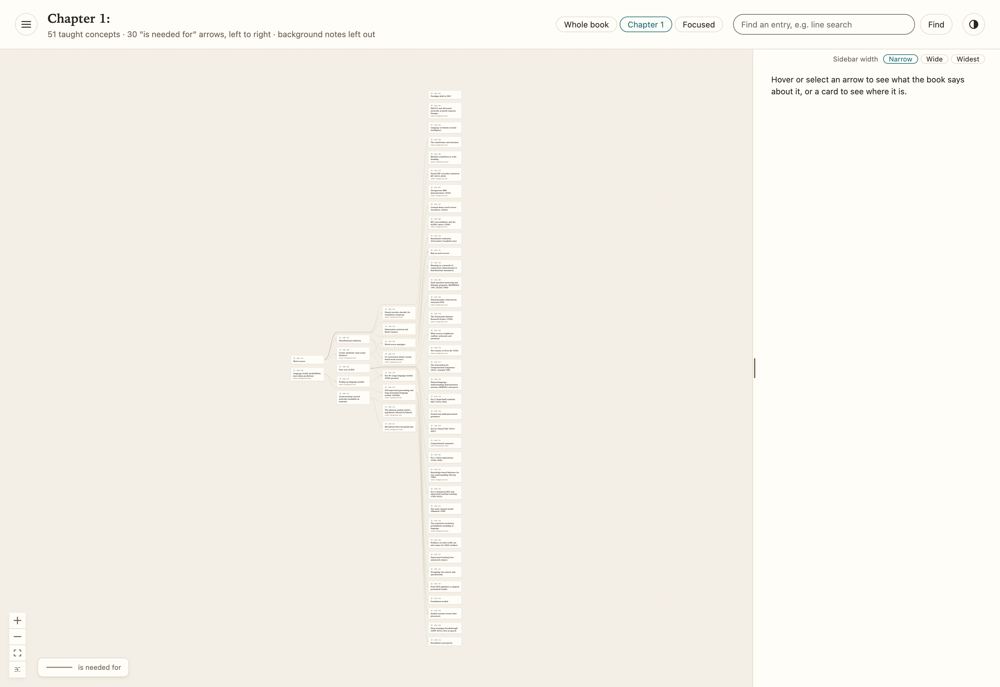
*Lecture 1 in metamatx's chapter view: the lecture's 51 taught concepts as cards, with the 30 "is needed for" arrows between them running left to right. Background notes are left out. The interactive version of this map is [concept-map.html](concept-map.html).*

## Contents

- [1. The course and the one idea to carry out of it](#1-the-course-and-the-one-idea-to-carry-out-of-it)
- [2. Four eras and two families](#2-four-eras-and-two-families)
- [3. Era 1, part one: translation as code-breaking](#3-era-1-part-one-translation-as-code-breaking)
- [4. Era 1, part two: neurons, hype and two visions of AI](#4-era-1-part-two-neurons-hype-and-two-visions-of-ai)
- [5. Era 1, part three: retrieval and the first benchmark](#5-era-1-part-three-retrieval-and-the-first-benchmark)
- [6. Era 2: meaning, built by hand](#6-era-2-meaning-built-by-hand)
- [7. Era 3: counting beats knowing](#7-era-3-counting-beats-knowing)
- [8. Era 4a: neural NLP](#8-era-4a-neural-nlp)
- [9. Era 4b: large language models](#9-era-4b-large-language-models)
- [10. The reading: what pretraining changed](#10-the-reading-what-pretraining-changed)
- [11. Assignment 1: building word vectors](#11-assignment-1-building-word-vectors)
- [Across the sections](#across-the-sections)
- [Glossary](#glossary)
- [Open questions](#open-questions)

## 1. The course and the one idea to carry out of it

The first ten minutes are the course: who teaches it, how it is graded, and what it is for. The learning goals on intro slide 5 are worth saying out loud in section, because they explain the rest of the quarter. The goals are "the foundations of the effective modern methods for deep learning applied to NLP"; "a big picture understanding of human languages and the difficulties in understanding and producing them via computers"; and the ability to build systems for real language problems. The basics come first ("word vectors, recurrent networks, attention, transformers"), then the methods of the LLM era ("pretraining, post-training, efficient adaptation, agents, reasoning, multilinguality, multimodality, interpretability").

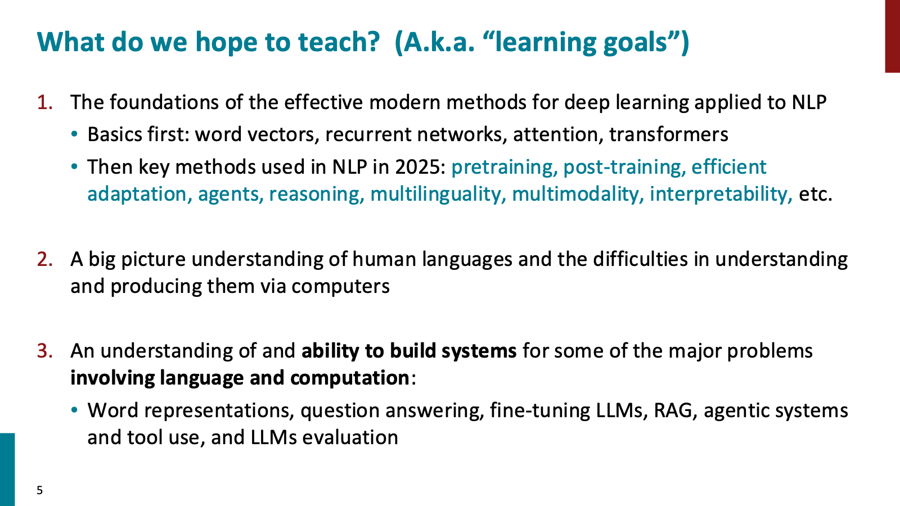
*Intro slide 5: what the course hopes to teach. The first goal's list of basics is a map of Lectures 2–5.*

Then comes the idea that organizes everything after it, the lecture's **paradigm shift in NLP**. The key learning is "understand the paradigm shifts in NLP and how our assumptions about language shape what is possible in each era" (intro slides 2, 9 and 19). Students can treat this as a reading instruction for the whole hour. For each era, ask two questions: what did people assume language was, and what did that assumption let them build?

The lecture tells the history twice. First comes "a creative way of looking at the history of NLP" (intro slide 9): an exhibition of painted panels by the Stanford NLP group, on intro slides 10–18. It runs from a Turing test and ELIZA to scaling curves, tool use and "The Thinking LLM". Then comes "a scientific way" (intro slide 19), handed to Christopher Manning, introduced as "the creator of CS224N" (intro slide 21).

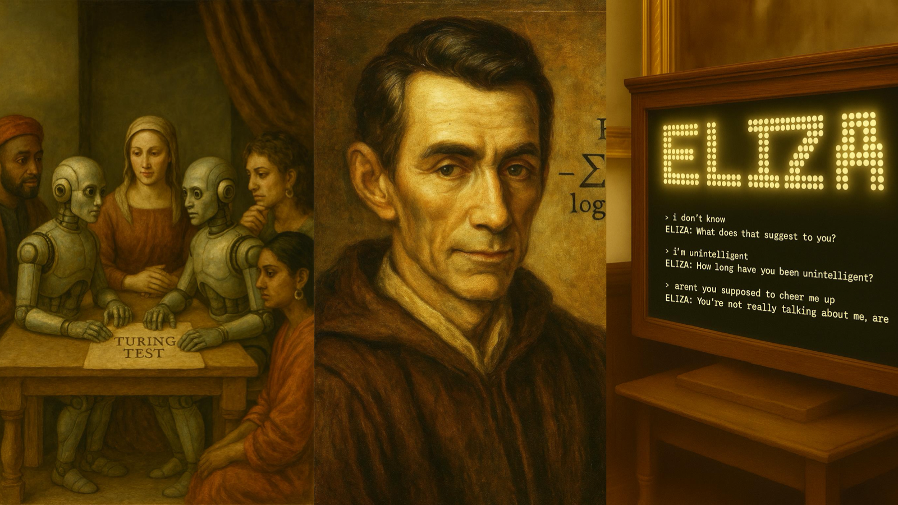
*Intro slide 10, the exhibition's opening: a Turing test, a portrait with an entropy formula, and an ELIZA terminal.*

> **Note:** The exhibition makes a good five-minute warm-up for section. Put intro slides 10–18 on the screen and ask students to name each panel's idea and guess its decade. None of the panels is labelled with a date, which is the point. By the end of these notes, every panel should be identifiable.

Intro slide 20 is a good joke. It shows three chatbots asked "if you can only invite one professor to talk about the history of NLP, who should we invite?" ChatGPT, Gemini and DeepSeek all name Manning.

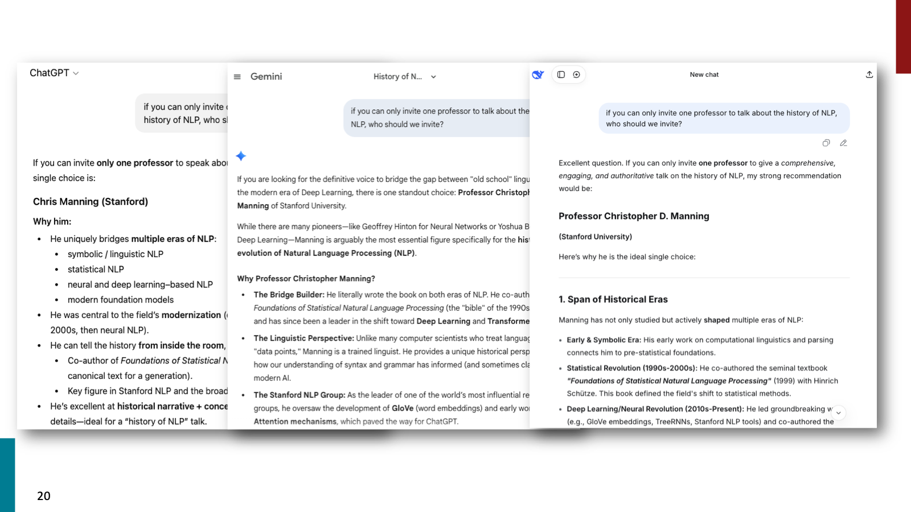
*Intro slide 20: ChatGPT, Gemini and DeepSeek answer the same question the same way.*

> **Note:** The joke has a teaching use. The lecture's own subject, large language models, turns up in the slide that introduces its guest. The history the lecture tells ends inside the screenshot.

**Check your understanding.** What two questions should you ask of each era in this lecture?
*Answer:* What did people assume language is, and what did that assumption make possible (and impossible)?

## 2. Four eras and two families

Manning's history has a simple skeleton, the **four eras of NLP** (history slide 2):

1. "1940–1969: Early Explorations"
2. "1970–1992: Hand-built symbolic NLP systems, of increasing formalization"
3. "1993–2012: Statistical or Probabilistic NLP and then more general Supervised ML for NLP"
4. "2013–now: Deep Learning or Artificial Neural Networks; Unsupervised or Self-Supervised NLP; Reinforcement Learning"

Later the deck splits era 4 in two: "4a. Neural NLP 2013–2021" and "4b. Large Language Models 2022–present" (history slides 38 and 48).

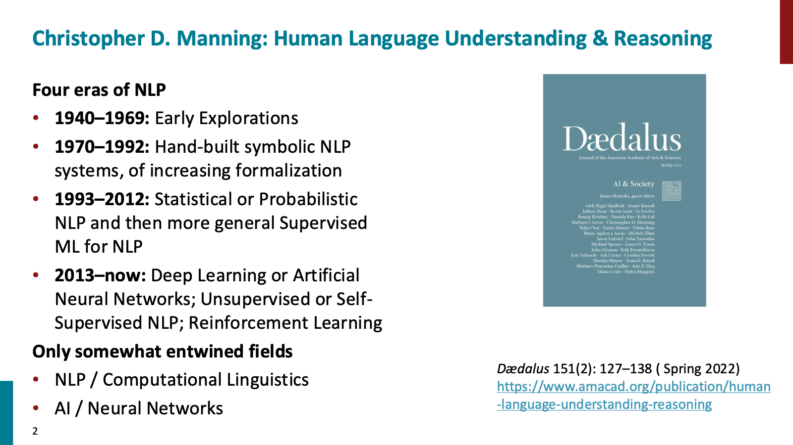
*History slide 2: the four eras, and the two "only somewhat entwined fields". The essay on the right is the assigned reading.*

The reading draws the same four eras with two small differences worth pointing out. It starts era 1 in 1950 rather than 1940 (*Dædalus* p. 128). It also suggests the line between eras 3 and 4 might move: self-supervised learning (2018) "may well be viewed as the fundamental change, and the third era might be extended until 2017" (p. 130). Era boundaries are a historian's choice, not a fact of nature. Manning offers two placements for one of them in his own essay.

The same slide makes a second point that is easy to skip: **NLP/CL and AI/neural networks as partly separate lineages**. NLP (computational linguistics) and AI with neural networks are "only somewhat entwined fields" (history slide 2). They grew up side by side. The reading notes that machine-translation work, including the Georgetown–IBM demonstration of 1954, "slightly preceded the coining of the term 'artificial intelligence' in 1956" (*Dædalus* p. 128). A lot of the drama in this lecture comes from those two lineages meeting, separating and meeting again.

The reading opens with a reason to care, Manning's claim of **language as human societal intelligence**. "Human language is powerful and has been transformative to our species because it gives groups of people a way to network human brains together" (*Dædalus* p. 127). He even suggests that "an individual human may not be much more intelligent than our close relatives of chimpanzees or bonobos" (p. 127): what sets us apart is the network. Writing then lets knowledge travel "across distances of time and space" (p. 127). On this view, building machines that handle language means plugging them into the network humans already use.

**Check your understanding.** Why might two careful historians date the start of era 4 differently?
*Answer:* Because "era 4" can mean the arrival of neural networks (2013) or the arrival of large-scale self-supervised pretraining (2018). Manning himself allows both (history slide 2; *Dædalus* p. 130).

## 3. Era 1, part one: translation as code-breaking

**Era 1: Early explorations (1940–1969)** began with one problem. "NLP research began as research in machine translation" (*Dædalus* p. 128), and history slide 4 is titled "Machine Translation: The origin of NLP/Computational Linguistics".

The founding idea was **machine translation as code-breaking**. After the Second World War, computers had just proved themselves breaking enemy codes, and Warren Weaver wondered whether translation was the same problem in a new coat:

> "When I look at an article in Russian, I say: 'This is really written in English, but it has been coded in some strange symbols. I will now proceed to decode.'" (Warren Weaver, quoted on history slides 4–5)

Norbert Wiener, the founder of cybernetics, replied with the objection that still haunts translation: "the [semantic] boundaries of words in different languages are too vague … to make any quasi-mechanical translation scheme very hopeful" (history slide 5).

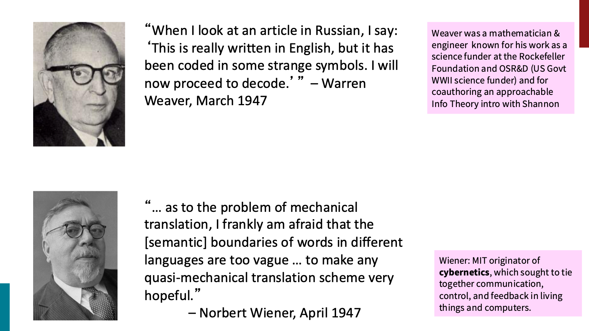
*History slide 5: Weaver's March 1947 decoding idea beside Wiener's April 1947 reply.*

> **Note:** Weaver's 1949 memorandum, which repeats the decoding passage, opens with an unusually modest wish. Weaver hopes it "might possibly serve in some small way as a stimulus to someone else, who would have the techniques, the knowledge, and the imagination to do something about it" (Weaver, ["Translation"](https://www.mt-archive.net/50/Weaver-1949.pdf), 1949, covering note). The era of MT research that followed suggests it did.

In section, ask who was right. Both were, about different things. Weaver was right that translation could be treated as a statistical decoding problem: that is exactly the noisy-channel view of era 3 (section 7). Wiener was right that word meanings don't line up one-to-one across languages, which is why word-by-word substitution failed.

The first public test was the **Georgetown–IBM demonstration (1954)**. The New York Times front page of 8 January 1954 reported "the first successful use of a machine to translate meaningful texts from one language to another" (history slide 7). The details deserve a slow read (history slides 7–8): a "vocabulary of only 250 words"; syntax rules reduced "to six instructions"; Russian sentences typed on punch cards and printed in English. One output was "We transmit thoughts by means of speech". The prediction was that a full device "should be ready within three to five years".

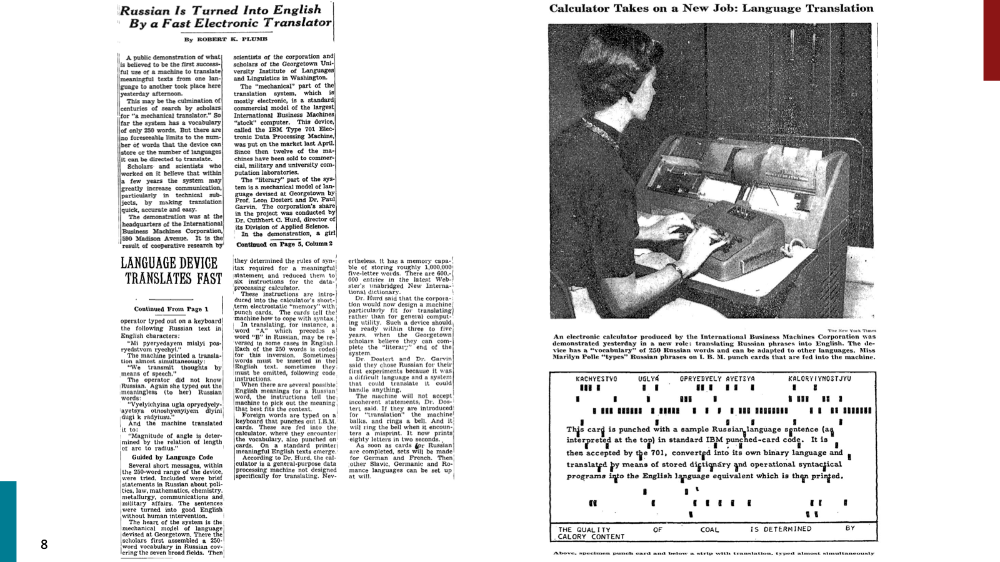
*History slide 8: the NYT coverage, with a punch card for "KACHYESTVO UGLYA OPRYEDYELYAYETSYA KALORYIYNOSTJYU" ("THE QUALITY OF COAL IS DETERMINED BY CALORY CONTENT").*

The three-to-five-year promise is the hinge for **MT overconfidence and the ALPAC report (1966)**. History slide 19 sums up the 1950s as "MT heavily funded by military — huge overconfidence", "using machines dumber than a pocket calculator", with "little understanding of syntax, semantics, pragmatics". Then, in 1966, the US National Academy of Sciences' ALPAC report arrived. The 1960s timeline (history slide 23) says it "condemned MT field", and the slide's own caption reads: "ALPAC report (1966): crap, this is really hard!"

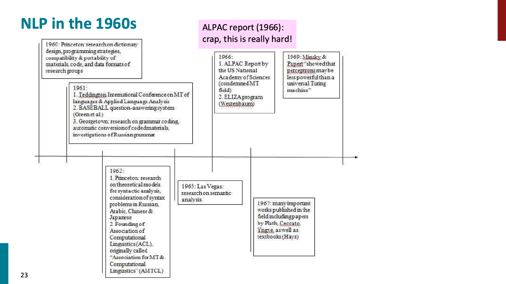
*History slide 23: the 1960s timeline, including the ALPAC report, BASEBALL and ELIZA.*

> **Note:** The report's own wording is drier than the slide's caption, and in a way more devastating: "while we have machine-aided translation of general scientific text, we do not have useful machine translation. Further, there is no immediate or predictable prospect of useful machine translation" (ALPAC, [*Language and Machines*](https://www.mt-archive.net/50/ALPAC-1966.pdf), 1966, p. 32). It distinguished machine-aided translation, which worked, from fully automatic translation, which did not.

The same era also produced the first **early question-answering and dialogue programs (BASEBALL 1961, ELIZA 1966)** (history slide 23). BASEBALL answered questions about a restricted database of baseball games ([Green et al. 1961](https://doi.org/10.1145/1460690.1460714), p. 219). ELIZA generated replies with keyword-triggered rules that decompose a sentence and reassemble the pieces ([Weizenbaum 1966](https://doi.org/10.1145/365153.365168), p. 36). The exhibition shows ELIZA at work: "> i'm unintelligent / ELIZA: How long have you been unintelligent?" (intro slide 10).

> **Note:** ELIZA's trick is visible in that one exchange. Match "I'm X", reply "How long have you been X?" There is no understanding of the word "unintelligent" at all, only its position in a template. Weizenbaum's paper calls these "decomposition" and "reassembly" rules (p. 36).

**Check your understanding.** The Georgetown–IBM system had 250 words and six rules. Why would its success on chosen sentences mislead people about general translation?
*Answer:* The sentences were selected to fit the vocabulary and rules. Real text brings unknown words, ambiguity and structure the six rules can't handle, which is the overconfidence ALPAC later answered (history slides 7–8, 19, 23).

## 4. Era 1, part two: neurons, hype and two visions of AI

While translation was failing, AI was being founded. History slide 10 marks **the Dartmouth Summer Research Project (1956)** as the moment "AI Begins", and the timeline says the "Dartmouth Conference introduces term 'Artificial Intelligence'" (history slide 19).

> **Note:** A small correction to the slide. The term "artificial intelligence" already appears in the title of McCarthy, Minsky, Rochester and Shannon's *proposal* for the workshop, dated 31 August 1955 ([the proposal, McCarthy's archive](https://www-formal.stanford.edu/jmc/history/dartmouth/dartmouth.html)). The workshop ran in 1956; the name came a year earlier, in the funding request.

The other half of era 1 is **connectionism (neural networks modelled on neurons)**. "Neural Networks: The inspiration from knowledge of neurons" (history slide 11) shows a textbook drawing of dendrites, soma and axon. The 1950s timeline marks three "seminal work[s] in connectionism": McCulloch & Pitts on formal neurons (1943), Hebb on cell assemblies and synapses (1949), and Rosenblatt on perceptrons (1958) (history slide 19).

The **McCulloch–Pitts threshold unit** is the first of these, and the first piece of mathematics in the course. A unit j sums its weighted inputs and fires if the sum passes a threshold:

netⱼ = Σᵢ wᵢⱼ xᵢ, and oⱼ = 𝟏(netⱼ > θⱼ)

or, in the slide's vector form, 𝟏(Wx > θ) = 𝟏(Wx − θ > 0) (history slide 13).

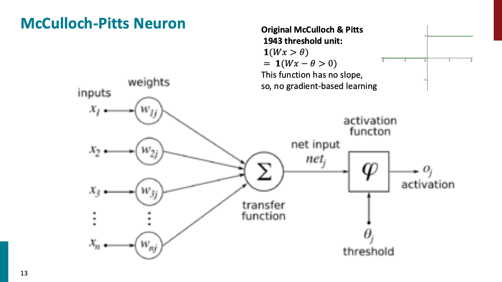
*History slide 13: inputs and weights feed a sum, the sum passes through a threshold, and the step graph shows the output jumping from 0 to 1.*

**Worked example** (numbers invented for illustration). Take two binary inputs x₁, x₂, both weights equal to 1, and threshold θ = 1.5. The unit fires only when x₁ + x₂ > 1.5, that is, only when both inputs are 1: it computes AND. Lower the threshold to θ = 0.5 and it fires when either input is 1: it computes OR. This is why McCulloch and Pitts could talk about neurons and logic in the same breath. Their [1943 paper](https://doi.org/10.1007/BF02478259) argued that networks of such units could implement a Turing machine (history slide 12). That claim is about *networks*, not a single unit.

Then the slide's warning: "This function has no slope, so, no gradient-based learning" (history slide 13). The step's derivative is zero everywhere except at the threshold, where it is undefined. Gradient descent asks "which way should I nudge the weights to reduce the error?", and a step function answers "no way at all", everywhere. Replacing the step with smooth functions is what later makes training by backpropagation possible (Lecture 3).

> **Note:** History slide 12 gives the authors' biographies, and they are worth a sentence in section. McCulloch was a "Neurophysiologist (MD), psychiatrist, and cyberneticist". Pitts, born in 1923 and so about twenty when the paper appeared, was a "Self-taught logician and computational neuroscientist" who "lived homeless at Chicago and then MIT". The first mathematical model of the neuron came partly from someone with no degree and, for a time, no home.

**Rosenblatt's perceptron** (1958) added learning, and Rosenblatt built it as hardware, the Mark I Perceptron at Cornell (history slide 14). It also produced the lecture's first great piece of hype. The New York Times of 8 July 1958 (history slide 15) reported "NEW NAVY DEVICE LEARNS BY DOING". The Navy expected its "embryo of an electronic computer" to "be able to walk, talk, see, write, reproduce itself and be conscious of its existence". The evidence was that it "learned to differentiate between right and left after fifty attempts".

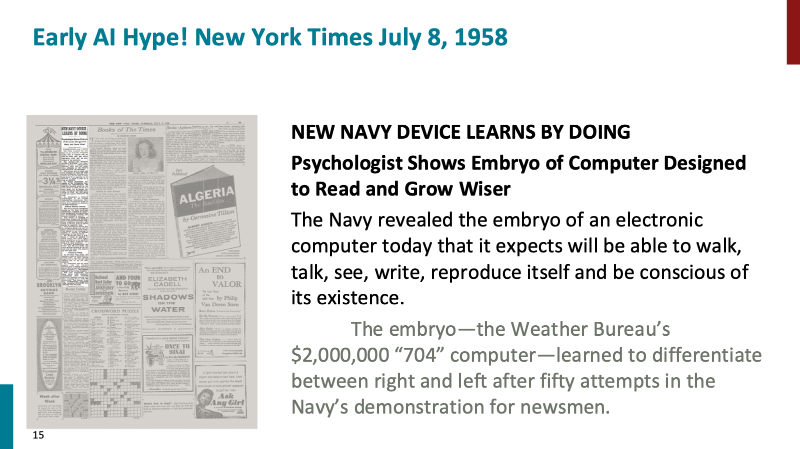
*History slide 15: "Early AI Hype!", the NYT report of 8 July 1958.*

> **Note:** A detail the slide's pairing hides: the fifty-attempt demonstration ran on the Weather Bureau's IBM 704, a "$2,000,000 '704' computer" in the article's own words (history slide 15), not on the Mark I machine pictured on slide 14. Point students to the gap between "tells left from right after fifty tries" and "conscious of its existence". It's the same gap as between six rules and "three to five years" in section 3. The 1969 timeline entry adds the sequel: Minsky and Papert "showed that perceptrons may be less powerful than a universal Turing machine" (history slide 23).

The section ends with **two visions of AI in the 1950s** (history slide 16). One is "(Symbolic) Artificial Intelligence" (Minsky, McCarthy, Simon, Newell), which manipulates symbols and rules. The other is "Cybernetics" (Wiener, Rosenblatt), which models learning and feedback in brain-like systems. Cybernetics "sought to tie together communication, control, and feedback in living things and computers" (history slide 5).

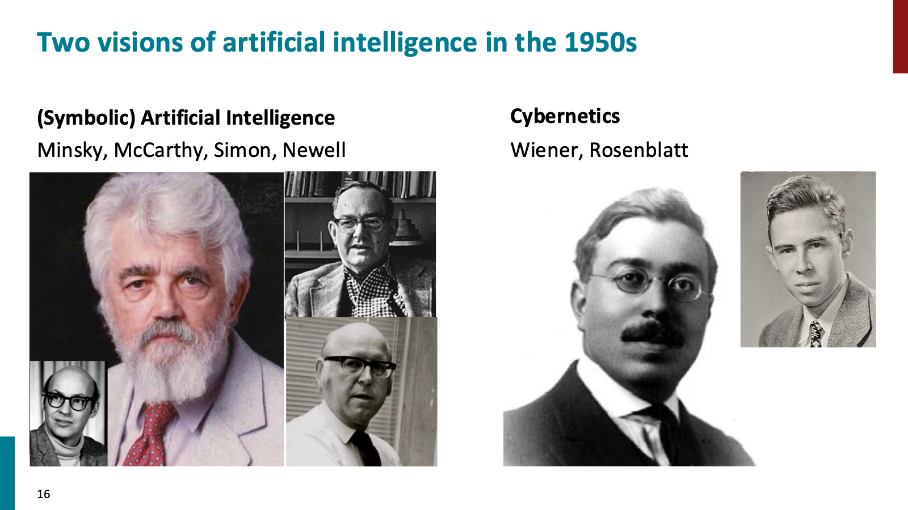
*History slide 16: the two camps, with their founders.*

> **Note:** Keep this slide in mind for section 8. Sixty years later, Manning's argument for neural NLP is an argument between exactly these two camps.

**Check your understanding.** Why can't a McCulloch–Pitts unit be trained by gradient descent, even though it can compute AND?
*Answer:* Computing AND needs only the right weights. Learning them by direct gradient descent through the hard step needs a useful gradient, and this step has zero derivative away from the threshold and is undefined at it (history slide 13). Other learning rules exist: Rosenblatt's perceptron, next, learns with a hard decision rule.

## 5. Era 1, part three: retrieval and the first benchmark

Two ideas from this era sound unglamorous and turn out to matter enormously. The first is **information retrieval and Bush's memex**. Vannevar Bush's 1945 essay ["As We May Think"](https://www.theatlantic.com/magazine/archive/1945/07/as-we-may-think/303881/) imagined a desk that holds a person's whole library:

> "A memex is a device in which an individual stores all his books, records, and communications, and which is mechanized so that it may be consulted with exceeding speed and flexibility. It is an enlarged intimate supplement to his memory." (Bush 1945, quoted on history slide 17)

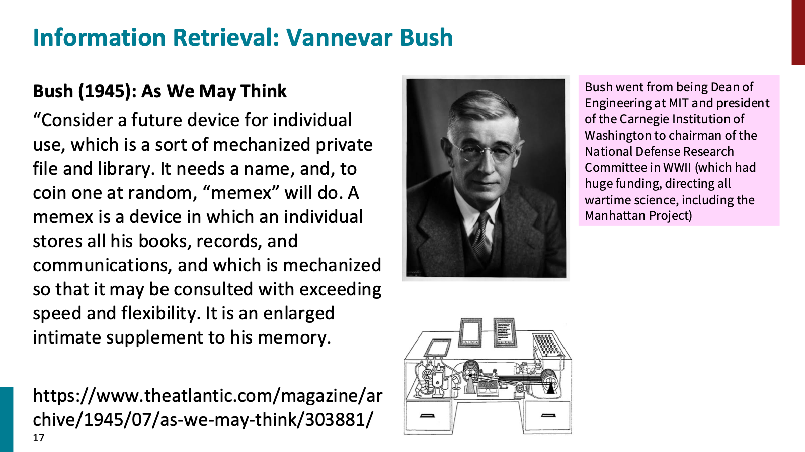
*History slide 17: the memex passage from "As We May Think".*

> **Note:** Slide 17's biography compresses two jobs into one. Bush chaired the National Defense Research Committee in 1940–1941, then directed the Office of Scientific Research and Development, which coordinated major US wartime research. The *Atlantic* printed the essay with him as OSRD director. Ask students what a memex is today. "A search engine plus your notes app" is a fair answer, and a chatbot with your files attached is closer still.

The second is **benchmark evaluation (Cleverdon's Cranfield tests)**. Cyril Cleverdon's Cranfield tests (1957–1967) "defined the idea of benchmark tests for language, with a document collection, queries, and correct answers" (history slide 18). The lecture adds, with an exclamation mark: "He had exhaustive answers on document relevance over a small corpus!"

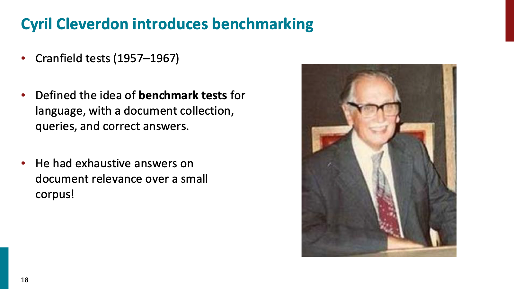
*History slide 18: benchmarking is born, in information retrieval.*

> **Note:** "Exhaustive answers over a small corpus" names the bargain Cranfield made. Judging every document's relevance to every query by hand is only affordable when the collection is small, and it gets costly fast as the collection grows. Benchmarks for document retrieval have wrestled with that cost ever since; Lecture 11 looks at how modern benchmarks get their answers.

Finally, the field got its society: **the Association for Computational Linguistics (ACL), founded 1962**, originally called the "Association for MT & Computational Linguistics" (history slide 23). David Hays, its founder, is also credited on history slide 20 with dependency parsing, which students meet in Assignment 2. The name itself records where the field started.

**Check your understanding.** What three ingredients does a Cranfield-style benchmark need?
*Answer:* A document collection, a set of queries, and the correct answers (here, which documents are relevant to each query) (history slide 18).

## 6. Era 2: meaning, built by hand

**Era 2: Hand-built symbolic NLP (1970–1992)** placed the opposite bet from Weaver. Language is structure, and structure can be written down. Systems from this era "showed sophistication and depth in handling phenomena like syntax and reference", but "these were all hand-built, rule-based systems" (*Dædalus* p. 128). "Some systems were even deployed operationally for tasks like database querying" (p. 128).

The era's stars were **natural-language-understanding demonstration systems (SHRDLU and peers)**: "SHRDLU, LUNAR, CHAT-80" (history slide 31). The timeline lists SHRDLU (Winograd, 1972), LUNAR (Woods, 1973) and LIFER (Hendrix et al., 1978); the reading adds Schank's SAM and Bobrow's GUS (*Dædalus* p. 128). Each understood English inside one narrow domain and nowhere else. LUNAR, for instance, answered questions about lunar geology, as the title of [Woods's 1973 paper](https://doi.org/10.1145/1499586.1499695) says. History slide 25 is Terry Winograd's slide: Stanford faculty from 1973, between Seymour Papert and Stuart Shieber in the academic lineage. Its embedded video doesn't survive in the PDF.

In the second decade came **formal and unification-based grammars**: "Formal and Unification-based Grammars for NLP: Martin Kay" (history slide 26), with Fernando Pereira and Stuart Shieber (slide 27), and LFG as the example (slide 31). The slides name these formalisms without unpacking them. The reading gives the key shift: "a clear separation between declarative linguistic knowledge and its procedural processing" (*Dædalus* p. 128). Grammar became data, and parsers became general programs that ran over it.

The heart of the era, and the best derivation in the lecture, is **compositional semantics**. History slide 28, "Constructing the meaning of human language: 1967–2017", gives the recipe:

1. "Tokenize a sentence into words"
2. "Parse it into a tree or graph data structure (using context-free grammars and beyond)"
3. "Construct its meaning by: (i) lexical lookup, then (ii) semantic composition, using a 'rule-to-rule' approach working up the tree"

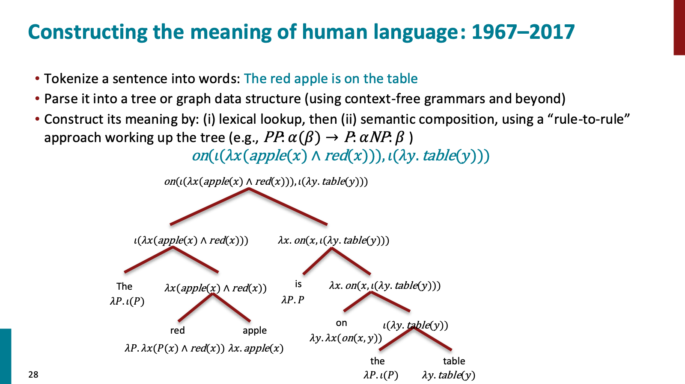
*History slide 28: every word gets a λ-term, and meanings combine up the parse tree.*

**Worked example** (history slide 28, step by step). The lexicon gives: the = λP.ι(P); red = λP.λx(P(x) ∧ red(x)); apple = λx.apple(x); is = λP.P; on = λy.λx(on(x, y)); table = λy.table(y). Here ι is "the unique thing that…".

- *red apple*: apply red to apple. λP.λx(P(x) ∧ red(x)) applied to λx.apple(x) gives λx(apple(x) ∧ red(x)), "things that are apples and red".
- *the red apple*: apply the. ι(λx(apple(x) ∧ red(x))), "the unique red apple".
- *the table*: ι(λy.table(y)).
- *on the table*: apply on. λy.λx(on(x, y)) applied to ι(λy.table(y)) gives λx.on(x, ι(λy.table(y))), "things on the table".
- *is on the table*: is = λP.P passes this through unchanged.
- *The red apple is on the table*: apply the predicate to the subject. on(ι(λx(apple(x) ∧ red(x))), ι(λy.table(y))).

> **Note:** Two places students stumble. First, "red" is not a property here but a function that *modifies* a property: it takes "apple-ness" and returns "red-apple-ness". Second, "is" does nothing (λP.P). English needs the word; the logic does not. Notice the slide's dates, 1967–2017: on this account the pipeline was the way to construct meaning for fifty years, until neural models took over.

Understanding a story needs more than composition, which is where **knowledge-based inference for text understanding (Norvig 1986)** comes in. Peter Norvig's thesis, ["A Unified Theory of Inference for Text Understanding"](https://www2.eecs.berkeley.edu/Pubs/TechRpts/1987/CSD-87-339.pdf) (history slide 29), starts from a story about a boy called Chang Lee. To understand it, a system must infer facts the text never states, such as "(d) The word they refers to Chang and his mother". Its premise: "a suitable knowledge base is a prerequisite for making proper inferences" (history slide 30, quoting p. 4). The system had "6 general forms of inference; 2 pairs, so 4 basic types" (history slide 30):

1. **Elaboration** fills a missing connection: "John got piggybank for REASON have money for REASON buy present".
2. **Reference resolution** works out what a word points to ("Hey – it's coreference!!!").
3. **View application** reads a word in a different frame: in "The Red Sox killed the Yankees", "KILLING is viewed as a DEFEAT-CONVINCINGLY".
4. **Concretization** infers something more specific: "TRAVELLING in an AUTOMOBILE is an instance of DRIVING".

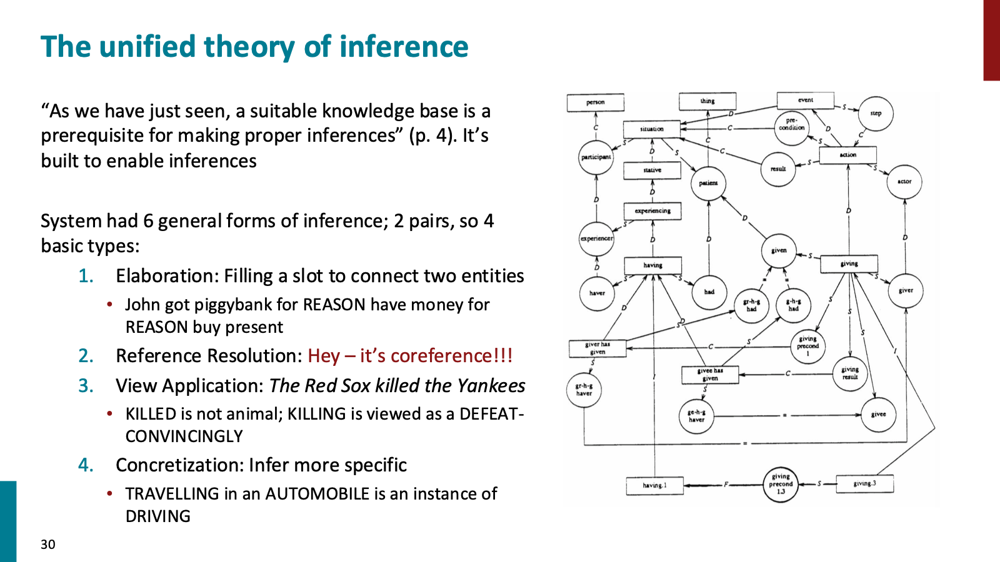
*History slide 30: the four inference types, beside the hand-built knowledge network they run over.*

> **Note:** A good recitation exercise is to hand out one sentence of a news story and have students list every inference a reader makes without noticing. They will find all four types within minutes, and then they will see the problem. The system needs an appropriate knowledge base and inference rules, and broad coverage requires authoring and maintaining that knowledge by hand.

The theory behind the whole era was **the physical symbol system hypothesis (Newell & Simon)**: "A physical symbol system has the necessary and sufficient means for general intelligent action" (Newell and Simon, [1975 Turing Award lecture manuscript](https://iiif.library.cmu.edu/file/Newell_box00024_fld01660_doc0003/Newell_box00024_fld01660_doc0003.pdf), p. 10; published as [*CACM* 19(3), 1976](https://doi.org/10.1145/360018.360022); history slide 31). In other words, physical symbol systems are necessary for general intelligence and, if large and well organized, sufficient to support it. The era ended, as history slide 31 puts it, when "symbolic AI hit the wall: 'AI winter'".

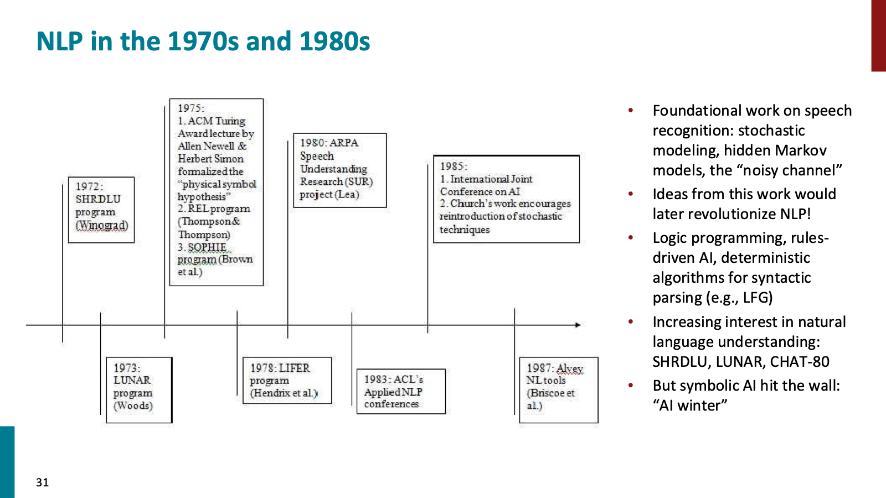
*History slide 31: the 1970s–80s timeline. Note the speech-recognition bullet, which is the seed of era 3.*

The same slide quietly plants the next era. While NLP wrote rules, speech recognition was doing "Foundational work… stochastic modeling, hidden Markov models, the 'noisy channel'", and "Ideas from this work would later revolutionize NLP!" (history slide 31).

**Check your understanding.** In the derivation above, what is the type of the meaning of "red", and why can't it simply be red(x)?
*Answer:* It's a function from properties to properties (λP.λx(P(x) ∧ red(x))). It has to combine with "apple" to produce a new property ("red apple"), not stand alone as a separate predicate (history slide 28).

## 7. Era 3: counting beats knowing

**Era 3: Statistical NLP and supervised machine learning (1993–2012)** reversed era 2's bet. Instead of writing knowledge down, learn it from text. "Digital text became abundantly available", and the field went through "a fundamental reorientation… around empirical machine learning models of NLP, an orientation that still dominates the field today" (*Dædalus* p. 129).

Its mathematical root is older than computers in NLP: **the noisy channel model (Shannon 1948)** ([Shannon, "A Mathematical Theory of Communication"](https://archive.org/details/bstj27-3-379), *Bell System Technical Journal* 27, 1948). A message leaves an information source, is sent as a signal, gets corrupted by noise, and a receiver must reconstruct it (history slide 34).

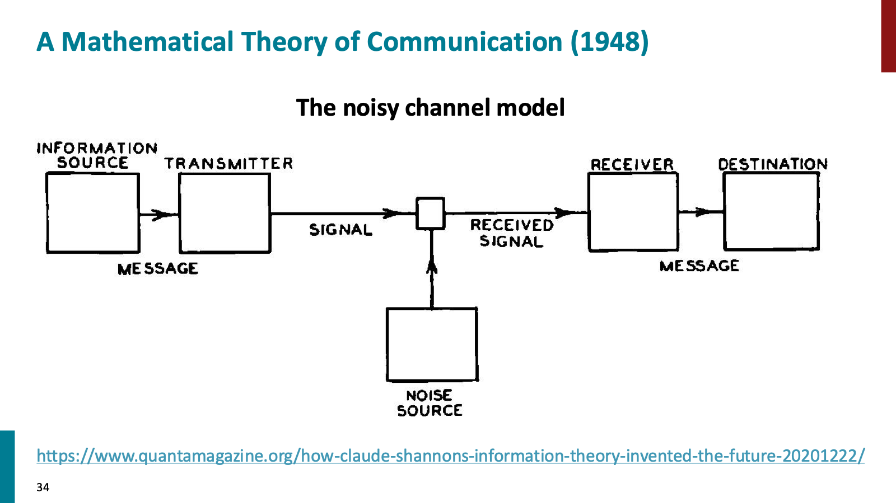
*History slide 34: information source, transmitter, noise source, receiver, destination.*

> **Note:** This is Weaver's decoding idea from section 3, made precise. Weaver co-wrote an introduction to information theory with Shannon (history slide 5). The statistical revolution is, in a sense, Weaver's bet coming back with better mathematics and much more data.

**The statistical revolution: probabilistic modeling of language** (history slide 35) arrived from engineering and speech: an "Influx of new ideas from EE & ASR: probabilistic modeling, corpus statistics, supervised learning, empirical evaluation". It also brought new humility: "Lowered expectations: forget full semantic understanding, let's do text cat, part-of-speech tagging, NER, and parsing!" The tools were "Naïve Bayes classifiers, HMMs, PCFGs, CRFs". The timeline credits Kenneth Church's work with encouraging the "reintroduction of stochastic techniques" (history slide 31).

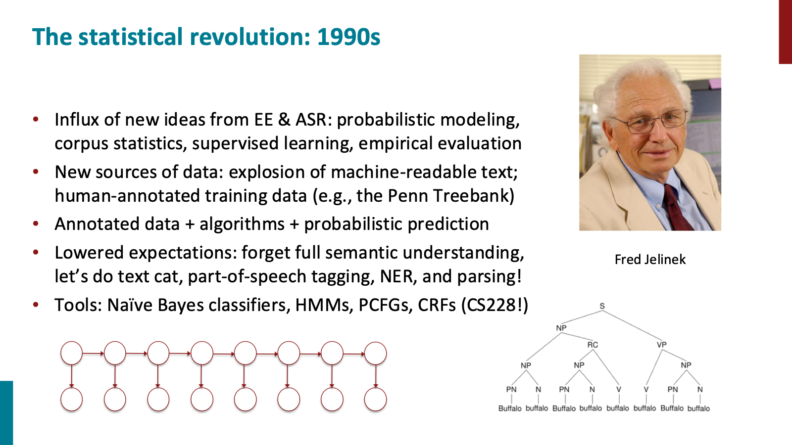
*History slide 35: the bullet points of the revolution, an HMM chain, Fred Jelinek, and a parse tree of eight "buffalo"s.*

> **Note:** The parse tree on slide 35 is a famous grammatical sentence: "Buffalo buffalo Buffalo buffalo buffalo buffalo Buffalo buffalo". Read the tree and it means "Bison from Buffalo, whom bison from Buffalo bully, themselves bully bison from Buffalo". It's on the slide for a reason. A grammar can admit several parses; a probabilistic model can rank them by how likely they are in the modelled language.

The lecture's worked example is **probabilistic spelling correction** (history slide 36). Faced with "She is a stellar and versatile **acress** whose combination of sass and glamour attracts", should the correction be *actress* or *across*? Score each candidate by how likely it is to sit between its neighbours:

- P(actress | versatile) = .0019 and P(whose | actress) = .0043
- P(across | versatile) = .000092 and P(whose | across) = .000026

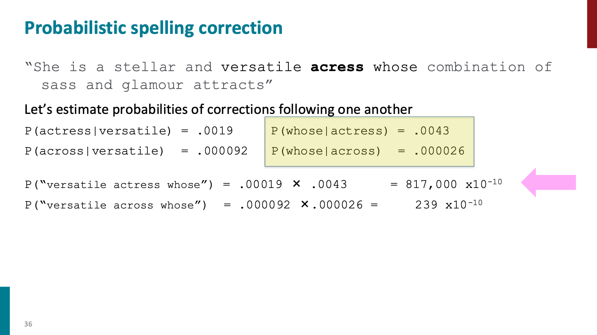
*History slide 36: scoring two corrections by the probabilities of the words around them.*

**Worked example (with a correction).** Multiply each pair. For *actress*: .0019 × .0043 = 8.17 × 10⁻⁶, which is 81,700 × 10⁻¹⁰. For *across*: .000092 × .000026 ≈ 2.39 × 10⁻⁹, which is 23.9 × 10⁻¹⁰. *Actress* wins by a factor of about 3,400.

> **Note:** The slide's printed products are each ten times too large (817,000 × 10⁻¹⁰ and 239 × 10⁻¹⁰), and the first uses .00019 where the line above has .0019. The ratio, and so the decision, is unchanged. That makes the slide a nice in-section puzzle: "One line on this slide is wrong. Find it, and decide whether it matters." It doesn't change the answer, which is itself a lesson about comparing probabilities. Also note what the slide leaves out. A full noisy-channel corrector would also weigh how likely the typo "acress" is as a misspelling of each candidate; slide 36 shows only the context half.

The era's other half is **supervised learning from annotated corpora**. "New sources of data: explosion of machine-readable text; human-annotated training data (e.g., the Penn Treebank)" (history slide 35). The reading explains why annotation took over. "Counts on words only go so far in providing language understanding devices", so the field turned to "constructing annotated linguistic resources", such as word senses, named entities and treebanks, "followed by the use of supervised machine learning techniques" (*Dædalus* p. 129).

The 2000s consolidated all this (history slide 37): "much more powerful machines"; "MaxEnt, SVMs, Bayes Nets, LDA"; "Big big data: 100x growth of web, massive server farms"; and a "Focus shifting from supervised to unsupervised learning".

**Check your understanding.** In the spelling example, which term would a full noisy-channel model add, and what would it capture?
*Answer:* The probability of the observed typo given each intended word, P(acress | actress) against P(acress | across). It captures which correction is a more plausible slip of the keyboard, while slide 36's terms capture which fits the sentence.

## 8. Era 4a: neural NLP

**Era 4a: Neural NLP (2013–2021)** begins with an argument rather than an algorithm, **symbol systems versus their processors**. Stanford's Symbolic Systems program studies "systems of meaningful symbols that represent the world about us—like human languages, logics, and programming languages—and the systems that work with these symbols—like brains, computers" (history slide 39). Manning's argument on slide 40 runs in five steps. "Language is the symbolic system par excellence". "This does not show that the main processor of these symbols—the human brain—is implemented as a physical symbol system". "We need not design NLP systems as physical symbol systems". "The brain is more like a neural network model". And "Artificial neural network models scale better and can capture the world represented by symbols".

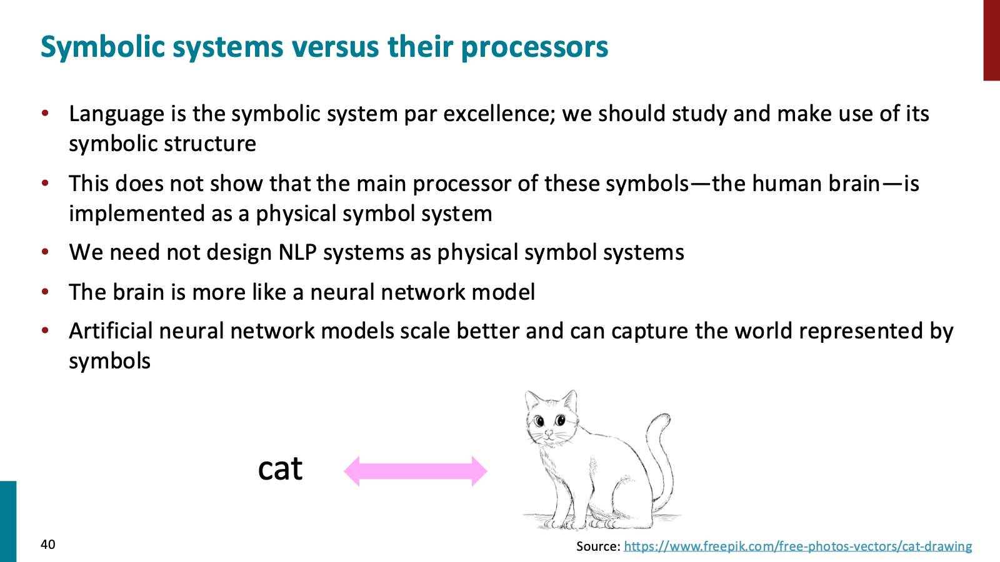
*History slide 40: language is symbolic; its processor need not be.*

> **Note:** This is the reply to section 6's physical symbol system hypothesis, and the rematch of section 4's two visions. The data can be symbols without the machine that processes them being a symbol-manipulator.

Then the evidence: **deep learning's breakthrough (2009–2012), first in speech**. "Speech recognition had first shown the breakthrough success of probabilistic methods: HMMs and GMMs", and "the first breakthrough results of 'deep learning' on large datasets also happened in speech recognition" (history slide 42). The slide's table gives word error rates on two conversational-speech tests: 27.4% and 23.6% for traditional GMM models, 18.5% and 16.1% for deep learning (2012), and 8.0% and 5.5% by 2017.

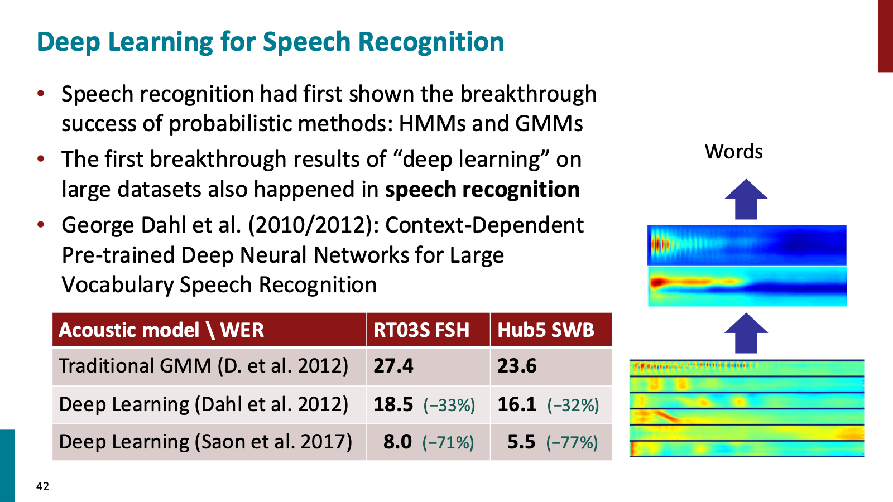
*History slide 42: word error rates fall by about a third with deep learning in 2012, and by about three quarters by 2017.*

> **Note:** A caution about the table's citations. The 2012 row is labelled "Dahl et al. 2012", but [Dahl et al.'s 2012 journal paper](https://www.microsoft.com/en-us/research/wp-content/uploads/2016/02/dbn4lvcsr-transaslp.pdf) reports a different dataset, Bing business search, with relative error reductions of 16% and 23%. The 2017 figures are in [Saon et al. (2017)](https://arxiv.org/abs/1703.02136): 5.5% on Switchboard, and 8.0% on RT'03 after letter spellings are normalized. The big picture is right; the exact numbers belong to more than one paper.

The idea that powered NLP's version of the breakthrough is **word vectors**: "We learn to represent a word as a vector of numbers", and "Similar vectors = similar meaning" (history slide 43). For example, *versatile* = (0.286, 0.792, −0.177, −0.107, 0.109, −0.542, 0.349, 0.271). How are the numbers learned? By **distributional similarity**:

> "You shall know a word by the company it keeps" (J. R. Firth 1957: 11; history slide 44)

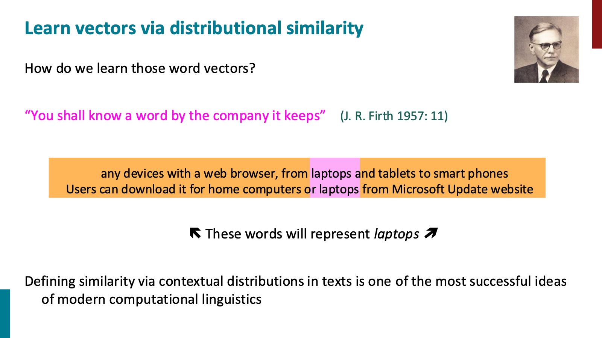
*History slide 44: two contexts of "laptops" that "will represent laptops".*

The slide's example shows the idea at work. Contexts like "any devices with a web browser, from laptops and tablets to smart phones" carry the meaning of *laptops*, and "Defining similarity via contextual distributions in texts is one of the most successful ideas of modern computational linguistics" (history slide 44).

> **Note:** Firth's famous line comes with a surprisingly earthy example. On p. 11 of his 1957 ["Synopsis of Linguistic Theory"](https://cs.brown.edu/courses/csci2952d/readings/lecture1-firth.pdf), the lines just before it give "'Don't be such an ass!', 'You silly ass!', 'What an ass he is!'" and explain that "the word *ass* is in familiar and habitual company". One of the most quoted sentences in NLP was written to explain how we know an insult when we hear one.

Words as vectors led to translation as vectors, the **neural encoder–decoder for translation (seq2seq)**. History slide 45 shows the basic RNN recurrence:

hₜ = tanh(W[xₜ] + Uhₜ₋₁ + b)

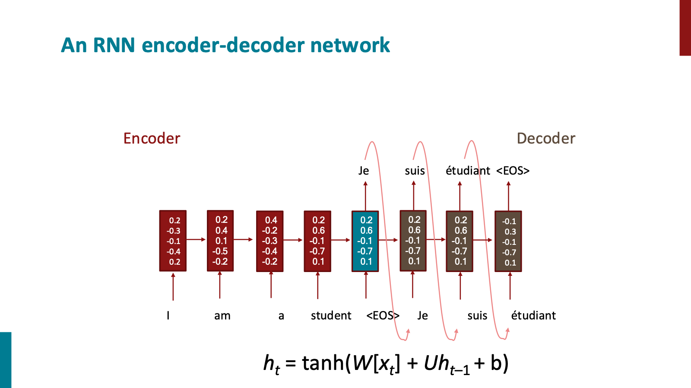
*History slide 45: the encoder (red) reads the English, its last state (blue) passes to the decoder (brown), and each French word is fed back in. The recurrence is at the bottom.*

Each new hidden state hₜ mixes the current word xₜ with the previous state hₜ₋₁. One network, the encoder, reads "I am a student". Its final state hands off to a second network, the decoder, which writes "Je suis étudiant", feeding each word it produces back in as the next input. History slide 46 shows the real thing, "An LSTM encoder-decoder network [Sutskever et al. 2014]", three layers deep, translating "Die Proteste waren am Wochenende eskaliert" into "The protests escalated over the weekend".

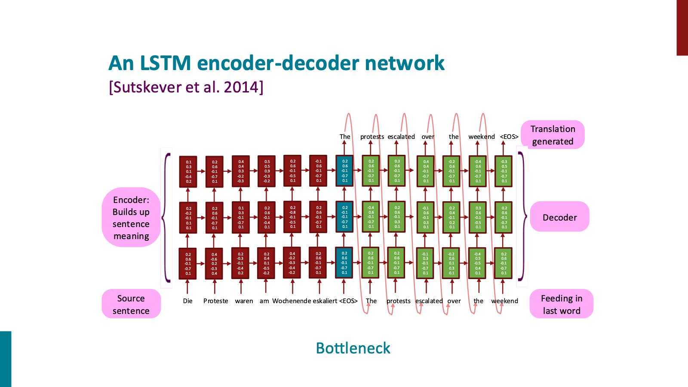
*History slide 46: the encoder "builds up sentence meaning", and everything must pass through the labelled bottleneck.*

Note the word under the diagram, "Bottleneck" (history slide 46). The whole source sentence, however long, must be squeezed into one fixed-size state before the decoder can start. Attention (Lecture 5) is the standard remedy.

> **Note:** A good question to put to students: what goes wrong with a fixed-size bottleneck as sentences get longer? Every detail of the source must compete for room in one fixed-size representation, which can make the information the decoder needs harder to keep and recover. Attention gives the decoder access to the encoder's representations at every source position. (Sutskever et al. themselves report that reversing the source sentence helped, and that their LSTM still did well on long sentences: [Sutskever, Vinyals & Le 2014](https://arxiv.org/abs/1409.3215), pp. 2–4.)

The payoff was **neural MT overtakes statistical MT (2015–2016)**. History slide 47 charts translation quality (BLEU) from English to German: neural MT starts behind both phrase-based and syntax-based statistical systems in 2015 and is ahead of both by 2016. The reading adds the public moment: "in late 2016, Google's machine translation improved markedly when they switched to the use of neural machine translation" (*Dædalus* p. 132).

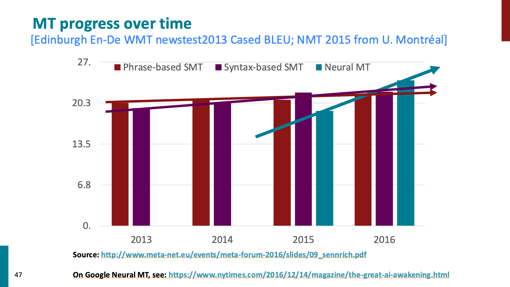
*History slide 47: two statistical systems creeping up, one neural system shooting past them.*

> **Note:** Notice the shape of this whole chapter of the story. Machine translation was NLP's first problem in 1947 (section 3), and in 2016 it was where neural methods made their most public leap. The field came back to its starting problem with something like Weaver's bet, decoding learned from data, at enormous scale.

**Check your understanding.** In hₜ = tanh(W[xₜ] + Uhₜ₋₁ + b), which term carries memory of earlier words?
*Answer:* Uhₜ₋₁: the previous hidden state, which itself summarizes everything read so far (history slide 45).

## 9. Era 4b: large language models

**Era 4b: Large language models (2022–present)** is the era students arrive in. Its public face is a chart: FactSet's count of S&P 500 companies mentioning "AI" on earnings calls, flat for years, then shooting up after the "ChatGPT launch", past 40% and then 50% of the index (history slide 49). History slide 54 shows ChatGPT 4o writing a sonnet praising Wikipedia "in which each line begins with the letter W". Every line does.

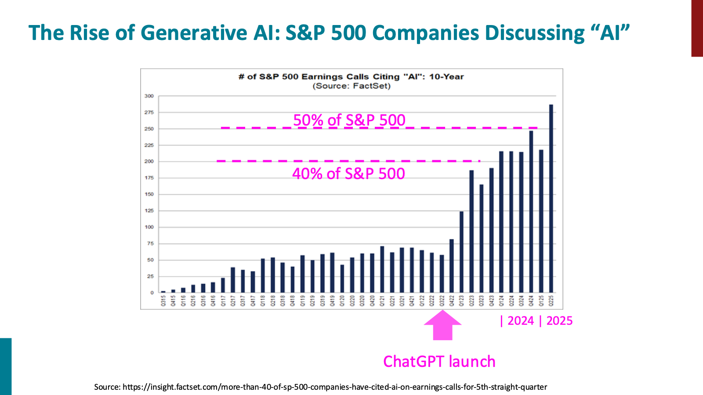
*History slide 49: the ChatGPT launch, as seen from corporate earnings calls.*

The surprise of the lecture's last act is that the core idea is old. A **language model (probabilistic next-token prediction)** assigns probabilities to what comes next in a text (history slide 51):

- 1913: Andrey Markov "explores consonant-vowel transition probabilities in Alexander Pushkin novel, Eugene Onegin, developing Markov Models".
- 1948: Shannon "explores character/word-level n-gram models, entropy, text generation".
- 1975: "Frederick Jelinek's group at IBM defines and names the modern concept of a (probabilistic) 'language model' for next token prediction. Used for spelling correction, speech recognition, machine translation…".

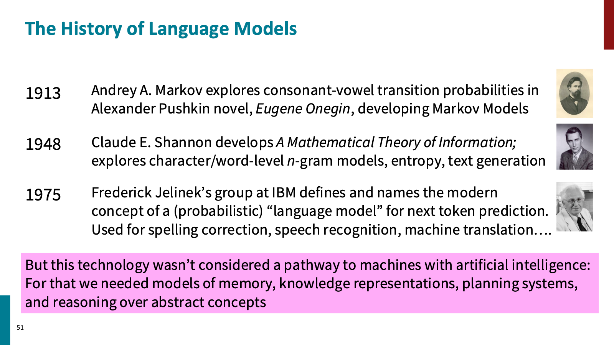
*History slide 51: Markov, Shannon and Jelinek, and the pink warning at the bottom.*

> **Note:** Markov did his counting by hand, on 20,000 letters of *Eugene Onegin*. He found that a vowel follows a vowel with probability about 0.128, but follows a consonant with probability about 0.663 (Markov 1913, in the [2006 *Science in Context* translation](https://doi.org/10.1017/S0269889706001074)). Shannon went further and *generated* text. His second-order word approximation, where each word is drawn given the one before, produced "THE HEAD AND IN FRONTAL ATTACK ON AN ENGLISH WRITER THAT THE CHARACTER OF THIS POINT IS THEREFORE ANOTHER METHOD FOR THE LETTERS…" (Shannon 1948, *BSTJ* p. 388). That is a language model's output from 1948. (Slide 51 calls Shannon's paper "A Mathematical Theory of Information"; its title is "A Mathematical Theory of Communication", as slide 34 has it.)

The exhibition already showed the core move: P(this, is, a, sentence) = P(this)P(is | this)P(a | is)P(sentence | a) for a bigram model, with a longer history for a trigram (intro slide 11). Section 7's spelling corrector was a language model in action.

Slide 51's warning box is the key to the whole lecture: "But this technology wasn't considered a pathway to machines with artificial intelligence: For that we needed models of memory, knowledge representations, planning systems, and reasoning over abstract concepts". For seventy years, next-word prediction was a humble tool. Era 4b is the discovery that, at sufficient scale, it was more than that.

Hence **scaling up language models** (history slides 52–53): a 1998 trigram model on a 200-million-word corpus (the "first use of 'LLM'" Manning knows of); [Bengio, Ducharme and Vincent's neural probabilistic language model](https://papers.nips.cc/paper_files/paper/2000/hash/728f206c2a01bf572b5940d7d9a8fa4c-Abstract.html) in 2000, trained on 32 million words (the slide calls it the "First neural language model", which oversimplifies: the paper itself, §1.2, cites earlier neural approaches); a 2007 n-gram model on 2 trillion tokens; GPT and BERT in 2018; and from 2020, "100+ billion parameter neural language models trained on > 1 trillion tokens". Slide 53 stamps each row with what held it back: "Not enough compute!", "Not enough model flexibility!", "Not enough data!" Then, for 2020 on: "LLMs go brrr!"

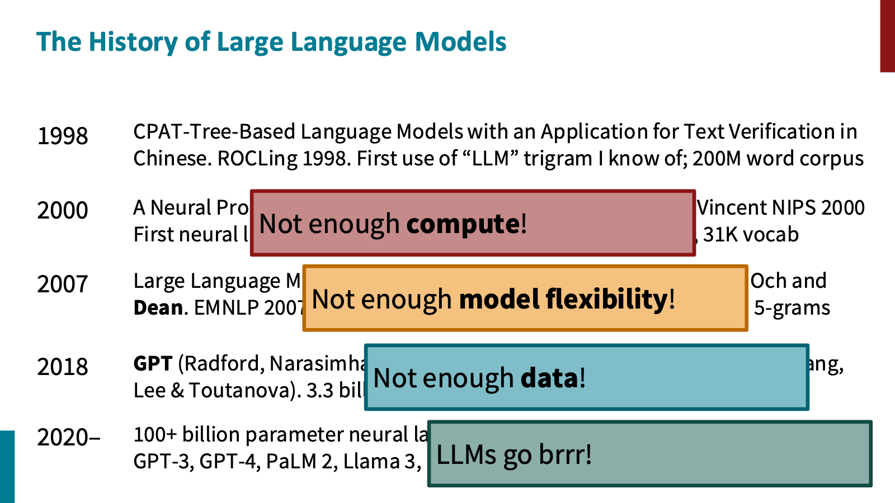
*History slide 53: each wave of language models hit a different wall, until all three gave way together.*

> **Note:** Two precise corrections, and one update. The 2018 row's "3.3 billion token corpus" is BERT's training data: BooksCorpus (800M words) plus English Wikipedia (2,500M words), counted in words. GPT used BooksCorpus alone ([BERT](https://arxiv.org/abs/1810.04805) §3.1; [GPT](https://cdn.openai.com/research-covers/language-unsupervised/language_understanding_paper.pdf) §4.1). GPT-3, the first model named in the 2020 row, trained on 300 billion tokens, not over a trillion ([Brown et al. 2020](https://arxiv.org/abs/2005.14165), Table 2.1). And the scale kept moving: Meta's Llama 3 flagship was pre-trained "on 15.6T text tokens" ([Grattafiori et al. 2024](https://arxiv.org/abs/2407.21783), arXiv v3, November 2024). Read the 2007 row next to these. [Brants et al.](https://aclanthology.org/D07-1090/) had 2 trillion tokens in 2007 and still a "large language model" that was an n-gram table. Data alone was never enough.

The lecture ends on **evidence on what LLMs can and cannot do (2023 studies)**. In the first study, Boston Consulting Group consultants using GPT-4 "finished 12.2% more tasks on average, completed tasks 25.1% more quickly, and produced 40% higher quality results than those not using AI". "Use of an LLM particularly improved the performance of lower-performing humans", but "Results vary depending on the task" (history slide 55, citing [Dell'Acqua et al. 2023](https://doi.org/10.2139/ssrn.4573321)). In the second, asked whether GPT-4 can match *New Yorker* fiction, the slide answers: "Good news! No! (At least in 2023….) GPT-4 is still 3–10x worse at creative writing!" (history slide 56).

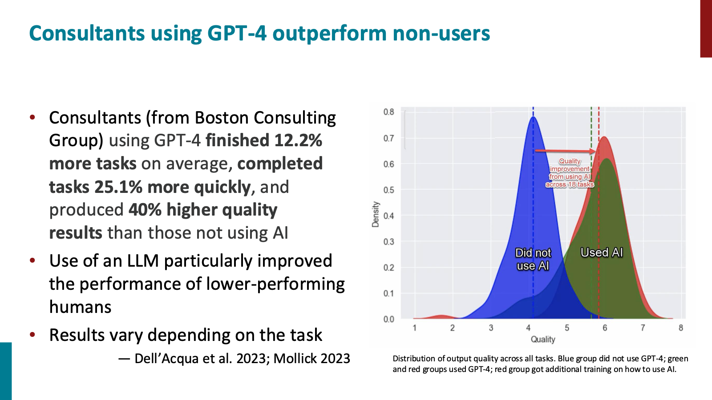
*History slide 55: the quality distribution shifts right for consultants using GPT-4.*

> **Note:** Both studies are more careful than the slides, and the care is the lesson. The BCG gains hold for 18 tasks chosen to be "within the frontier of AI capabilities". On a task chosen to lie outside it, consultants using AI were 19 percentage points *less* likely to get the right answer. The [published version](https://doi.org/10.1287/orsc.2025.21838) (*Organization Science*, 2026) puts the quality gain at "an average of 32%" rather than 40%. The fiction study measured stories against 14 pass/fail creative-writing tests (TTCW), judged by human writers: "LLM-generated stories pass 3-10X less TTCW tests than stories written by professionals" ([Chakrabarty et al., CHI 2024](https://arxiv.org/abs/2309.14556)). That is narrower than "3–10x worse at creative writing", and more interesting.

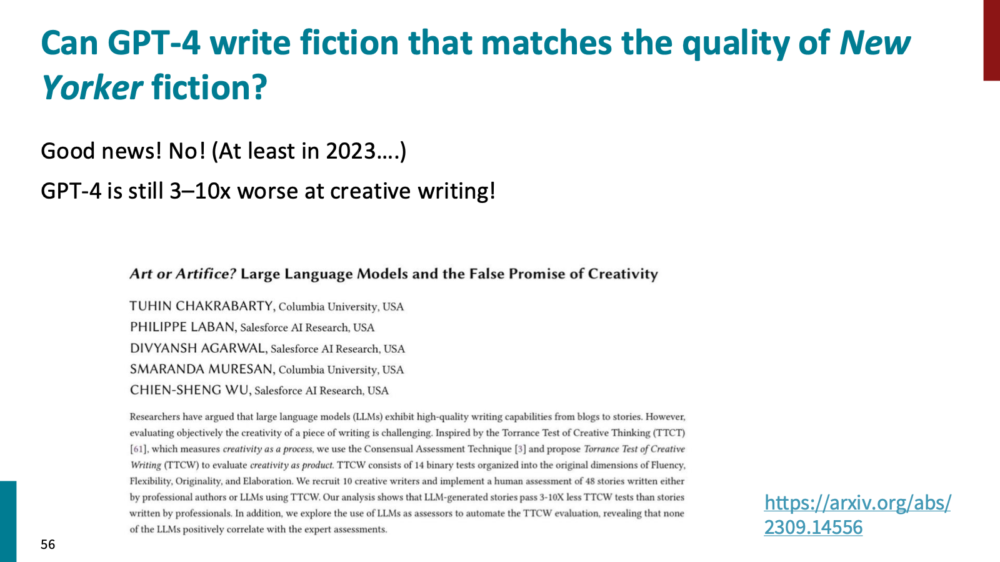
*History slide 56: "Good news! No! (At least in 2023….)"*

**Check your understanding.** Slide 51 says language models "weren't considered a pathway" to AI. What did people think AI needed instead, and which earlier sections of these notes tried to build those things?
*Answer:* "models of memory, knowledge representations, planning systems, and reasoning over abstract concepts" (history slide 51). Era 2's knowledge bases and symbolic systems (section 6) were exactly those attempts.

## 10. The reading: what pretraining changed

Manning's essay (*Dædalus* 151(2), 2022) explains the mechanism behind era 4b more directly than the slides. Its central concept is **self-supervised pretraining and large pretrained language models (LPLMs)**. "Everything changed in 2018, when NLP was the first major success of very large scale self-supervised neural network learning" (*Dædalus* p. 129). The trick is that the text supplies its own exam. The model creates "its own prediction challenges, such as successively identifying each next word in the text given the previous words or filling in a masked word or phrase" (pp. 129–130). By repeating this billions of times, "general knowledge of a language and the world is accumulated" (p. 130).

> **Note:** Manning's description of masked-word prediction is the best line in the reading: "a kind of humorless Mad Libs" (p. 131). His point is that the game is universal. To guess the missing word well, "every form of linguistic and world knowledge, from sentence structure, word connotations, and facts about the world" helps (p. 131). Studying for this one exam means studying everything.

The architecture underneath is **the transformer and attention**. Attention computes "a representation at a position… as a weighted combination of representations from other positions" (p. 130). Each position produces a query, a key and a value. The query is compared with every position's key to decide how much attention to pay, and the output is a weighted average of the values (p. 130; Figure 1).

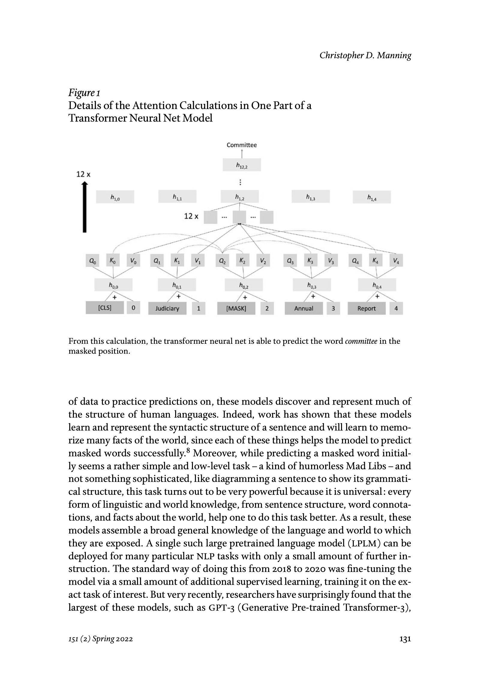
*Dædalus Figure 1 (p. 131): for "[CLS] Judiciary [MASK] Annual Report", the query at the masked position is compared with each key, and the values are averaged. The prediction at the mask is "committee".*

> **Note:** A small slip in the text, useful for checking understanding. The essay says "the query at a position is compared with the value at every position" (p. 130). Figure 1 shows, correctly, that the query is compared with the *keys*; the *values* are what get averaged. If a student can explain why the figure is right and the sentence is not, they understand attention. Lecture 5 builds this properly.

Once pretrained, one model can be adapted in two ways. The first is fine-tuning, "a small amount of additional supervised learning, training it on the exact task of interest" (p. 131), the standard from 2018 to 2020. The second is **prompting (in-context task specification)**: the largest models "can perform novel tasks very well with just a prompt. Give them a human language description or several examples of what one wants them to do" (pp. 131–132).

The practical consequence is a shift **from NLP pipelines to adapted pretrained models**. Traditional systems were "elaborately composed from several usually independently developed components, frequently built into a pipeline" (p. 132). Google Translate's history compresses this into three steps: statistical from 2006, neural from late 2016, and from 2020 "one huge neural net that was simultaneously trained on all languages that Google Translate covers, with input simply marked by a distinct token that indicates the language" (p. 132). The essay's examples include a question-answering system extracting "5x" as a phone's optical zoom from a review (p. 133) and a generated radiology impression (pp. 133–134). It also gives the caveat: "there are still reasons to be skeptical as to whether these systems really understand what they are doing" (p. 134).

Do they understand? Manning's answer is **meaning as a network of connections (denotational vs distributional semantics)**. Denotational semantics says a word means "the set of objects or situations in the world that it describes"; distributional semantics says "the meaning of a word is simply a description of the contexts in which it appears" (p. 134). Manning takes a third position: "meaning arises from understanding the network of connections between a linguistic form and other things, whether they be objects in the world or other linguistic forms" (p. 134).

His example is an Indian wind instrument, the shehnai (pp. 134–135). Someone who has held one knows something; someone who has heard one played knows more. Someone who has only been told "it's like a traditional Indian oboe" knows something too. And someone who has only read a couple of sentences from a novel, about shehnai players at a house where a groom's family is expected, knows cultural associations that the person who merely held one lacks. So that reader's understanding is not simply a subset of the holder's. Hence: "there can be no doubt that pretrained language models learn meanings", although "very incomplete" ones (p. 135).

> **Note:** This is a live debate, not a settled one. Manning is answering, among others, [Bender and Koller (2020)](https://aclanthology.org/2020.acl-main.463/), who argue that a system trained only on form cannot learn meaning (*Dædalus* p. 134, n. 17). It makes a good section discussion question. Which of the shehnai-knowers is a language model most like?

The essay ends with **foundation models**: "models with millions of parameters trained on copious data via self-supervision that can then easily be adapted to perform a wide range of downstream tasks" (p. 135). BERT and GPT-3 are "early examples"; the future includes models that "take in other sensory data", such as DALL·E (p. 135). The risks are named plainly: "excessive power and influence" for the few groups able to build them, "biases", and difficulty telling "if models are safe to use" (p. 136). So is a prediction: such models are "likely to remain limited, lacking a human-level ability for careful logical or causal reasoning" (p. 136).

> **Note:** That 2022 prediction is worth revisiting at the end of the quarter. Four years later, this course gives reasoning in language models two full lectures, "Reasoning 1" and "Reasoning 2" (Lectures 12–13). The essay is the right place to start that discussion, not the place to end it.

**Check your understanding.** Why does predicting a masked word teach a model about the world, not just about grammar?
*Answer:* Because many masked words can only be guessed with world knowledge (who was born where, what follows what), so the prediction objective rewards learning those facts (*Dædalus* p. 131).

## 11. Assignment 1: building word vectors

Assignment 1 goes out with this lecture (due Tuesday 13 January) and turns section 8's slogan into something you can compute. Lecture 2 explains the learned vectors that its second half uses. These notes explain what A1 teaches; they don't answer its questions.

A1 starts from the same idea as history slide 44: "similar words, i.e., (near) synonyms, will be used in similar contexts" (A1 Part 1). Its first tool is the **co-occurrence matrix (count-based word vectors)**: "a symmetric word-by-word matrix in which Mᵢⱼ is the number of times wⱼ appears inside wᵢ's window among all documents", where the window is "the n preceding and n subsequent words".

**Worked example: reading A1's matrix.** A1 builds its n = 1 example from two documents, "all that glitters is not gold" and "all is well that ends well", each wrapped in `<START>` and `<END>` tokens. Take the row for *well*. The first *well* (in "is well that") has neighbours *is* and *that*. The second (in "ends well `<END>`") has neighbours *ends* and `<END>`. So the *well* row has a 1 under each of *is*, *that*, *ends* and `<END>`, exactly as A1's table shows. Now check the `<START>` row: both documents begin with *all*, so M(`<START>`, all) = 2.

> **Note:** A common confusion: the matrix counts neighbours within the window, not whole-document co-occurrence. *Gold* and *glitters* appear in the same document but get a 0, because with n = 1 they aren't adjacent.

The rows are long (one column per word in the vocabulary), so A1 shortens them by **dimensionality reduction by truncated SVD**. Written out, A ≈ Uₖ Sₖ Vₖᵀ, keeping only the top k singular values. A1's embeddings are Uₖ Sₖ: "TruncatedSVD returns U*S" (A1 Q1.5). A1 then normalizes each (nonzero) row to unit length, "so that all the vectors will appear around the unit circle (therefore closeness is directional closeness)" (Q1.5). The hoped-for result: "*doctor* and *hospital* will be closer than *doctor* and *dog*" (A1 Part 1).

> **Note:** A1 says SVD is "akin to PCA". Strictly, PCA is SVD applied to *centered* data, and A1 doesn't center the counts, so the two are close relatives rather than the same thing. It's a good detail to raise with students who have taken a linear algebra or ML course.

The second half uses **learned dense word vectors (word2vec, GloVe)**: 200-dimensional GloVe vectors, reduced the same way for plotting (A1 Part 2). A1 calls these "prediction-based" and notes in passing that GloVe "also utilizes the benefit of counts". In fact GloVe learns its vectors by fitting them to global co-occurrence counts ([Pennington et al. 2014](https://aclanthology.org/D14-1162/)), so the line between "counting" and "learning" is blurrier than the assignment's headings suggest. Lecture 2 covers both algorithms.

To compare vectors, A1 introduces **cosine similarity (and cosine distance)**. For nonzero vectors p and q, s = (p · q) / (‖p‖ ‖q‖), with s between −1 and 1. Cosine distance is 1 − s (A1 "Cosine Similarity"; Q2.3). L1 and L2 distances measure how far "we must travel" between points; cosine measures the angle (A1).

**Worked example** (vectors invented for illustration). Let p = (1, 2), q = (2, 4) and r = (2, −1). Then p · q = 10, ‖p‖ = √5 and ‖q‖ = √20, so s(p, q) = 10/√100 = 1: same direction, even though q is twice as long. And p · r = 0, so s(p, r) = 0: perpendicular, unrelated. Cosine cares only about direction, which is why A1 normalizes its vectors before plotting.

The rest of A1 explores what nearest neighbours can and cannot tell you:

- **What nearest neighbours conflate: polysemy and antonymy.** A word with several meanings still gets a single vector. A1's examples are "leaves", whose top 10 show both a "go_away" and an "a_structure_of_a_plant" sense, and "scoop" (Q2.2). And "happy" turns out closer to "sad" than to "cheerful" (Q2.3). Explaining why is A1's job, not these notes'.
- **Word-vector analogies.** Vectors "*sometimes*" solve analogies (Q2.4). The `most_similar` function finds words close to the positive words and far from the negative ones, "omitting the input words, which are often the most similar" (Q2.4, citing [Schluter 2018](https://aclanthology.org/N18-2039/)). A1 shows both a success, "man : grandfather :: woman : x", with near misses, and a failure: "hand : glove :: foot : **sock**" returns "45,000-square" (Q2.5–Q2.6).
- **Bias in word vectors.** "Bias can be dangerous because it can reinforce stereotypes through applications that employ these models" (Q2.7). A1 probes it by comparing which terms land near "man" + "profession" − "woman" and near "woman" + "profession" − "man" (Q2.7).

> **Note:** Analogies fail in instructive ways, and A1 asks students to explain failures, not just collect successes. Once the assignment is in, the 45,000-square result makes a good discussion in section.

What A1 asks, as a checklist (answers are the student's work):

| Question | What it asks | Concepts |
|---|---|---|
| Q1.1–Q1.4 [code] | Distinct words; the co-occurrence matrix (window 4); truncated SVD; plotting | Co-occurrence matrix; truncated SVD |
| Q1.5 [written] | Clusters in the 2-D co-occurrence plot, and what fails to cluster | Co-occurrence matrix; truncated SVD |
| Q2.1 [written] | How the GloVe plot differs from Q1.5's, and why | Truncated SVD; learned dense word vectors |
| Q2.2–Q2.3 | A polysemous word with both senses in its top 10; a synonym/antonym triple where the antonym is closer | Cosine similarity; polysemy and antonymy |
| Q2.4–Q2.6 | The vector expression for an analogy; why near misses appear; a failing analogy | Word-vector analogies |
| Q2.7–Q2.9 | Gender bias in profession terms; another biased analogy; how bias enters and one mitigation | Bias in word vectors |

**Check your understanding.** Two word vectors have cosine similarity 1. Are they the same vector?
*Answer:* Not necessarily. They point in the same direction but may have different lengths, as p and 2p do (A1 "Cosine Similarity"; worked example above).

## Across the sections

The lecture established one way of seeing the field: each era is a bet on what language is. Era 1 bet it was a code (Weaver), and also founded AI, neurons and benchmarks. Era 2 bet it was structure to be written by hand: grammars, compositional semantics, knowledge bases. Era 3 bet it was statistics to be counted, with the noisy channel and annotated corpora. Era 4 bet it was vectors to be learned, and then discovered that one old objective, next-word prediction, scales into something general. The two lineages of section 2, computational linguistics and AI/neural networks, kept meeting. Machine translation was where the field began, and one of the first places neural methods won outright.

Three habits from this lecture are worth keeping all quarter. Read claims at their real strength: ALPAC, the perceptron press and the BCG study all reward checking what was actually measured. Ask what a model's assumption makes impossible. And remember that the old ideas keep returning: Firth's company of words, Shannon's channel, Markov's counts.

What comes next needs exactly the pieces introduced here. Lecture 2 turns word vectors and distributional similarity into word2vec and GloVe, which Assignment 1 is already using. Lecture 3 supplies what the McCulloch–Pitts unit lacked, gradient-based learning by backpropagation. Lectures 4 and 5 rebuild the encoder–decoder and remove its bottleneck with attention and the transformer. Lectures 7 to 9 turn section 10's pretraining, fine-tuning and prompting into methods.

## Glossary

- **ALPAC report (1966):** the US National Academy of Sciences report that judged fully automatic machine translation not useful and without "immediate or predictable prospect" (section 3).
- **Attention:** computing a position's representation as a weighted average of the values at other positions, with weights from comparing its query to their keys (section 10).
- **Co-occurrence matrix:** counts of how often each word appears within n words of each other word (section 11).
- **Compositional semantics:** building a sentence's meaning by combining word meanings up its parse tree (section 6).
- **Connectionism:** modelling intelligence with networks of simple neuron-like units (section 4).
- **Cosine similarity:** (p · q)/(‖p‖ ‖q‖) for nonzero vectors, measuring the angle between them (section 11).
- **Distributional similarity:** learning a word's meaning from the contexts it appears in (section 8).
- **Encoder–decoder (seq2seq):** one network reads a sequence into a state, a second generates the output from it (section 8).
- **Fine-tuning:** adapting a pretrained model with a little supervised training on one task (section 10).
- **Foundation model:** a large model trained by self-supervision and easily adapted to many tasks (section 10).
- **Language model:** a model that assigns probabilities to what comes next in a text (section 9).
- **McCulloch–Pitts unit:** a binary neuron that fires when its weighted input sum exceeds a threshold (section 4).
- **Noisy channel:** Shannon's model of a message corrupted in transmission and reconstructed by a receiver (section 7).
- **Paradigm shift:** the move from one era's assumption about language, and its methods, to the next (section 1).
- **Perceptron:** Rosenblatt's learning neural network (1958) (section 4).
- **Physical symbol system hypothesis:** Newell and Simon's claim that a physical symbol system has the necessary and sufficient means for general intelligent action (section 6).
- **Prompting:** specifying a task to a large model in its input, by description or examples (section 10).
- **Self-supervised pretraining:** training on text by predicting held-out parts of the text itself (section 10).
- **Truncated SVD:** keeping only the top k singular components of a matrix, A ≈ UₖSₖVₖᵀ (section 11).
- **Word vector (embedding):** a word represented as a list of real numbers, where similar vectors mean similar words (section 8).

## Open questions

- **Do language models learn meaning?** Manning argues they learn meaning as "a network of connections"; others, such as Bender and Koller (2020), argue form alone cannot carry it (*Dædalus* p. 134). The question is still argued.
- **How limited is their reasoning?** The 2022 essay expected foundation models "to remain limited, lacking a human-level ability for careful logical or causal reasoning" (*Dædalus* p. 136). Lectures 12–13 take up what has changed.
- **Where is the frontier?** The BCG study's most important finding may be the task outside the frontier, where AI help made answers worse (section 9). No one has a reliable map of which tasks fall on which side.
- **Who builds foundation models, and who checks them?** The essay's risks (concentrated power, inherited bias, safety that is hard to assess) are named, not solved (*Dædalus* p. 136).
- **What do benchmarks measure?** Cranfield judged relevance exhaustively, "over a small corpus" (history slide 18). How much of what matters does a benchmark's set of known answers cover, and how is relevance judged when exhaustive checking is out of reach (Lecture 11)?
