# Word Vectors: Meaning You Can Compute

Lecture 2 of CS224N (Winter 2026) turns one sentence into mathematics: "You shall know a word by the company it keeps." It starts by asking what a word's meaning is, watches two old answers fail (a hand-built thesaurus, and one-hot symbols that make every word a stranger), and then builds the answer modern NLP runs on: a short, dense vector of real numbers per word, placed so that words keeping similar company sit close together. There are two ways to build one. **Word2vec** predicts each word's neighbours and learns from its mistakes, and the lecture spends its longest stretch on the gradient that drives that learning. **Counting** tallies co-occurrences and compresses them, and **GloVe** joins the two. The lecture ends by asking how to tell good vectors from bad. These notes follow the [Winter 2026 slides](materials/cs224n-2026-lecture02-wordvecs.pdf) in order (cited "slide N"; every slide appears below), with the two sets of course notes the syllabus assigns: [notes 1](materials/cs224n_winter2023_lecture1_notes_draft.pdf) (Winter 2023 draft, "Introduction and Word2Vec", cited "notes 1 §N"), which supplies the worked gradient that the slides' "Interactive Session!" doesn't print, and [notes 2](materials/cs224n-2019-notes02-wordvecs2.pdf) (Winter 2019, "Word Vectors II: GloVe, Evaluation and Training", "notes 2 §N"), which supplies GloVe's derivation, the evaluation details and a final section on using vectors for tasks. There is no public recording of the Winter 2026 lecture, so everything here comes from these documents and the papers they cite, linked where they first appear. A recorded lecture on this topic: [Spring 2024, Lecture 1, "Intro and Word Vectors"](https://www.youtube.com/watch?v=DzpHeXVSC5I).

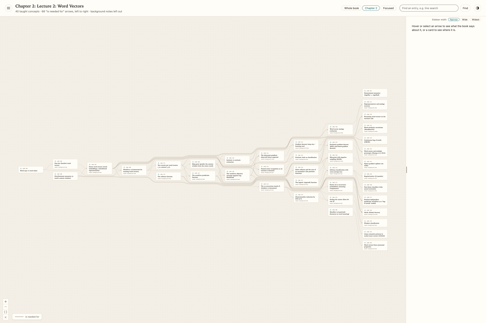
*Lecture 2 in metamatx's chapter view: the lecture's 40 taught concepts as cards, with the 68 "is needed for" arrows between them running left to right, from word types and one-hot vectors on the left to evaluation, GloVe and classification on the right. Background notes are left out. The interactive version of this map is [concept-map.html](concept-map.html).*

## Contents

- [1. The plan: a word is a vector, and by the end you can read the papers](#1-the-plan-a-word-is-a-vector-and-by-the-end-you-can-read-the-papers)
- [2. What does a word mean?](#2-what-does-a-word-mean)
- [3. Word2vec: learn a word by guessing its neighbours](#3-word2vec-learn-a-word-by-guessing-its-neighbours)
- [4. The gradient: observed minus expected](#4-the-gradient-observed-minus-expected)
- [5. Walking downhill: gradient descent and SGD](#5-walking-downhill-gradient-descent-and-sgd)
- [6. The word2vec family, and the trick that made it fast](#6-the-word2vec-family-and-the-trick-that-made-it-fast)
- [7. Counting instead: co-occurrence matrices and SVD](#7-counting-instead-co-occurrence-matrices-and-svd)
- [8. GloVe: meaning in the ratios](#8-glove-meaning-in-the-ratios)
- [9. How good are the vectors?](#9-how-good-are-the-vectors)
- [10. From vectors to tasks (notes 2 §3)](#10-from-vectors-to-tasks-notes-2-3)
- [Across the sections](#across-the-sections)
- [Glossary](#glossary)
- [Open questions](#open-questions)

## 1. The plan: a word is a vector, and by the end you can read the papers

Lecture 1 ended with a promise. Its history lecture said that Era 4 began when words got vectors, and Assignment 1 handed you some to play with. Lecture 2 opens the box and shows how those vectors are made.

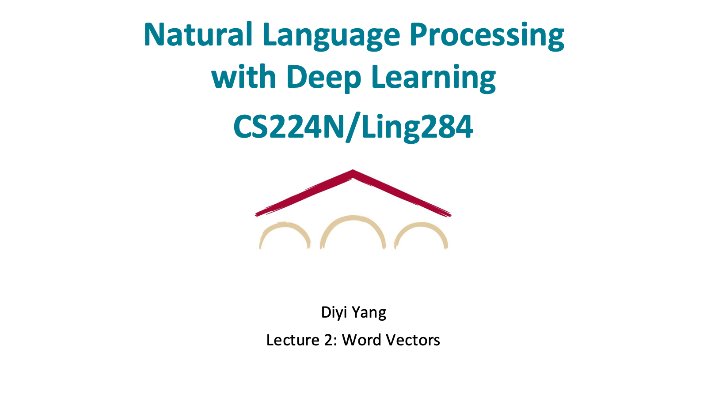
*Slide 1: "Natural Language Processing with Deep Learning, CS224N/Ling284", Diyi Yang, "Lecture 2: Word Vectors".*

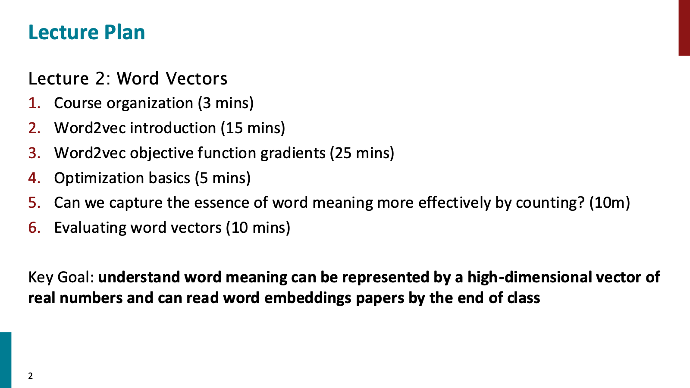
*Slide 2: the lecture plan, six parts with their timings, and the key goal.*

Slide 2 is the whole lecture on one page, with timings. Look at where the minutes go: "Word2vec introduction (15 mins)", then "Word2vec objective function gradients (25 mins)". The biggest block of the hour goes to calculus on a single equation. It's time well spent: the equation is short, and nearly everything later in the course (neural networks, language models, transformers) is trained the same way: write down a probability, take its log, differentiate, step downhill. Learn the ritual once on a model small enough to hold in your head.

The key goal is worth reading twice: "understand word meaning can be represented by a high-dimensional vector of real numbers and can read word embeddings papers by the end of class". The second half is a real promise. The lecture hands you the vocabulary (skip-gram, negative sampling, co-occurrence matrix, GloVe, intrinsic evaluation) that the embedding papers of 2013 to 2018 assume, and the notes below point to the original papers wherever a slide leans on one.


*Slide 3: "1. Course Organization": the staff email list, office hours ("3-hour blocks Mon–Sat, with multiple TAs") and the instructors' own hours.*

Slide 3 is logistics, and one line on it is advice rather than administration: "Try to come early, often and off-cycle!" Office-hour queues are shortest in the first weeks and longest the night before a deadline. Assignment 1, released with Lecture 1, is due the following Tuesday.

**So far, and next.** One sentence to carry out of the room: a word's meaning can be a list of real numbers. Before building those numbers, the lecture asks the question they are meant to answer, and it is a philosopher's question before it is an engineer's: what *is* the meaning of a word?

## 2. What does a word mean?

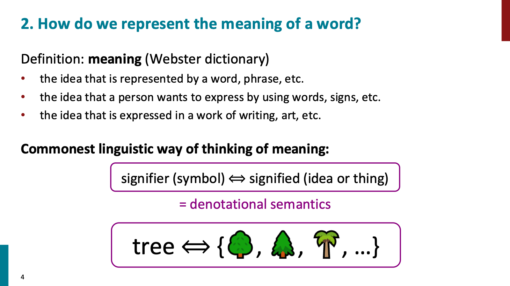
*Slide 4: "2. How do we represent the meaning of a word?": Webster's definition of "meaning", then "signifier (symbol) ⟺ signified (idea or thing) = denotational semantics", with tree ⟺ {three pictures of trees, …}.*

Slide 4 gives the "Commonest linguistic way of thinking of meaning", **denotational semantics**: a symbol on one side, the idea or thing it stands for on the other. The word *tree* points at the set of trees, the oak and the fir and the palm and every tree you will never see. Lecture 1 met this view in Manning's essay as the first of two answers to "what is meaning?" (Lecture 1's map, ch01:C43). Here it is the starting point, and the rest of the lecture is the second answer.

> **Note:** "Signifier" and "signified" are the English names for Ferdinand de Saussure's *signifiant* and *signifié*. His [*Course in General Linguistics*](https://en.wikipedia.org/wiki/Course_in_General_Linguistics) (1916) was published three years after his death, assembled by two colleagues, Charles Bally and Albert Sechehaye, from students' notes of his Geneva lectures. One of the founding texts of linguistics is, in other words, a set of reconstructed lecture notes. You are reading the same genre.

The course notes (notes 1, written for the Winter 2023 offering by John Hewitt) make the same point with a better example: "Zuko makes the tea for his uncle." Swap in "coffee" or "drink" and ask which sentence is "more like" the tea one (notes 1 §2.1). Coffee isn't tea, but it is clearly closer to tea than *the* is. Denotation pairs a word with what it points at. That bare pairing doesn't, by itself, give a graded measure of how close two words are. And a graded closeness is exactly what a computer needs here.

> **Note:** If the example sounds familiar, Zuko and his uncle [Iroh](https://en.wikipedia.org/wiki/Iroh) are from *Avatar: The Last Airbender*, where Iroh's fondness for good tea is a running theme; in Ba Sing Se he and Zuko run a tea-house. Of all the sentences to test word similarity on, this one has the most at stake.

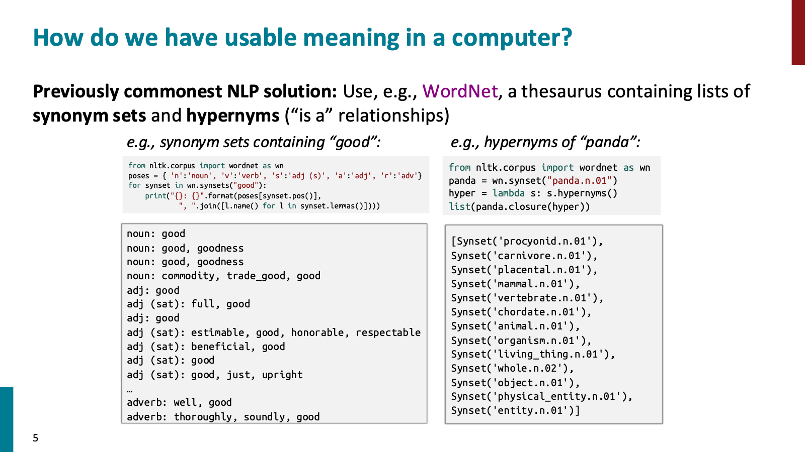
*Slide 5: "How do we have usable meaning in a computer?": WordNet, "a thesaurus containing lists of synonym sets and hypernyms ('is a' relationships)", with NLTK code listing the synonym sets that contain "good" and the hypernyms of "panda".*

The old engineering answer was to write meaning down by hand. **WordNet** is a huge thesaurus: words grouped into synonym sets ("synsets"), linked by "is a" relations. Slide 5 shows two snippets of Python through the NLTK library. The left one prints every synset containing "good" (as a noun: good, goodness; as an adjective: estimable, good, honorable, respectable; and many more). The right one climbs the hypernym ladder from *panda*: procyonid, carnivore, placental, mammal, vertebrate, chordate, animal, organism, living thing, whole, object, physical entity, entity. Thirteen rungs from a bear-shaped thing to the most abstract noun in English.

> **Note:** [WordNet](https://en.wikipedia.org/wiki/WordNet) was begun at Princeton in 1985 under the psychologist George A. Miller, the same Miller who wrote ["The Magical Number Seven, Plus or Minus Two"](https://doi.org/10.1037/h0043158) (1956), about the limits of short-term memory. Miller's point there was that we cope with memory's limits by recoding information into bigger chunks. WordNet, with well over a hundred thousand synsets, is that idea at industrial scale: a vocabulary chunked into a hierarchy.

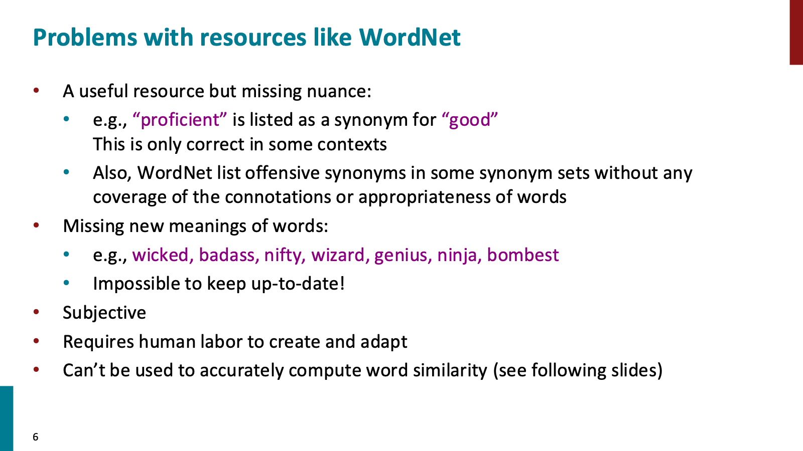
*Slide 6: "Problems with resources like WordNet": missing nuance, offensive synonyms with no coverage of connotation, missing new meanings, impossible to keep up to date, subjective, requires human labour, and "Can't be used to accurately compute word similarity".*

Slide 6 is the case against. WordNet lists "proficient" as a synonym of "good", which is "only correct in some contexts": a proficient surgeon is a good surgeon, but a proficient sandwich is something else. It records offensive synonyms "without any coverage of the connotations or appropriateness of words". It is always out of date: the slide's list of missing senses is "wicked, badass, nifty, wizard, genius, ninja, bombest", a list that has itself aged a little. It is "Subjective", it "Requires human labor to create and adapt", and the last bullet is the one that matters for the rest of the lecture: it "Can't be used to accurately compute word similarity".

> **Note:** A fair recitation question: is WordNet useless, then? No. Slide 6 calls it "A useful resource", and it still is one for some jobs: lexicography, checking a model's outputs, building test sets. Its problem is the job this lecture needs done, a graded similarity for every pair of words, including the words coined last week.

Notes 1 adds a cousin of WordNet that is worth knowing about: **word vectors from annotated properties** (notes 1 §2.3). Give each word one dimension per hand-labelled feature (plural noun, 3rd-person-singular verb, hyponym-of-beverage, synonym-of-chai), using resources like WordNet and UniMorph. The notes list three failures. The resources are "always lacking in vocabulary". Representing all those categories takes a vector "much larger than the vocabulary size". And, the theme of the whole course, "human ideas of what the right representations should be for text tend to underperform methods that allow data to determine more aspects—at least when one has a lot of data to learn from."

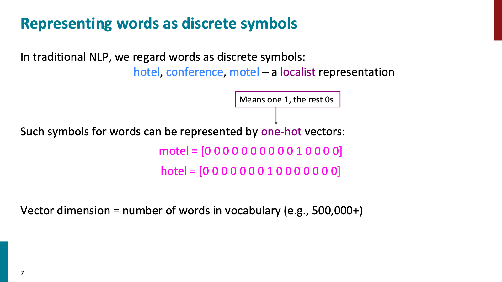
*Slide 7: "Representing words as discrete symbols": hotel, conference, motel as "a localist representation"; one-hot vectors for motel and hotel; "Vector dimension = number of words in vocabulary (e.g., 500,000+)".*

The simplest representation of all is the **one-hot vector**. Number the vocabulary; word number 11 becomes a vector of zeros with a single 1 in position 11. The slide calls this a "localist" representation: each word lives in exactly one coordinate, and that coordinate means only that word. With a realistic vocabulary the vectors are long, "500,000+" dimensions, each with a single 1.

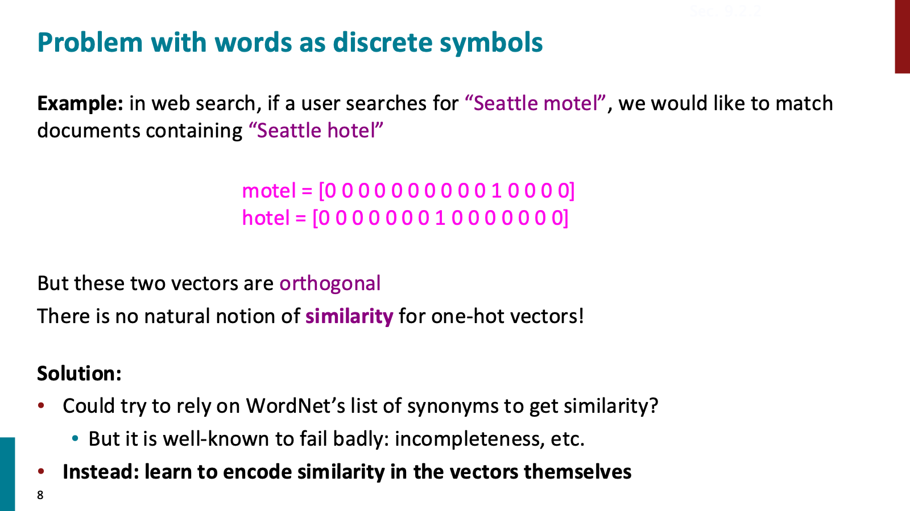
*Slide 8: "Problem with words as discrete symbols": a search for "Seattle motel" should match "Seattle hotel", but the one-hot vectors for motel and hotel "are orthogonal"; "There is no natural notion of similarity for one-hot vectors!" (citing "Sec. 9.2.2").*

Slide 8 states the problem with an example from web search. Someone types "Seattle motel"; a page about a "Seattle hotel" is probably what they want. But the dot product of the one-hot vectors for *motel* and *hotel* is zero: they are orthogonal. Notes 1 §2.2 puts the whole disaster in one line: v_teaᵀv_coffee = v_teaᵀv_the = 0. Under one-hot vectors, *tea* is exactly as similar to *coffee* as it is to *the*. Every word is a stranger to every other word.

> **Note:** "Sec. 9.2.2" in the slide's corner is a citation to Manning, Raghavan and Schütze's *Introduction to Information Retrieval* (Cambridge University Press, 2008; [free online](https://nlp.stanford.edu/IR-book/)). Section 9.2.2 is query expansion with a thesaurus or WordNet: the search-engine version of exactly this fix, and its limits.

The slide considers WordNet's synonym lists as a fix and rejects them ("well-known to fail badly: incompleteness, etc."), then states the plan for the rest of the lecture: "Instead: learn to encode similarity in the vectors themselves."

Notes 1 adds a distinction that will matter later, **word type vs word token**. "A (word) type is an element of a vocabulary; a word in abstract. A (word) token is an instance of a type in context" (notes 1 §2.2). Everything in this lecture gives one vector per *type*: the *bank* of a river and the *bank* that lends money share a vector. Hold that thought until section 9.

> **Check your understanding.** With a 500,000-word vocabulary, how many of the dot products between distinct one-hot vectors are nonzero? *Answer: none of them. Every pair of distinct one-hot vectors has dot product 0, so all 124,999,750,000 pairs look equally unrelated.*

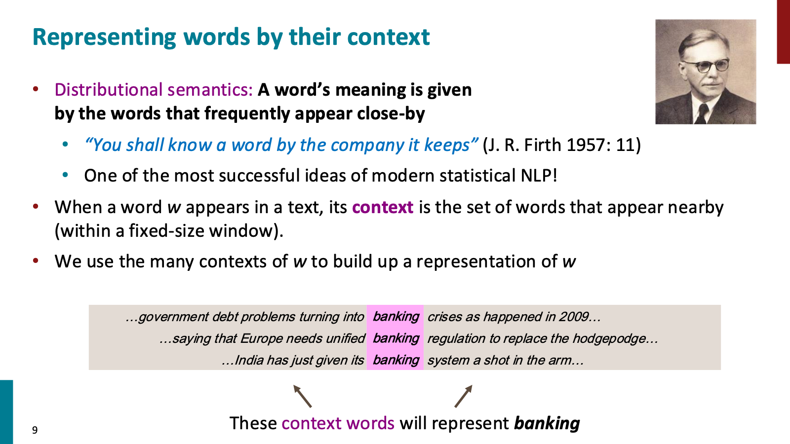
*Slide 9: "Representing words by their context": "Distributional semantics: A word's meaning is given by the words that frequently appear close-by", Firth's "You shall know a word by the company it keeps" (1957: 11), and three contexts of "banking". The photograph is of J. R. Firth.*

Here is the idea that the rest of the course is built on. **Distributional semantics**: "A word's meaning is given by the words that frequently appear close-by" (slide 9). A word's **context** is "the set of words that appear nearby (within a fixed-size window)", and "We use the many contexts of w to build up a representation of w". The slide shows three snippets with *banking* in the middle: "government debt problems turning into banking crises", "Europe needs unified banking regulation", "India has just given its banking system a shot in the arm". The words around *banking* are the evidence about what *banking* means.

Notes 1 §3 states it as the **distributional hypothesis**: "the meaning of a word can be derived from the distribution of contexts in which it appears". It also gives an example you can almost taste. *Tea* turns up near "drank, the, pot, kettle, bag, delicious, oolong, hot, steam". *Coffee* turns up near most of the same words. So their context distributions are similar, and so, by hypothesis, are their meanings. Lecture 1 introduced this as distributional similarity (ch01:C32); slide 9 adds the fixed-size window that turns it into something you can compute.

> **Note:** The slide quotes Firth's [*A Synopsis of Linguistic Theory 1930–1955*](https://cs.brown.edu/courses/csci2952d/readings/lecture1-firth.pdf) (1957), where the line is on page 11. Notes 1 cites a different Firth paper of the same year, his presidential address ["Applications of General Linguistics"](https://doi.org/10.1111/j.1467-968X.1957.tb00568.x). We checked that address and the sentence isn't in it. Firth wasn't alone, either: the American linguist Zellig Harris argued in ["Distributional Structure"](https://doi.org/10.1080/00437956.1954.11659520) (*Word*, 1954) that linguistic structure can be studied through the distribution of its elements. Distributional semantics is an idea with at least two fathers, and the British one got the better slogan.

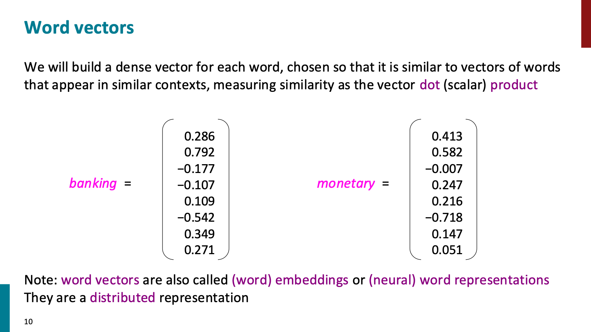
*Slide 10: "Word vectors": "We will build a dense vector for each word, chosen so that it is similar to vectors of words that appear in similar contexts", with 8-dimensional examples for banking and monetary.*

Slide 10 is the target. **Dense word vectors**: a short vector of real numbers per word, "chosen so that it is similar to vectors of words that appear in similar contexts, measuring similarity as the vector dot (scalar) product." They go by several names: "(word) embeddings or (neural) word representations". And they are "a distributed representation", the opposite of slide 7's localist one-hot vectors. In a distributed representation, no single coordinate means "banking"; the meaning is spread across all of them, and every coordinate helps describe many words.

The slide shows banking = (0.286, 0.792, −0.177, −0.107, 0.109, −0.542, 0.349, 0.271) and monetary = (0.413, 0.582, −0.007, 0.247, 0.216, −0.718, 0.147, 0.051). If those first numbers look familiar, they should: Lecture 1's history deck used the identical eight numbers for the word "versatile". The decks reuse them as an example. What matters is the shape: eight real numbers, most dimensions nonzero, and two related words whose vectors point roughly the same way (their first two coordinates are both large and positive, their sixth both strongly negative).

> **Check your understanding.** Compute the dot product of the banking and monetary vectors from slide 10. *Answer: 0.286·0.413 + 0.792·0.582 + (−0.177)(−0.007) + (−0.107)(0.247) + 0.109·0.216 + (−0.542)(−0.718) + 0.349·0.147 + 0.271·0.051 ≈ 0.118 + 0.461 + 0.001 − 0.026 + 0.024 + 0.389 + 0.051 + 0.014 ≈ 1.03. Compare a one-hot pair, whose dot product is exactly 0.*

**So far, and next.** Meaning-as-pointing doesn't by itself give a graded similarity to compute with, hand-built thesauri can't keep up, and one-hot vectors make every word a stranger. The way out is to let a word's company define it, and to squeeze that company into a short dense vector. Section 3 is the first recipe for doing that, and the most famous: word2vec, from 2013, which learns the vectors by playing a guessing game about neighbours.

## 3. Word2vec: learn a word by guessing its neighbours

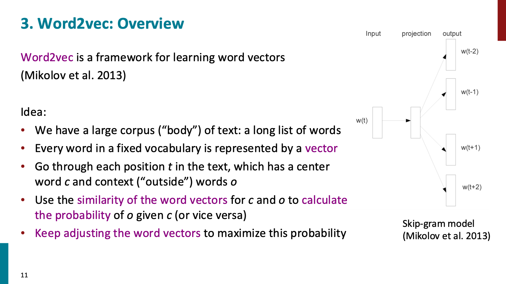
*Slide 11: "3. Word2vec: Overview": "Word2vec is a framework for learning word vectors (Mikolov et al. 2013)", the five-step idea, and the skip-gram architecture diagram from the paper.*

**Word2vec** is "a framework for learning word vectors (Mikolov et al. 2013)", and slide 11 gives the whole algorithm as five bullets:

1. "We have a large corpus ('body') of text: a long list of words".
2. "Every word in a fixed vocabulary is represented by a vector".
3. "Go through each position t in the text, which has a center word c and context ('outside') words o".
4. "Use the similarity of the word vectors for c and o to calculate the probability of o given c (or vice versa)".
5. "Keep adjusting the word vectors to maximize this probability".

That is a guessing game. Stand on a word, guess its neighbours, and nudge the vectors so the guess gets better next time. Nobody ever tells the model what a word means. Meaning is a side effect of getting good at the game, which is what the distributional hypothesis predicts.

The diagram on the right is the paper's own (Mikolov et al. 2013, ["Efficient Estimation of Word Representations in Vector Space"](https://arxiv.org/abs/1301.3781), Figure 1): input w(t), a projection, and outputs w(t−2), w(t−1), w(t+1), w(t+2). That is the **skip-gram model**, the variant the lecture teaches.

> **Note:** The original paper's abstract claims it "takes less than a day to learn high quality word vectors from a 1.6 billion words data set". In 2013 that was the headline. Earlier neural language models, such as Bengio et al.'s (2003), had learned word vectors too, but as a by-product of an expensive model. Word2vec stripped the model down to almost nothing (no non-linear hidden layer, just two sets of vectors and a dot product) so that it could see far more text. Its whole design is a bet that more data beats a cleverer model, a bet that Lecture 1's history says the field kept winning. Ten years on, the companion negative-sampling paper received the [NeurIPS 2023 Test of Time Award](https://blog.neurips.cc/2023/12/11/announcing-the-neurips-2023-paper-awards/).

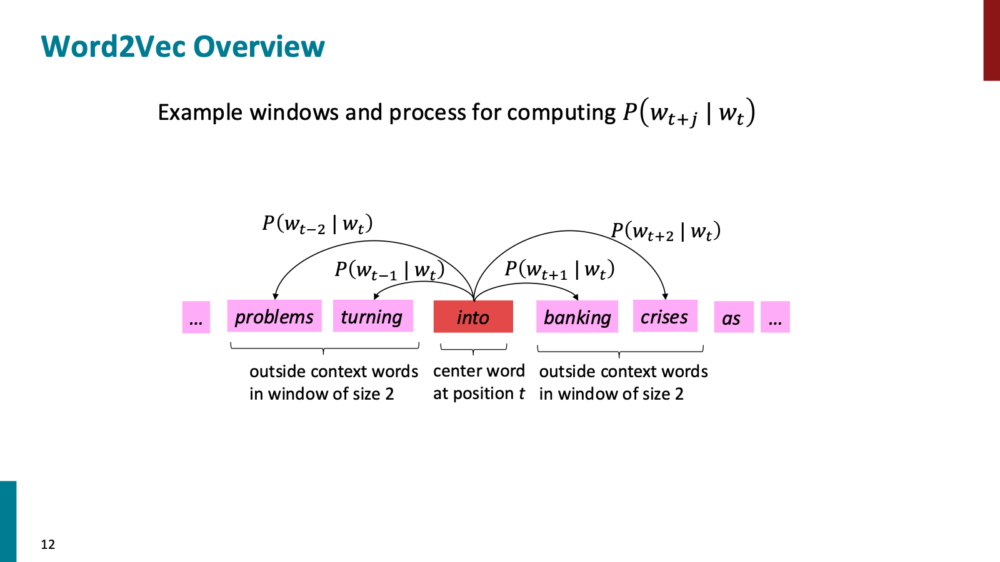
*Slide 12: "Word2Vec Overview": the text "… problems turning into banking crises as …" with centre word "into" at position t, and arcs for P(w_{t−2} | w_t), P(w_{t−1} | w_t), P(w_{t+1} | w_t), P(w_{t+2} | w_t) over a window of size 2.*

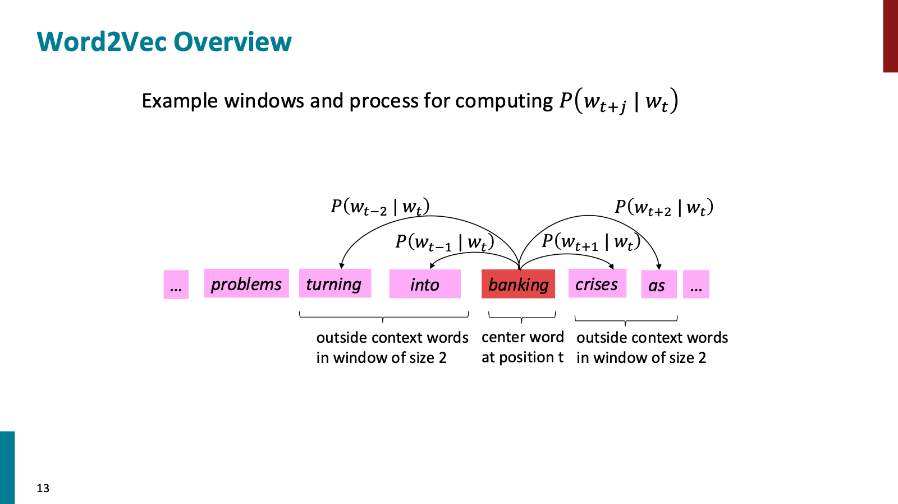
*Slide 13: the same sentence with the window moved one step: centre word "banking", outside words "turning", "into", "crises", "as".*

Slides 12 and 13 show one step of the walk. On slide 12 the centre word is "into" and the window of size 2 covers "problems turning" on the left and "banking crises" on the right; the model is asked for four probabilities, one per arc. On slide 13 the window slides one word right, and "banking" is the centre. Do this for every position in a corpus of billions of words and you have the training data. No labels, no annotators: the text is its own answer key. Notes 1 calls this kind of learning self-supervised (notes 1 §3).

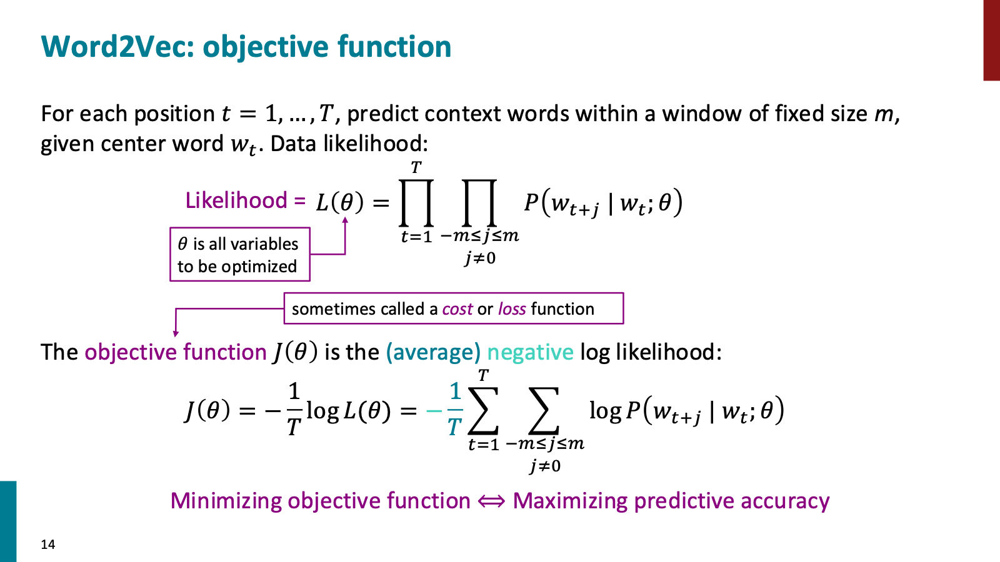
*Slide 14: "Word2Vec: objective function": the data likelihood L(θ) and the objective J(θ), the average negative log-likelihood, with "Minimizing objective function ⟺ Maximizing predictive accuracy".*

Slide 14 turns the game into one number to optimise. The **likelihood** multiplies the probability of every outside word in every window:

L(θ) = ∏_{t=1}^{T} ∏_{−m≤j≤m, j≠0} P(w_{t+j} | w_t; θ)

Here T is the length of the corpus, m the window size, and θ is "all variables to be optimized" (every word vector). Then three cosmetic changes give the **objective function**, also "sometimes called a cost or loss function":

J(θ) = −(1/T) log L(θ) = −(1/T) Σ_{t=1}^{T} Σ_{−m≤j≤m, j≠0} log P(w_{t+j} | w_t; θ)

Each change has a reason, and students often take them on trust:

- **The log** turns a product of billions of small numbers (which would underflow to zero on any computer) into a sum, and sums are easy to differentiate.
- **The minus sign** turns "maximise likelihood" into "minimise loss", because optimisers are conventionally written as minimisers.
- **The 1/T** makes it an average, so the loss doesn't grow just because the corpus did.

None of the three changes moves the optimum: the log is monotonic, and scaling by a positive constant doesn't move a minimum. So minimising J is exactly maximising the likelihood L. The slide's own gloss is "Minimizing objective function ⟺ Maximizing predictive accuracy". Read "predictive accuracy" loosely there: what is maximised is the probability the model gives to the words that actually occur, not the fraction of neighbours it guesses correctly. A model can raise its likelihood without changing a single top guess.

Notes 1 §3.2 writes the same thing as cross-entropy with the true distribution of outside words given centre words, min over U, V of E_{o,c}[−log p_{U,V}(o | c)] (Eq. 5). The word "cross-entropy" will come back in every later lecture.

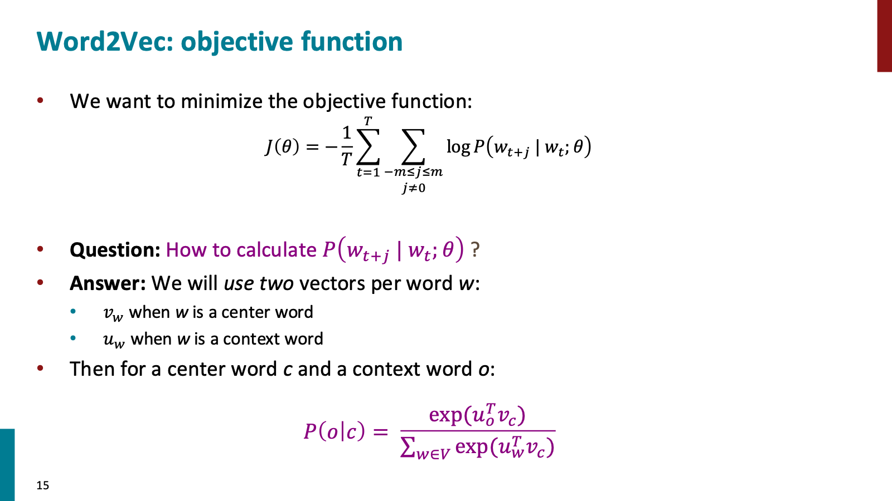
*Slide 15: "Word2Vec: objective function": "How to calculate P(w_{t+j} | w_t; θ)? … We will use two vectors per word w: v_w when w is a center word, u_w when w is a context word", then P(o|c) = exp(u_oᵀv_c) / Σ_{w∈V} exp(u_wᵀv_c).*

Slide 15 answers the question the objective left open: how do you compute P(o | c)? First, a design choice that surprises everyone: **two vectors per word**. Every word w gets v_w for when it is the centre word and u_w for when it is an outside word. (Section 6 gives the reason: "Easier optimization".) Then the probability is

P(o | c) = exp(u_oᵀv_c) / Σ_{w∈V} exp(u_wᵀv_c)

Notes 1 §3.2 stores the vectors as two matrices, U and V, each of size |V| × d, one row per word.

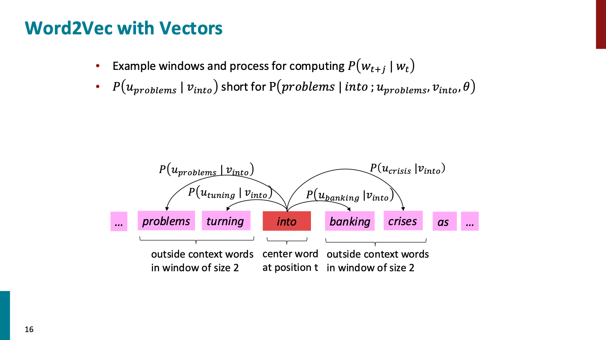
*Slide 16: "Word2Vec with Vectors": the same window, now labelled with vectors: P(u_problems | v_into), P(u_tuning | v_into), P(u_banking | v_into), P(u_crisis | v_into).*

Slide 16 relabels slide 12's arcs with vectors. "P(u_problems | v_into)" is "short for P(problems | into; u_problems, v_into, θ)": the centre word contributes its v, each outside word its u. (Two labels on the slide are typos, u_tuning for "turning" and u_crisis for "crises". The arithmetic doesn't care.)

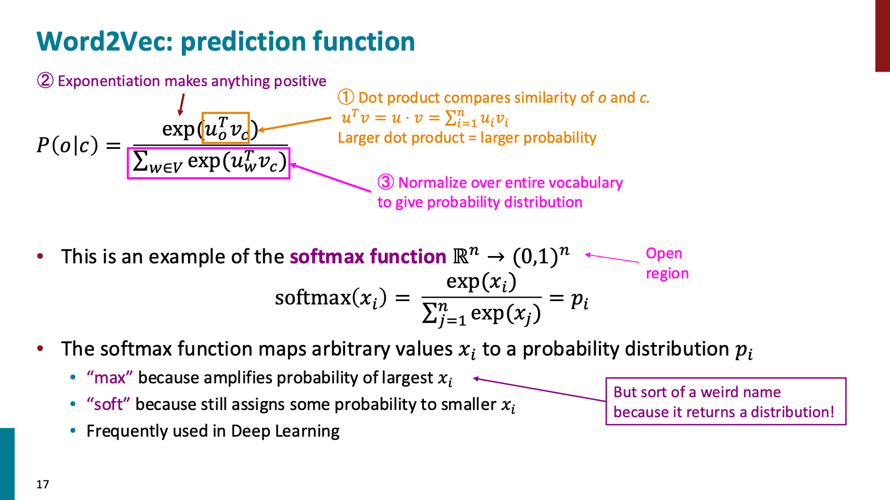
*Slide 17: "Word2Vec: prediction function": P(o|c) annotated: "① Dot product compares similarity of o and c", "② Exponentiation makes anything positive", "③ Normalize over entire vocabulary to give probability distribution"; then the softmax function.*

Slide 17 takes P(o | c) apart in three steps:

1. "Dot product compares similarity of o and c … Larger dot product = larger probability." The dot product uᵀv = Σᵢ uᵢvᵢ is big when the two vectors point the same way.
2. "Exponentiation makes anything positive." Dot products can be negative; probabilities can't. exp fixes that while keeping the order.
3. "Normalize over entire vocabulary to give probability distribution." Divide by the sum over all words, so the probabilities add up to 1.

These three steps have a name: the **softmax function**, softmax(xᵢ) = exp(xᵢ) / Σⱼ exp(xⱼ) = pᵢ, which maps ℝⁿ to (0,1)ⁿ, "arbitrary values xᵢ to a probability distribution pᵢ". The slide explains the name ("'max' because amplifies probability of largest xᵢ", "'soft' because still assigns some probability to smaller xᵢ") and then, in a box, admits that it is "sort of a weird name because it returns a distribution!" It is "Frequently used in Deep Learning", which undersells it: you will meet softmax in nearly every lecture from here on.

> **Note:** The slide is right that the name is odd. A more accurate name would be "soft arg max": the hard version, argmax, picks out the largest input, and softmax is a smooth approximation of the one-hot encoding of that choice, not of the max value itself. The name is [credited to John Bridle](https://en.wikipedia.org/wiki/Softmax_function), in papers from 1989–1990 on turning a neural network's outputs into class probabilities. Physicists had been using the same formula since the nineteenth century, as the Boltzmann distribution over the energy states of a system.

> **Worked example.** Three words have scores x = (2, 1, 0) against some centre word. exp gives (7.39, 2.72, 1.00), which sum to 11.11, so softmax(x) ≈ (0.665, 0.245, 0.090). Now double the scores to (4, 2, 0): softmax ≈ (0.867, 0.117, 0.016). The winner's share grows from two-thirds to almost nine-tenths. That is the "max" part. The loser keeps 1.6%, never zero. That is the "soft" part.

One more observation from notes 1 §3.2 is worth slowing down for. Fix a centre word c, and the vector of probabilities p_{U,V}(·|c) over the whole vocabulary "is a lot like a row of our old co-occurrence matrix X_c". Word2vec is predicting, for each word, a smoothed version of the counts we could have collected directly. Section 7 asks the obvious next question: why not just collect them?

**So far, and next.** Word2vec is a guessing game with one rule: predict the words around each word, scoring each guess by a dot product pushed through a softmax. The objective J(θ) says how badly the guesses are going. To make them better, we need to know which way to move each vector, and that is a gradient. The lecture plan gives it 25 minutes, more than anything else.

## 4. The gradient: observed minus expected

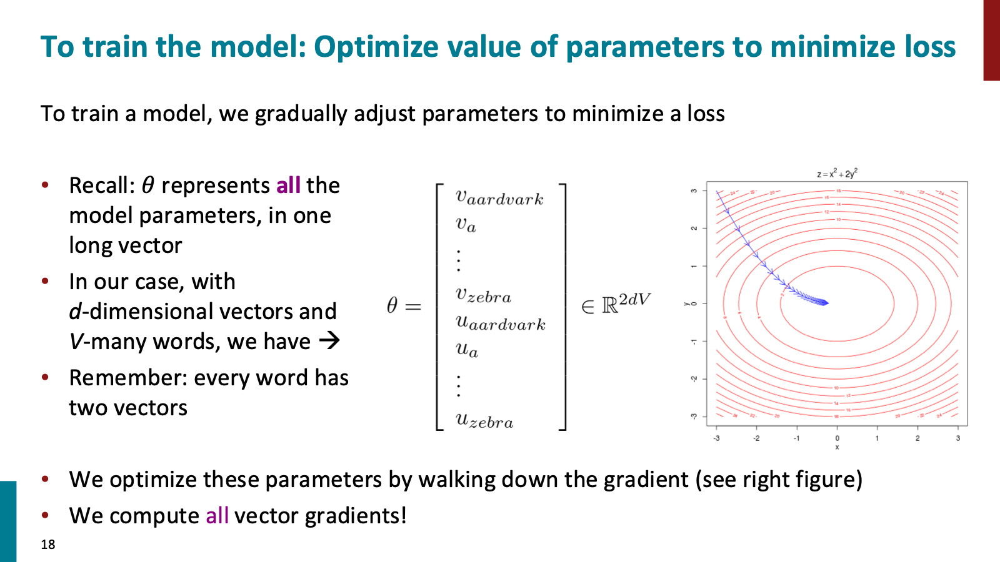
*Slide 18: "To train the model: Optimize value of parameters to minimize loss": θ stacks every word's two vectors, θ ∈ ℝ^{2dV}, beside a contour plot of z = x² + 2y² with a path walking down to its minimum.*

Slide 18 sets up the calculus. "Recall: θ represents all the model parameters, in one long vector". With d-dimensional vectors and V words, and "every word has two vectors", θ = (v_aardvark, v_a, …, v_zebra, u_aardvark, u_a, …, u_zebra) is a single vector in ℝ^{2dV}. For a modest model (d = 300, V = 400,000) that is 240 million numbers. "We optimize these parameters by walking down the gradient (see right figure)" and "We compute all vector gradients!" The contour plot on the right is a bowl, z = x² + 2y², with a blue path stepping down to the bottom: the picture to have in mind for everything in this section and the next.

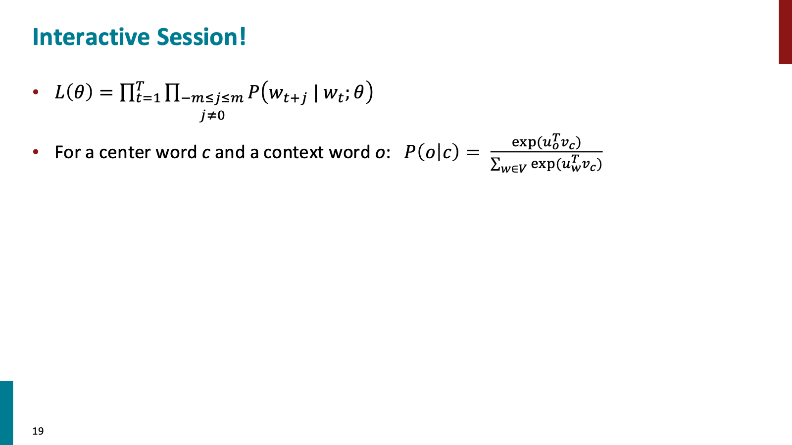
*Slide 19: "Interactive Session!": the likelihood L(θ) and P(o|c) restated, with nothing else on the slide.*

Slide 19 says "Interactive Session!" and restates the two formulas, and that is all the deck gives. The lecture plan gives "Word2vec objective function gradients" 25 minutes. The printed slide numbers then jump from 19 to 27, so the PDF has no worked derivation. Notes 1 §3.4 has one, and we follow it here: one centre word c, one outside word o, and the gradient of log P(o | c) with respect to the centre vector v_c.

Start by splitting the log of the fraction into two parts:

∇_{v_c} log P(o | c) = ∇_{v_c} log exp(u_oᵀv_c) − ∇_{v_c} log Σ_{w∈V} exp(u_wᵀv_c)

**Part A** is easy, because log undoes exp: ∇_{v_c} u_oᵀv_c = u_o. Notes 1 checks this one coordinate at a time: the derivative of Σᵢ u_{o,i} v_{c,i} with respect to v_{c,i} is u_{o,i}, and stacking those gives u_o. (By convention, the gradient has the shape of the thing you differentiate with respect to, so the answer is the column vector u_o, not u_oᵀ.)

**Part B** takes the chain rule twice. The derivative of log of a sum is 1/(the sum) times the derivative of the sum; the derivative of each exp(u_xᵀv_c) is exp(u_xᵀv_c) times u_x:

∇_{v_c} log Σ_w exp(u_wᵀv_c) = Σ_x [ exp(u_xᵀv_c) / Σ_w exp(u_wᵀv_c) ] u_x = Σ_x P(x | c) u_x

The bracket is exactly the model's own probability P(x | c). Put the parts together:

∇_{v_c} log P(o | c) = u_o − Σ_{x∈V} P(x | c) u_x = u_o − E[u_x]

Notes 1 names this result: "'observed' - 'expected'". u_o is the outside vector of the word that actually appeared. Σ_x P(x | c) u_x is the average outside vector, weighted by what the model expected to appear. So "the v_c vector is updated to be 'more like' the word vector that was actually observed than the word vector it expected" (notes 1 §3.4).

> **Note:** Watch the sign. The derivation computes the gradient of the *log-probability*, which we want to go *up*. The loss is −log P(o | c), so its gradient is the negative, Σ_x P(x | c) u_x − u_o, and gradient *descent* subtracts that. Both routes give the same update: move v_c towards u_o and away from the expected vector.

> **Note:** If you work through notes 1 with a pencil, three slips in the draft will trip you up. Eq. 10 prints the denominator without its exp (Eq. 11 restores it). Part B writes u_w inside a sum over x, where u_x is meant. And Part B's left-hand side carries a minus sign that its right-hand side quietly drops. The final answer above is correct. Notes 1's empirical loss, Eq. 6, also sums only the left half of each window (j = 1 … k, with w_{i−j}); the full skip-gram loss sums both sides, −k ≤ j ≤ k with j ≠ 0.

Here is why this is a lovely result rather than just a correct one. Summed over the data, this gradient for v_c is zero when the outside vectors the model expects, on average, match the ones it observes. That is a statement about averages of *vectors*: it doesn't mean the predicted distribution matches the data word for word, and the gradients for the other parameters (the u's) may still be nonzero. Training is a tug-of-war between what was observed and what was expected. You will see the same "observed minus expected" shape again wherever a softmax is trained with cross-entropy: in classifiers and in language models. It is one of the most reused equations in machine learning.

> **Check your understanding.** Take an idealised limit (a softmax never quite reaches 0 or 1): the model is certain, with P(o | c) → 1 for the observed word o. What does the log-probability gradient approach? *Answer: u_o − 1·u_o = 0. A perfectly confident, correct model has nothing to learn from this pair. If instead it put almost all its probability on a wrong word x, the gradient would approach u_o − u_x: move v_c away from the wrong guess and towards the right one.*

**So far, and next.** We have a loss, J(θ), and the gradient of the log-probability with respect to the centre vector, observed minus expected; the loss gradient is its negative. The next four slides are the generic machinery that turns a gradient into learning: walk downhill, and do it on bite-sized samples, because the full corpus is far too big to look at once.

## 5. Walking downhill: gradient descent and SGD

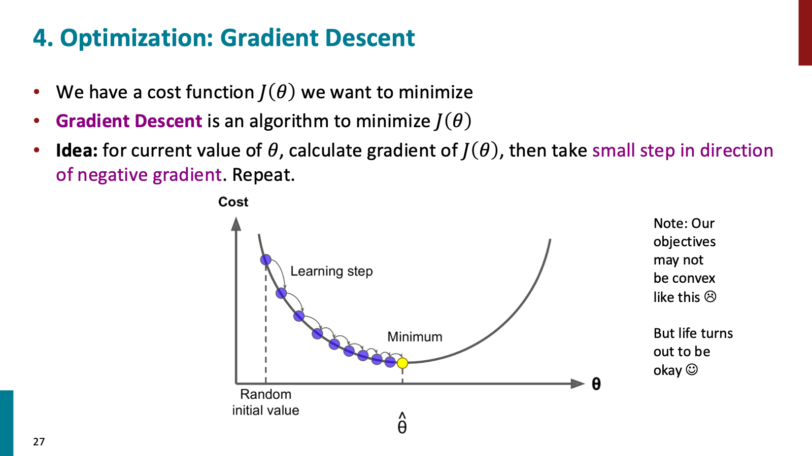
*Slide 20: "4. Optimization: Gradient Descent": a cost curve with learning steps from a "Random initial value" down to the minimum θ̂, and a note that "Our objectives may not be convex like this ☹ But life turns out to be okay ☺".*

**Gradient descent** is the plainest idea in the course: "for current value of θ, calculate gradient of J(θ), then take small step in direction of negative gradient. Repeat." The gradient points uphill, the way the loss increases fastest. Step the other way and the loss goes down, at least for a small step.

The picture on slide 20 starts at a "Random initial value" and takes "Learning step"s down the curve to the minimum θ̂, with steps that shrink as the slope flattens. The note beside it is honest: "Our objectives may not be convex like this ☹ But life turns out to be okay ☺". For a convex objective, every local minimum is a global one, so gradient descent with a suitable step size can reach the best value. (Convex doesn't mean a single bottom point: a flat-bottomed valley is convex too. And too large a step can fail even on a convex bowl.) Real objectives have many dips and flat regions, and there is no guarantee of the best one. The happy face is an empirical claim: in practice, for these models, the place you end up is good enough.

> **Note:** Gradient descent is old. It is usually [credited to Augustin-Louis Cauchy](https://ems.press/content/book-chapter-files/27368?nt=1), who described it in an 1847 note on solving systems of equations. The stochastic version on the next slides descends from Herbert Robbins and Sutton Monro's 1951 paper ["A Stochastic Approximation Method"](https://projecteuclid.org/euclid.aoms/1177729586). Every large model you have heard of is trained by refinements of these two ideas.

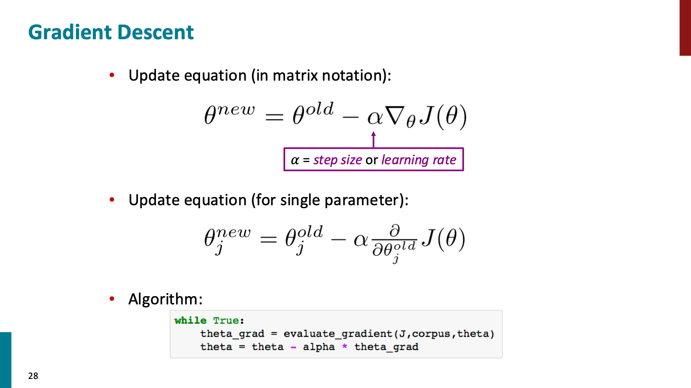
*Slide 21: "Gradient Descent": the update in matrix notation, θ^{new} = θ^{old} − α∇_θJ(θ), with "α = step size or learning rate"; the update for a single parameter; and the algorithm as three lines of code.*

In symbols, θ^{new} = θ^{old} − α∇_θJ(θ). For one parameter, θ_j^{new} = θ_j^{old} − α ∂J(θ)/∂θ_j^{old}. The number α is the **step size** or **learning rate**. The algorithm is three lines:

```
while True:
    theta_grad = evaluate_gradient(J,corpus,theta)
    theta = theta - alpha * theta_grad
```

The learning rate is the dial students fiddle with most. Too small and training crawls; too large and each step overshoots the valley and the loss bounces or blows up. Notes 1 §3.3 adds where θ starts: small random numbers, "U, V ∼ N(0, 0.001)^{|V|×d}". (The original word2vec code does it slightly differently: random input vectors and all-zero output vectors.) What you must not do is start *both* matrices at zero: every score uᵀv is then 0, and every gradient (u_o − E[u] for v_c, and the matching one for each u) is 0 too, so training never moves.

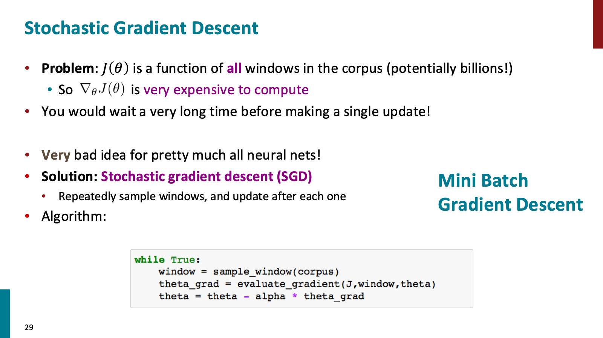
*Slide 22: "Stochastic Gradient Descent": the problem ("J(θ) is a function of all windows in the corpus (potentially billions!)"), the solution ("Repeatedly sample windows, and update after each one"), the code, and "Mini Batch Gradient Descent".*

Look at the code on slide 21 again: `evaluate_gradient(J,corpus,theta)`. Every single step reads the whole corpus. The problem, slide 22 says, is that J(θ) is a function of all windows in the corpus, "potentially billions!", so "You would wait a very long time before making a single update!", a "Very bad idea for pretty much all neural nets!"

The fix is **stochastic gradient descent (SGD)**: "Repeatedly sample windows, and update after each one."

```
while True:
    window = sample_window(corpus)
    theta_grad = evaluate_gradient(J,window,theta)
    theta = theta - alpha * theta_grad
```

The gradient from one window is a noisy estimate of the true gradient: right on average, wrong in any particular step. Thousands of cheap, noisy steps beat one expensive, exact one. Think of a crowd estimating the weight of an ox: each guess is off, but the guesses are cheap, and their average is good. The slide's displayed loop updates after one sampled window. Its side label, "Mini Batch Gradient Descent", names the variant used in practice, which averages the gradient over a small batch of samples (32, 64, …) for each update: less noise per step, and it keeps a GPU busy. Notes 1 §3.3 gives its own version, sampling a few documents per step (Eq. 8).

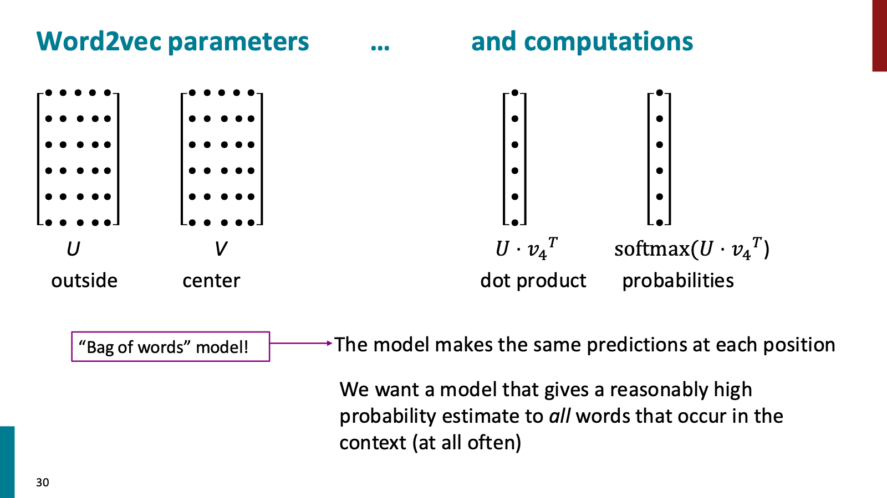
*Slide 23: "Word2vec parameters … and computations": the outside matrix U and centre matrix V, the dot products U·v₄ᵀ and the probabilities softmax(U·v₄ᵀ), labelled a "'Bag of words' model!"*

Slide 23 shows what one prediction costs. Take the centre word's vector, here v₄. Multiply the whole outside matrix U by it to get a dot product for every word in the vocabulary, U·v₄ᵀ. Push that column through a softmax to get softmax(U·v₄ᵀ), a probability for every word.

The box says this is a **"Bag of words" model**: "The model makes the same predictions at each position." The model computes one distribution for the whole window. It does not know whether a word is one to the left or three to the right; the window is a bag, not a sequence. So the model can't hope to get every position right. The slide states the more modest goal: "We want a model that gives a reasonably high probability estimate to all words that occur in the context (at all often)".

> **Check your understanding.** In "the cat sat on the mat", with centre word "sat" and window size 2, does skip-gram predict a different distribution for "the" (two to the left) and "on" (one to the right)? *Answer: no. It computes one distribution, softmax(U·v_satᵀ), and scores both outside words against it. Word order inside the window is invisible, which is why word2vec vectors capture topical and syntactic similarity but can't model sentence structure. Sequence models arrive in Lecture 4.*

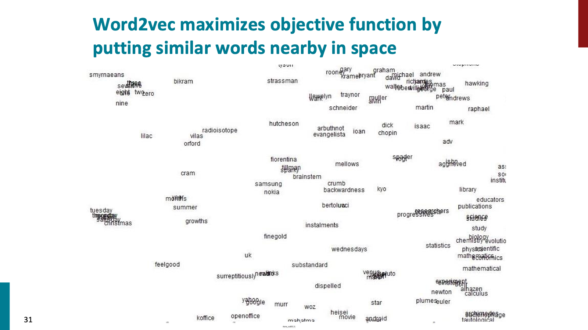
*Slide 24: "Word2vec maximizes objective function by putting similar words nearby in space": a 2-D projection of trained word vectors, where similar words cluster.*

Slide 24 is the payoff, and it rewards a slow look. In a 2-D projection of trained vectors, days of the week huddle together, number words form a clump, given names gather in one region, and science words (physics, chemistry, biology, mathematics) sit side by side with names like Newton and Euler. Nobody told the model any of this. It learned it because these words keep similar company.

The slide's title says word2vec "maximizes objective function". In slide 14's notation, training *minimises* the negative log-likelihood J, which is the same as maximising the likelihood L. The title means the likelihood.

**So far, and next.** We can now train word2vec: compute the gradient on one sampled window, step against it, repeat a few billion times, and similar words drift together. But slide 23 hides an expensive detail. Every prediction needs a dot product with every word in the vocabulary, all 500,000 of them, just to compute one probability. The next section is about cheating that sum, and about word2vec's sibling model.

## 6. The word2vec family, and the trick that made it fast

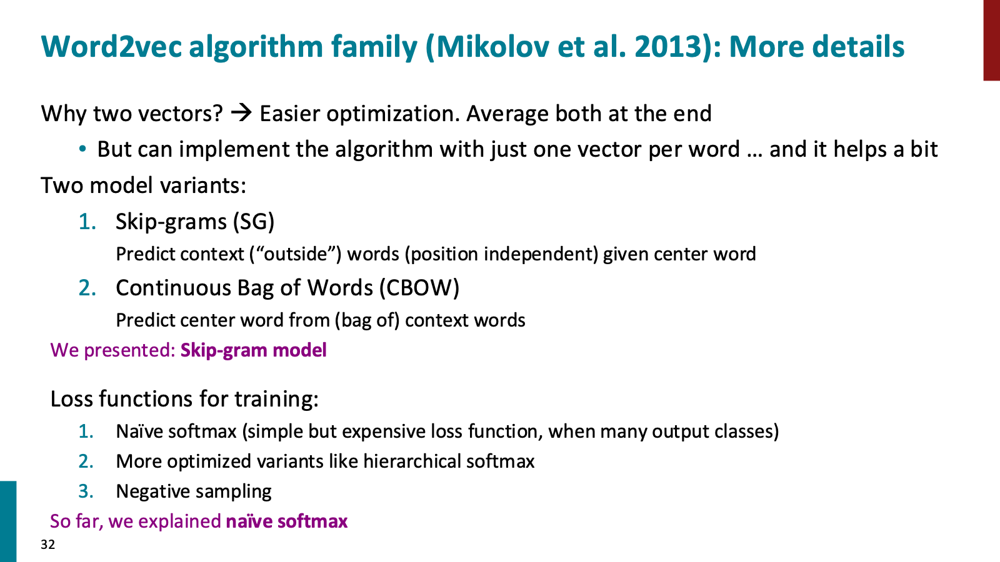
*Slide 25: "Word2vec algorithm family (Mikolov et al. 2013): More details": why two vectors; the two model variants, skip-grams (SG) and continuous bag of words (CBOW); and three loss functions for training: naïve softmax, hierarchical softmax and negative sampling.*

Slide 25 settles three loose ends.

**Why two vectors?** "Easier optimization. Average both at the end." The slide leaves it there; here is one way to see it. With one vector per word, P(o | c) for o = c would involve vᵀv, the squared length of a single vector, and the model would be pushed towards giving a word a high score with itself, which is rarely what the data says. Two vectors keep the centre and outside roles apart. After training you have two vectors per word and you average them. The slide adds that you "can implement the algorithm with just one vector per word … and it helps a bit".

**Two variants.** Skip-gram (SG) predicts the outside words "(position independent) given center word". **Continuous Bag of Words (CBOW)** does it the other way round: "Predict center word from (bag of) context words". CBOW is the fill-in-the-blank version of the game: "government debt problems turning into ___ crises as" → banking. "We presented: Skip-gram model." (Notes 1 has a heading for CBOW in its appendix, A.1, with nothing under it yet. It is a draft.)

**Three losses.** "1. Naïve softmax (simple but expensive loss function, when many output classes) 2. More optimized variants like hierarchical softmax 3. Negative sampling". "So far, we explained naïve softmax." The next two slides explain why naïve softmax is too slow and what negative sampling does instead.

> **Note:** Hierarchical softmax, named here and not taught, arranges the vocabulary as the leaves of a binary tree and replaces one 500,000-way choice with a path of left-or-right decisions, about 19 of them if the tree is balanced. The idea is from [Morin and Bengio (2005)](https://proceedings.mlr.press/r5/morin05a.html). The word2vec paper built its tree as a Huffman code, so path lengths vary with frequency: frequent words get short paths and rare words longer ones.

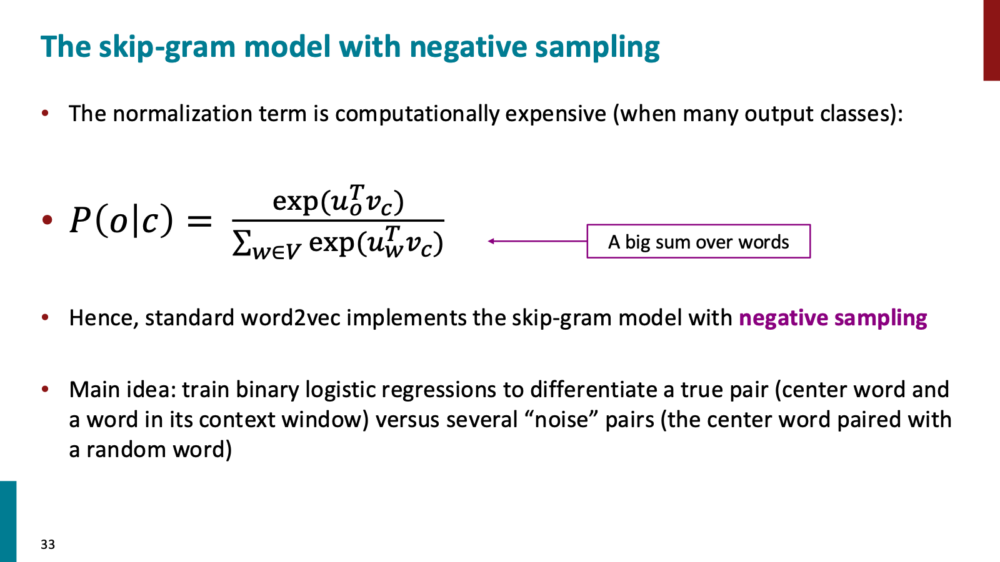
*Slide 26: "The skip-gram model with negative sampling": "The normalization term is computationally expensive (when many output classes)" (the denominator is "A big sum over words"); the main idea: "train binary logistic regressions to differentiate a true pair … versus several 'noise' pairs".*

The trouble is the denominator, "A big sum over words". To compute P(o | c) for one outside word, you need exp(u_wᵀv_c) for every word in the vocabulary: 500,000 dot products for the denominator. (Within one window those scores can be reused for every outside word, since the centre word is the same, but each new centre word needs a fresh set.) Over a corpus of billions of positions, that is a vast amount of arithmetic, nearly all of it spent on words that didn't occur. Notes 1 §3.5 calls the denominator the **partition function** (a name borrowed from statistical physics) and makes a nice point about what it does for learning. The numerator pulls u_o towards v_c, and the partition function "'pushes down' on all the words other than the observed words". It is the "expected" part of section 4's gradient, and it is what costs so much.

So "standard word2vec implements the skip-gram model with negative sampling". The main idea changes the question. Instead of "which of 500,000 words appears in its context?", ask a yes/no question: is this pair real? "train binary logistic regressions to differentiate a true pair (center word and a word in its context window) versus several 'noise' pairs (the center word paired with a random word)". A real pair is (into, banking). A noise pair is (into, giraffe), made by pairing the centre word with a random word. Telling the two apart is cheap.

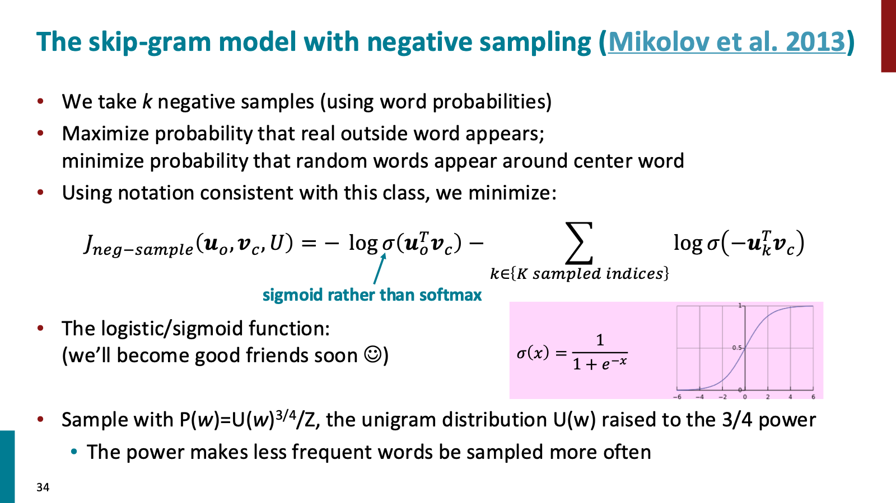
*Slide 27: "The skip-gram model with negative sampling (Mikolov et al. 2013)": the loss J_neg-sample, "sigmoid rather than softmax", the logistic function σ(x) = 1/(1 + e^{−x}) and its plot, and sampling with P(w) = U(w)^{3/4}/Z.*

"We take k negative samples (using word probabilities)", and then we "Maximize probability that real outside word appears; minimize probability that random words appear around center word". In this class's notation, the loss is

J_neg-sample(u_o, v_c, U) = −log σ(u_oᵀv_c) − Σ_{k∈{K sampled indices}} log σ(−u_kᵀv_c)

The **logistic** (or **sigmoid**) function σ(x) = 1/(1 + e^{−x}) squashes any real number into (0, 1), and the slide promises that "we'll become good friends soon ☺". That is a safe promise: it returns in Lecture 3's neural networks. Two facts make the loss readable:

- σ(x) is softmax with just two classes. Softmax over the scores (x, 0) gives e^x / (e^x + 1) = σ(x). Negative sampling replaces one 500,000-way softmax with k + 1 two-way ones.
- σ(−x) = 1 − σ(x). So log σ(−u_kᵀv_c) is the log-probability that noise word k is *not* a real neighbour.

The first term rewards a high score for the real pair; the sum rewards low scores for the k fake pairs. Notes 1 §3.5 writes the same objective without the minus signs, as something to maximise, and gives the intuition: "if we randomly push down a few words at each step, then on average, things will work out sort of as if we always pushed down every word."

**Which words are the noise?** "Sample with P(w)=U(w)^{3/4}/Z, the unigram distribution U(w) raised to the 3/4 power", where Z normalises. "The power makes less frequent words be sampled more often." Raising to 3/4 flattens the distribution: it takes a little from the very frequent words and gives it to the rare ones.

> **Worked example.** Suppose a two-word language where "the" has unigram probability 0.99 and "aardvark" 0.01. Raised to 3/4, these become 0.9925 and 0.0316, which normalise to about 0.969 and 0.031. The aardvark is now drawn as a negative about three times as often, so the model learns something about it instead of spending nearly every negative sample on "the".

> **Note:** Where does 3/4 come from? Experiment. The negative-sampling paper (Mikolov et al. 2013, ["Distributed Representations of Words and Phrases and their Compositionality"](https://arxiv.org/abs/1310.4546)) reports that U(w)^{3/4} "outperformed significantly the unigram and the uniform distributions". It suggests k of "5–20" for small datasets and "2–5" for large ones. It also describes negative sampling as "a simplified variant of Noise Contrastive Estimation", a method for avoiding partition functions introduced by [Gutmann and Hyvärinen (2010)](https://proceedings.mlr.press/v9/gutmann10a.html). The same paper adds a trick the slides skip: it randomly drops very frequent words like "the" from the training text (subsampling), which speeds training and improves the rare words' vectors.

> **Check your understanding.** Why is the negative-sampling loss so much cheaper than the naïve softmax loss? *Answer: naïve softmax needs a dot product with all |V| outside vectors per prediction (for the denominator). Negative sampling needs only k + 1 of them, the real outside word plus k noise words, with k around 5 to 20 instead of hundreds of thousands.*

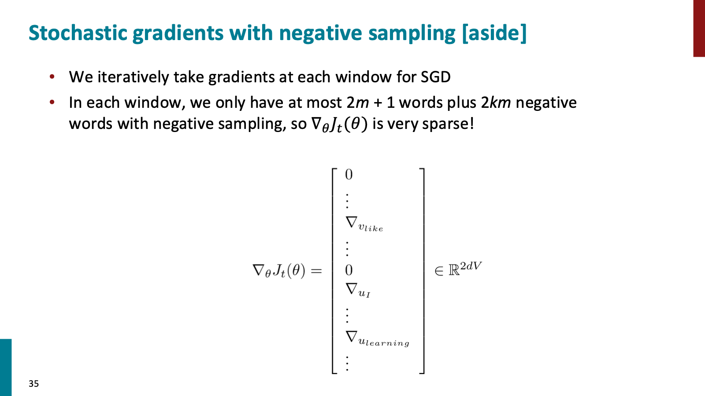
*Slide 28: "Stochastic gradients with negative sampling [aside]": in each window "we only have at most 2m + 1 words plus 2km negative words with negative sampling, so ∇_θJ_t(θ) is very sparse!", shown as a gradient in ℝ^{2dV} that is mostly zeros.*

Slides 28 and 29 are an aside, but a practical one. With negative sampling, one window touches very few vectors: the centre word, at most 2m outside words, and k negatives for each of those (2km). The gradient ∇_θJ_t(θ) lives in ℝ^{2dV}, but nearly all of its entries are zero. The slide's example has nonzero blocks only at ∇v_like, ∇u_I and ∇u_learning, a window from the corpus "I like deep learning" that comes back in section 7.

This sparsity belongs to negative sampling. With the naïve softmax, the big sum in the denominator gives every outside vector a nonzero gradient, even for a single window.

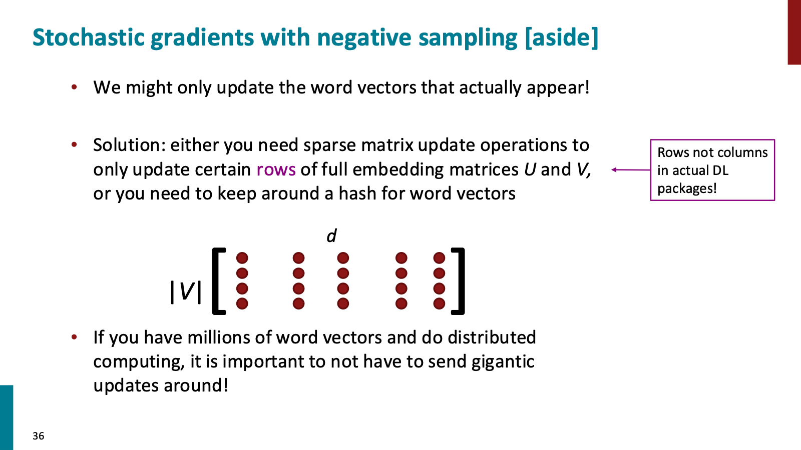
*Slide 29: "Stochastic gradients with negative sampling [aside]": "We might only update the word vectors that actually appear!", using sparse updates to "certain rows of full embedding matrices U and V" ("Rows not columns in actual DL packages!") or a hash for word vectors.*

So "We might only update the word vectors that actually appear!" You can either use "sparse matrix update operations to only update certain rows of full embedding matrices U and V", or "keep around a hash for word vectors". The box in the corner is a warning for when you write code: in the actual deep learning packages, word vectors are stored as *rows* of a |V| × d matrix, "Rows not columns", even though the maths on the slides treats vectors as columns. The last bullet is about scale: "If you have millions of word vectors and do distributed computing, it is important to not have to send gigantic updates around!"

**So far, and next.** Word2vec is a family (skip-gram and CBOW), and the version everyone actually ran is skip-gram with negative sampling: cheap yes/no questions in place of one enormous softmax, with sparse updates to match. All of this is a sophisticated way of walking through the corpus window by window. The deck now asks the cheeky question: if word2vec is learning which words appear near which, why not just count them?

## 7. Counting instead: co-occurrence matrices and SVD

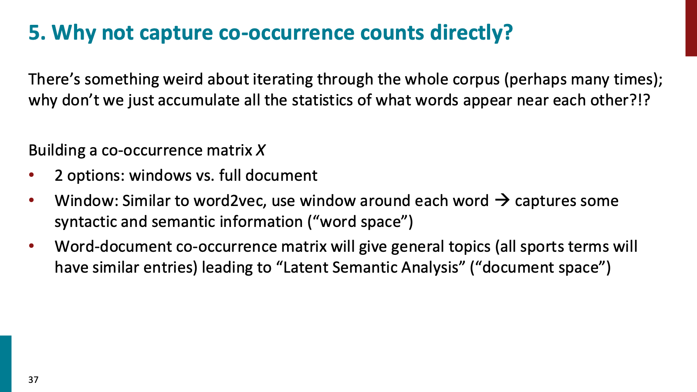
*Slide 30: "5. Why not capture co-occurrence counts directly?": two options for building a co-occurrence matrix X, windows (a "word space") or full documents (general topics, leading to "Latent Semantic Analysis").*

Slide 30 asks what a sceptical student asks at this point: "There's something weird about iterating through the whole corpus (perhaps many times); why don't we just accumulate all the statistics of what words appear near each other?!?" Word2vec reads the corpus window by window, over and over, learning which words keep company. You could count the company once and be done.

Build a **co-occurrence matrix X**, one row and one column per word. There are "2 options: windows vs. full document". A window "similar to word2vec" counts words that appear within a few positions of each other, and "captures some syntactic and semantic information ('word space')". A word-document matrix counts which documents each word appears in. It "will give general topics (all sports terms will have similar entries) leading to 'Latent Semantic Analysis' ('document space')". Notes 1 §3.1 makes the same contrast in general terms: "shorter windows … seem to encode syntactic properties", while larger windows give "more semantic (and at extremes, topic-like) properties". Lecture 1 built exactly this kind of matrix in Assignment 1 (ch01:C45); here the deck explains the choices behind it.

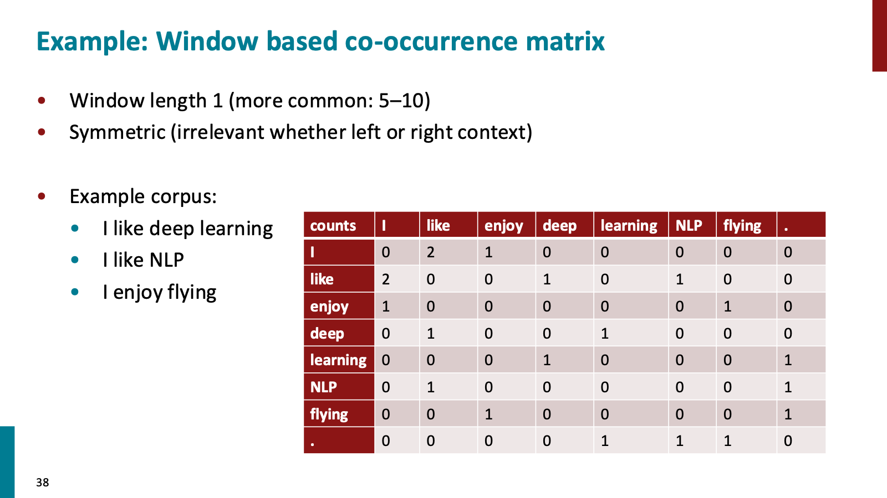
*Slide 31: "Example: Window based co-occurrence matrix": window length 1, symmetric, over the corpus "I like deep learning", "I like NLP", "I enjoy flying", with the full 8 × 8 table of counts.*

Slide 31 is small enough to check by hand, and you should. The corpus is three sentences: "I like deep learning", "I like NLP", "I enjoy flying". The window has length 1 ("more common: 5–10") and is symmetric ("irrelevant whether left or right context"). The table has a column for "." too, so each sentence is counted as ending with a full stop. Read off a few cells:

- I–like = 2: "I like" occurs twice.
- like–deep = 1 and like–NLP = 1.
- learning–"." = 1, NLP–"." = 1, flying–"." = 1: each sentence's last word sits next to its full stop.

Every one of the 64 cells checks out, and the matrix is symmetric, as a symmetric window guarantees.

> **Check your understanding.** Which words have a nonzero count in the "like" column, and why should "deep" and "NLP" end up with somewhat similar vectors? *Answer: "I" (2), "deep" (1) and "NLP" (1). "deep" and "NLP" both fill the slot "I like ___", so they share a neighbour. That is the distributional hypothesis at its smallest scale: same slot, similar row.*

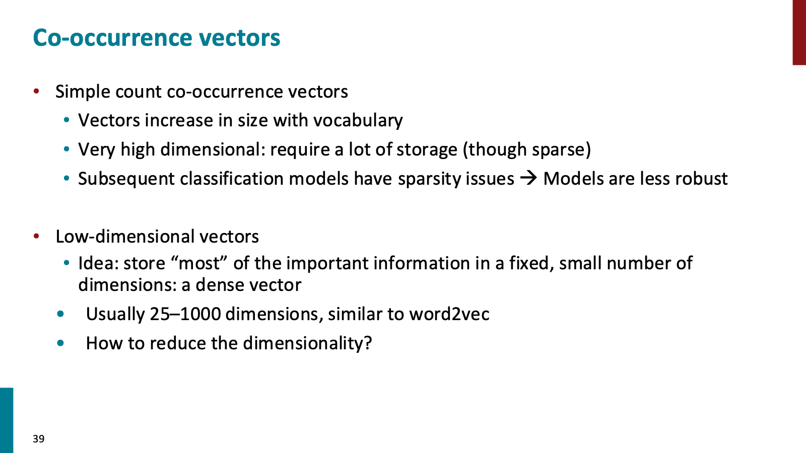
*Slide 32: "Co-occurrence vectors": simple count vectors grow with the vocabulary, are very high-dimensional and sparse, and make later models "less robust"; the fix is low-dimensional dense vectors, "Usually 25–1000 dimensions, similar to word2vec".*

Each row of X is already a word vector, and slide 32 lists its problems. The vectors "increase in size with vocabulary", are "Very high dimensional: require a lot of storage (though sparse)", and give later classifiers "sparsity issues → Models are less robust". The idea, then, is to "store 'most' of the important information in a fixed, small number of dimensions: a dense vector", "Usually 25–1000 dimensions, similar to word2vec". Notes 1 §3.1 is blunter: representing explicit counts in |V|-sized vectors "ends up being a big mistake", partly because raw counts over-emphasise very common words like "the".

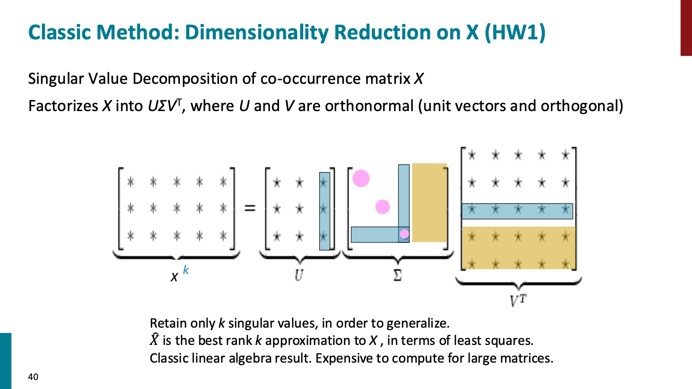
*Slide 33: "Classic Method: Dimensionality Reduction on X (HW1)": the singular value decomposition X = UΣVᵀ, keeping only the top k singular values, which gives X̂, "the best rank k approximation to X, in terms of least squares".*

The "Classic Method" for squeezing X is the **singular value decomposition** (SVD), which you used in Assignment 1 (the slide says "HW1"; Lecture 1's map, ch01:C46). It "Factorizes X into UΣVᵀ, where U and V are orthonormal (unit vectors and orthogonal)". Σ is diagonal, with the singular values in decreasing order. "Retain only k singular values, in order to generalize." The truncated product X̂ "is the best rank k approximation to X, in terms of least squares". The rows of the truncated U (scaled by the singular values) are the k-dimensional word vectors. The slide adds two honest footnotes: it is a "Classic linear algebra result", and it is "Expensive to compute for large matrices".

> **Note:** A notation trap: the U and V on this slide are the SVD's factors, not word2vec's outside and centre matrices from section 3. Same letters, different objects. Linear algebra ran out of letters long before NLP arrived.

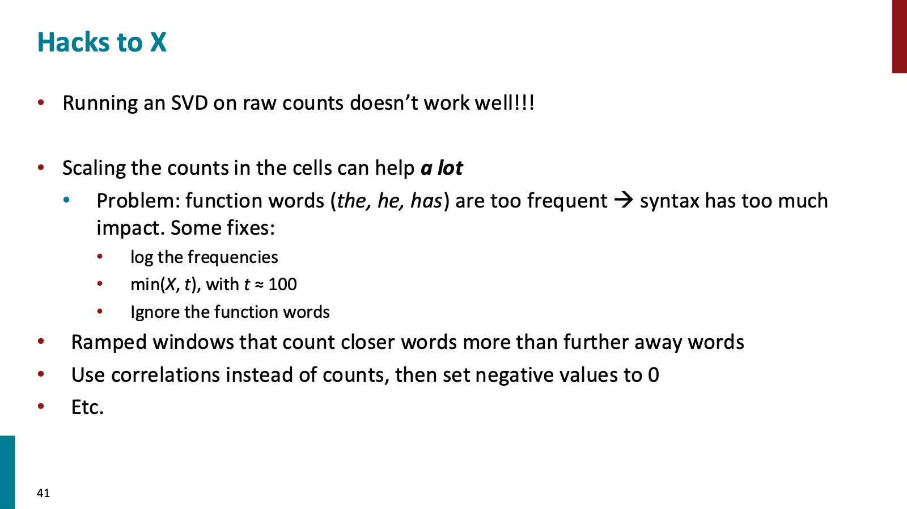
*Slide 34: "Hacks to X": "Running an SVD on raw counts doesn't work well!!!", then a list of ways to scale the counts.*

Slide 34 is the bit textbooks leave out. "Running an SVD on raw counts doesn't work well!!!" (three exclamation marks: someone learned this the hard way). The culprit is frequency: "function words (the, he, has) are too frequent → syntax has too much impact". Almost every word appears near "the", so raw counts mostly measure how common a word is. The fixes all **scale the counts**:

- "log the frequencies";
- "min(X, t), with t ≈ 100": cap every count;
- "Ignore the function words";
- "Ramped windows that count closer words more than further away words";
- "Use correlations instead of counts, then set negative values to 0".

Notes 1 §3.1 agrees: "Taking the log token frequency ends up being much more useful". Keep the idea of limiting frequent pairs' influence in mind: GloVe revisits it, though it caps a loss weight rather than the counts themselves.

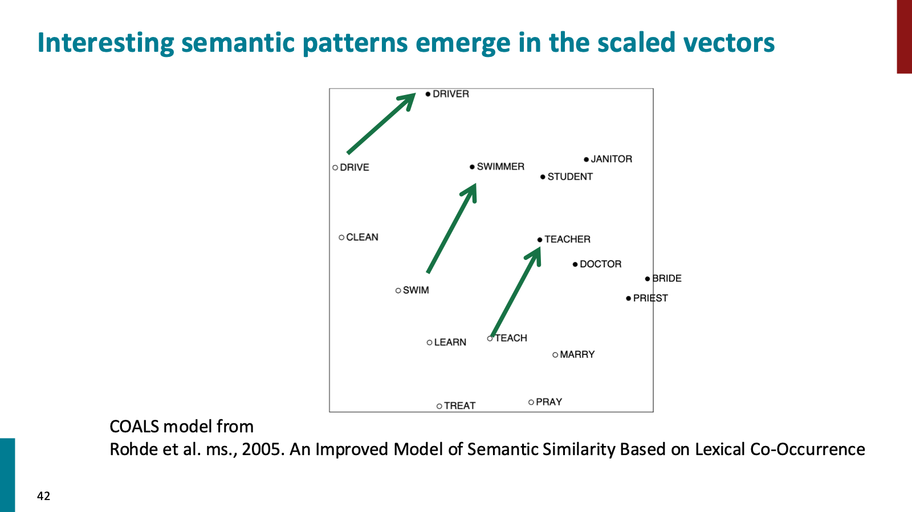
*Slide 35: "Interesting semantic patterns emerge in the scaled vectors": the COALS model (Rohde et al. ms., 2005), with verbs (drive, swim, teach, clean, learn, treat, marry, pray) and their nouns (driver, swimmer, teacher, janitor, student, doctor, bride, priest) in two dimensions, and parallel arrows from drive to driver, swim to swimmer and teach to teacher.*

Slide 35 is the reward for all that hacking. With the counts scaled, a simple count-based model, **COALS**, shows linear structure. Each verb sits at roughly the same offset from the person who does it: drive → driver, swim → swimmer, teach → teacher, three nearly parallel arrows. The "doer" relation has become a direction in space. This is the same kind of regularity people celebrated in word2vec's analogies (the king and queen of Lecture 1's exhibition), here coming out of counts.

> **Note:** COALS stands for "Correlated Occurrence Analogue to Lexical Semantics", from a [2005 manuscript](http://www.cnbc.cmu.edu/~plaut/papers/pdf/RohdeGonnermanPlautSUB-CogSci.COALS.pdf) (the slide's "ms.") by Douglas Rohde, Laura Gonnerman and David Plaut. Its scaling recipe (manuscript §2.5) includes the last of slide 34's hacks: replace counts with correlations, set the negative ones to 0, and take the square root of the positive ones. The manuscript's argument for discarding them is a guessing game. In its corpus 81.8% of the correlations are negative, yet they "carry very little information": would you rather guess a mystery word from "10 words associated with the mystery word (cat, bone, paw, collar...)", or from 100 words that have nothing to do with it? In the manuscript the picture on this slide is a multidimensional-scaling plot (its Figure 13), a different projection from SVD.

**So far, and next.** Counting works, once you tame the frequencies, and the scaled counts show the same linear "meaning directions" that made word2vec famous. So we have two families: prediction methods that stream through windows, and count methods that factorise a matrix. The next slide is from a 2014 paper with an obvious question in mind: can one model get the best of both?

## 8. GloVe: meaning in the ratios

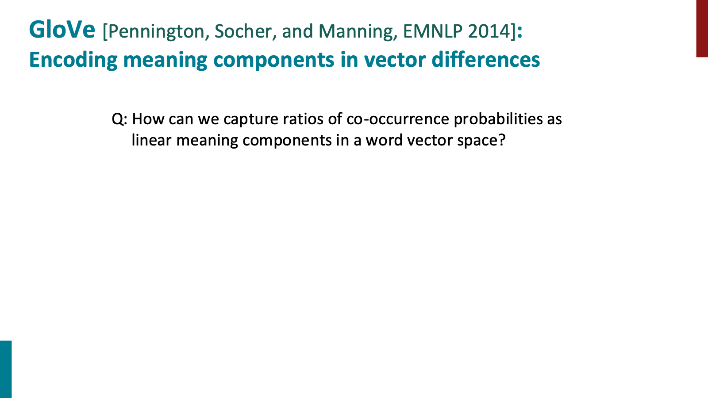
*Slide 36: "GloVe [Pennington, Socher, and Manning, EMNLP 2014]: Encoding meaning components in vector differences": "Q: How can we capture ratios of co-occurrence probabilities as linear meaning components in a word vector space?"*

Slide 36 asks one question and leaves the rest of the slide empty for the answer: "How can we capture ratios of co-occurrence probabilities as linear meaning components in a word vector space?" The key word is *ratios*. The slide doesn't show why ratios matter; the [GloVe paper](https://aclanthology.org/D14-1162/)'s first table does, and it is the clearest small table in the embeddings literature.

Take two words, *ice* and *steam*, and ask how often various probe words k appear near each (GloVe paper, Table 1, from a 6-billion-token corpus):

| k | solid | gas | water | fashion |
|---|---|---|---|---|
| P(k \| ice) | 1.9 × 10⁻⁴ | 6.6 × 10⁻⁵ | 3.0 × 10⁻³ | 1.7 × 10⁻⁵ |
| P(k \| steam) | 2.2 × 10⁻⁵ | 7.8 × 10⁻⁴ | 2.2 × 10⁻³ | 1.8 × 10⁻⁵ |
| P(k \| ice) / P(k \| steam) | 8.9 | 8.5 × 10⁻² | 1.36 | 0.96 |

The raw probabilities are hard to read: water is the most common neighbour of both, and fashion is rare for both. The ratio is easy. Solid goes with ice (8.9, much greater than 1), gas goes with steam (0.085, much less than 1), and water and fashion, which are either shared by both or irrelevant to both, come out near 1. In the paper's words, "Only in the ratio does noise from non-discriminative words like water and fashion cancel out". The ratio isolates the **meaning component** that separates ice from steam: something like a solid-to-gas axis.

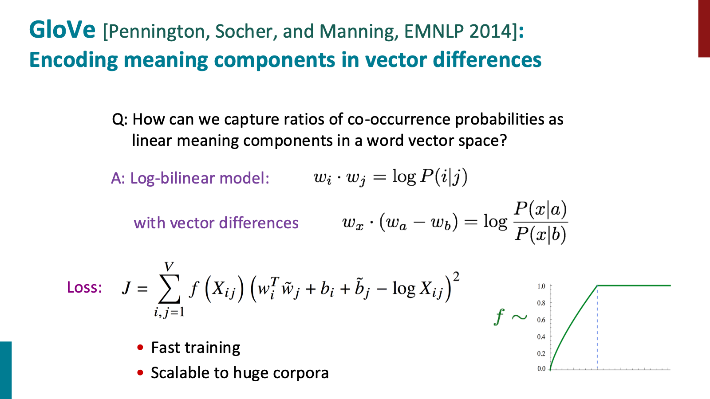
*Slide 37: the answer: a "Log-bilinear model", w_i · w_j = log P(i|j), so that "with vector differences" w_x · (w_a − w_b) = log [P(x|a)/P(x|b)]; the loss J with weighting function f; "Fast training", "Scalable to huge corpora".*

Slide 37 answers with a **log-bilinear model**: make dot products equal log co-occurrence probabilities, w_i · w_j = log P(i | j). Then subtract. For any probe word x,

w_x · (w_a − w_b) = w_x · w_a − w_x · w_b = log P(x | a) − log P(x | b) = log [P(x | a) / P(x | b)]

A *ratio* of probabilities has become a *difference* of vectors. If the dot products match the logs, the direction from steam to ice automatically encodes "solid versus gas". That is the slide's title, "Encoding meaning components in vector differences", and it explains why analogies work: an analogy is two pairs of words with the same difference vector.

The loss that **GloVe** (Global Vectors) actually minimises is

J = Σ_{i,j=1}^{V} f(X_ij) (w_iᵀw̃_j + b_i + b̃_j − log X_ij)²

Here w_i is a target-word vector and w̃_j a separate context-word vector (two vectors per word again, as in word2vec); b_i and b̃_j are learned scalar biases; X_ij is the co-occurrence count; and f(X_ij) is a weight. It is a weighted least-squares fit: make each dot product, plus biases, match the log count. The biases absorb how frequent each word is on its own, so the vectors only need to capture the interaction.

The weighting function f, plotted on the slide, rises from 0 and then flattens at 1. The paper defines it as f(x) = (x/x_max)^α for x < x_max and 1 otherwise, with x_max = 100 and α = 3/4. It does two jobs. f(0) = 0, so the zero cells of the matrix (most of them) cost nothing; GloVe trains "only on the nonzero elements" (notes 2 §1.4). And the cap on the *weight*, f(X) = min((X/100)^{3/4}, 1), means very frequent pairs like ("of", "the") can't dominate the loss. The log X_ij inside the loss is left uncapped. It is a relative of slide 34's min(X, t) hack with t ≈ 100, not the same operation: there the counts were clipped, here the weights are.

> **Note:** The same 3/4 again. GloVe's paper says it "found that α = 3/4 gives a modest improvement over a linear version with α = 1", and adds, "it is interesting that a similar fractional power scaling was found to give the best performance in (Mikolov et al., 2013a)". Two groups, two different models, one exponent. Both original papers motivate the choice empirically: it worked better in their experiments. GloVe's paper says as much ("we offer only empirical motivation for choosing the value 3/4").

Slide 37's verdict: "Fast training" and "Scalable to huge corpora". You count once, and the training cost depends on the number of nonzero cells, not on the length of the corpus.

Notes 2 (Winter 2019, "Word Vectors II: GloVe, Evaluation and Training") explains where GloVe sits and how its loss can be derived from skip-gram. Count-based methods (LSA, HAL) "effectively leverage global statistical information" but "do poorly on tasks such as word analogy"; window-based methods (skip-gram, CBOW) "capture complex linguistic patterns beyond word similarity, but fail to make use of the global co-occurrence statistics" (notes 2 §1.1). GloVe is meant to have both. The derivation in notes 2 §1.3 runs in four steps:

1. Group skip-gram's loss by word pairs. Its implied global cross-entropy is J = −Σ_i Σ_j X_ij log Q_ij, where Q_ij is skip-gram's softmax probability.
2. Normalising Q is the expensive part (section 6's "big sum"), so drop the normalisation and fit unnormalised quantities by least squares: P̂_ij = X_ij against Q̂_ij = exp(u_jᵀv_i).
3. Raw counts are huge and make the fit hard, so take logs: Σ X_i (u_jᵀv_i − log X_ij)².
4. Replace the weight X_i with a general weighting function f(X_ij).

The result is GloVe's loss, biases aside. Notes 2 §1.4 concludes that it "consistently outperforms word2vec on the word analogy task, given the same corpus, vocabulary, window size, and training time".

Note the slide's citation: Pennington, Socher and Manning, EMNLP 2014. Christopher Manning, who created this course and gave Lecture 1's history, is the third author. The course is teaching its own work here, and it does so fairly: the same lecture teaches word2vec first and at greater length.

> **Note:** Are counting and predicting really different? One of the lecture's suggested readings says much less than it seems. Levy, Goldberg and Dagan (2015, ["Improving Distributional Similarity with Lessons Learned from Word Embeddings"](https://aclanthology.org/Q15-1016/)) found that "much of the performance gains of word embeddings are due to certain system design choices and hyperparameter optimizations, rather than the embedding algorithms themselves", and that the same choices carried over to count-based models gave "similar gains". Behind this is a striking result they build on ([Levy and Goldberg 2014](https://proceedings.neurips.cc/paper/2014/hash/b78666971ceae55a8e87efb7cbfd9ad4-Abstract.html)): if the score for every (word, context) pair could be set independently, skip-gram with negative sampling would be optimised at w · c = log [p(c | w) / (k q(c))], where q is the noise distribution. With unigram noise this is PMI(w, c) − log k, a shifted pointwise-mutual-information matrix of exactly the kind section 7 counts. (The 3/4-power noise used in practice gives a related target, and Levy and Goldberg note the distinction.) With low-dimensional vectors, word2vec can only approximate that matrix, which makes it a kind of implicit matrix factorisation: word2vec was approximately factorising a co-occurrence statistic all along, without ever writing the matrix down.

**So far, and next.** Two families became one picture: dot products should match log co-occurrence statistics, and differences of vectors then carry meaning. GloVe makes this explicit; skip-gram does it implicitly. That leaves the question every engineer asks after training anything: how do we know the vectors are any good?

## 9. How good are the vectors?

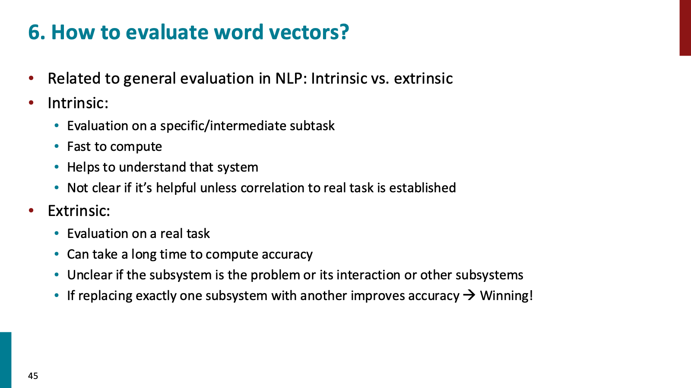
*Slide 38: "6. How to evaluate word vectors?": intrinsic evaluation (a specific subtask, fast, helps understand the system, "Not clear if it's helpful unless correlation to real task is established") versus extrinsic evaluation (a real task, slow, "Unclear if the subsystem is the problem", "If replacing exactly one subsystem with another improves accuracy → Winning!").*

Slide 38 sets out the two ways to grade a set of word vectors, and the distinction runs through the rest of the course.

**Intrinsic evaluation** tests the vectors on "a specific/intermediate subtask": analogies, or similarity judgements. It is "Fast to compute" and "Helps to understand that system". Its weakness is in its last bullet: "Not clear if it's helpful unless correlation to real task is established". A great analogy score is only worth something if it predicts good performance on something you care about.

**Extrinsic evaluation** tests the vectors inside "a real task", such as finding names in text or answering questions. It is the score that matters, but it "Can take a long time to compute accuracy", and when it goes wrong it is "Unclear if the subsystem is the problem or its interaction or other subsystems". The clean experiment is the slide's last line: "If replacing exactly one subsystem with another improves accuracy → Winning!"

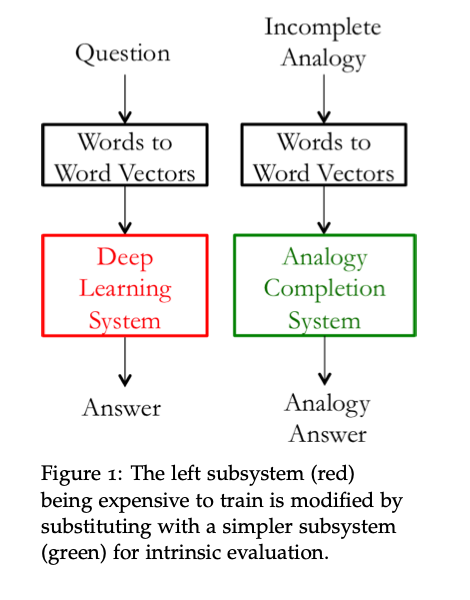
*Notes 2, Figure 1: a question-answering pipeline (words → word vectors → deep learning system → answer) beside an analogy pipeline (words → word vectors → analogy completion → analogy answer). The expensive red subsystem is swapped for a simple green one for intrinsic evaluation.*

Notes 2 §2.1 gives the engineering reason for intrinsic tests. Say the end goal is a question-answering system built on word vectors, and you want to tune the vectors' hyperparameters (dimension, window size and so on). Retraining the whole system for every setting "is impractical". So you swap the expensive downstream system for a cheap stand-in, like analogy completion, and tune against that. The catch is the one slide 38 named: "a requirement is that the intrinsic evaluation has a positive correlation with the final task performance."

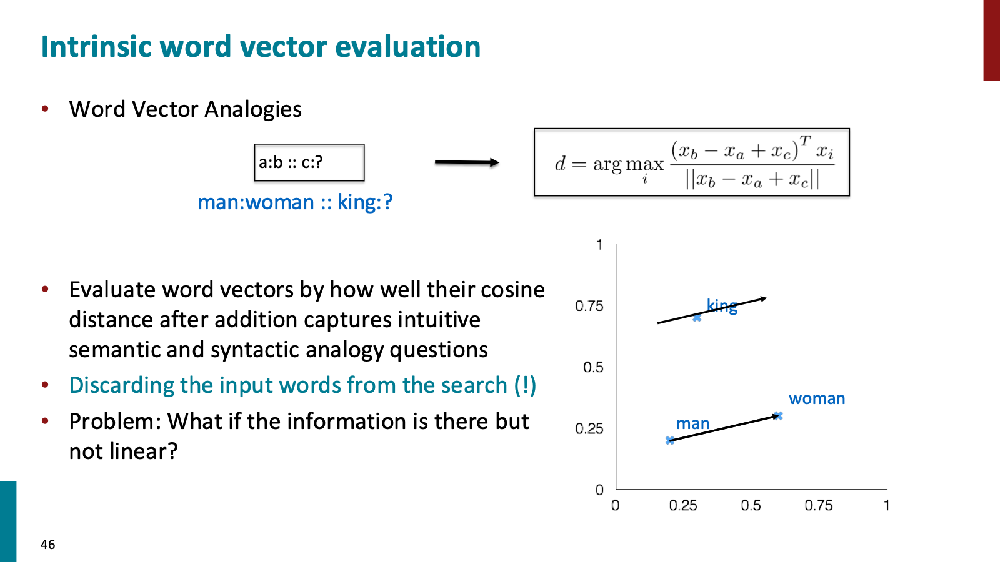
*Slide 39: "Intrinsic word vector evaluation": word vector analogies a:b :: c:?, solved by d = argmax_i (x_b − x_a + x_c)ᵀx_i / ‖x_b − x_a + x_c‖; "man:woman :: king:?" plotted as two parallel arrows; "Discarding the input words from the search (!)"; "Problem: What if the information is there but not linear?"*

The best-known intrinsic test is the **analogy**. Given a:b :: c:?, compute x_b − x_a + x_c and find the word whose vector is closest by cosine:

d = argmax_i (x_b − x_a + x_c)ᵀx_i / ‖x_b − x_a + x_c‖

For man:woman :: king:?, the arrow from man to woman, added at king, should land near queen. The plot shows the two arrows running parallel. Notes 2 §2.3 states the ideal: x_b − x_a = x_d − x_c, "For instance, queen – king = actress – actor". This is GloVe's "meaning components in vector differences" from section 8, turned into a test. Lecture 1's Assignment 1 had you try it (ch01:C50).

Three details on the slide repay attention.

- **The formula is only a cosine if the vectors have unit length.** The denominator divides by the length of x_b − x_a + x_c but not by the length of x_i. Implementations normalise every word vector first, which is what makes this a cosine, as the slide says. (That's our note, not the slide's.)
- **"Discarding the input words from the search (!)"** The exclamation mark is earned. Without this rule, the nearest vector to king − man + woman is very often king itself, because the offset is small and king starts right there. The standard test quietly excludes a, b and c from the candidates. That makes analogy scores look better than the raw geometry is, and it can make biased "results" look stronger than they are. Assignment 1 met the same caveat (ch01:C50).
- **"Problem: What if the information is there but not linear?"** The analogy test only rewards relations stored as straight-line offsets. Vectors could encode a relation perfectly well in a curved way and score zero.

> **Note:** The fine print matters. Nissim, van Noord and van der Goot (2020) titled their paper ["Fair Is Better than Sensational: Man Is to Doctor as Woman Is to Doctor"](https://aclanthology.org/2020.cl-2.7/). In their experiment with the GoogleNews word2vec vectors (using the standard 3COSADD and 3COSMUL solvers), man : doctor :: woman : ? returns "gynecologist" under the usual rule; allowed to return the input words, it returns "doctor". They argue the rule "exacerbated some possibly non-existing biases and perhaps hidden others". Bias in word vectors is real (Lecture 1, ch01:C51), and the authors say so; measuring it through analogies takes care.

Notes 2 §2.3 adds two caveats about the *data* rather than the vectors. **Ambiguous names**: in "City 1 : State containing City 1 :: City 2 : ?", "there are at least 10 places in the US called Phoenix", so Arizona need not be the only right answer. **Time**: "prior to 1997 the capital of Kazakhstan was Almaty", so a dated corpus will "fail" a capital-city question that it actually answers correctly for its time. Analogies can test syntax too: superlatives (bad : worst :: big : biggest) and past tense (dancing : danced :: flying : flew).

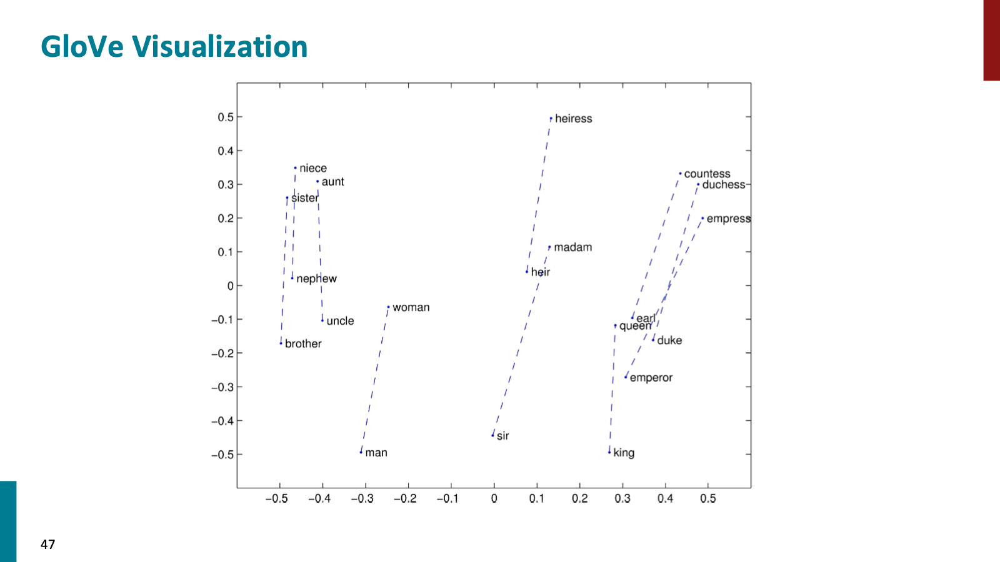
*Slide 40: "GloVe Visualization": pairs of words joined by dashed lines in a 2-D projection: man–woman, king–queen, sir–madam, heir–heiress, uncle–aunt, brother–sister, nephew–niece, earl–countess, duke–duchess, emperor–empress.*

Slide 40 is the picture that sold a generation on word vectors. In GloVe's space, ten male–female pairs are joined by nearly parallel dashed lines: one direction for "female version of", shared by kings, uncles, dukes and heirs alike.

Two warnings go with it. The plot is a 2-D projection of vectors with hundreds of dimensions, chosen to show this relation; notes 2 §2.3 warns that in such projections "a significant portion of spatial information is lost". And the same notes give a nice example of why one projection can't show everything: "nokia" might be close to "samsung" in one dimension (both electronics companies) and close to "finland" in another (Nokia is Finnish).

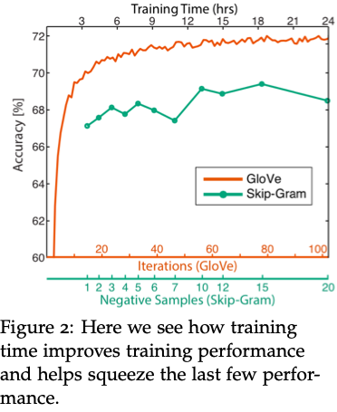
*Notes 2, Figure 2: analogy accuracy against training time, for GloVe (by iterations) and skip-gram (by negative samples).*

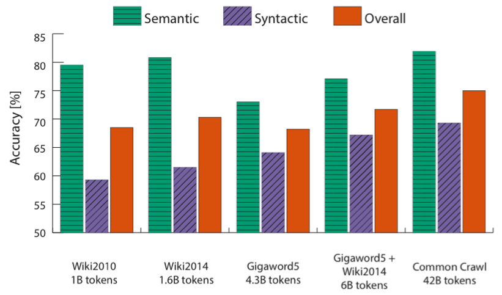
*Notes 2, Figure 3: semantic, syntactic and overall analogy accuracy for five training corpora, from Wiki2010 (1B tokens) to Common Crawl (42B tokens).*

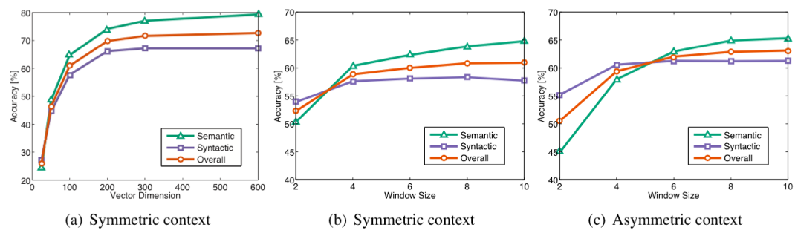
*Notes 2, Figure 4: GloVe accuracy against (a) vector dimension and (b) window size with a symmetric context, and (c) window size with an asymmetric context.*

Analogies are cheap, so they are good for tuning **hyperparameters**: "Dimension of word vectors", "Corpus size", "Corpus souce/type", "Context window size", "Context symmetry" (notes 2 §2.4). Its comparison table (Table 5) and plots give three lessons:

- "Performance is heavily dependent on the model used for word embedding." In Table 5, plain SVD on 6B tokens scores 7.3% overall; GloVe on 42B tokens scores 75.0%.
- "Performance increases with larger corpus sizes", but Figure 3 adds that the source matters too: Wikipedia (1.6B tokens) beats newswire Gigaword (4.3B) on semantic questions despite being smaller.
- "Performance is lower for extremely low dimensional word vectors." Figure 4(a) shows accuracy climbing steeply up to about 300 dimensions and then flattening. In Figure 4(b) and (c), wider windows help semantic analogies, while syntactic accuracy peaks with smaller windows.

The notes illustrate too few dimensions with a toy: to encode "king", "queen", "man" and "woman" as 2-bit vectors you need two bits, "gender" and "leadership". Their margin adds that very high dimensions might be expected to overfit, "but Yin et al. show in On the Dimensionality of Word Embedding that skip-gram and GloVe are robust to this over-fitting". Yin and Shen's [paper](https://arxiv.org/abs/1812.04224) (NeurIPS 2018) is one of the lecture's additional readings. And a practical tip: "A window size of 8 around each center word typically works well for GloVe embeddings".

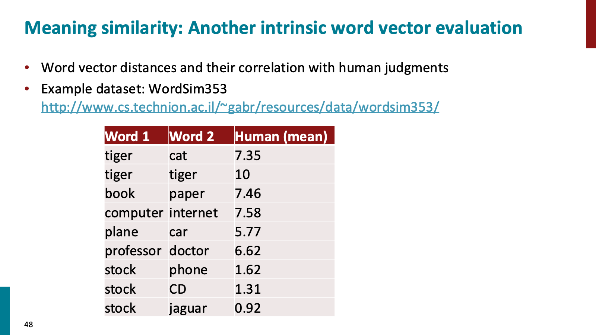
*Slide 41: "Meaning similarity: Another intrinsic word vector evaluation": "Word vector distances and their correlation with human judgments", with sample pairs from WordSim353 and their mean human scores.*

The second intrinsic test asks people. Show them word pairs, have them rate similarity "on a fixed scale (say 0-10)" (notes 2 §2.5), and check whether the vectors' cosine similarities rank the pairs the same way. Slide 41's sample from **WordSim353**: tiger–cat 7.35, tiger–tiger 10, book–paper 7.46, computer–internet 7.58, plane–car 5.77, professor–doctor 6.62, stock–phone 1.62, stock–CD 1.31, stock–jaguar 0.92.

> **Note:** Look at computer–internet (7.58) beating tiger–cat (7.35). A computer is not *similar* to the internet in the way a tiger is similar to a cat; the two are *related*. WordSim353 mixes the two notions, and so do distributional vectors, since related words share contexts too. [SimLex-999](https://aclanthology.org/J15-4004/) (Hill, Reichart and Korhonen, 2015) was built to separate them: in its terms, cup and mug are *similar*, while coffee and cup are only *associated*. And "stock–jaguar" at 0.92 is a good reminder that a jaguar is also a car, and that stock car racing exists: a low score for a pair that, in one reading, is related.

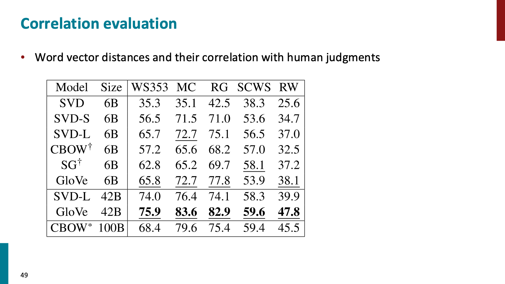
*Slide 42: "Correlation evaluation": a table of models (SVD, SVD-S, SVD-L, CBOW, SG, GloVe) by corpus size, scored on five similarity datasets: WS353, MC, RG, SCWS, RW.*

Slide 42's table is Table 3 of the GloVe paper, whose caption says what the numbers are: Spearman rank correlations between the vectors' similarities and human scores, on five datasets. (SCWS is Huang et al.'s dataset of words in context; RW is rare words.) GloVe on 42B tokens has the highest score in every column: 75.9, 83.6, 82.9, 59.6 and 47.8, ahead even of CBOW trained on the largest corpus in the table, 100B tokens. Notice too how much the hacks of section 7 matter even before GloVe: plain SVD on 6B tokens scores 35.3 on WS353, while SVD-L, the variant with log-scaled counts, scores 65.7.

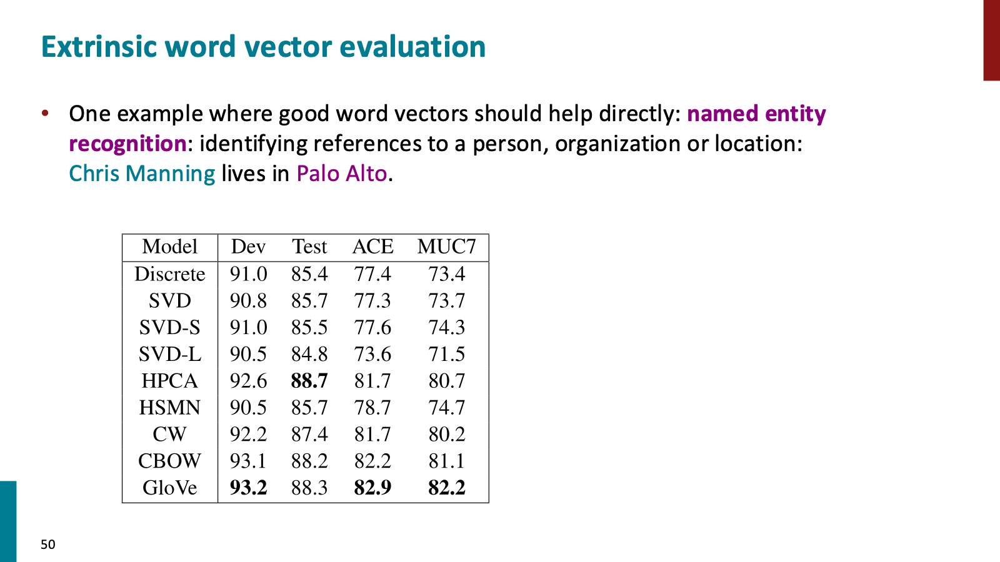
*Slide 43: "Extrinsic word vector evaluation": named entity recognition, "identifying references to a person, organization or location: Chris Manning lives in Palo Alto", with a table of F1 scores for different word vectors.*

The extrinsic example is **named entity recognition** (NER): "identifying references to a person, organization or location". In the slide's example, "Chris Manning lives in Palo Alto", the first two words are a person and the last two a location; the colours on the slide mark them. NER is a task where "good word vectors should help directly": if *Palo Alto* is near other place names in vector space, a tagger can generalise from places it has seen to ones it hasn't.

The table is GloVe's Table 4: F1 scores (the harmonic mean of precision and recall) for an NER system using different 50-dimensional vectors, on a development set, a test set, and two other datasets (ACE and MUC7). GloVe is best on three of the four columns (93.2, 82.9, 82.2); a method called HPCA has the best test score, 88.7. The "Discrete" row, a system without word vectors, trails on every column (91.0, 85.4, 77.4, 73.4). Vectors help, and the margin is largest on the datasets that differ most from the training data, which is exactly where generalisation matters.

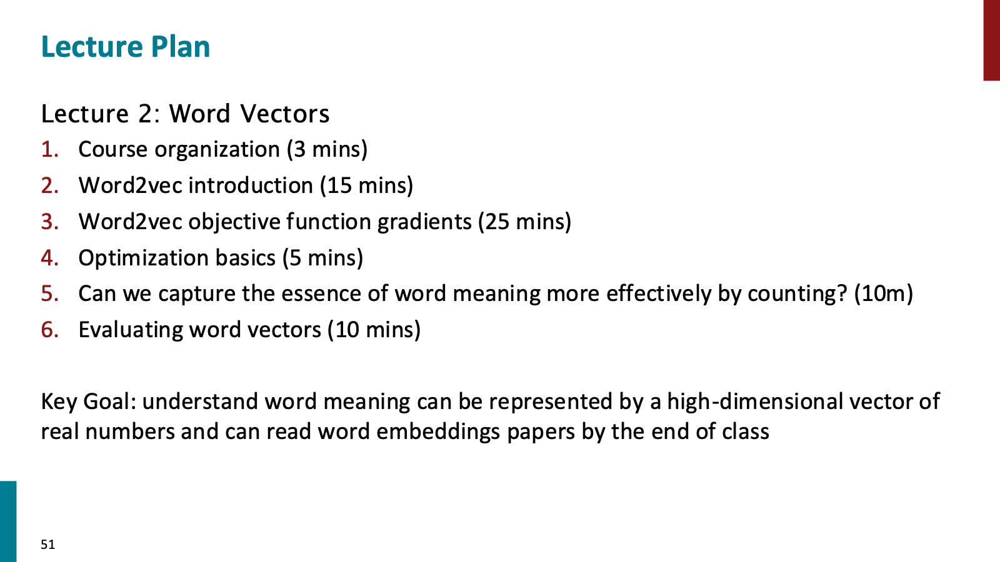
*Slide 44: the lecture plan again, now covered: course organisation, word2vec introduction, objective function gradients, optimisation basics, counting, and evaluating word vectors.*

The deck ends where it began, with slide 2's plan, every item now done. Check the key goal against it: "understand word meaning can be represented by a high-dimensional vector of real numbers and can read word embeddings papers by the end of class". Open the GloVe paper, or the negative-sampling paper: every term in their first two pages (skip-gram, negative sampling, co-occurrence matrix, log-bilinear, analogy task, WordSim353) is now one you have met.

Notes 2 §2.6 adds a "further reading" that answers the type/token puzzle from section 2: what about words with several meanings? Its example is "run", "both a noun and a verb". [Huang, Socher, Manning and Ng (2012)](https://aclanthology.org/P12-1092/) give each word several vectors, one per sense, called **multiple word prototypes**. Gather a window around every occurrence of the word ("5 before and 5 after"), represent each window by an idf-weighted average of its words' vectors, cluster the windows with spherical k-means, relabel each occurrence by its cluster, and train one vector per cluster. *Bank* the river and *bank* the lender become two words. Lecture 1's Assignment 1 found the problem (ch01:C49); this is one fix. (A later fix, contextual word vectors that change with every sentence, is where this course is heading.)

**So far, and next.** Intrinsic tests (analogies, similarity scores) are fast and good for tuning; extrinsic tests (NER and other real tasks) are the ones that count; and an intrinsic score is only a useful stand-in when it correlates with the real task. The slides stop here, but notes 2 goes one step further: once you have vectors, how do you actually use them to *do* a task? The answer leads straight into Lecture 3.

## 10. From vectors to tasks (notes 2 §3)

This last section has no slides; it is the end of notes 2, "Training for Extrinsic Tasks", and it is the bridge to Lecture 3. The question: once you have word vectors, how do you use them for a real task?

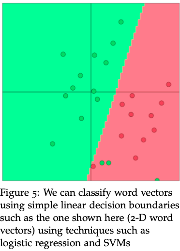
*Notes 2, Figure 5: 2-D word vectors in two classes, green and red, separated by a straight decision boundary.*

First, notice that "Most NLP extrinsic tasks can be formulated as classification tasks" (notes 2 §3.1). Sentiment is classifying a sentence as positive, negative or neutral. NER is classifying each word: "Jim bought 300 shares of Acme Corp. in 2006" becomes "[Jim]Person bought 300 shares of [Acme Corp.]Organization in [2006]Time." The training data is pairs {x^(i), y^(i)}, i = 1 … N, where x^(i) is "a d-dimensional word vector" and y^(i) is "a C-dimensional one-hot vector" marking the right label. Figure 5 shows the simplest case, word vectors split by a straight line, the kind of boundary that logistic regression or an SVM draws.

The model is a **softmax classifier** (notes 2 §3.3), the same softmax as section 3, now over C classes instead of the vocabulary:

p(y_j = 1 | x) = exp(W_j·x) / Σ_{c=1}^{C} exp(W_c·x)

It is trained with the **cross-entropy loss**, −Σ_j y_j log p(y_j = 1 | x). Because y is one-hot, the sum has a single nonzero term, so the loss is just −log of the probability given to the correct class k. Over the training set it is −Σ_i log p(y_{k(i)} = 1 | x^(i)). If that looks familiar, it should: word2vec's skip-gram loss is the same thing, a softmax classifier whose "classes" are the words of the vocabulary.

Then comes the twist that is particular to NLP: "we introduce the idea of retraining the input word vectors when we train for extrinsic tasks" (notes 2 §3.1). The vectors you start from were "initialized by optimizing them over a simpler intrinsic task". Should you keep adjusting them while training the classifier?

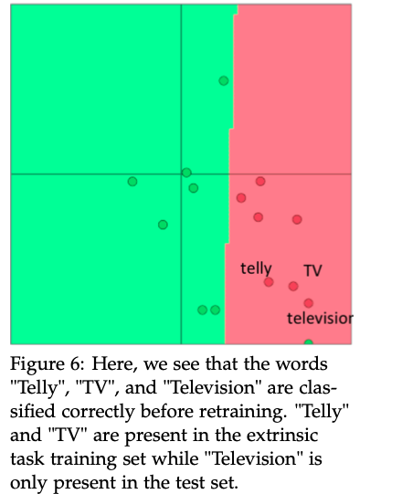
*Notes 2, Figure 6, with its printed caption: "Telly", "TV" and "Television" sit together and are classified correctly before retraining. "Telly" and "TV" are in the task's training set; "Television" appears only at test time. (The label "television" is already clipped at the plot's edge in the notes PDF.)*


*Notes 2, Figure 7: after retraining, "Telly" and "TV" have moved and are still classified correctly, but "Television", which never appeared in training, is left on the wrong side of the new boundary.*

**Retraining word vectors** "can be risky". Figures 6 and 7 tell the story. Pretrained vectors put *telly*, *TV* and *television* close together, and all three are classified correctly. Now train on a small dataset that contains only "Telly" and "TV". Retraining moves those two vectors, and the decision boundary moves with them, but nothing moves *television*, which the training set never mentioned. It is stranded on the wrong side. The rule (notes 2 §3.2): "word vectors should not be retrained if the training data set is small. If the training set is large, retraining may improve performance."

> **Note:** This is the first appearance of a dilemma that dominates the second half of this course, under the name fine-tuning. Pretrained knowledge generalises because similar things sit together; task training can break that for the parts of the space the task data never touches. Lectures 7 to 9 (pretraining, post-training and efficient adaptation) are, in a sense, a long answer to the telly problem.

How big is the risk? Count the parameters (notes 2 §3.3). The classifier's weights W number C·d. Retrain every word vector too and you add |V|·d more, "as many as C·d + |V|·d" in total, for what is still "a simple linear classifier". With C = 4 classes, d = 300 and |V| = 400,000, that is 1,200 weights plus 120 million word-vector numbers. Such a model "is highly prone to overfitting".

The standard defence is **regularization**: add a penalty λ Σ_k θ_k² to the loss, which "poses the Bayesian belief that the parameters (θ) should be small is magnitude (i.e. close to zero)" (notes 2 §3.3). The penalty stops parameters "taking on extremely large values just to fit the training set well" and "may improve generalization if the relative objective weight λ is tuned well". The notes add that it "becomes even more of a requirement once we explore more complex models (such as Neural Networks)".


*Notes 2, Figure 8: "… museums in Paris are amazing …", a centre word with a symmetric window of length 2: "Such context may help disambiguate between the place Paris and the name Paris."*

One word is rarely enough to classify. "Natural languages tend to use the same word for very different meanings": "to sanction" can mean "to permit" or "to punish" (notes 2 §3.4). So **window classification** feeds the classifier the centre word *and* its neighbours, by stacking their vectors into one long input:

x_window = [x^(i−2); x^(i−1); x^(i); x^(i+1); x^(i+2)]

With a five-word window the input is 5d-dimensional, so the weight matrix becomes C × 5d instead of C × d. The gradient with respect to x_window comes back as five d-dimensional pieces, δ_window = [∇x^(i−2); …; ∇x^(i+2)], and each piece "will of course need to be distributed to update the corresponding word vectors". (A word that appears twice in a window gets two contributions, summed.) "museums in Paris are amazing" is the notes' example: with the neighbours in view, *Paris* the city and *Paris* the name come apart. The notes repeat the window lesson from section 9: "narrower window sizes lead to better performance in syntactic tests while wider windows lead to better performance in semantic tests."


*Notes 2, Figure 9: red and green points that no straight line can separate; even the best linear boundary misclassifies many of them.*


*Notes 2, Figure 10: the same points with a curved, non-linear boundary that classifies them much better.*

The last figures are the cliffhanger. In Figure 9, no straight line separates red from green: "many examples are wrongly classified even though the best linear decision boundary is chosen". In Figure 10, a curved boundary does far better. "Although oversimplified, this is a classic case demonstrating the need for non-linear decision boundaries" (notes 2 §3.5). A softmax classifier, however many parameters it has, can only draw straight lines (flat hyperplanes, in more dimensions). To draw curves you need **non-linear classifiers**, and the notes end with the promise: "In the next set of notes, we study neural networks as a class of non-linear models". That is Lecture 3.

> **Check your understanding.** A colleague has 2,000 labelled sentences for a sentiment task and proposes fine-tuning all 400,000 pretrained word vectors along with the classifier. What do you tell them? *Answer: with a training set that small, most of the vocabulary never appears in it, so retraining moves only the few words that do and can strand their unseen neighbours (the telly problem). Keep the word vectors fixed, or retrain them only with strong regularization; retraining is worth trying when the training set is large.*

## Across the sections

Lecture 2 answers one question three ways. **What is a word's meaning, to a computer?** Not just a pointer to a thing (the bare symbol–referent pairing gives no graded similarity to compute with), not an entry in a hand-built thesaurus (WordNet can't keep up), and not a one-hot symbol (every word a stranger). It is a dense vector, placed so that words with similar company sit close together.

**How do you get the vectors?** By predicting: word2vec's skip-gram guesses each word's neighbours, using a softmax over dot products, trained by gradient descent (the log-probability gradient for the centre vector is "observed minus expected"; the loss gradient is its negative), made fast by negative sampling. Or by counting: build a co-occurrence matrix, tame its frequencies, and factorise it with SVD. GloVe joins the two by fitting dot products to log counts, which turns ratios of probabilities into differences of vectors. Underneath, the two families are closer than they look: skip-gram with negative sampling implicitly approximates a factorisation of a shifted PMI-like matrix (exactly shifted PMI under unigram noise).

**How do you know they work?** Intrinsically, with analogies and human similarity scores, which are fast and good for tuning but come with fine print. Extrinsically, by plugging the vectors into a real task such as NER and seeing whether it improves.

Lecture 1 told the history of how NLP arrived at learned vectors, and its Assignment 1 had you build count-based vectors with SVD and probe GloVe's analogies and biases. Lecture 2 explains the machinery behind what you did there. Lecture 3 picks up exactly where notes 2 leaves off: the softmax classifier draws straight lines, real problems need curves, and the tool for curves is a neural network trained by backpropagation. Everything it needs is already here: a softmax, a cross-entropy loss, a gradient computed by the chain rule, and stochastic gradient descent to follow it downhill.

## Glossary

- **Analogy evaluation:** an intrinsic test that solves a:b :: c:? by finding the word nearest to x_b − x_a + x_c, excluding the input words.
- **Bag-of-words model:** a model that ignores word order; skip-gram predicts the same distribution for every position in the window.
- **CBOW (continuous bag of words):** the word2vec variant that predicts the centre word from its context words.
- **Co-occurrence matrix:** a word-by-word (or word-by-document) table of how often words appear together.
- **Cross-entropy loss:** −log of the probability a model gives the correct answer, averaged over examples.
- **Denotational semantics:** meaning as the relation between a symbol (signifier) and what it stands for (signified).
- **Distributed representation:** a representation where meaning is spread over many dimensions, each shared by many words; the opposite of localist.
- **Distributional hypothesis / distributional semantics:** a word's meaning can be derived from the contexts it appears in.
- **Extrinsic evaluation:** evaluating word vectors inside a real task, such as NER.
- **GloVe:** Global Vectors; fits word-vector dot products (plus biases) to log co-occurrence counts with a weighted least-squares loss.
- **Gradient descent:** repeatedly step parameters against the gradient of the loss, θ ← θ − α∇J(θ).
- **Intrinsic evaluation:** evaluating word vectors on a quick intermediate task, such as analogies or word similarity.
- **Learning rate (step size), α:** how far each gradient step moves the parameters.
- **Negative sampling:** replacing the full softmax by binary logistic regressions that tell a real (centre, outside) pair from k random noise pairs.
- **One-hot (localist) vector:** a vector with a single 1, one dimension per vocabulary word.
- **Partition function:** the normalising sum in a softmax's denominator.
- **Regularization:** a penalty on parameter size (here λΣθ²) that reduces overfitting.
- **Sigmoid (logistic) function:** σ(x) = 1/(1 + e^{−x}), a two-class softmax.
- **Skip-gram:** the word2vec variant that predicts each context word from the centre word.
- **Softmax:** softmax(xᵢ) = exp(xᵢ)/Σⱼ exp(xⱼ); turns scores into a probability distribution.
- **Stochastic gradient descent (SGD):** gradient descent using the gradient from a sampled window (or mini-batch) instead of the whole corpus.
- **SVD (singular value decomposition):** X = UΣVᵀ; keeping the top k singular values gives the best rank-k approximation of X.
- **Window classification:** classifying a word from the concatenated vectors of the word and its neighbours.
- **Word embedding / word vector:** a dense, real-valued vector representing a word.
- **Word type vs token:** a type is a vocabulary entry; a token is one occurrence of it in text.
- **WordNet:** a hand-built lexical database of synonym sets linked by relations such as "is a".

## Open questions

- **Why 3/4?** Word2vec's negative-sampling distribution and GloVe's weighting function both settled on an exponent of 3/4, by experiment. Is there a reason, or is it a coincidence that happened to work twice?
- **Is the analogy test measuring the vectors or the test?** Excluding the input words, using unit-length vectors and choosing the candidate vocabulary all change the score. How much of the famous linear structure survives a stricter test?
- **One vector per word, or one per sense?** Multiple prototypes split *bank* into two; contextual models give every occurrence its own vector. Is a fixed set of senses even the right way to think about word meaning?
- **When should word vectors be retrained?** Notes 2's rule is "only with a large training set". With today's huge pretrained models the same question returns at a far larger scale.
- **Does a vector learned from text alone capture meaning?** Lecture 1 (via Manning's essay) argued that meaning is a network of connections, some to the world and some to other words. Distributional vectors capture only the second kind. How far can that go?
