# Backpropagation: The Chain Rule, Organised

Lecture 3 of CS224N (Winter 2026) builds the first real neural network of the course and then answers the question every network raises: how do you find the gradient of a loss with respect to millions of parameters at once? The network is small: a window of word vectors in, one hidden layer h = f(Wx + b), a score out, which is enough to find the names of places in a sentence. The answer is **backpropagation**, and the lecture gets there twice. First by hand, with matrix calculus: Jacobians, the chain rule, and one reusable piece called δ. Then by algorithm, on a computation graph, where every node multiplies the gradient arriving from above by its own local derivative and passes the result down. The two turn out to be the same calculation, and the second costs about as much as running the network forward once. That cheapness is what makes training large networks practical. These notes follow the [Winter 2026 slides](materials/cs224n-2026-lecture03-neuralnets.pdf) in order (cited "slide N" by position in the PDF; every slide appears below), with the course notes the syllabus assigns, [notes 3](materials/cs224n-2019-notes03-neuralnets.pdf) (Winter 2019, "Neural Networks, Backpropagation", cited "notes 3 §N"), which add a worked element-by-element derivation and a chapter of training tips, and [Assignment 2](materials/a2.pdf), which the lecture launches. There is no public recording of the Winter 2026 lecture, so everything here comes from these documents and the papers they cite, linked where they first appear. A recorded lecture on this topic: [Spring 2024, Lecture 3, "Backpropagation, Neural Network"](https://www.youtube.com/watch?v=HnliVHU2g9U).

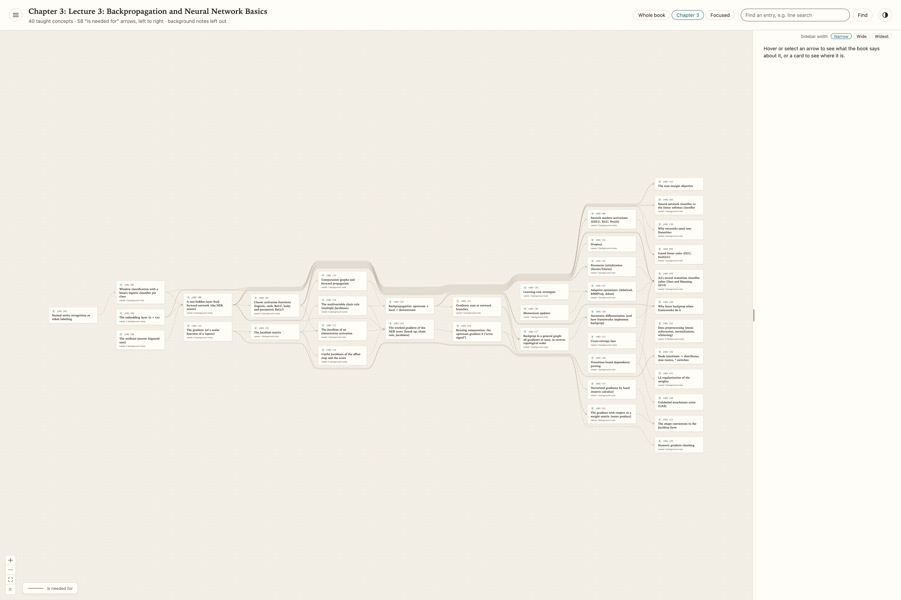
*Lecture 3 in metamatx's chapter view: the lecture's 40 taught concepts as cards, with the 58 "is needed for" arrows between them running left to right. They run from named entity recognition as token labelling on the left, through the Jacobians, the worked gradient and backpropagation's upstream × local rule in the middle, to the training tips, gradient checking and Assignment 2's parser on the right. Background notes are left out. The interactive version of this map is [concept-map.html](concept-map.html).*

## Contents

- [1. The plan: how neural networks learn](#1-the-plan-how-neural-networks-learn)
- [2. Recap: how do we know word vectors are good?](#2-recap-how-do-we-know-word-vectors-are-good)
- [3. A neural network for named entities](#3-a-neural-network-for-named-entities)
- [4. Non-linearities, old and new](#4-non-linearities-old-and-new)
- [5. The loss, and the question of the hour](#5-the-loss-and-the-question-of-the-hour)
- [6. Matrix calculus: gradients, Jacobians and the chain rule](#6-matrix-calculus-gradients-jacobians-and-the-chain-rule)
- [7. The worked gradient: from score to weights](#7-the-worked-gradient-from-score-to-weights)
- [8. Backpropagation: the chain rule as an algorithm](#8-backpropagation-the-chain-rule-as-an-algorithm)
- [9. Backprop in practice: code, checks, and leaks](#9-backprop-in-practice-code-checks-and-leaks)
- [10. Training tips from notes 3](#10-training-tips-from-notes-3)
- [11. Assignment 2: word2vec gradients and a neural dependency parser](#11-assignment-2-word2vec-gradients-and-a-neural-dependency-parser)
- [Across the sections](#across-the-sections)
- [Glossary](#glossary)
- [Open questions](#open-questions)

## 1. The plan: how neural networks learn

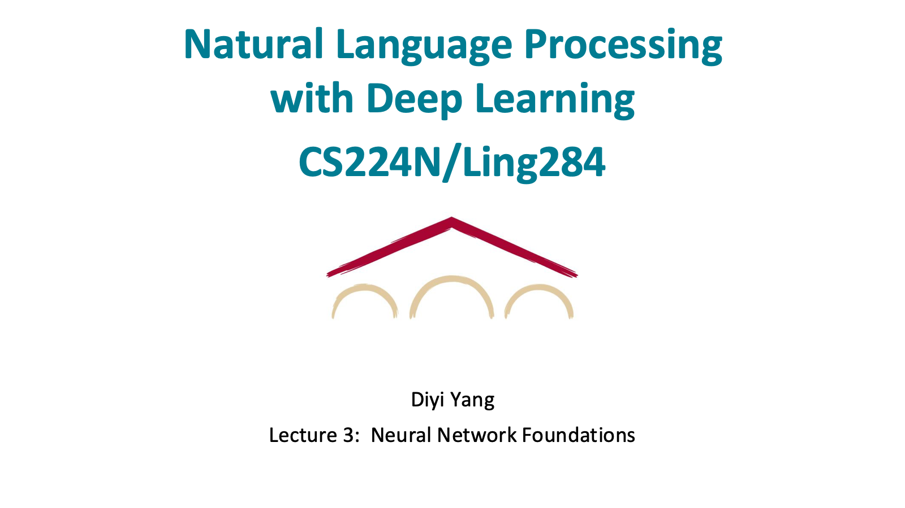
*Slide 1: "Natural Language Processing with Deep Learning, CS224N/Ling284", Diyi Yang, "Lecture 3: Neural Network Foundations".*

Lecture 2 trained word vectors with one loss and one gradient, worked out by hand. Lecture 3 asks what happens when the model is a real neural network, with layers stacked on layers, and the gradient has to be found for millions of numbers at once. The answer is backpropagation. It is the most important algorithm in the course, and it turns out to be the chain rule plus careful bookkeeping.

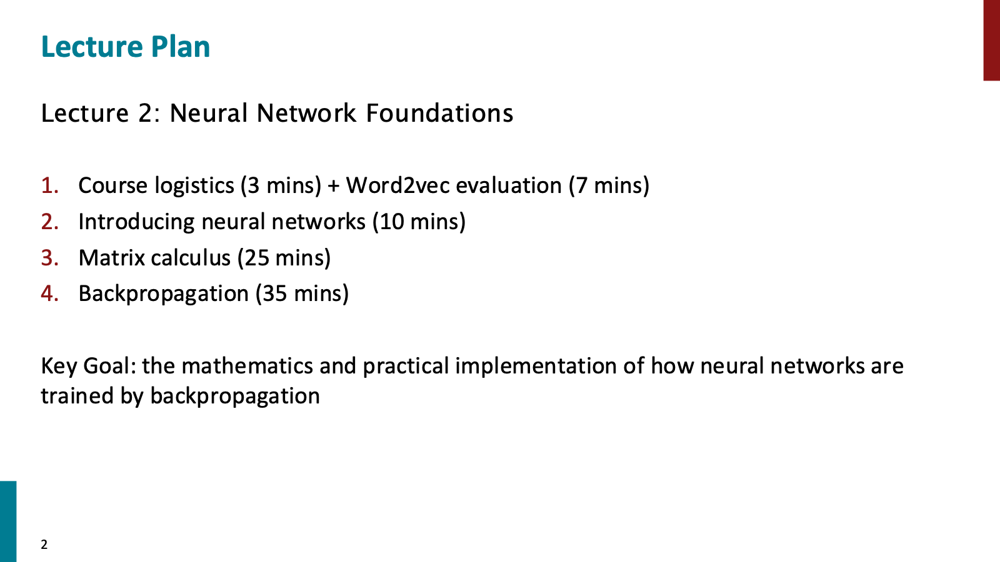
*Slide 2: the plan: logistics and word2vec evaluation (10 mins), introducing neural networks (10 mins), matrix calculus (25 mins), backpropagation (35 mins), and the key goal.*

The plan gives the key goal: "the mathematics and practical implementation of how neural networks are trained by backpropagation". Look at the minutes again: 60 of the 80 go to calculus. (The header reads "Lecture 2: Neural Network Foundations", a typo carried over from the deck's template; this is Lecture 3.)


*Slide 3: "1. Course Logistics": Assignment 2, the PyTorch tutorial on Friday, and the poster session date.*

Slide 3 is honest about the week ahead: "Assignment 2 is all about making sure you really understand the math of neural networks … then we'll let the software do it! It also teaches us about dependency parsing". And, in red: "This will be a tough week for some! → Make sure to get help if you need it". The PyTorch tutorial is on Friday; A2 is due January 22, and Assignment 1 is due today. Section 11 below walks through A2.

**So far, and next.** One goal: learn how a network's gradients are computed, by hand and then by algorithm. First the deck finishes Lecture 2's last topic, evaluating word vectors, before it builds its first neural network.

## 2. Recap: how do we know word vectors are good?

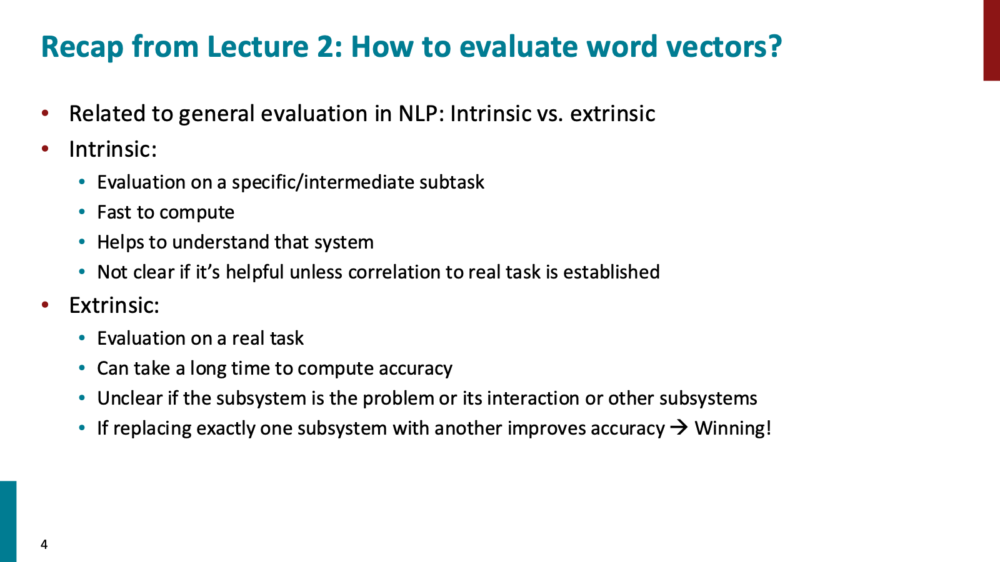
*Slide 4: "Recap from Lecture 2: How to evaluate word vectors?": intrinsic vs extrinsic evaluation.*

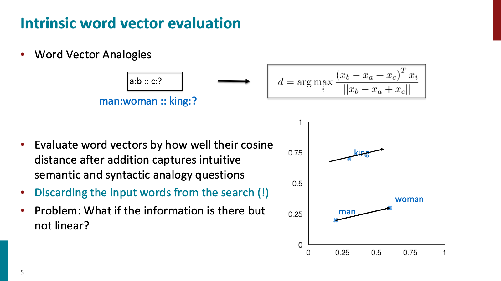
*Slide 5: "Intrinsic word vector evaluation": word vector analogies, a:b :: c:?.*

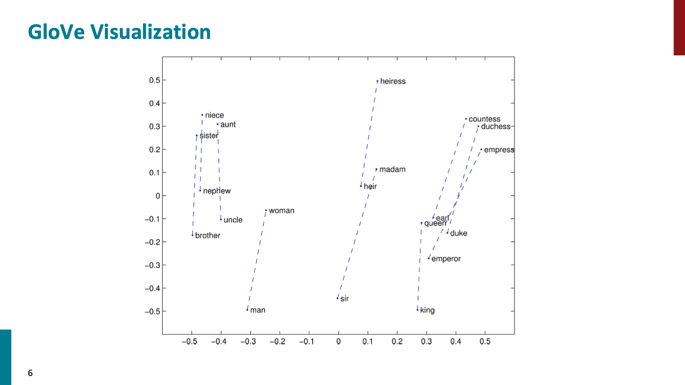
*Slide 6: "GloVe Visualization": parallel gender offsets between word pairs.*

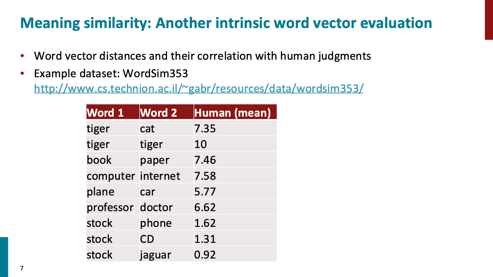
*Slide 7: "Meaning similarity: Another intrinsic word vector evaluation": WordSim353 pairs and their human ratings.*

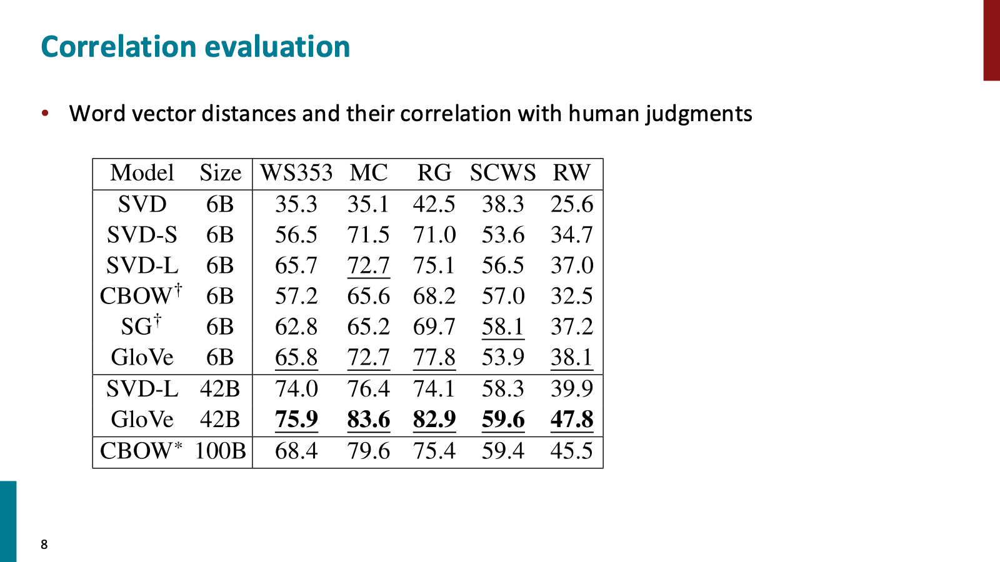
*Slide 8: "Correlation evaluation": correlations with human judgments for several models and corpora.*

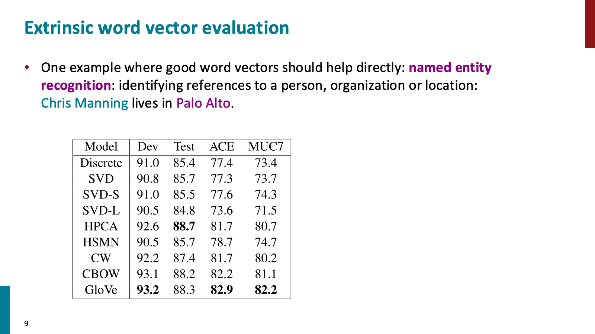
*Slide 9: "Extrinsic word vector evaluation": named entity recognition, "Chris Manning lives in Palo Alto."*

Slides 4–9 repeat Lecture 2's evaluation slides (its slides 38–43), so the lecture starts by finishing the previous one. Lecture 2's notes cover each in detail ([Lecture 2, section 9](../02-word-vectors/README.md#9-how-good-are-the-vectors)). In brief:

- *Intrinsic* tests, like analogies and similarity ratings, are fast and good for tuning.
- *Extrinsic* tests put the vectors inside a real task.
- An intrinsic score only means something if it predicts the extrinsic one.

The last slide's extrinsic task, **named entity recognition**, is exactly where this lecture picks up, because to do NER well you need more than vectors: you need a classifier built on top of them.

**So far, and next.** Word vectors are inputs, not answers. The next step builds a neural network that reads them and makes a decision: is "Paris" a location?

## 3. A neural network for named entities

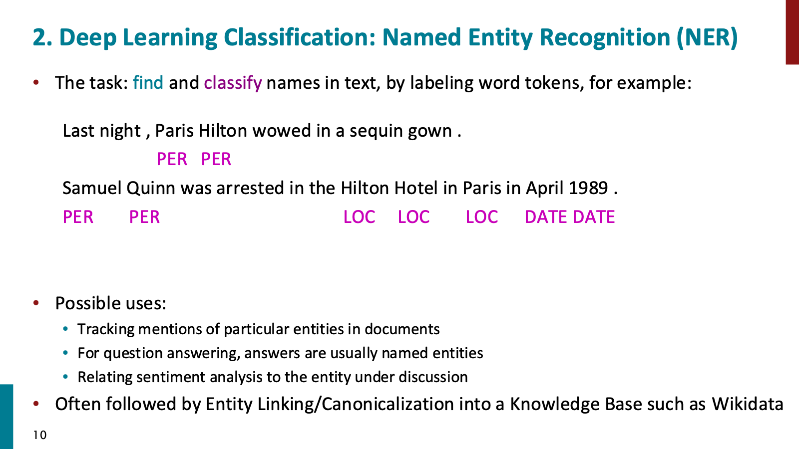
*Slide 10: "2. Deep Learning Classification: Named Entity Recognition (NER)": two labelled sentences and the task's uses.*

**Named entity recognition** is the task "find and classify names in text, by labeling word tokens". Slide 10's examples are chosen to be awkward. In "Last night , Paris Hilton wowed in a sequin gown .", *Paris Hilton* is a person (PER PER). In "Samuel Quinn was arrested in the Hilton Hotel in Paris in April 1989 .", *Samuel Quinn* is a person, *Hilton Hotel* and *Paris* are locations, and *April 1989* is a date. "Paris" and "Hilton" each change type with their neighbours, which is why a word's vector alone is not enough.

The uses on the slide are the everyday ones: tracking mentions of entities in documents; question answering, where "answers are usually named entities"; relating sentiment to the entity under discussion; and linking each mention to an entry in a knowledge base such as Wikidata.

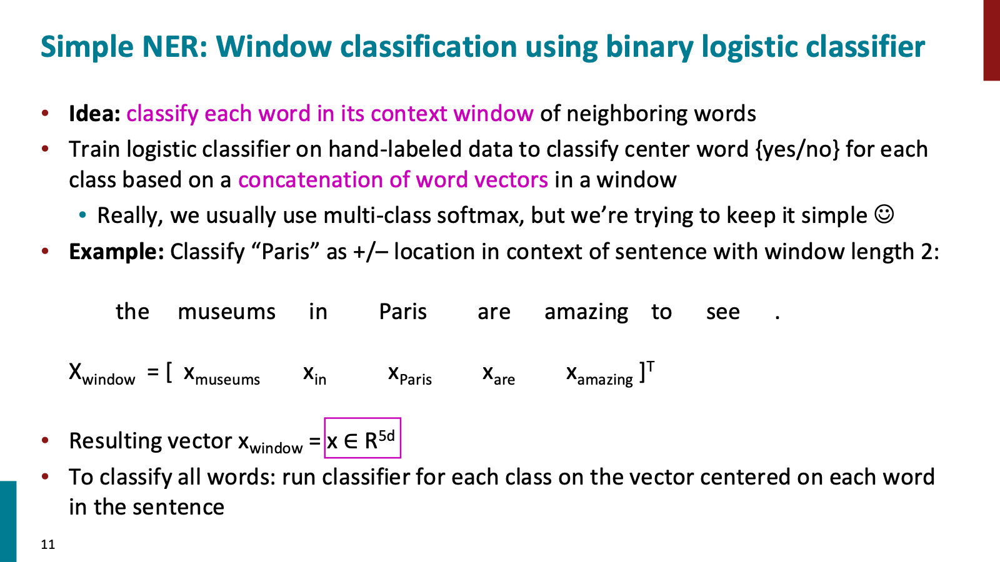
*Slide 11: "Simple NER: Window classification using binary logistic classifier": classify "Paris" from the window "museums in Paris are amazing", x_window ∈ ℝ^{5d}.*

The simplest approach is to "classify each word in its context window of neighboring words". Take the five words around "Paris" in "the museums in Paris are amazing to see .", stack their vectors into one long vector, x_window = [x_museums, x_in, x_Paris, x_are, x_amazing] ∈ ℝ^{5d}, and train a yes/no "is this a location?" classifier on it, one classifier per entity class. "Really, we usually use multi-class softmax, but we're trying to keep it simple ☺". Lecture 2's notes met the softmax version of the same idea ([Lecture 2, section 10](../02-word-vectors/README.md#10-from-vectors-to-tasks-notes-2-3)).

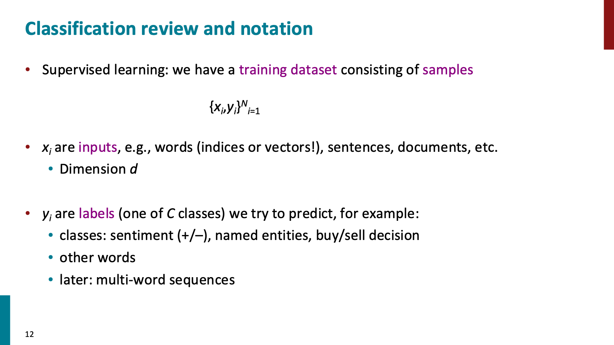
*Slide 12: "Classification review and notation": training data {x_i, y_i}, inputs of dimension d, labels from C classes.*

Slide 12 fixes the notation: training data {x_i, y_i}, i = 1 … N, with inputs x_i ("words (indices or vectors!), sentences, documents, etc.") and labels y_i, one of C classes, such as sentiment, named entities, buy/sell decisions, "other words" and, "later: multi-word sequences".

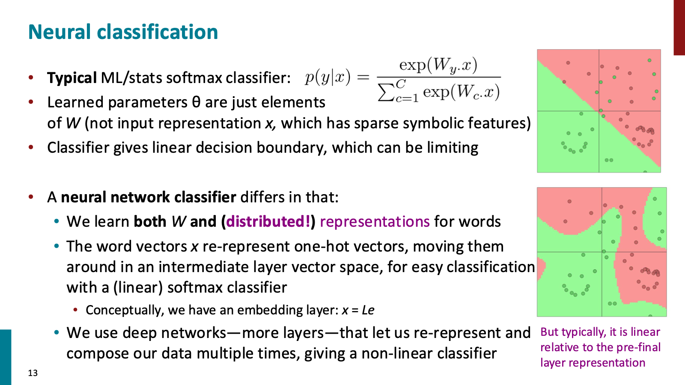
*Slide 13: "Neural classification": a typical softmax classifier with a linear boundary vs a neural network classifier with a non-linear one.*

Slide 13 is the turning point of the lecture's first half. A "Typical ML/stats softmax classifier", p(y | x) = exp(W_y·x) / Σ_c exp(W_c·x), learns only W. Its input x is fixed, "sparse symbolic features", and it "gives linear decision boundary, which can be limiting" (the top picture). A **neural network classifier** "differs in that":

- "We learn both W and (distributed!) representations for words." The word vectors themselves move during training.
- "The word vectors x re-represent one-hot vectors, moving them around in an intermediate layer vector space, for easy classification with a (linear) softmax classifier".
- "We use deep networks—more layers—that let us re-represent and compose our data multiple times, giving a non-linear classifier" (the bottom picture).

The magenta footnote is the key insight: "But typically, it is linear relative to the pre-final layer representation". The last layer is still a plain linear classifier. The layers before it learn to bend the space so that a straight line suffices.

The slide also names the **embedding layer**: "Conceptually, we have an embedding layer: x = Le". Here e is a word's one-hot vector (Lecture 2, section 2) and L is a matrix whose columns are word vectors. Multiplying by a one-hot vector just picks out one column, so "looking up a word's vector" and "multiplying by an embedding matrix" are the same operation. That is why word vectors can be trained by gradient descent like any other weights.

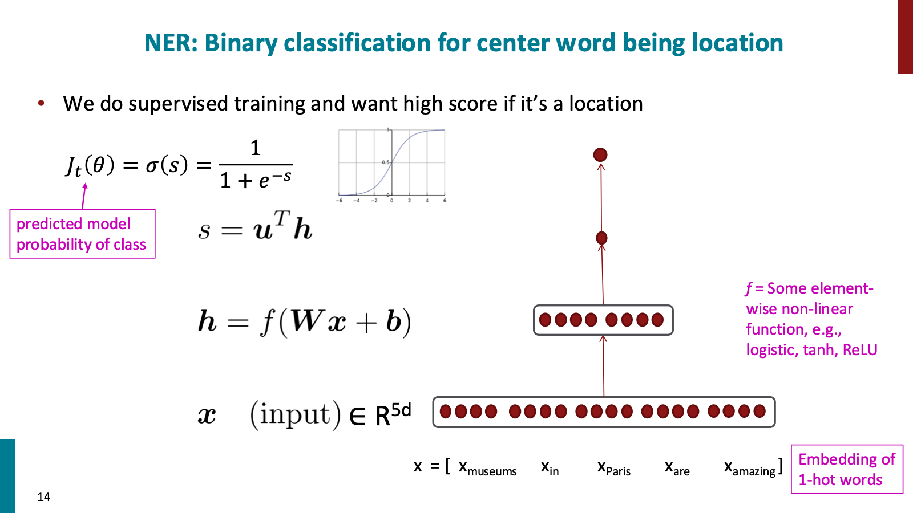
*Slide 14: "NER: Binary classification for center word being location": x (input) ∈ ℝ^{5d}, h = f(Wx + b), s = uᵀh, J_t(θ) = σ(s).*

Slide 14 is the network the rest of the lecture differentiates, so learn its four lines:

- x (input) ∈ ℝ^{5d}, the concatenated window, an "Embedding of 1-hot words";
- h = f(Wx + b), a hidden layer, where "f = Some element-wise non-linear function, e.g., logistic, tanh, ReLU";
- s = uᵀh, a single score;
- J_t(θ) = σ(s) = 1/(1 + e^{−s}), the "predicted model probability of class".

"We do supervised training and want high score if it's a location".

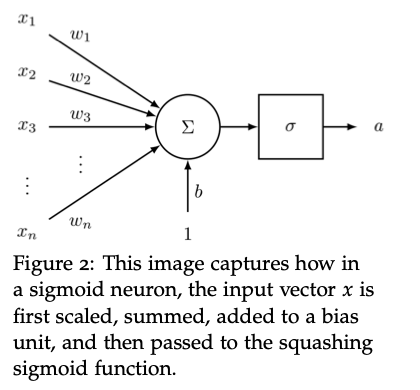
*Notes 3, Figure 2: a sigmoid neuron: inputs x₁…x_n scaled by weights w₁…w_n, summed with a bias b, and squashed by σ.*

The course notes for this lecture (notes 3, Winter 2019, "Neural Networks, Backpropagation") build the same network from its smallest part. An **artificial neuron** is "a generic computational unit that takes n inputs and produces a single output". The sigmoid version computes a = 1/(1 + exp(−(wᵀx + b))): weight the inputs, add a bias, squash (Figure 2). The notes add a caution worth repeating: neural networks are "biologically inspired", but "it is usually better to not draw too many parallels between the two".

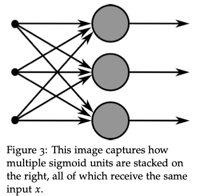
*Notes 3, Figure 3: several sigmoid units stacked, all receiving the same input x.*

Stack m neurons, all reading the same input, and you get a layer: z = Wx + b, a = σ(z), with W ∈ ℝ^{m×n} (notes 3 §1.2). Feed the layer's activations into one more weighted sum and you get slide 14's score. Why bother with the middle layer? The notes give the reason with the same sentence: "maybe it should matter that 'Museums' is the first word only if 'in' is the second word. Such non-linear decisions can often not be captured by inputs fed directly to a Softmax function" (notes 3 §1.3). The hidden units can learn conjunctions like that; a linear classifier cannot.

> **Worked example (notes 3 §1.3).** With 4-dimensional word vectors and a 5-word window, x ∈ ℝ^20. With 8 hidden units: W ∈ ℝ^{8×20}, b ∈ ℝ^8, U ∈ ℝ^{8×1}, and the score s is a single number. That is 160 + 8 + 8 = 176 parameters, plus the word vectors themselves if we train those too. Get in the habit of writing these shapes down; slide 36 will ask you to.

> **Note:** The notes write the layer's activations as 1/(1 + exp(w⁽ⁱ⁾ᵀx + b_i)), dropping the minus sign their own §1.1 uses. Read every exp there as exp(−·).

**So far, and next.** A window of word vectors goes in, a hidden layer applies f(Wx + b), and a score comes out. The f is doing all the interesting work, so the deck now asks which f to use, and why there has to be one at all.

## 4. Non-linearities, old and new

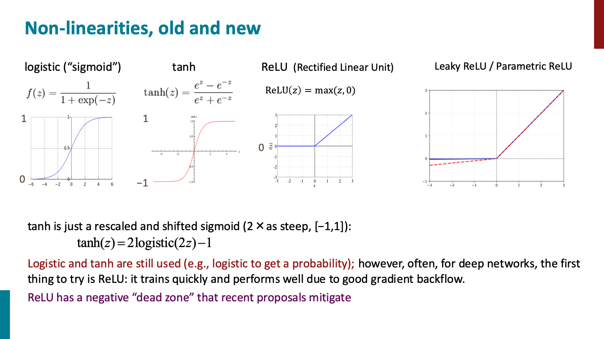
*Slide 15: "Non-linearities, old and new": logistic ("sigmoid"), tanh, ReLU and Leaky/Parametric ReLU, each plotted.*

Slide 15 shows the classic **activation functions**: the logistic ("sigmoid"), 1/(1 + exp(−z)), from 0 to 1; tanh, from −1 to 1; ReLU(z) = max(z, 0); and Leaky / Parametric ReLU, which give the negative side a small slope instead of zero.

Two facts on the slide are worth memorising:

- "tanh is just a rescaled and shifted sigmoid (2 × as steep, [−1,1]): tanh(z) = 2logistic(2z) − 1".
- "Logistic and tanh are still used (e.g., logistic to get a probability); however, often, for deep networks, the first thing to try is ReLU: it trains quickly and performs well due to good gradient backflow."

"Good gradient backflow" is a phrase to remember for later. A sigmoid's slope is at most 1/4 and nearly zero at both ends, so gradients passing back through many sigmoids shrink. ReLU's slope is exactly 1 for every positive input. The flip side, in purple: "ReLU has a negative 'dead zone' that recent proposals mitigate". A ReLU unit whose input is always negative outputs 0 and gets zero gradient, so it never recovers. Leaky ReLU fixes a small negative slope; Parametric ReLU (PReLU, from He, Zhang, Ren and Sun's [Delving Deep into Rectifiers](https://arxiv.org/abs/1502.01852v1), arXiv v1, February 2015; ICCV 2015) learns that slope as a parameter.

> **Note:** Notes 3 §2.4 lists each function with its derivative, which you will need for A2: σ′(z) = σ(z)(1 − σ(z)); tanh′(z) = 1 − tanh²(z); ReLU′ is 1 for z > 0 and 0 for z < 0; leaky′ is 1 for z > 0 and k for z < 0. At the kink (z = 0) the derivative is undefined, and code just picks a value. The notes also list two relatives of tanh. **Hard tanh** clips its input, "computationally cheaper" than tanh: hardtanh(z) = −1 for z < −1, z for −1 ≤ z ≤ 1, and 1 for z > 1. Its derivative is 1 for |z| < 1 and 0 for |z| > 1, and undefined at ±1. **Soft sign**, softsign(z) = z/(1 + |z|), also runs from −1 to 1, and the notes offer it because "it too does not saturate as easily as hard clipped functions". Their soft-sign derivative is misprinted; the correct one is 1/(1 + |z|)².

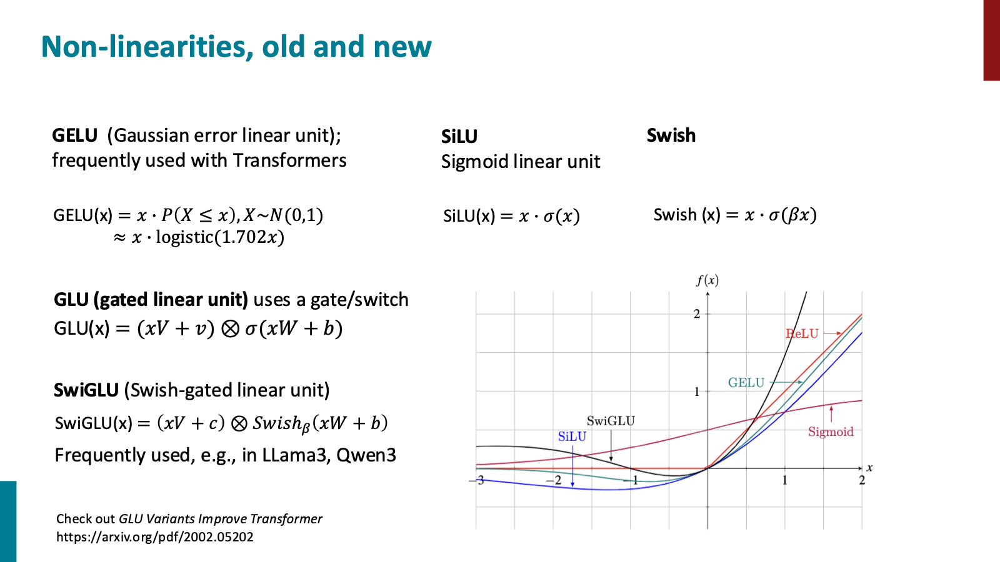
*Slide 16: GELU, SiLU, Swish, GLU and SwiGLU, with their formulas and a plot comparing them to ReLU and the sigmoid.*

Slide 16 is the modern zoo, and the line that matters is the last one: these are what current models actually use.

- **GELU** (Gaussian error linear unit), GELU(x) = x · P(X ≤ x) with X ~ N(0,1), "≈ x · logistic(1.702x)", "frequently used with Transformers". It weights x by the probability that a standard normal variable is below it: big positive inputs pass almost unchanged, big negative ones are almost zeroed.
- **SiLU** (sigmoid linear unit), x · σ(x), and **Swish**, x · σ(βx). These are the same shape, with Swish adding a tunable steepness β.
- **GLU** (gated linear unit) "uses a gate/switch": GLU(x) = (xV + v) ⊗ σ(xW + b). One linear projection of the input is multiplied element-wise by a sigmoid "gate" computed from another projection.
- **SwiGLU**, the same with a Swish gate, "Frequently used, e.g., in LLama3, Qwen3".

In the plot, every modern curve looks like a smoothed ReLU with a small dip below zero.

> **Note:** The slide sends you to Noam Shazeer's ["GLU Variants Improve Transformer"](https://arxiv.org/abs/2002.05202v1) (arXiv v1, February 2020), a five-page paper that tested these variants inside the Transformer's feed-forward layers and found the gated ones better. Its conclusion is a field favourite: "We offer no explanation as to why these architectures seem to work; we attribute their success, as all else, to divine benevolence." Swish has a similar origin story: Ramachandran, Zoph and Le's [Searching for Activation Functions](https://arxiv.org/abs/1710.05941v2) (arXiv v2, October 2017) found it with "a combination of exhaustive and reinforcement learning-based search" over candidate functions. Some of the most-used pieces of modern networks were found by trying things, not by theory.

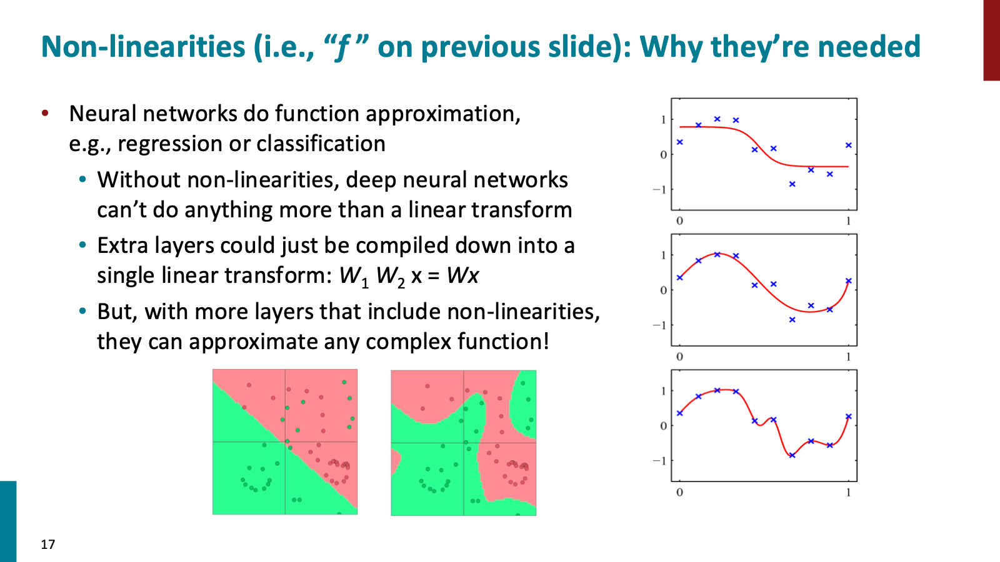
*Slide 17: "Non-linearities (i.e., 'f' on previous slide): Why they're needed": W₁W₂x = Wx, curve fits, and decision boundaries.*

Slide 17 explains why f is not optional. "Without non-linearities, deep neural networks can't do anything more than a linear transform": "Extra layers could just be compiled down into a single linear transform: W₁W₂x = Wx". A hundred linear layers are one linear layer with extra steps. "But, with more layers that include non-linearities, they can approximate any complex function!" The curve fits on the right get more flexible as capacity grows, and the boundaries at the bottom go from a straight line to a curve.

> **Note:** "Approximate any complex function" has a theorem behind it. George Cybenko proved in 1989 that sums of sigmoids with "only a single internal, hidden layer and any continuous sigmoidal nonlinearity" can approximate any continuous function on the unit cube as closely as you like (["Approximation by Superpositions of a Sigmoidal Function"](https://doi.org/10.1007/BF02551274), *Mathematics of Control, Signals and Systems*, 1989). The catch, which the theorem doesn't mention, is that the hidden layer may need to be enormous and the theorem doesn't say how to train it. Deep networks are a practical answer to both.

> **Check your understanding.** A network computes h₂ = W₂(W₁x + b₁) + b₂ with no activation. Write it as a single affine map. *Answer: h₂ = (W₂W₁)x + (W₂b₁ + b₂), one weight matrix and one bias. Depth without non-linearity buys nothing.*

**So far, and next.** We have the network: windows in, f(Wx + b), a score out. Training it means choosing a loss to minimise and a way to compute its gradient. The loss gets two slides; the gradient gets the rest of the lecture.

## 5. The loss, and the question of the hour

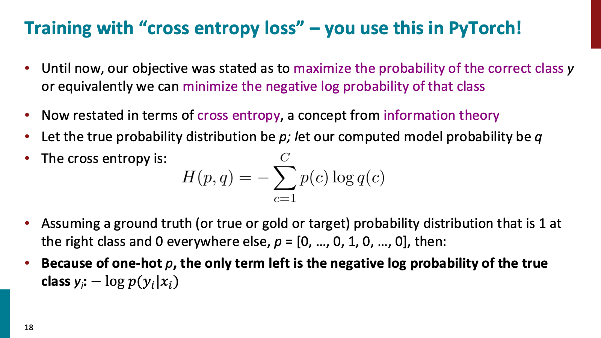
*Slide 18: "Training with 'cross entropy loss' – you use this in PyTorch!": H(p, q) = −Σ p(c) log q(c); with a one-hot p, only −log p(y_i | x_i) remains.*

"Until now, our objective was stated as to maximize the probability of the correct class y or equivalently we can minimize the negative log probability of that class". Slide 18 restates the same loss "in terms of cross entropy, a concept from information theory". With p the true distribution over classes and q the model's,

H(p, q) = −Σ_{c=1}^{C} p(c) log q(c)

For a labelled example, p is one-hot, p = [0, …, 0, 1, 0, …, 0], and "Because of one-hot p, the only term left is the negative log probability of the true class y_i: −log p(y_i | x_i)". The fancy name and the simple formula are the same thing. Lecture 2 used it for word2vec; the title's "you use this in PyTorch!" is a promise that A2's code will call it.

> **Note:** Notes 3 §1.4 trains the same NER scorer with a different loss, the **max-margin** objective. Score a true window s ("Museums in Paris are amazing") and a corrupted one s_c ("Not all museums in Paris"), and minimise J = max(1 + s_c − s, 0). The loss is zero once the true window beats the fake by a margin of 1, and only violations cost anything. The notes point to support vector machines for why the margin can be fixed at 1. Cross-entropy is the loss you will use; max-margin is worth knowing because it reappears whenever a model must rank a right answer above wrong ones.

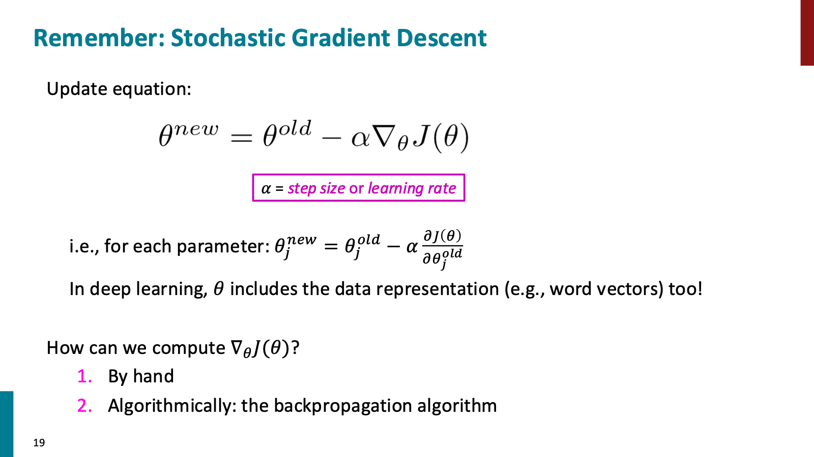
*Slide 19: "Remember: Stochastic Gradient Descent": θ^{new} = θ^{old} − α∇_θJ(θ); θ includes the word vectors; how can we compute ∇_θJ(θ)?*

Slide 19 recalls Lecture 2's update, θ^{new} = θ^{old} − α∇_θJ(θ) ("α = step size or learning rate"), and adds the deep-learning twist in one line: "In deep learning, θ includes the data representation (e.g., word vectors) too!" Then it asks the question the rest of the lecture answers: "How can we compute ∇_θJ(θ)? 1. By hand 2. Algorithmically: the backpropagation algorithm".

**So far, and next.** We have a network, a loss and an update rule; the missing piece is the gradient. Option 1 is by hand, and the deck spends 35 slides teaching you to do it with matrices. Option 2, backpropagation, will turn out to be option 1 done systematically by a computer.

## 6. Matrix calculus: gradients, Jacobians and the chain rule

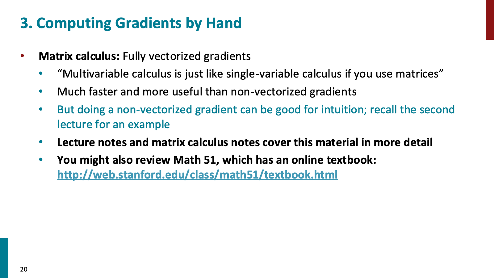
*Slide 20: "3. Computing Gradients by Hand": matrix calculus, fully vectorized gradients; the notes and the Math 51 textbook for review.*

The section opens with a slogan worth keeping: "'Multivariable calculus is just like single-variable calculus if you use matrices'". Vectorized gradients are "Much faster and more useful than non-vectorized gradients", although "doing a non-vectorized gradient can be good for intuition; recall the second lecture for an example". Lecture 2's word2vec gradient was done one coordinate at a time. Today the same ideas get done with whole matrices at once. "Lecture notes and matrix calculus notes cover this material in more detail": the "matrix calculus notes" are Kevin Clark's ["Computing Neural Network Gradients"](materials/gradient-notes.pdf) ([original](https://web.stanford.edu/class/cs224n/readings/gradient-notes.pdf)), the first suggested reading: seven pages well worth having open beside A2.

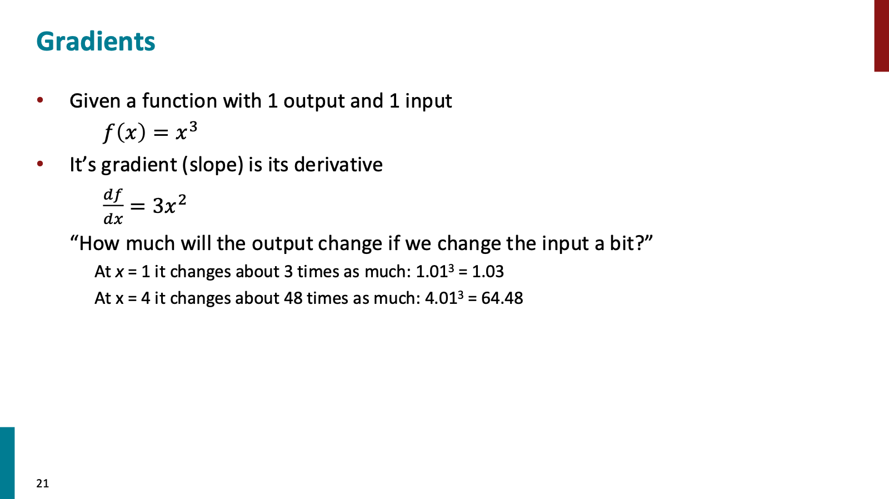
*Slide 21: "Gradients": f(x) = x³, df/dx = 3x²; at x = 1 the output changes about 3 times as much as the input, at x = 4 about 48 times.*

Start with one input and one output. f(x) = x³ has derivative 3x², and the slide reads it as an answer to "How much will the output change if we change the input a bit?" At x = 1 the output changes about 3 times as much: 1.01³ = 1.03. At x = 4 it changes about 48 times as much: 4.01³ = 64.48, up from 64. A derivative is a local exchange rate between input and output.

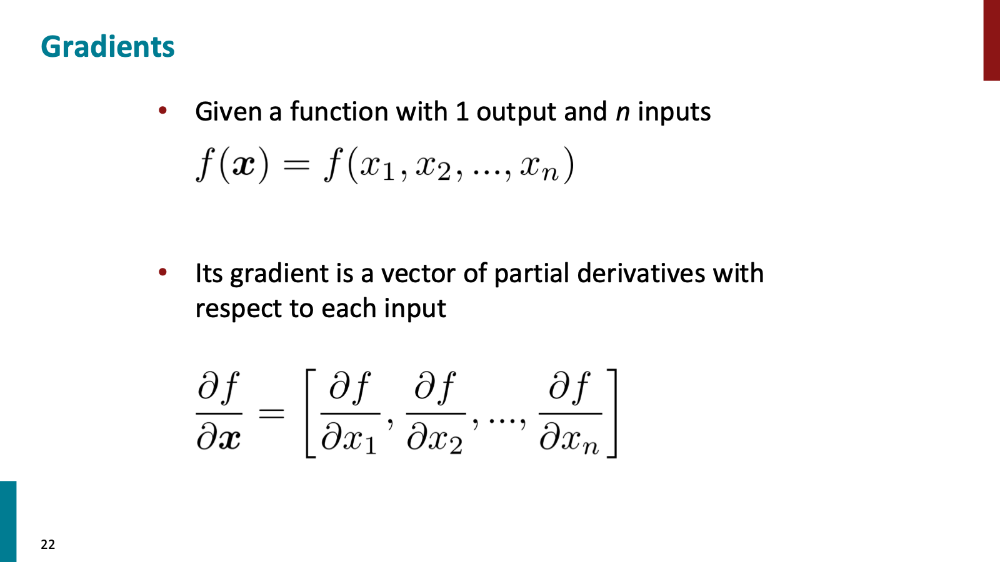
*Slide 22: "Gradients": for a function with one output and n inputs, the gradient is the vector of partial derivatives.*

With n inputs and one output, "Its gradient is a vector of partial derivatives with respect to each input": ∂f/∂x = [∂f/∂x₁, …, ∂f/∂x_n]. Each entry is the exchange rate for one input, holding the others still.

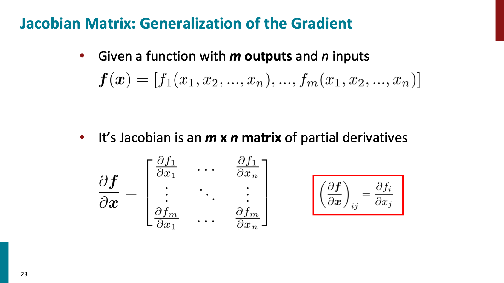
*Slide 23: "Jacobian Matrix: Generalization of the Gradient": for m outputs and n inputs, an m × n matrix with entries ∂f_i/∂x_j.*

With m outputs and n inputs, you need an exchange rate from every input to every output. The **Jacobian** is the m × n matrix of all of them: (∂f/∂x)_ij = ∂f_i/∂x_j. Row i says how output i responds to each input; column j says how every output responds to input j. The gradient is the special case with one output: a 1 × n Jacobian.

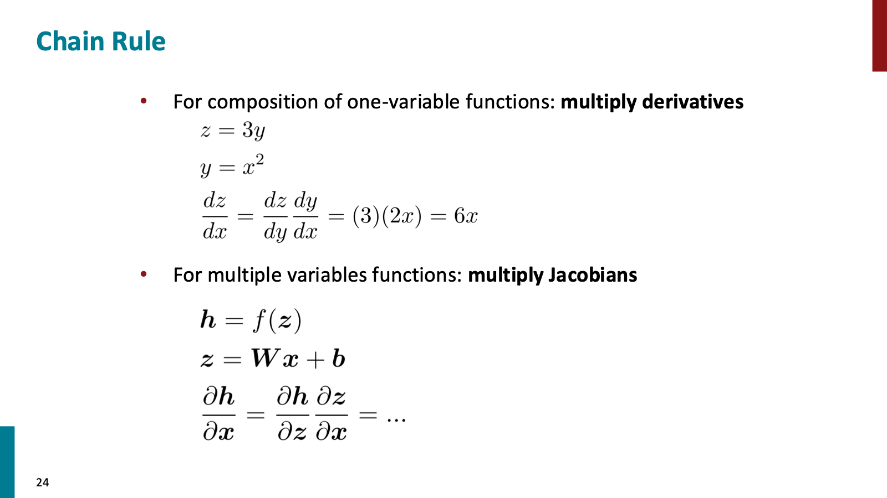
*Slide 24: "Chain Rule": for one-variable functions, multiply derivatives (z = 3y, y = x², dz/dx = 6x); for many variables, multiply Jacobians.*

The **chain rule** is the whole engine of backpropagation, and slide 24 states it twice. For one variable, "multiply derivatives": with z = 3y and y = x², dz/dx = (dz/dy)(dy/dx) = (3)(2x) = 6x. For many variables, "multiply Jacobians": with h = f(z) and z = Wx + b, ∂h/∂x = (∂h/∂z)(∂z/∂x). The shapes chain like dominoes: an n × n Jacobian times an n × d Jacobian gives the n × d answer.

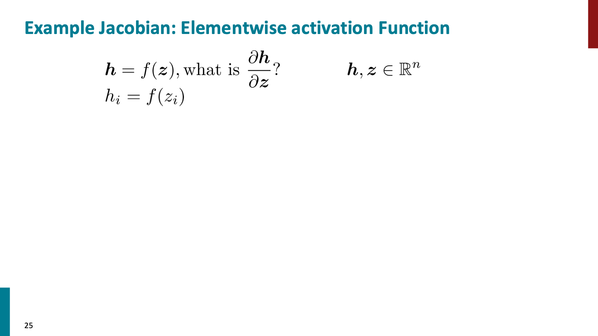
*Slide 25: "Example Jacobian: Elementwise activation Function": h = f(z), what is ∂h/∂z?*

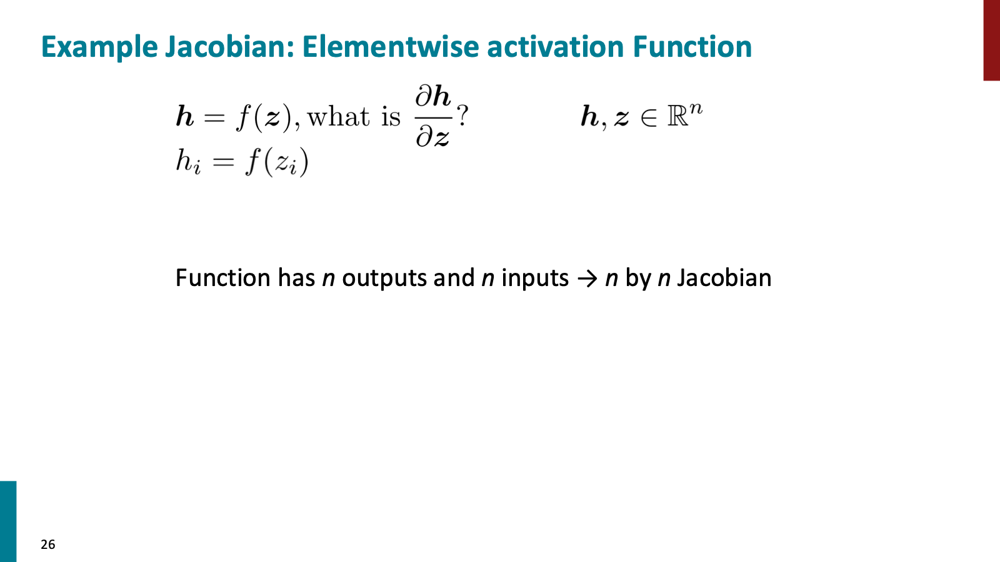
*Slide 26: "Function has n outputs and n inputs → n by n Jacobian".*

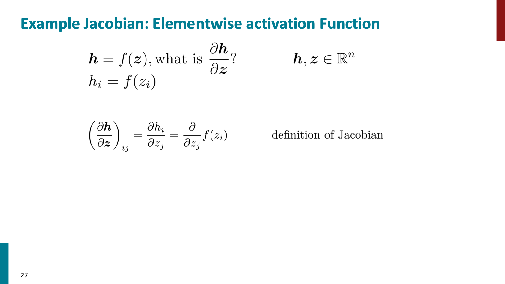
*Slide 27: the (i, j) entry of the Jacobian, by definition.*

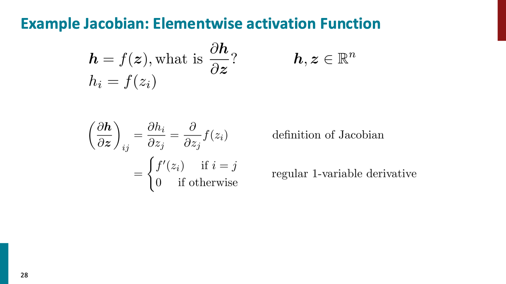
*Slide 28: the entry is f′(z_i) if i = j and 0 otherwise.*

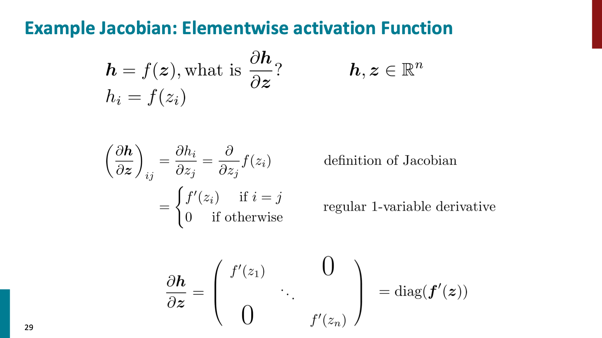
*Slide 29: ∂h/∂z = diag(f′(z)).*

Slides 25–29 build the first Jacobian you need, one step per slide. Take an elementwise activation, h = f(z) with h_i = f(z_i) and h, z ∈ ℝⁿ: n outputs and n inputs, so "n by n Jacobian". By definition, entry (i, j) is ∂h_i/∂z_j = ∂f(z_i)/∂z_j. Output i depends only on input i, so the entry is f′(z_i) when i = j and 0 otherwise. The Jacobian is diagonal: ∂h/∂z = diag(f′(z)). Remember the picture, because the diagonal is why an elementwise f will later turn into an elementwise product (⊙) instead of a full matrix multiply.

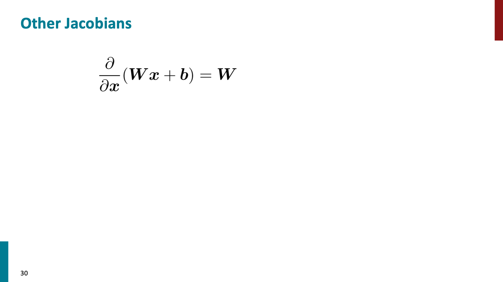
*Slide 30: "Other Jacobians": ∂/∂x(Wx + b) = W.*

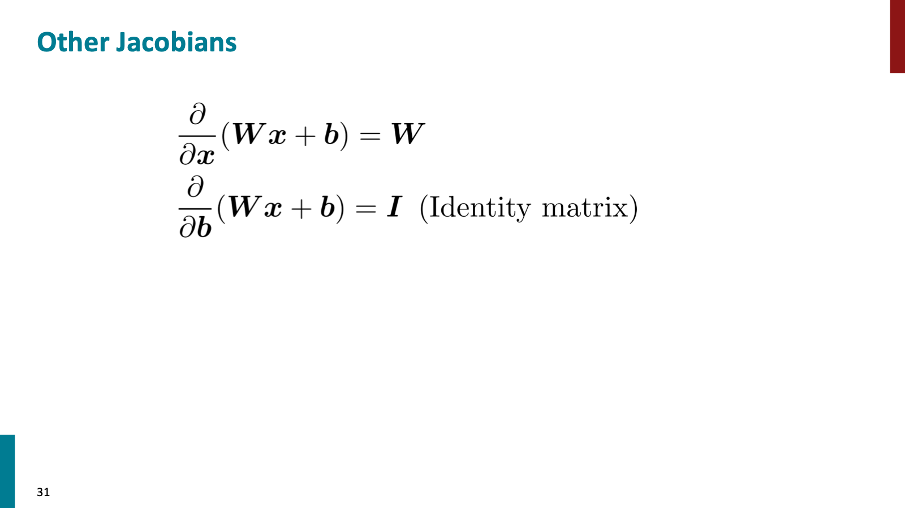
*Slide 31: ∂/∂b(Wx + b) = I (identity matrix).*

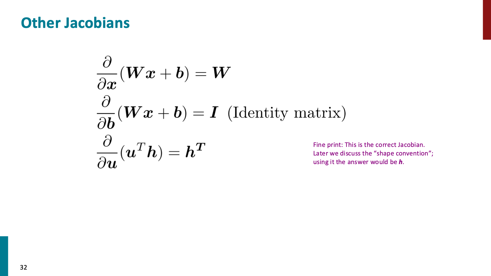
*Slide 32: ∂/∂u(uᵀh) = hᵀ, with the fine print on the "shape convention".*

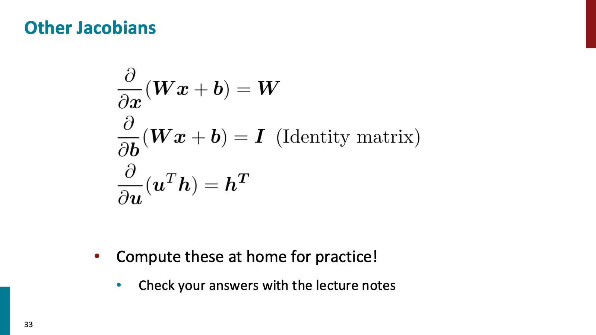
*Slide 33: the three Jacobians together: "Compute these at home for practice! Check your answers with the lecture notes".*

Three more Jacobians complete the toolkit, one per build. ∂/∂x (Wx + b) = W: the affine map's Jacobian with respect to its input is its weight matrix. ∂/∂b (Wx + b) = I: the bias passes straight through. ∂/∂u (uᵀh) = hᵀ: the score's Jacobian with respect to u is a row vector. Slide 32's fine print flags a subtlety coming back in section 7: "This is the correct Jacobian. Later we discuss the 'shape convention'; using it the answer would be h".

> **Check your understanding.** Use the Jacobian definition to show ∂/∂x(Wx + b) = W. *Answer: output i is Σ_k W_ik x_k + b_i, whose partial derivative with respect to x_j is W_ij. So entry (i, j) of the Jacobian is W_ij, which is the matrix W.*

**So far, and next.** Four tools: the gradient, the Jacobian, the chain rule as a product of Jacobians, and four Jacobians worth memorising (diag(f′(z)), W, I and hᵀ). Now the deck goes back to the NER network and uses them, step by step.

## 7. The worked gradient: from score to weights

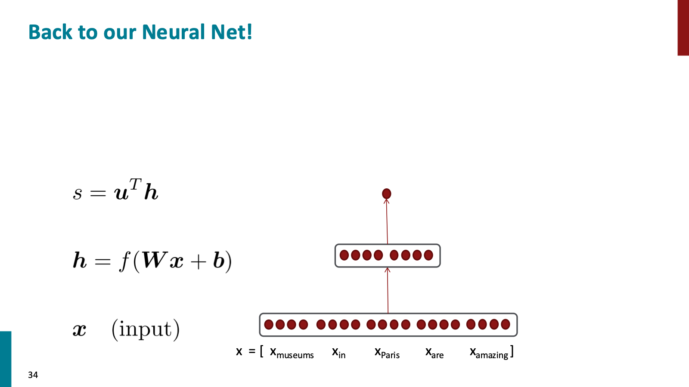
*Slide 34: "Back to our Neural Net!": the NER network and its input window.*

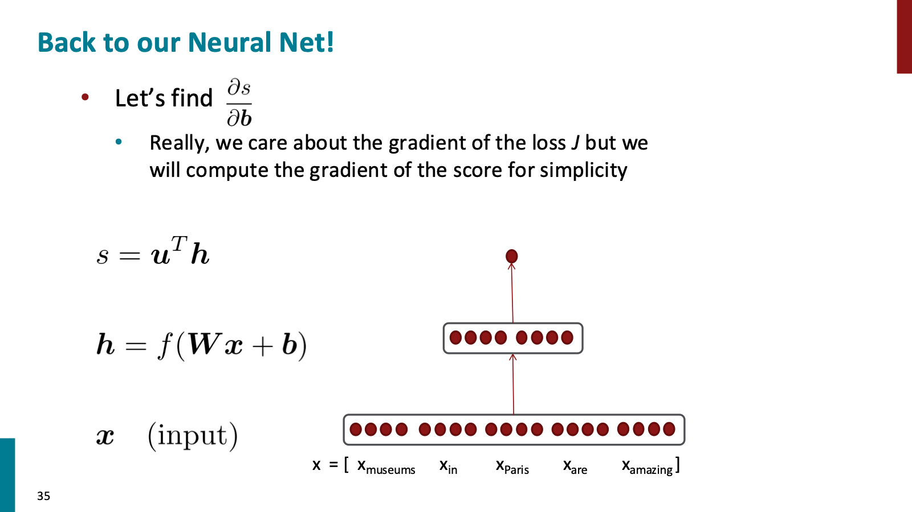
*Slide 35: "Let's find ∂s/∂b": "Really, we care about the gradient of the loss J but we will compute the gradient of the score for simplicity".*

The target is ∂s/∂b, the gradient of the score with respect to the hidden bias. "Really, we care about the gradient of the loss J but we will compute the gradient of the score for simplicity". The loss just adds one more link at the start of the chain (σ, then the log), which you will add yourself in A2.

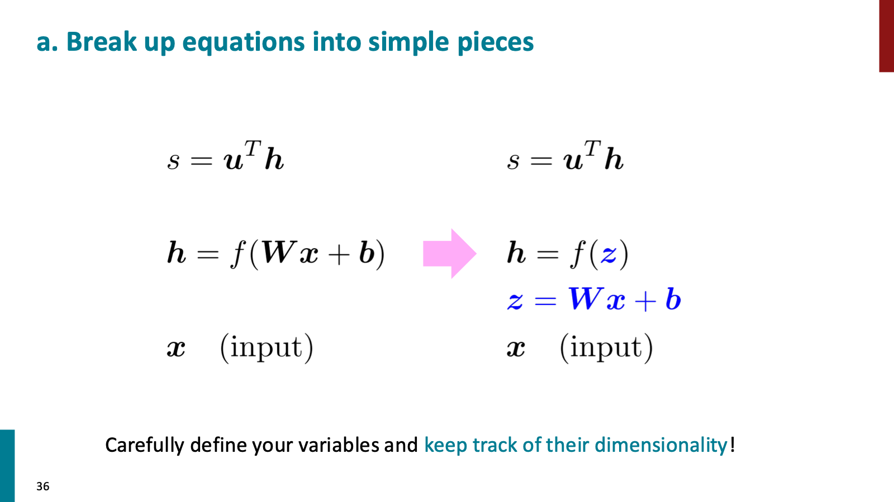
*Slide 36: "a. Break up equations into simple pieces": h = f(Wx + b) split into h = f(z) and z = Wx + b; "Carefully define your variables and keep track of their dimensionality!"*

Step a is the most important habit in the lecture: "Break up equations into simple pieces". Split h = f(Wx + b) into h = f(z) and z = Wx + b, so every line is one operation whose Jacobian you know. And, in teal: "Carefully define your variables and keep track of their dimensionality!" Most gradient bugs are shape bugs.

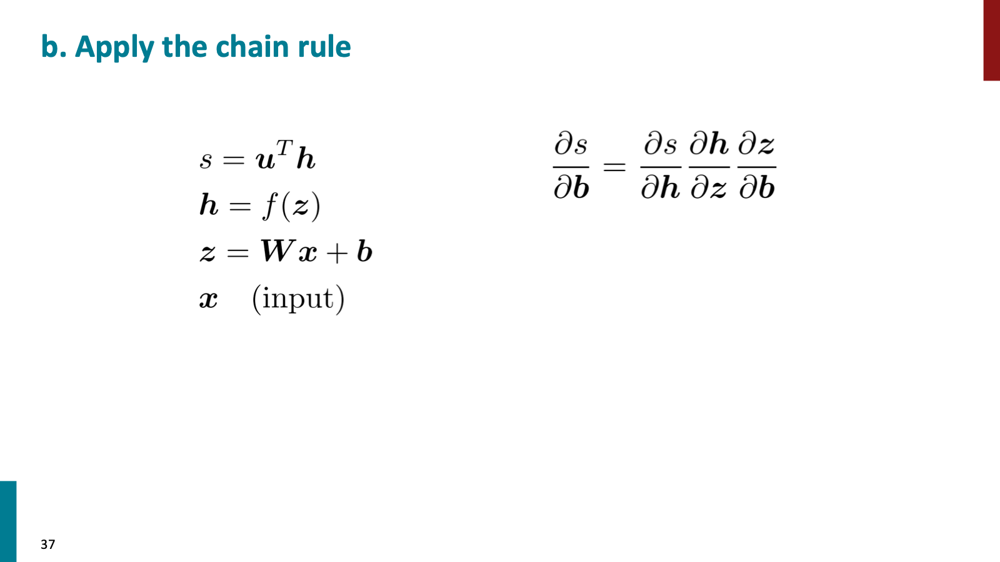
*Slide 37: "b. Apply the chain rule": the first factor.*

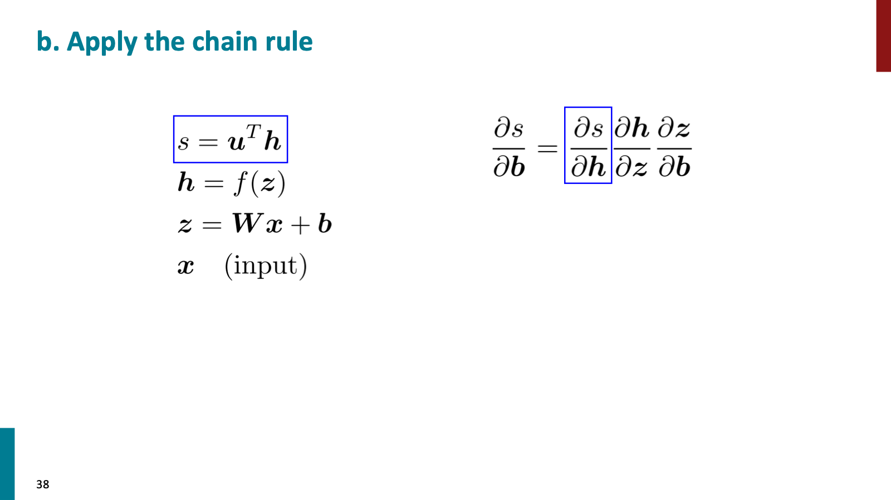
*Slide 38: the chain rule, second factor.*

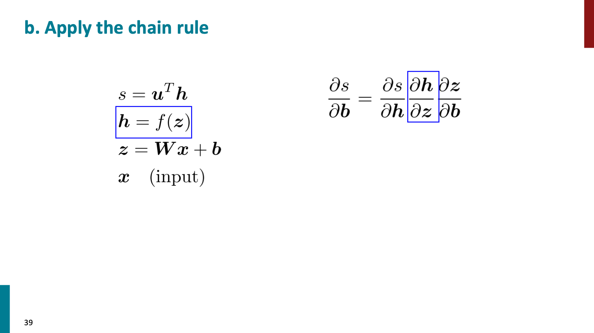
*Slide 39: the chain rule, third factor.*

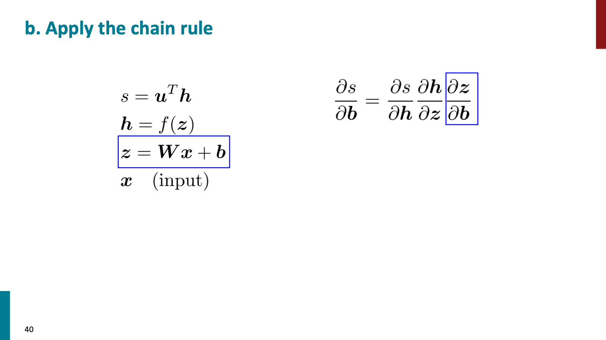
*Slide 40: ∂s/∂b = (∂s/∂h)(∂h/∂z)(∂z/∂b).*

Step b, over four builds, writes the chain one link at a time, from the score back to the bias: ∂s/∂b = (∂s/∂h)(∂h/∂z)(∂z/∂b). Each factor corresponds to one line of slide 36's broken-up equations.

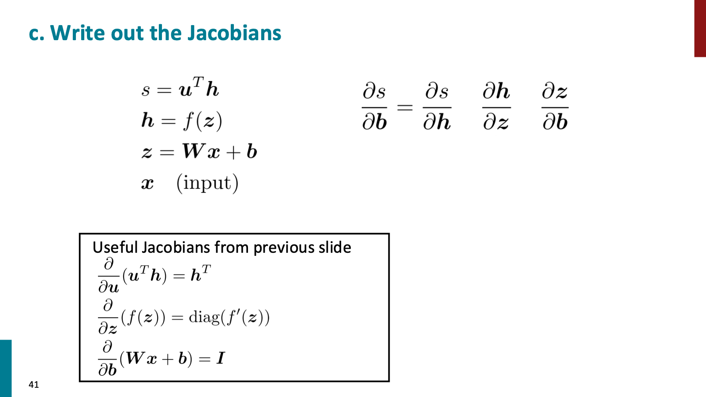
*Slide 41: "c. Write out the Jacobians", with the "Useful Jacobians from previous slide" boxed.*

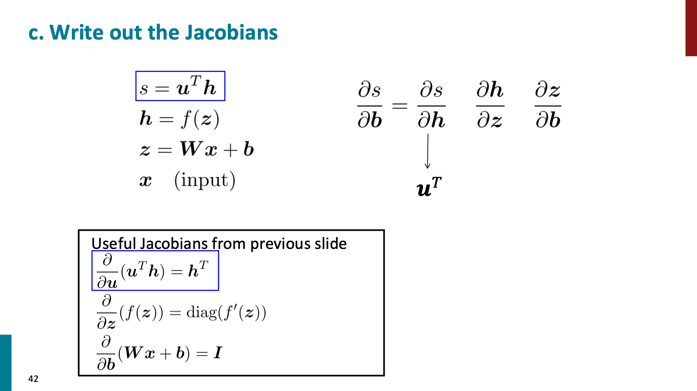
*Slide 42: the first factor becomes uᵀ.*

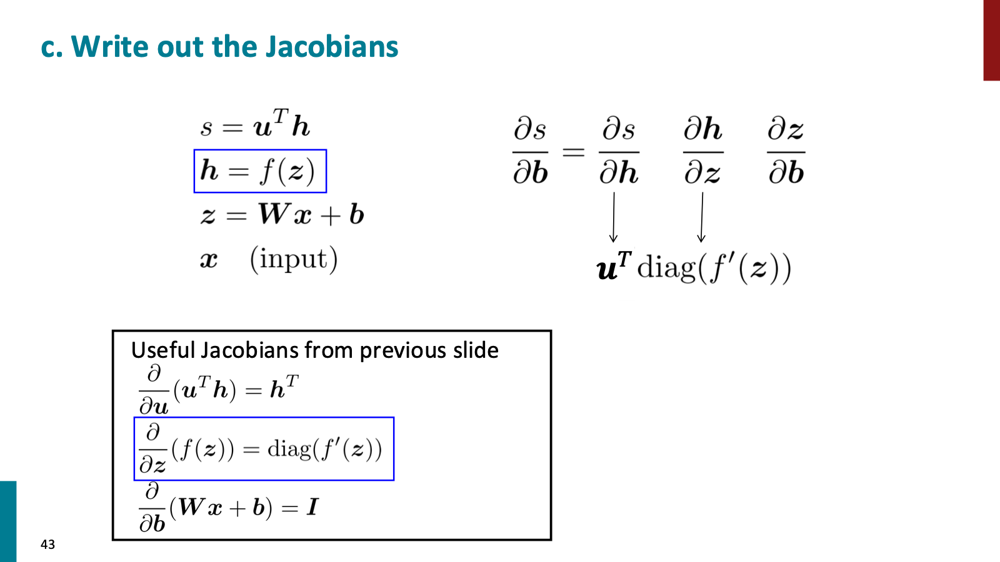
*Slide 43: the second becomes diag(f′(z)).*

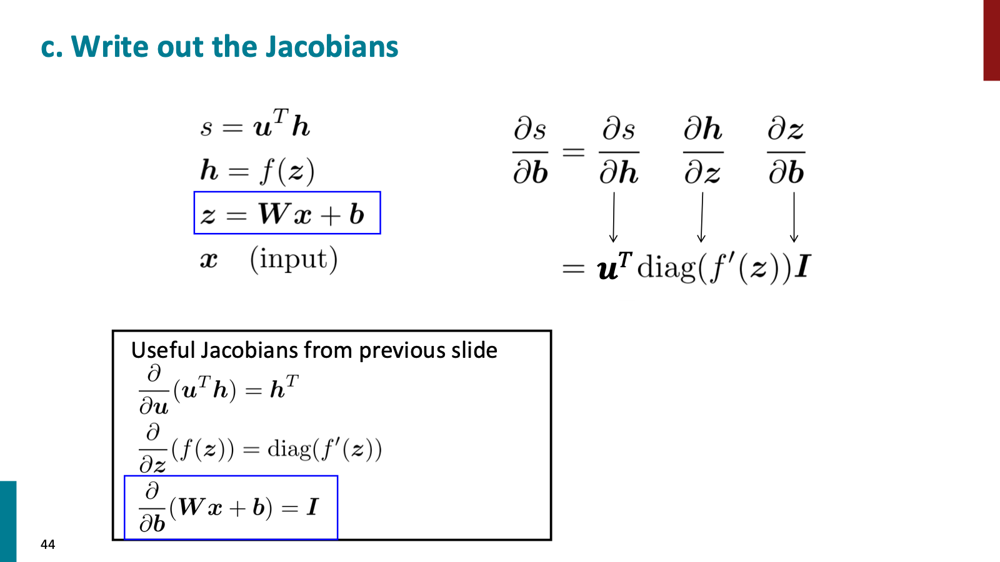
*Slide 44: the third becomes I.*

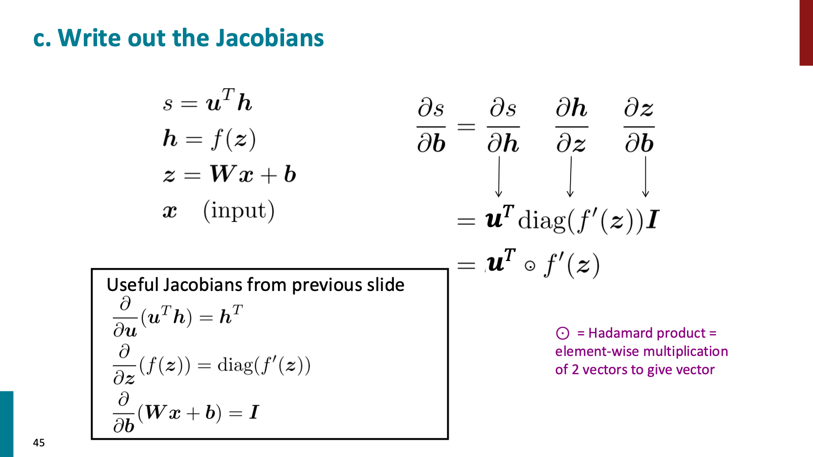
*Slide 45: ∂s/∂b = uᵀ diag(f′(z)) I = uᵀ ∘ f′(z), where ⊙ is the Hadamard (element-wise) product.*

Step c replaces each factor with its Jacobian from section 6: ∂s/∂h = uᵀ, ∂h/∂z = diag(f′(z)), ∂z/∂b = I. Multiply:

∂s/∂b = uᵀ diag(f′(z)) I = uᵀ ∘ f′(z)

Multiplying a row vector by a diagonal matrix just scales each entry, so the product is an element-wise one: "⊙ = Hadamard product = element-wise multiplication of 2 vectors to give vector". Read it out loud: the bias of hidden unit i matters to the score by u_i (how much the score cares about h_i) times f′(z_i) (how much h_i responds to z_i).

> **Note:** Notes 3 §1.5 does the same derivation element by element, for one weight in a small 4-2-1 network, and lands on ∂s/∂W⁽¹⁾₁₄ = a⁽¹⁾₄ f′(z⁽²⁾₁) W⁽²⁾₁: the input that weight multiplies, times the slope of the unit it feeds, times that unit's weight on the score. The notes' slogan for it: "backpropagated gradients are only affected by values they contribute to". It is the same answer as the matrix version, one entry at a time.

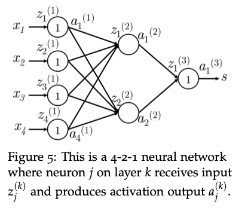
*Notes 3, Figure 5: the 4-2-1 network used for the element-by-element derivation; neuron j on layer k receives z_j^(k) and outputs a_j^(k).*

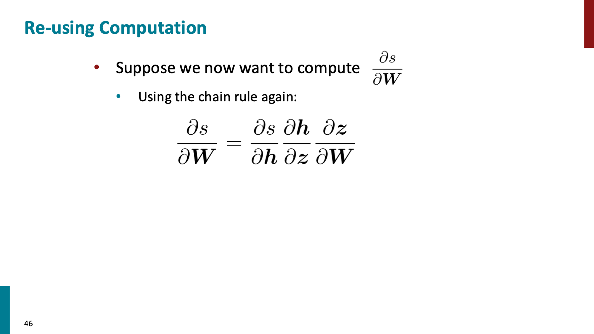
*Slide 46: "Re-using Computation": now compute ∂s/∂W, using the chain rule again.*

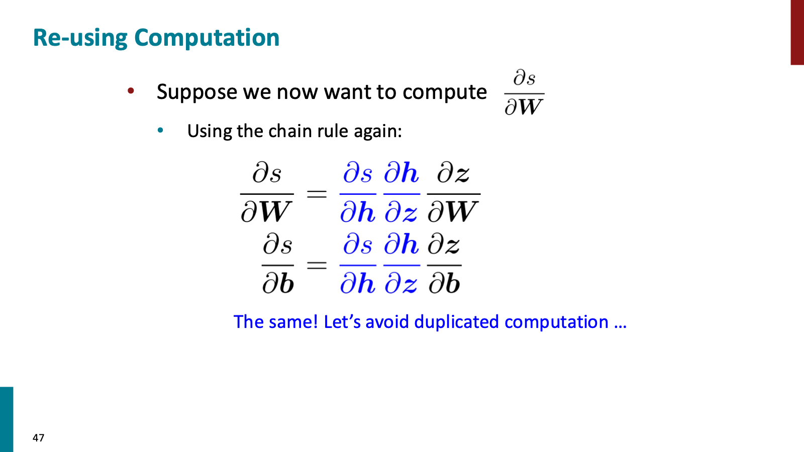
*Slide 47: "The same! Let's avoid duplicated computation …"*


*Slide 48: δ = (∂s/∂h)(∂h/∂z) = uᵀ ∘ f′(z), "the upstream gradient ('error signal')"; ∂s/∂W = δ ∂z/∂W and ∂s/∂b = δ.*

Now find ∂s/∂W. The chain is (∂s/∂h)(∂h/∂z)(∂z/∂W), and its first two factors are exactly the ones we just multiplied for b: "The same! Let's avoid duplicated computation". So give them a name:

δ = (∂s/∂h)(∂h/∂z) = uᵀ ∘ f′(z)

Then ∂s/∂b = δ ∂z/∂b = δ and ∂s/∂W = δ ∂z/∂W. "δ is the upstream gradient ('error signal')". It is everything the score has to say about z, computed once and reused by every parameter that feeds z. That reuse, applied layer after layer, is the whole efficiency trick of backpropagation (section 8).


*Slide 49: "Derivative with respect to Matrix: Output shape": as a Jacobian, ∂s/∂W would be 1 by nm, which is "Inconvenient".*


*Slide 50: "Instead, we leave pure math and use the shape convention: the shape of the gradient is the shape of the parameters!"*

What shape is ∂s/∂W? Pure maths says one output and nm inputs, so a 1 × nm Jacobian, which is "Inconvenient" to use in θ^{new} = θ^{old} − α∇θ. So "we leave pure math and use the **shape convention**: the shape of the gradient is the shape of the parameters!" The gradient of a scalar with respect to a matrix is laid out as a matrix of the same shape, each entry the partial derivative for the corresponding weight. (The slide calls W's shape n by m. In slide 14's network W ∈ ℝ^{m×n}, with m hidden units and n = 5d inputs, and the gradient then has that shape too.)


*Slide 51: ∂s/∂W = δᵀxᵀ, with δ the upstream gradient at z and x the local input signal.*


*Slide 52: "Why the Transposes?": "Hacky answer: this makes the dimensions work out!"; "Each input goes to each output – you want to get outer product".*


*Slide 53: "Deriving local input gradient in backprop": W_ij only contributes to z_i, so ∂z_i/∂W_ij = x_j.*

The answer is an outer product: ∂s/∂W = δᵀxᵀ. "δ is upstream gradient ('error signal') at z" and "x is local input signal". Slide 52's "Hacky answer" to why the transposes are there is honest and useful: "this makes the dimensions work out! Useful trick for checking your work!" δᵀ is a column with one entry per hidden unit, xᵀ is a row with one entry per input, and their product has one entry per weight. Slide 53 gives the real reason with a single weight: "W_ij only contributes to z_i" ("W₂₃ is only used to compute z₂ not z₁"), and ∂z_i/∂W_ij = x_j. So the gradient for W_ij is δ_i x_j: the error at the weight's output times the signal at its input. "Each input goes to each output – you want to get outer product".

> **Note:** Two conventions for δ are in play, and mixing them is the commonest source of transpose errors. The slides keep δ as a row (it came out of multiplying Jacobians): δ_row = uᵀ diag(f′(z)) = (u ⊙ f′(z))ᵀ. Then the Jacobian ∂s/∂b is δ_row, the shaped gradient ∇_b s is δ_rowᵀ, and ∇_W s = δ_rowᵀ xᵀ. Notes 3 keeps δ as a column from the start, δ = ∇_z s, so its weight gradient reads δ xᵀ. Same numbers, different bookkeeping.


*Slide 54: "What shape should derivatives be?": the Jacobian form makes ∂s/∂b a row vector, but the shape convention wants a column; "We expect answers in the assignment to follow the shape convention".*


*Slide 55: two options: use the Jacobian form and reshape at the end, or always follow the shape convention; "Use Jacobian to compute; Use shape convention to format".*

Slides 54–55 name the tension directly. There is a "Disagreement between Jacobian form (which makes the chain rule easy) and the shape convention (which makes implementing SGD easy)". By Jacobians, ∂s/∂b is a row vector; "But shape convention says our gradient should be a column vector because b is a column vector". The rule for A2: "We expect answers in the assignment to follow the shape convention. But Jacobian form is useful for computing the answers." There are two ways to work: Jacobians throughout, then transpose at the end; or the shape convention throughout, using "dimensions to figure out when to transpose and/or reorder terms". A check that always works: "The error message δ that arrives at a hidden layer has the same dimensionality as that hidden layer". The margin note is the one to tape to your monitor: "Use Jacobian to compute; Use shape convention to format."

> **Note:** Notes 3 §1.6 runs this through any number of layers, in its column convention. The error at layer k is built from the error at layer k + 1: δ⁽ᵏ⁾ = f′(z⁽ᵏ⁾) ⊙ ((W⁽ᵏ⁾)ᵀ δ⁽ᵏ⁺¹⁾). "Error propagates from layer (k + 1) to (k)". Each weight gradient is "the outer product of the error vector … and the activations forwarded": ∇_{W⁽ᵏ⁾} = δ⁽ᵏ⁺¹⁾ (a⁽ᵏ⁾)ᵀ, with bias gradient δ⁽ᵏ⁺¹⁾. That one recurrence is backpropagation for a feed-forward network.


*Notes 3, Figure 7: error δ^(k) at a unit in layer k flows back along the weight W_ij^(k−1) to unit j in layer k − 1.*


*Notes 3, Figure 8: unit j in layer k − 1 feeds several units in layer k, so it collects error from all of them.*

> **Check your understanding.** In slide 14's network, with h ∈ ℝ^m and x ∈ ℝ^{5d}, what are the shapes of δ (as a column), ∇_W s and ∇_b s? *Answer: δ ∈ ℝ^m, one entry per hidden unit. ∇_W s = δxᵀ ∈ ℝ^{m×5d}, the same shape as W. ∇_b s = δ ∈ ℝ^m, the same shape as b.*

**So far, and next.** By hand, the recipe is: break the function into pieces, chain the Jacobians, name the shared upstream piece δ and reuse it, and format the answers in the shape of the parameters. That is backpropagation already, done on paper for one small network. Next, the deck hands the same recipe to a computer, as a graph.

## 8. Backpropagation: the chain rule as an algorithm


*Slide 56: "4. Backpropagation": "We've almost shown you backpropagation"; the other trick is re-using derivatives computed for higher layers.*

Slide 56 lets you in on the secret: "We've almost shown you backpropagation. It's taking derivatives and using the (generalized, multivariate, or matrix) chain rule". There is one "Other trick: We re-use derivatives computed for higher layers in computing derivatives for lower layers to minimize computation". You've already done it once: that was δ in section 7. Backpropagation is that one trick, made systematic so a computer can do it for any network.


*Slide 57: "Computation Graphs and Backpropagation": the NER network drawn as a graph; "Source nodes: inputs", "Interior nodes: operations".*


*Slide 58: "Edges pass along result of the operation".*


*Slide 59: "Forward Propagation": x and W enter a multiply node, giving Wx; adding b gives z; f gives h; the dot product with u gives s.*

"Software represents our neural net equations as a graph". In a **computation graph**, the "Source nodes" are inputs (x, W, b, u), the "Interior nodes" are operations (multiply, add, f, dot product), and "Edges pass along result of the operation". Slide 59 draws the NER scorer as a chain: x → (· W) → Wx → (+ b) → z → f → h → (· u) → s. Computing left to right, from inputs to the score, is **forward propagation**. It is the bookkeeping you did in slide 36's "break up equations into simple pieces", now drawn as a picture.


*Slide 60: "Backpropagation": "Then go backwards along edges", "Pass along gradients".*

Backpropagation runs the same graph the other way: "Then go backwards along edges. Pass along gradients". The forward pass works out what the network says. The backward pass works out who gets the blame, and how much.


*Slide 61: "Backpropagation: Single Node": a node h = f(z) receives an "upstream gradient" and must pass on the correct "downstream gradient".*


*Slide 62: "Each node has a local gradient": "The gradient of its output with respect to its input", ∂h/∂z.*


*Slide 63: "Chain rule!": ∂s/∂z = (∂s/∂h)(∂h/∂z).*


*Slide 64: "[downstream gradient] = [upstream gradient] x [local gradient]".*

Zoom in on one node, h = f(z). From above it receives an **upstream gradient**, ∂s/∂h: how much the final score cares about this node's output. Its "Goal is to pass on the correct 'downstream gradient'", ∂s/∂z. And "Each node has a **local gradient**: The gradient of its output with respect to its input", ∂h/∂z, which it can work out by itself without knowing anything about the rest of the graph. The chain rule joins them, and slide 64 prints the slogan of the whole algorithm:

**[downstream gradient] = [upstream gradient] × [local gradient]**

That is what makes backprop modular. Each node only needs to know its own local derivative. It never needs to know what network it sits in, just as a relay runner only needs to carry the baton through their own leg.


*Slide 65: "What about nodes with multiple inputs?": a multiply node z = Wx.*


*Slide 66: "Multiple inputs → multiple local gradients": ∂s/∂W = (∂s/∂z)(∂z/∂W) and ∂s/∂x = (∂s/∂z)(∂z/∂x).*

A node with several inputs has one local gradient per input. For z = Wx, the one upstream gradient ∂s/∂z goes out twice, multiplied by ∂z/∂W toward W and by ∂z/∂x toward x. "Multiple inputs → multiple local gradients".

> **Note:** From slide 67 on, the numbers printed in the slides' corners no longer match their position in the PDF: slide 67's corner reads 78, and slide 78's reads 91. These notes number slides by their position in the PDF, as everywhere else.


*Slide 67: "Gradients sum at outward branches": a node whose output feeds two nodes.*


*Slide 68: a = x + y, b = max(y, z), f = ab; ∂f/∂y = (∂f/∂a)(∂a/∂y) + (∂f/∂b)(∂b/∂y).*

What if one value feeds several nodes? Then "Gradients sum at outward branches". In slide 68's example y is used twice, in a = x + y and in b = max(y, z), so its gradient has two contributions, one per path, and they add:

∂f/∂y = (∂f/∂a)(∂a/∂y) + (∂f/∂b)(∂b/∂y)

This is the multivariable chain rule (a change in y moves f through every path it takes), and it is the same "collect error from all of them" that notes 3 Figure 8 drew in section 7.


*Slide 69: "Node Intuitions" for f(x, y, z) = (x + y) max(y, z) at x = 1, y = 2, z = 0: "+ 'distributes' the upstream gradient to each summand".*


*Slide 70: "max 'routes' the upstream gradient".*


*Slide 71: "* 'switches' the upstream gradient": the forward values (black) and the gradients (blue) on every edge.*

Slides 69–71 work one example by hand, and it is worth doing with a pencil. Take f(x, y, z) = (x + y) max(y, z) at x = 1, y = 2, z = 0.

**Forward.** a = x + y = 3, b = max(y, z) = 2, f = ab = 6.

**Backward.** Start with ∂f/∂f = 1 and visit the nodes in reverse.

- The multiply node f = ab "switches": each input gets the upstream gradient times the *other* input. So a gets 1 × b = 2, and b gets 1 × a = 3.
- The add node "distributes": each summand gets the *whole* upstream gradient (a full copy each, not a share), since ∂a/∂x = ∂a/∂y = 1. So x gets 2 and y gets 2.
- The max node "routes": all of the gradient goes to whichever input won the forward pass, and none to the loser. y = 2 beat z = 0, so y gets 3 and z gets 0.

Now sum at the branch. y was used twice, so ∂f/∂y = 2 + 3 = 5. The answers are ∂f/∂x = 2, ∂f/∂y = 5, ∂f/∂z = 0. To check, write f = (x + y)y for this region where y > z: ∂f/∂x = y = 2 and ∂f/∂y = y + (x + y) = 5. ✓

The max node is worth a second look, because ReLU is max(z, 0). A ReLU whose input lost to zero on the forward pass gets no gradient on the backward pass. That is the "dead zone" of section 4, seen from the backward side.

> **Check your understanding.** Redo the example at x = 1, y = −1, z = 3. *Answer: forward, a = 0, b = 3, f = 0. Backward, the multiply node gives a the value 3 and b the value 0. The add node gives x and y 3 each. The max node routes b's 0 to z, the winner, and nothing to y. So ∂f/∂x = 3, ∂f/∂y = 3 + 0 = 3 and ∂f/∂z = 0. A check: here f = (x + y)z, so ∂f/∂z = x + y = 0. z won the max and still gets no gradient, because the other factor of the product is zero.*


*Slide 72: "Efficiency: compute all gradients at once": "Incorrect way of doing backprop: First compute ∂s/∂b".*


*Slide 73: "Then independently compute ∂s/∂W": "Duplicated computation!"*


*Slide 74: "Correct way: Compute all the gradients at once", "Analogous to using δ when we computed gradients by hand": the shared green path, then ∂s/∂b (blue) and ∂s/∂W (red) branching off it.*

Slides 72–74 repeat section 7's lesson in graph form. The "Incorrect way of doing backprop" is to compute ∂s/∂b, then "independently" compute ∂s/∂W, walking the shared path from s down to z twice: "Duplicated computation!" The "Correct way" is to "Compute all the gradients at once": one backward sweep along the green path, peeling off ∂s/∂b and ∂s/∂W as it passes. It is "Analogous to using δ when we computed gradients by hand". In a network with a hundred layers, the incorrect way would walk the top of the network once for every parameter below it. The correct way walks it once.


*Slide 75: "Back-Prop in General Computation Graph": fprop in topological order, bprop in reverse order from a single scalar output, ∂z/∂x = Σᵢ (∂z/∂yᵢ)(∂yᵢ/∂x) over the successors of x; "big O() complexity of fprop and bprop is the same".*

Slide 75 gives the whole algorithm for any directed acyclic graph with a "Single scalar output" z (the loss):

1. "Fprop: visit nodes in topological sort order", so every node is computed after its inputs: "Compute value of node given predecessors".
2. "Bprop": "initialize output gradient = 1" (∂z/∂z = 1), then "visit nodes in reverse order", computing each node's gradient "using gradient wrt successors": ∂z/∂x = Σᵢ (∂z/∂yᵢ)(∂yᵢ/∂x), where y₁, …, y_n are the nodes x feeds.

The sum is "gradients sum at outward branches"; the reverse order guarantees each node's successors are finished before the node is visited. The punchline is in bold on the slide: "Done correctly, big O() complexity of fprop and bprop is **the same**". The gradient with respect to every parameter costs about as much as computing the loss once. Finally, "In general, our nets have regular layer-structure and so we can use matrices and Jacobians…", which is why section 7 did it with matrices.

> **Note:** How much is "the same"? Baydin, Pearlmutter, Radul and Siskind's survey [Automatic Differentiation in Machine Learning](https://jmlr.org/papers/v18/17-468.html) (JMLR 2018) quotes Griewank and Walther (2008): for f: ℝⁿ → ℝᵐ, reverse mode computes the full Jacobian in m·c·ops(f), "where c is a constant guaranteed to be c < 6 and typically c ∼ [2, 3]". A loss has m = 1, so the whole gradient costs a small constant times one forward pass, however many parameters there are. Forward mode, the other way to run the chain rule (from inputs to outputs), needs n passes for the same gradient. With millions of parameters and one loss, reverse mode wins by a factor on the order of the number of parameters.

> **Note:** The same survey tells backprop's history, which has more inventors than it needs. Linnainmaa's 1970 master's thesis "is often cited as the first published description of the reverse mode"; Werbos cast it in formal terms in 1974; Speelpenning (1980) gave "the first implementation that was actually automatic". In machine learning it "has been reinvented several times, such as by Parker (1985), until it was eventually brought to fame by Rumelhart et al. (1986)", in [Learning representations by back-propagating errors](https://www.nature.com/articles/323533a0). "The PDP group became aware of Parker's work only after their own discovery; similarly, Werbos' work was not appreciated until it was found by Parker". The survey's verdict: "two highly interconnected research communities that have somehow also managed to stay detached during this foundational period".

**So far, and next.** Backpropagation in one line: run the graph forward, saving every value, then run it backward from a gradient of 1, multiplying each upstream gradient by a local one and summing at branches. It costs about as much as the forward pass. Next, the deck shows what that looks like in code, how to check it, and why you should still learn it when a library does it for you.

## 9. Backprop in practice: code, checks, and leaks


*Slide 76: "Automatic Differentiation": the gradient can be inferred from the fprop's symbolic expression; each node type knows its output and its local gradient; modern frameworks do backprop for you.*

**Automatic differentiation** (AD) computes derivatives by applying the chain rule to a program's elementary operations. It comes in a forward mode and a reverse mode (section 8's note); reverse-mode AD is backpropagation, and it is the mode deep-learning frameworks use for training. The slide: "The gradient computation can be automatically inferred from the symbolic expression of the fprop". It works because of slide 64's modularity: "Each node type needs to know how to compute its output and how to compute the gradient wrt its inputs given the gradient wrt its output". So "Modern DL frameworks (Tensorflow, PyTorch, etc.) do backpropagation for you but mainly leave layer/node writer to hand-calculate the local derivative". In other words, someone still does the calculus of sections 6–7, once per node type, so that everyone else can skip it.


*Slide 77: "Backprop Implementations": a ComputationalGraph class whose forward() calls gate.forward() over the nodes in topological order and returns the loss, and whose backward() calls gate.backward() in reverse order.*

Slide 77 shows the whole algorithm in about ten lines of Python. forward() runs gate.forward() "for gate in self.graph.nodes_topologically_sorted()" and returns the loss ("the final gate in the graph outputs the loss"). backward() runs gate.backward() over "reversed(self.graph.nodes_topologically_sorted())", each call "little piece of backprop (chain rule applied)", and returns the input gradients. That is slide 75, line for line. PyTorch's loss.backward(), which you will call in A2, is this loop, with a large library of gates.


*Slide 78: "Manual Gradient checking: Numeric Gradient": f′(x) ≈ (f(x + h) − f(x − h))/2h for small h (≈ 1e-4); easy to implement but approximate and very slow.*

How do you know your hand-derived gradient is right? Ask the definition of the derivative. "For small h (≈ 1e-4)",

f′(x) ≈ (f(x + h) − f(x − h)) / 2h

It is "Easy to implement correctly", "But approximate and **very** slow: You have to recompute f for **every parameter** of our model". It is "Useful for checking your implementation": "In the old days, we hand-wrote everything, doing this everywhere was the key test"; "Now much less needed; you can use it to check layers are correctly implemented".

The slowness is easy to put a number on. Each parameter needs two forward passes, so a model with a million parameters needs two million forward passes for one numeric gradient. Backprop, by the note in section 8, needs a small constant number. A gradient check is a test, not a training method.

> **Note:** Notes 3 §2.1 gives the same check and explains the choice of formula. The centered difference "has an error proportional to ε²", whereas the one-sided (f(x + ε) − f(x))/ε "is more error-prone". The notes use ε "usually around 1e−5" where the slide says 1e-4; either is fine for a check. Why not make it far smaller still? Because computers round. Baydin et al.'s survey (Figure 3) plots the error of both formulas against the step size: truncation error falls as h shrinks, but "as h is decreased, round-off error increases and becomes dominant". There is a sweet spot, and it is not h → 0. (One small joke in the notes' code, Snippet 2.1: it stores f(x + h) in a variable called fxh_left and f(x − h) in fxh_right. The arithmetic is right; only the names are the wrong way round.)

> **Check your understanding.** For f(x) = x³ at x = 1, with h = 0.01, compute the centered and one-sided estimates of f′(1) = 3. *Answer: centered, (1.030301 − 0.970299)/0.02 = 3.0001, an error of 10⁻⁴ = h². One-sided, (1.030301 − 1)/0.01 = 3.0301, an error of 0.03, which is about 3h. Shrinking h tenfold cuts the centered error a hundredfold but the one-sided error only tenfold.*


*Slide 79: "Summary": "We've mastered the core technology of neural nets!": backpropagation, downstream = upstream × local, the forward pass and the backward pass.*

The summary slide is a victory lap, and it has earned it: "We've mastered the core technology of neural nets!"

- "Backpropagation: recursively (and hence efficiently) apply the chain rule along computation graph"
- "[downstream gradient] = [upstream gradient] x [local gradient]"
- "Forward pass: compute results of operations and save intermediate values"
- "Backward pass: apply chain rule to compute gradients"

Note the "save intermediate values". The local gradients need the forward values (the multiply node needed a and b, the max node needed to know who won). That is one reason training needs more memory than prediction: every intermediate value is kept until the backward pass has used it.


*Slide 80: "Why learn all these details about gradients?": frameworks compute gradients for you, but backpropagation doesn't always work perfectly out of the box; see Karpathy's article; exploding and vanishing gradients in a future lecture.*

The last slide answers the obvious objection. "Modern deep learning frameworks compute gradients for you!" ("Come to the PyTorch introduction this Friday!"). So why learn this? "why take a class on compilers or systems when they are implemented for you? Understanding what is going on under the hood is useful!" "Backpropagation doesn't always work perfectly out of the box", and "Understanding why is crucial for debugging and improving models".

> **Note:** The slide points to Andrej Karpathy's [Yes you should understand backprop](https://medium.com/@karpathy/yes-you-should-understand-backprop-e2f06eab496b) (2016), which is short, and the best argument for this lecture. "The problem with Backpropagation is that it is a leaky abstraction": you can't treat it as magic that will "magically make them work". One of his examples is the dead ReLU of section 4, seen in code. His layer is z = max(0, Wx), and its backward pass includes `dW = np.outer(z > 0, x)`, which he labels the "local gradient for W". That line is a simplification: it leaves out the gradient arriving from above, as if it were 1. In full, with g the gradient arriving at z (column convention, as in notes 3), the mask *multiplies* g to make the error signal, δ = g ⊙ 1[Wx > 0], and the weight gradient is section 7's outer product, δxᵀ. The mask doesn't replace δ; it zeroes some of its entries. Either way, his point stands: "if a neuron gets clamped to zero in the forward pass … then its weights will get zero gradient". His other examples are vanishing gradients through saturated sigmoids, exploding gradients in RNNs, and a bug in a public DQN implementation. His conclusion: backpropagation "is a credit assignment scheme with non-trivial consequences", and if you believe "TensorFlow automagically makes my networks learn", "you will not be ready to wrestle with the dangers it presents".

The slide ends with a forward reference: "Example in future lecture: exploding and vanishing gradients". When gradients pass back through many layers, they get multiplied by many local gradients, and products of many numbers tend to blow up or shrink to nothing. You now know enough to see why. The fixes come later in the course.

**So far, and next.** The lecture is done: you can derive a network's gradients by hand, run backprop on any graph, write it as a loop, check it numerically, and spot where it leaks. Notes 3 adds a set of practical tricks for training networks well, several of which A2 asks about. They come next.

## 10. Training tips from notes 3

The deck ends at backpropagation. Notes 3 §2, "Neural Networks: Tips and Tricks", keeps going with the practical side of training, and A2 Part 2 asks about two of the tricks. The notes are from 2019, so treat this section as a well-made field guide that is a few editions old: everything in it is still in use, and the newer ideas get their own lectures.

**L2 regularization** (notes 3 §2.2). Networks overfit: "near perfect performance on the training dataset" but no ability "to generalize to unseen data", "an issue also known as the 'high-variance problem'". The fix is a penalty on large weights, added to the loss, with λ "the hyper-parameter controlling how much weight the regularization term has relative to the original cost function". It can be read "as the prior Bayesian belief that the optimal weights are close to zero". λ needs tuning: too high and "most of the weights" are "too close to 0" and the model learns nothing; "Too low a value, and we fall into the domain of overfitting once again". Two details: "the bias terms are not regularized" (the notes leave "try thinking about why" to you), and L1 regularization, which sums absolute values, is "less commonly applied in practice since it leads to sparsity of parameter weights". Lecture 2 met the same idea as a penalty λΣθ².

> **Note:** The notes print the penalty as J_R = J + λ Σᵢ ‖W⁽ⁱ⁾‖_F, with the Frobenius norm unsquared, then describe it as "the sum of the squared elements" with a "quadratic nature". The standard L2 penalty squares the norm: J_R = J + λ Σᵢ ‖W⁽ⁱ⁾‖²_F. Squared, its gradient is simply 2λW. With plain SGD the update becomes W ← (1 − 2αλ)W − α∇J: each step first shrinks every weight by the same factor, which is why, for plain SGD, L2 regularization and **weight decay** are the same thing. With an adaptive optimizer such as Adam (below) they are not: the penalty's gradient gets rescaled along with the rest of the gradient, so adding L2 to the loss is generally different from decaying the weights directly. Loshchilov and Hutter's [Decoupled Weight Decay Regularization](https://arxiv.org/abs/1711.05101v3) (arXiv v3, January 2019; ICLR 2019) makes the case.

**Dropout** (notes 3 §2.3), from Srivastava et al.'s [Dropout: A Simple Way to Prevent Neural Networks from Overfitting](https://jmlr.org/papers/v15/srivastava14a.html) (JMLR 2014). "During training, we will randomly 'drop' with some probability (1 − p) a subset of neurons during each forward/backward pass (or equivalently, we will keep alive each neuron with a probability p). Then, during testing, we will use the full network". The intuition is that dropout is "training exponentially many smaller networks at once and averaging over their predictions". Backprop needs no new idea: "we only pass gradients through neurons that were kept alive during the forward pass", which is the multiply node of section 8 with a 0 or a 1 as the other input.


*Notes 3 §2.3: "Dropout applied to an artificial neural network. Image credits to Srivastava et al.": the full network, and a thinned network with some units crossed out.*

There is one catch. At test time every unit is on, so each layer's output would be larger than it was in training. "The expected output of a neuron during testing should be approximately the same as it was during training", so the outputs must be rescaled. The notes rescale at test time and leave the factor "as an exercise to the reader". A2 Q2(b) asks the same question the other way round: it multiplies by a constant γ during training, h_drop = γ d ⊙ h, with γ chosen so that E[h_drop]ᵢ = hᵢ. Working out γ is the exercise.

**Data preprocessing** (notes 3 §2.5). **Mean subtraction**: "zero-center the data by subtracting the mean feature vector". The mean "is calculated only across the training set, and this mean is subtracted from the training, validation, and testing sets", so no information about the test data leaks into training. **Normalization**: divide each feature "by their respective standard deviation calculated across the training set", so features measured in different "units" start out on an equal footing. **Whitening**, used less, "converts the data to a have an identity covariance matrix": features "become uncorrelated and have a variance of 1".

> **Note:** The notes' whitening recipe has a slip. It takes the SVD of the centered data X′, computes "UX′", and divides by the singular values. For centered samples in the rows of X′ = USVᵀ, the projection onto the principal directions is X′V, not UX′. Dividing by sᵢ alone also leaves a covariance of I/N. A correct version is Z = X′V diag(√N/sᵢ), over the nonzero singular values: rotate onto the directions of the covariance's eigenvectors, then divide each coordinate by the square root of its eigenvalue.

**Parameter initialization** (notes 3 §2.6). A reasonable start is "small random numbers normally distributed around 0". Notes 3 then recommends the scheme from Glorot and Bengio's [Understanding the difficulty of training deep feedforward neural networks](https://proceedings.mlr.press/v9/glorot10a.html) (AISTATS 2010): for sigmoid and tanh units, the notes say, "faster convergence and lower error rates are achieved" when W ∈ ℝ^{n⁽ˡ⁺¹⁾×n⁽ˡ⁾} is drawn uniformly from

W ~ U[−√(6/(n⁽ˡ⁾ + n⁽ˡ⁺¹⁾)), √(6/(n⁽ˡ⁾ + n⁽ˡ⁺¹⁾))]

with n⁽ˡ⁾ the fan-in, n⁽ˡ⁺¹⁾ the fan-out, and biases set to 0. For a 300-to-300 layer, the bound is √(6/600) = 0.1. In the notes' words, the aim is to "maintain activation variances as well as backpropagated gradient variances across layers. Without such initialization, the gradient variances (which are a proxy for information) generally decrease with backpropagation across layers". That is the vanishing-gradient problem from slide 80, treated at birth. (The notes credit "Xavier et al"; Xavier is Glorot's first name. The name stuck: the scheme is widely called Xavier initialization, and A2's starter code calls `nn.init.xavier_uniform_`.)

**Learning rates** (notes 3 §2.7). Bigger is not faster. "With very large learning rates, we might experience that the loss function actually diverges because the parameters update causes the model to overshoot", and too small a rate "might not converge in a reasonable amount of time, or might get caught in local minima".


*Notes 3, Figure 15: "Here we see that updating parameter w₂ with a large learning rate can lead to divergence of the error": a step that overshoots the bowl's bottom and lands higher up the other side.*

The notes list ways to set the rate. Ronan Collobert scales each weight's rate "by the inverse square root of the fan-in of the neuron". **Annealing** starts high and lowers the rate as training goes: "reduce the learning rate α by a factor x after every n iterations", or decay it exponentially, α(t) = α₀e^{−kt}, or hold it and then let it fall, α(t) = α₀τ / max(t, τ), which "has been found to work quite well".

**Momentum** (notes 3 §2.8), "inspired by the study of dynamics and motion in physics", keeps a running "velocity" of updates (Snippet 2.2):

```python
v = mu*v - alpha*grad_x
x += v
```

The update now remembers its past, like a ball rolling downhill that doesn't stop dead at every bump. Why that helps is A2 Q2(a)i.

**Adaptive optimizers** (notes 3 §2.9). **AdaGrad** gives each parameter its own learning rate, divided by the root of the sum of its past squared gradients, so "parameters that have not been updated much in the past are likelier to have higher learning rates now" (Snippet 2.3: `cache += dx**2; x += - learning_rate * dx / np.sqrt(cache + 1e-8)`). Since the cache only grows, AdaGrad's effective rates can only shrink. **RMSProp** replaces the sum with a moving average, so "unlike AdaGrad, its updates do not become monotonically smaller". **Adam** is "a variant of RMSProp, but with the addition of momentum-like updates" (Snippet 2.5, "courtesy of Andrej Karpathy"):

```python
m = beta1*m + (1-beta1)*dx
v = beta2*v + (1-beta2)*(dx**2)
x += - learning_rate * m / (np.sqrt(v) + eps)
```

A2 Q2(a) builds this in two steps, with "β₁ … often set to 0.9" and "β₂ … often set to 0.99", and asks which parameters get larger updates when Adam divides by √v.

> **Note:** Both the snippet and A2 leave out part of Adam. The full algorithm, from Kingma and Ba's [Adam: A Method for Stochastic Optimization](https://arxiv.org/abs/1412.6980v9) (ICLR 2015; arXiv v9, January 2017), also corrects the bias of m and v at the start of training, when they are averages over only a few steps and are pulled toward their zero initialization. A2's footnote acknowledges it: "The actual Adam update uses a few additional tricks that are less important, but we won't worry about them here". In A2's code you will call `torch.optim.Adam`, which does include them.

**So far, and next.** Regularize with L2 and dropout; preprocess with training-set statistics; initialize so signals neither swell nor fade; tune the learning rate; and let momentum and Adam smooth the steps. Last, the assignment that puts it all to work.

## 11. Assignment 2: word2vec gradients and a neural dependency parser

[Assignment 2](materials/a2.pdf), "Word2Vec and Dependency Parsing", is due "January 22nd, Thursday, 4:30 PM PST". It has three parts, 68 points in all, and it is the "tough week" slide 3 warned about. What follows is what each part asks and what the lecture gives you for it. There are no solutions here.

**Part 1, "Understanding word2vec" (20 points).** This is Lecture 2's model, done with Lecture 3's tools. You derive the naive-softmax loss's gradients: show it equals a cross-entropy (Q1(a), section 5 of these notes); find ∂J/∂v_c "in vectorized form", following "the shape convention" (Q1(b), section 7's rule: "Use Jacobian to compute; Use shape convention to format"); then ∂J/∂U and ∂J/∂u_w; plus the derivatives of Leaky ReLU (Q1(f)) and of the sigmoid in terms of itself (Q1(g)), both from section 4. Q1(c) asks when L2-normalizing word vectors throws away useful information for a simple sentiment classifier.

> **Note:** Watch the layout. A2 stores each word's vectors as the *columns* of U and V; Lecture 2's notes 1 stored them as rows. The same gradient comes out transposed depending on which you use, and the shape convention is how you check you have the one A2 wants.

**Part 2, "Neural Networks Optimization" (8 points).** Short written answers on the two tricks from section 10: Adam's momentum and adaptive rates (Q2(a)), and dropout's γ and why dropout is used in training but not evaluation (Q2(b)).

**Part 3, "Neural Transition-Based Dependency Parsing" (40 points).** Here you build and train a real network in PyTorch. "A dependency parser analyzes the grammatical structure of a sentence, establishing relationships between head words, and words which modify those heads". A **transition-based** parser "incrementally builds up a parse one step at a time". It keeps "A stack of words that are currently being processed", "A buffer of words yet to be processed" and "A list of dependencies predicted by the parser". It starts with [ROOT] on the stack and the whole sentence in the buffer, and it stops when the buffer is empty and the stack holds one item. At each step it applies one of three transitions:

- **SHIFT** moves the first word of the buffer onto the stack.
- **LEFT-ARC** makes the second item on the stack a dependent of the first, and removes the second.
- **RIGHT-ARC** makes the first item a dependent of the second, and removes the first.

"First" means the most recently added item, the top of the stack, which is the *last* element when the stack is written as a list. That is the most common way to get the arcs backwards.


*A2 Q3(a): the dependency tree for "I presented my findings at the NLP conference", and the first three transitions: SHIFT, SHIFT, then LEFT-ARC, which adds presented → I.*

Q3(a) asks you to finish that parse by hand; Q3(b) asks how many steps a sentence of n words takes; Q3(c)–(d) implement the transitions and Algorithm 1, which parses sentences in minibatches because "neural networks run much more efficiently when making predictions about batches of data at a time".

Q3(e), worth 20 points, is the network that chooses the transitions. It uses the features from Chen and Manning's [A Fast and Accurate Dependency Parser using Neural Networks](https://aclanthology.org/D14-1082/) (EMNLP 2014): a list of m tokens from the parser's state, such as "the last word in the stack, first word in the buffer". Their embeddings are concatenated, x = [E_{w₁}, …, E_{w_m}] ∈ ℝ^{dm} (section 3's x = Le again), then

h = ReLU(xW + b₁),  l = hU + b₂,  ŷ = softmax(l)

trained with cross-entropy. That is section 3's NER network, with ReLU for f and a three-way softmax over SHIFT, LEFT-ARC and RIGHT-ARC in place of a single score. The written part asks for ∂hᵢ/∂xⱼ and ∂CE/∂lᵢ, which are sections 4, 6 and 7. Notice that A2 writes xW, with x a row vector, where the lecture wrote Wx; every transpose in your head flips with it.

The starter code fixes some rules: implement the linear and embedding layers yourself ("Please DO NOT use torch.nn.Linear or torch.nn.Embedding"); initialize with `nn.init.xavier_uniform_` (section 10); put dropout "after ReLU function"; return logits, not probabilities, because softmax "is included in the loss function nn.CrossEntropyLoss"; and train with Adam. Training "should take up to 15 minutes" on the full data. The targets: in debug mode (`python run.py -d`), "a loss smaller than 0.2 and a UAS larger than 65"; in full training, "a loss smaller than 0.08 on the train set and an Unlabeled Attachment Score larger than 87 on the dev set". The **unlabeled attachment score (UAS)** is "the ratio between number of correctly predicted dependencies and the number of total dependencies despite of the relations", meaning arcs count as correct whether or not they carry the right label, since this model doesn't predict labels.

> **Note:** A2 adapts the paper rather than copying it. Chen and Manning's network uses a *cube* activation, h = (W₁x + b₁)³, and labelled transitions, 2N_l + 1 of them for N_l arc labels; A2 uses ReLU and three unlabelled ones. A2 says "the model in the original neural dependency parsing paper gets 92.5 UAS". The paper's own tables report 92.2 UAS on the dev set and 92.0 on the test set for Penn Treebank with CoNLL dependencies, and the parser ran at "more than 1000 sentences per second". Either way, your 87 comes from a smaller, simpler model trained in a quarter of an hour, and it is respectable. (A2's introduction also mentions "analyzing a few erroneous dependency parses", but no question in this edition asks you to.)

> **Check your understanding.** In A2's h = ReLU(xW + b₁), with x ∈ ℝ^{1×dm} as a row and a hidden layer of size H, what are the shapes of W and b₁? *Answer: W ∈ ℝ^{dm×H} and b₁ ∈ ℝ^{1×H}. The row-vector convention puts the weight matrix on the right, which is the transpose of the lecture's W ∈ ℝ^{H×dm} in Wx.*

**So far, and next.** A2 is the lecture made concrete: Part 1 is gradients by hand, Part 2 is training tricks, and Part 3 is a working network that PyTorch differentiates for you, which you can now explain step by step.

## Across the sections

Lecture 3 answers one question: **how does a neural network learn?** It learns the way word2vec did in Lecture 2, by stepping its parameters against the gradient of a loss. What changes is the model. A window of word vectors goes in, a hidden layer computes h = f(Wx + b), and a score comes out. The non-linearity f is what lets stacked layers do more than one linear map could (section 4), and cross-entropy is the loss (section 5).

The gradient is found two ways, and they turn out to be one. **By hand** (sections 6–7): break the function into simple pieces, write each piece's Jacobian, multiply them by the chain rule, and give the shared upstream piece a name, δ, so it is computed once and reused. Then format the answers in the shape of the parameters: "Use Jacobian to compute; Use shape convention to format". **By algorithm** (sections 8–9): draw the same pieces as a computation graph, run it forward saving every value, then run it backward from a gradient of 1. Each node multiplies the upstream gradient by its local one, and gradients sum where branches meet. Done in reverse topological order, the whole gradient costs about as much as the forward pass. Frameworks automate this, a numeric gradient check catches mistakes, and Karpathy's "leaky abstraction" explains why you still need to know how it works: dead ReLUs, saturated sigmoids, and, in a later lecture, exploding and vanishing gradients.

Notes 3 adds the practice of training (section 10): regularize with L2 and dropout, preprocess, initialize with Xavier, tune and anneal the learning rate, and use momentum and Adam. A2 (section 11) puts it all to work: Lecture 2's word2vec gradients derived with Lecture 3's shape convention, two training tricks explained, and a neural dependency parser built in PyTorch, which is section 3's network with a three-way softmax.

Lecture 2 handed this lecture a softmax, a cross-entropy loss, a gradient found by the chain rule, and SGD. Lecture 3 turns that into a method for any differentiable model. Every later network in the course, however large, is trained by the loop on slide 77.

## Glossary

- **Activation function (non-linearity), f:** the element-wise function applied after a layer's affine map, such as the logistic, tanh, ReLU or GELU.
- **Adam:** an optimizer combining momentum (a running mean of gradients, m) with per-parameter scaling by a running mean of squared gradients (v); the full version adds a bias correction.
- **AdaGrad / RMSProp:** optimizers that divide each parameter's step by the root of its accumulated (AdaGrad) or moving-average (RMSProp) squared gradients.
- **Automatic differentiation (AD):** computing derivatives by applying the chain rule to a program's elementary operations, given each operation's local derivative. It has a forward and a reverse mode; reverse-mode AD is backpropagation.
- **Backpropagation:** computing all gradients of a scalar output in one backward sweep over the computation graph, multiplying upstream by local gradients and summing at branches.
- **Chain rule:** the derivative of a composition is the product of the derivatives; for vector functions, the product of Jacobians.
- **Computation graph:** a directed acyclic graph whose source nodes are inputs and parameters, whose interior nodes are operations, and whose edges carry values forward and gradients backward.
- **Cross-entropy:** H(p, q) = −Σ_c p(c) log q(c); with one-hot p, it is −log of the probability of the true class.
- **δ (error signal, upstream gradient):** the gradient of the score or loss with respect to a layer's pre-activation z, computed once and reused for every parameter feeding z.
- **Dependency parsing:** finding, for each word in a sentence, the head word it modifies.
- **Dropout:** randomly zeroing units during training, with rescaling so expected outputs match at test time, when all units are used.
- **Forward propagation:** computing a graph's values from inputs to output, in topological order.
- **Gradient:** the vector of partial derivatives of a scalar function with respect to its inputs.
- **Gradient check:** comparing an analytic gradient to the centered difference (f(x + h) − f(x − h))/2h.
- **Hadamard product, ⊙:** element-wise multiplication of two vectors or matrices of the same shape.
- **Jacobian:** the m × n matrix of partial derivatives ∂fᵢ/∂xⱼ of a function from ℝⁿ to ℝᵐ.
- **L2 regularization:** adding λ Σ‖W‖²_F to the loss to keep weights small. With plain SGD it is equivalent to weight decay; with Adam it generally is not.
- **Local gradient:** the derivative of a node's output with respect to its input, computable from the node alone.
- **Max-margin loss:** J = max(0, 1 + s_c − s), zero once the true example outscores the corrupted one by a margin of 1.
- **Momentum:** an update that keeps a running velocity of past steps.
- **Named entity recognition (NER):** labelling words as names of people, places, organizations and so on.
- **ReLU:** max(z, 0); its gradient is 1 for positive inputs and 0 for negative ones.
- **Shape convention:** laying out the gradient of a scalar with respect to a parameter in the same shape as the parameter.
- **Transition-based parser:** a parser that builds a dependency tree step by step from a stack, a buffer and the transitions SHIFT, LEFT-ARC and RIGHT-ARC.
- **Unlabeled attachment score (UAS):** the fraction of words given the correct head, ignoring the arc's label.
- **Xavier (Glorot) initialization:** drawing weights from U[−√(6/(n_in + n_out)), √(6/(n_in + n_out))] to keep activation and gradient variances steady across layers.

## Open questions

- **Why do the gated activations work?** Shazeer tested GLU variants and attributed their success "to divine benevolence". Swish was found by search. Today's most-used activations came from experiment, not theory. Is there a theory that would have predicted them?
- **How much memory does a gradient cost?** Backprop's time matches the forward pass, but it has to keep every intermediate value until the backward pass uses it. For very large models that memory, not time, is often the limit. How should you trade recomputation against storage?
- **Should the bias be regularized?** Notes 3 says the biases "are not regularized" and asks you to think about why. What does a bias do that a weight doesn't, and when, if ever, would penalizing it help?
- **Is backprop how brains learn?** Backprop needs each weight's error signal to travel back along the same connections, with the forward values saved. Whether anything like that happens in biological neurons is an open research question.
- **What does a 2019 tips list miss?** Notes 3's tricks predate much of current practice. Which still hold for today's large models, and which have been replaced?
