# Language Models and RNNs: Predicting the Next Word, One Step at a Time

Lecture 4 of CS224N (Winter 2026) introduces the task the rest of the course is built on: **language modeling**, predicting the next word, which is the same as assigning a probability to a whole text. It solves it three ways in turn, and each solution hits the limit that motivates the next. **Counting n-grams** works but forgets everything beyond the last few words. **A fixed-window neural network** cures the counting problems but still has a fixed window. **A recurrent neural network** reuses one set of weights at every step, reads text of any length, and is trained by backpropagation through time, but its gradients vanish or explode over long distances. The lecture closes with the RNN's showcase, **sequence-to-sequence machine translation**, and the notes add the gated units, **GRUs and LSTMs**, that give an RNN a memory worth keeping. These notes follow the [Winter 2026 slides](materials/cs224n-2026-lecture04-rnnlm.pdf) in order (cited "slide N" by position in the PDF; every slide appears below), with the course notes the syllabus assigns, [notes 5](materials/cs224n-2019-notes05-LM_RNN.pdf) (Winter 2019, "Language Models, RNN, GRU and LSTM", cited "notes 5 §N"), which add the vanishing-gradient derivation, bidirectional and deep RNNs, translation-model extensions, GRUs and LSTMs. There is no public recording of the Winter 2026 lecture, so everything here comes from these documents and the papers they cite, linked where they first appear. A recorded lecture on this topic: [Spring 2024, Lecture 5, "Recurrent Neural Networks"](https://www.youtube.com/watch?v=fyc0Jzr74y4).

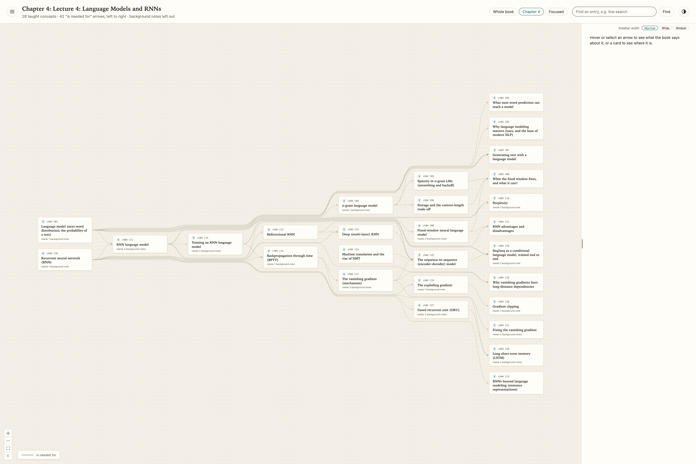
*Lecture 4 in metamatx's chapter view: the lecture's 28 taught concepts as cards, with the 42 "is needed for" arrows between them running left to right. They run from the language model and the recurrent network on the left, through the RNN language model, its training and backpropagation through time, to perplexity, vanishing and exploding gradients, seq2seq translation, GRUs and LSTMs on the right. Background notes are left out. The interactive version of this map is [concept-map.html](concept-map.html).*

## Contents

- [1. The plan: the most important idea in the class](#1-the-plan-the-most-important-idea-in-the-class)
- [2. Language modeling: predict the next word](#2-language-modeling-predict-the-next-word)
- [3. n-gram language models: learning by counting](#3-n-gram-language-models-learning-by-counting)
- [4. A fixed-window neural language model](#4-a-fixed-window-neural-language-model)
- [5. Recurrent neural networks: one set of weights, any length](#5-recurrent-neural-networks-one-set-of-weights-any-length)
- [6. Training an RNN language model, and backpropagation through time](#6-training-an-rnn-language-model-and-backpropagation-through-time)
- [7. Generating text, and measuring a language model](#7-generating-text-and-measuring-a-language-model)
- [8. Vanishing and exploding gradients](#8-vanishing-and-exploding-gradients)
- [9. Bidirectional and deep RNNs](#9-bidirectional-and-deep-rnns)
- [10. Machine translation and sequence-to-sequence models](#10-machine-translation-and-sequence-to-sequence-models)
- [11. Gated units: GRUs and LSTMs](#11-gated-units-grus-and-lstms)
- [Across the sections](#across-the-sections)
- [Glossary](#glossary)
- [Open questions](#open-questions)

## 1. The plan: the most important idea in the class

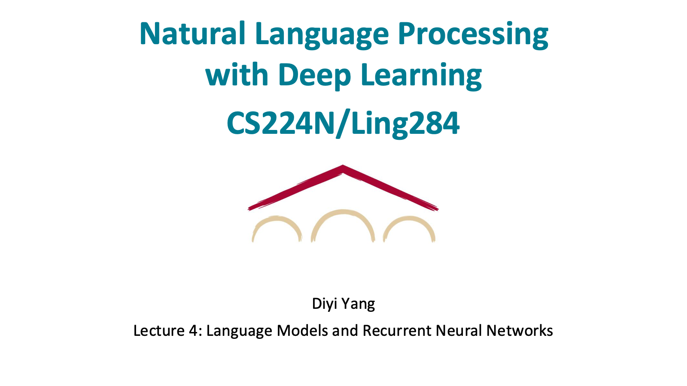
*Slide 1: "Natural Language Processing with Deep Learning, CS224N/Ling284", Diyi Yang, "Lecture 4: Language Models and Recurrent Neural Networks".*

Lecture 3 ended with a working recipe: write a network as a graph, run it forward, run backpropagation backward, step downhill. Lecture 4 points that recipe at the single most useful question in NLP: *what word comes next?* It is a small question with a long reach. Answer it well enough and you get autocomplete; answer it far better and, as slide 7 is about to put it, you get ChatGPT.

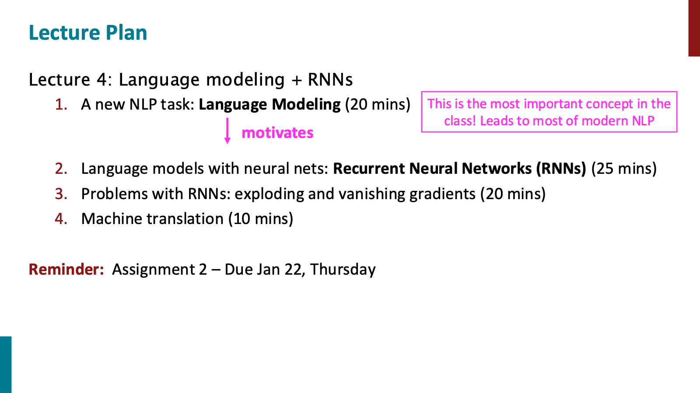
*Slide 2: the plan: "A new NLP task: Language Modeling (20 mins)", "Language models with neural nets: Recurrent Neural Networks (RNNs) (25 mins)", "Problems with RNNs: exploding and vanishing gradients (20 mins)", "Machine translation (10 mins)"; a reminder that Assignment 2 is due Jan 22.*

The plan has four parts, and an arrow from the first: language modeling "motivates" the rest, and a pink note says "This is the most important concept in the class! Leads to most of modern NLP". It's a bold claim for slide 2 of a lecture, and slide 7 will back it up: "Everything else in NLP has been rebuilt upon Language Modeling". Keep it in mind as the course moves on to larger models.

> **Note:** The deck numbers machine translation "4." in this plan (and on slide 59, which repeats it), but its own section slide, slide 51, is headed "5. Machine Translation". There is no part 4 missing; it's a renumbering slip. Also, from slide 9 on, the number printed in each slide's corner runs ahead of its position in the PDF, two ahead from slide 9 and four ahead from slide 46. These notes count slides by their position in the PDF.

**So far, and next.** One task, four parts, and a warning that this task is the foundation for most of what follows. First, what exactly the task is.

## 2. Language modeling: predict the next word

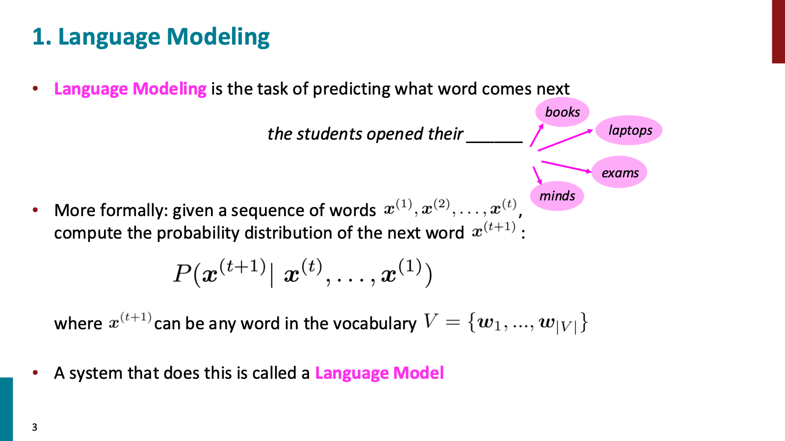
*Slide 3: "1. Language Modeling": "the students opened their ___" with books, laptops, exams and minds as candidates; the formal definition P(x^(t+1) | x^(t), …, x^(1)).*

"Language Modeling is the task of predicting what word comes next". Slide 3's example is a sentence everyone can finish: "the students opened their ___". Books? Laptops? Exams? Minds? (The last one is aspirational.) More formally, given a sequence of words x^(1), x^(2), …, x^(t), a **language model** computes the probability distribution of the next word,

P(x^(t+1) | x^(t), …, x^(1)),

"where x^(t+1) can be any word in the vocabulary V = {w_1, …, w_|V|}". "A system that does this is called a Language Model". Note what the output is: not one word, but a probability for every word in the vocabulary. Choosing a word comes later.

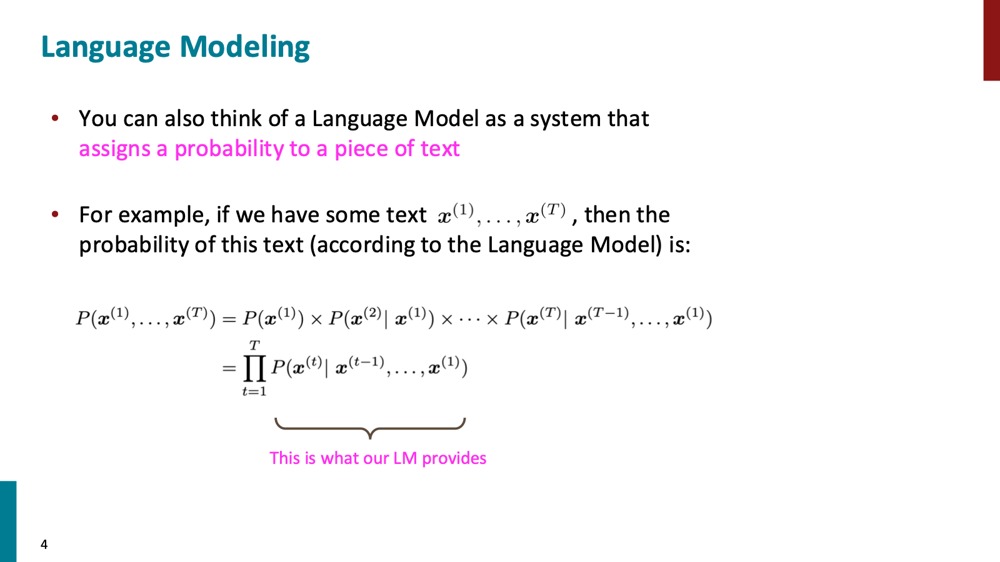
*Slide 4: an LM "assigns a probability to a piece of text": P(x^(1), …, x^(T)) as a product of next-word conditionals, "This is what our LM provides".*

There is a second way to see the same machine. "You can also think of a Language Model as a system that assigns a probability to a piece of text". Any joint probability factors, by the chain rule of probability, into a product of conditionals:

P(x^(1), …, x^(T)) = P(x^(1)) × P(x^(2) | x^(1)) × ⋯ × P(x^(T) | x^(T−1), …, x^(1)) = ∏_{t=1}^{T} P(x^(t) | x^(t−1), …, x^(1))

and each factor is exactly what slide 3's model gives, "This is what our LM provides". So "predict the next word" and "score a whole text" are one skill, seen from two ends. Lecture 1 told the history of this idea, from Markov's consonant–vowel transition probabilities in Pushkin's *Eugene Onegin* (1913) to IBM naming the "language model" in the 1970s ([Lecture 1, section 9](../01-history-of-nlp/README.md#9-era-4b-large-language-models)); this lecture makes it precise.

> **Check your understanding.** A model says P(the) = 0.1, P(cat | the) = 0.02 and P(sat | the, cat) = 0.3. What probability does it give the text "the cat sat"? *Answer: 0.1 × 0.02 × 0.3 = 0.0006. Every word you add multiplies in another factor below 1, which is why long texts get tiny probabilities, and why section 7 will average per word.*


*Slide 5: "You use Language Models every day!": a phone keyboard suggesting cafe, airport, office; a search box completing "what is the …".*

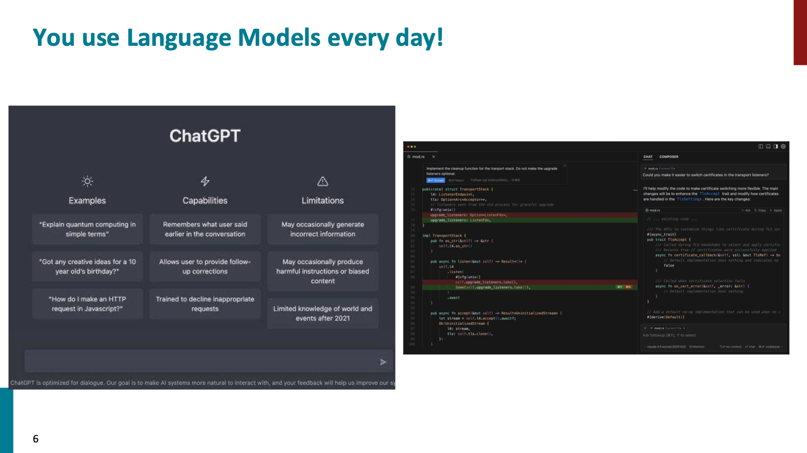
*Slide 6: more everyday LMs: ChatGPT's welcome screen and a coding assistant editing code.*

"You use Language Models every day!" Slide 5 has the humble ones: the keyboard that offers "cafe, airport, office" after "I'll meet you at the", and the search box that finishes "what is the" with everything from "weather" to "meaning of life". Slide 6 has the famous ones: ChatGPT and an AI coding assistant. Same job, very different scale.

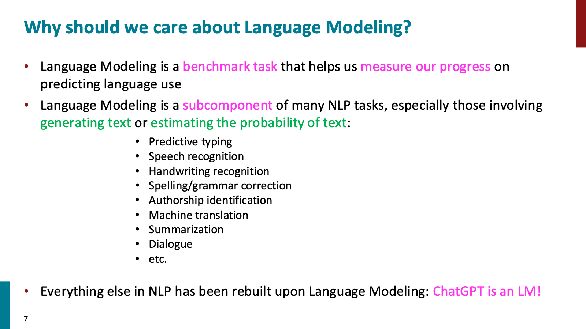
*Slide 7: "Why should we care about Language Modeling?": a benchmark task, a subcomponent of many tasks, and "ChatGPT is an LM!"*

Why should a course care? Two old reasons and one new one. "Language Modeling is a benchmark task that helps us measure our progress on predicting language use". It is "a subcomponent of many NLP tasks, especially those involving generating text or estimating the probability of text": predictive typing, speech recognition, handwriting recognition, spelling and grammar correction, authorship identification, machine translation, summarization, dialogue. And the new one, in bold: "Everything else in NLP has been rebuilt upon Language Modeling: ChatGPT is an LM!"

> **Note:** Notes 5 §1.1 gives the "estimating the probability of text" use a concrete form. A translation system generates several candidate outputs and asks the language model to score them, so it prefers "the cat is small" to "small the is cat", and "walking home after school" to "walking house after school". The translator proposes; the language model judges what sounds like English.

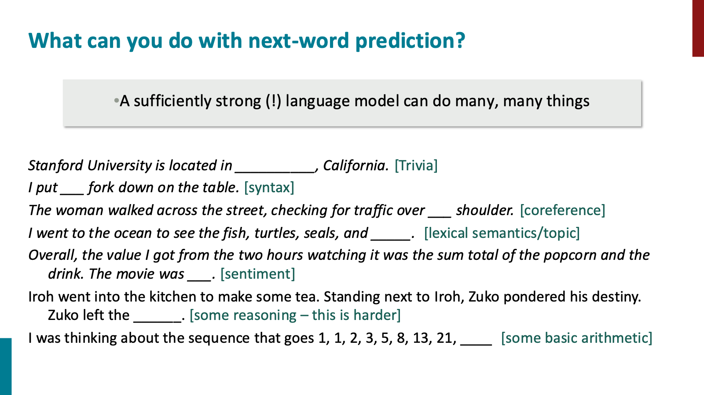
*Slide 8: "What can you do with next-word prediction?": seven fill-in-the-blank sentences labelled trivia, syntax, coreference, lexical semantics/topic, sentiment, reasoning and arithmetic.*

Slide 8 is the most important slide in the section, because it explains why "just predict the next word" is not a small ambition. "A sufficiently strong (!) language model can do many, many things". Each blank needs a different kind of knowledge:

- "Stanford University is located in ___, California." needs a fact [Trivia].
- "I put ___ fork down on the table." needs grammar [syntax].
- "The woman walked across the street, checking for traffic over ___ shoulder." needs to know who "the woman" is [coreference].
- "I went to the ocean to see the fish, turtles, seals, and ___." needs a sense of topic [lexical semantics/topic].
- The movie whose value was "the sum total of the popcorn and the drink" was ___ [sentiment].
- "Iroh went into the kitchen to make some tea. Standing next to Iroh, Zuko pondered his destiny. Zuko left the ___." needs [some reasoning – this is harder]: Zuko is in the kitchen, so he leaves the kitchen.
- "1, 1, 2, 3, 5, 8, 13, 21, ___" needs [some basic arithmetic].

The point is that the training signal is free (any text supplies its own next words) and the knowledge needed to predict well is not. So the objective can reward learning grammar, facts and reasoning patterns without anyone labelling any of it. Seven examples don't prove that a model has learned these things in general; they show what the task can demand.

**So far, and next.** A language model gives a distribution over the next word, or equivalently a probability for any text, and predicting well demands a surprising amount of knowledge. Now: how to build one. First the way it was done for decades, by counting.

## 3. n-gram language models: learning by counting

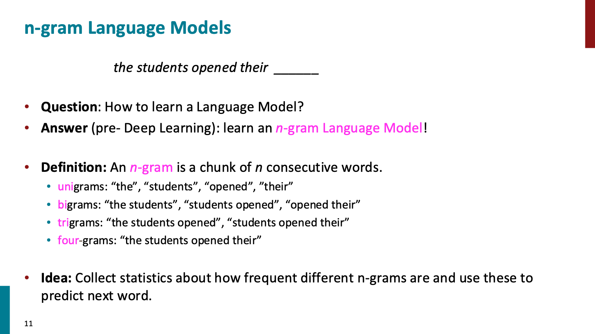
*Slide 9: "n-gram Language Models": "the students opened their ___"; unigrams, bigrams, trigrams and four-grams of the phrase; "Collect statistics about how frequent different n-grams are".*

"Question: How to learn a Language Model? Answer (pre- Deep Learning): learn an n-gram Language Model!" "An n-gram is a chunk of n consecutive words": "the", "students", "opened", "their" are unigrams; "the students", "students opened", "opened their" are bigrams; and so on up to the four-gram "the students opened their". The idea: "Collect statistics about how frequent different n-grams are and use these to predict next word."

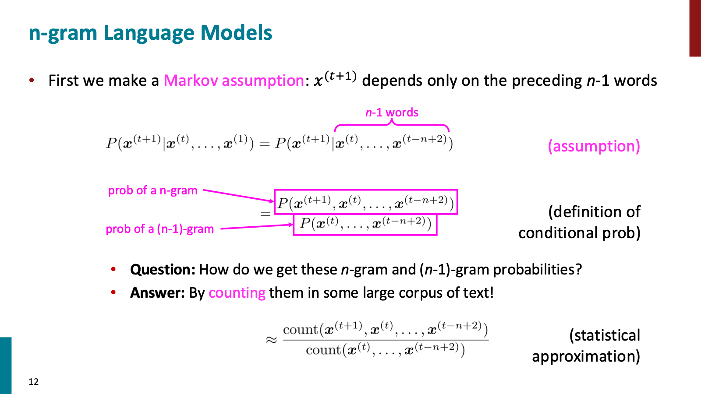
*Slide 10: the Markov assumption, the conditional probability as an n-gram over an (n−1)-gram probability, and the counting approximation.*

Slide 10 turns the idea into three steps, each labelled.

1. **The assumption.** "First we make a Markov assumption: x^(t+1) depends only on the preceding n-1 words": P(x^(t+1) | x^(t), …, x^(1)) = P(x^(t+1) | x^(t), …, x^(t−n+2)).
2. **The definition of conditional probability.** That conditional is the "prob of a n-gram" divided by the "prob of a (n-1)-gram": P(x^(t+1), x^(t), …, x^(t−n+2)) / P(x^(t), …, x^(t−n+2)).
3. **The statistical approximation.** Estimate both by "counting them in some large corpus of text!": ≈ count(x^(t+1), x^(t), …, x^(t−n+2)) / count(x^(t), …, x^(t−n+2)).

For a bigram model (n = 2) this is just p(w_2 | w_1) = count(w_1, w_2) / count(w_1), and for a trigram p(w_3 | w_1, w_2) = count(w_1, w_2, w_3) / count(w_1, w_2) (notes 5 §1.2, Eqs. 2–3).

> **Note:** Watch the n. On the slides an n-gram model conditions on the preceding n − 1 words, so a trigram model looks back two. Notes 5 §1.1 (Eq. 1) instead conditions on "a window of n previous words", P(w_i | w_{i−n}, …, w_{i−1}), which is n + 1 words per gram. Same idea, off by one; these notes follow the slides.

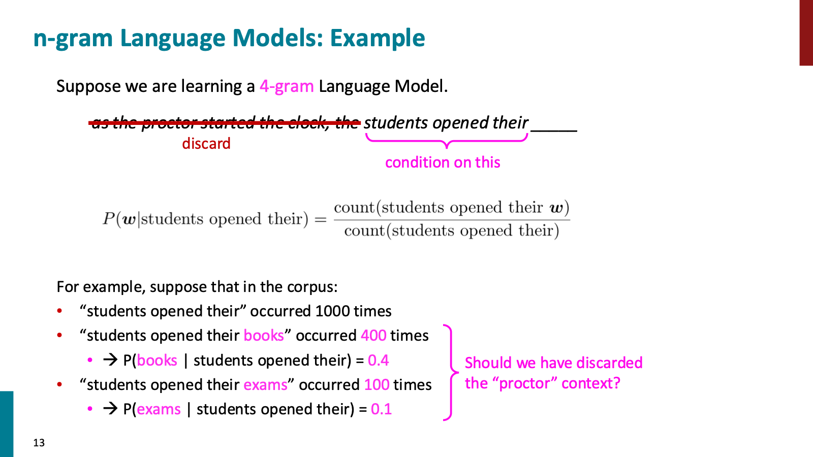
*Slide 11: "n-gram Language Models: Example": a 4-gram LM discards "as the proctor started the clock" and conditions on "students opened their"; P(books | …) = 0.4, P(exams | …) = 0.1; "Should we have discarded the 'proctor' context?"*

Slide 11 runs the recipe on "as the proctor started the clock, the students opened their ___". A 4-gram model keeps only the last three words, "students opened their", and discards the rest. Suppose in the corpus "students opened their" occurred 1000 times, "students opened their books" 400 times and "students opened their exams" 100 times. Then P(books | students opened their) = 400/1000 = 0.4 and P(exams | students opened their) = 100/1000 = 0.1. Then the slide asks the awkward question: "Should we have discarded the 'proctor' context?" A proctor and a clock make "exams" the obvious answer, and the model threw that evidence away before it started.

> **Check your understanding.** A tiny corpus reads "the cat sat . the cat ran . the dog sat ." Using a bigram model, what is P(cat | the), and P(sat | cat)? *Answer: "the" occurs 3 times, followed by "cat" twice, so P(cat | the) = 2/3. "cat" occurs twice, followed once by "sat" and once by "ran", so P(sat | cat) = 1/2.*

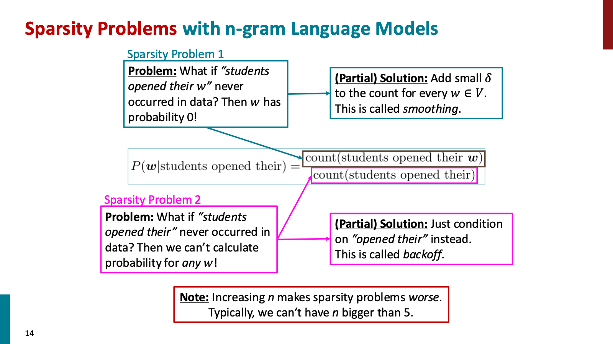
*Slide 12: "Sparsity Problems with n-gram Language Models": a zero numerator (smoothing) and a zero denominator (backoff); "we can't have n bigger than 5".*

Counting has a weakness: most long word sequences never occur, even in a big corpus. Slide 12 names the two ways this bites, one for each part of the fraction.

- **Sparsity Problem 1, a zero numerator.** "What if 'students opened their w' never occurred in data? Then w has probability 0!" A perfectly good word gets probability exactly zero just because the corpus never happened to contain it. "(Partial) Solution: Add small δ to the count for every w ∈ V. This is called smoothing."
- **Sparsity Problem 2, a zero denominator.** "What if 'students opened their' never occurred in data? Then we can't calculate probability for any w!" "(Partial) Solution: Just condition on 'opened their' instead. This is called backoff."

And the bad news in the red box: "Increasing n makes sparsity problems worse. Typically, we can't have n bigger than 5."

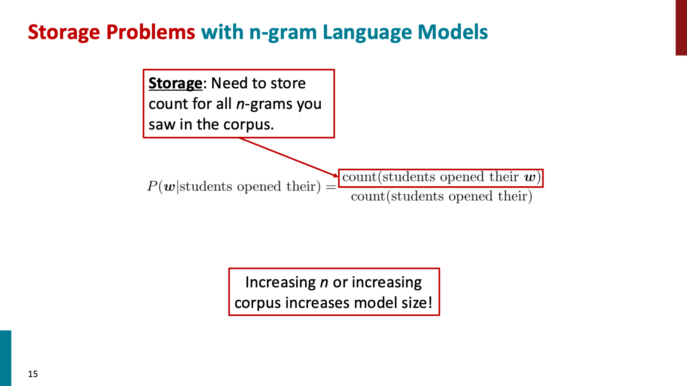
*Slide 13: "Storage Problems with n-gram Language Models": counts for all observed n-grams; "Increasing n or increasing corpus increases model size!"*

The second weakness is storage. "Need to store count for all n-grams you saw in the corpus." A bigger n or a bigger corpus means more distinct n-grams to remember: "Increasing n or increasing corpus increases model size!" An n-gram model doesn't learn a compact summary of language; it keeps the receipts.

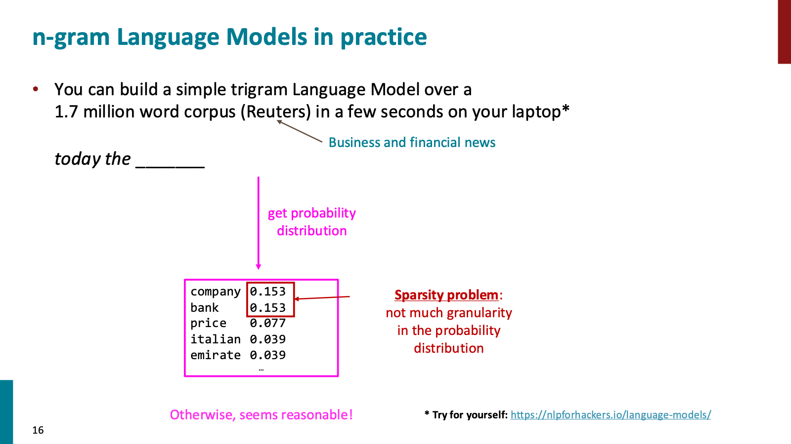
*Slide 14: "n-gram Language Models in practice": a trigram LM over the 1.7-million-word Reuters corpus; "today the ___" gives company 0.153, bank 0.153, price 0.077, italian 0.039, emirate 0.039.*

None of this means n-grams are useless. "You can build a simple trigram Language Model over a 1.7 million word corpus (Reuters) in a few seconds on your laptop", and on business and financial news it predicts "today the ___" as company (0.153), bank (0.153), price (0.077), italian (0.039), emirate (0.039): "Otherwise, seems reasonable!" The slide circles one sign of trouble: company and bank tie at exactly 0.153, labelled "Sparsity problem: not much granularity in the probability distribution". With few matching contexts, the probabilities are ratios of small whole numbers, and ties are common.

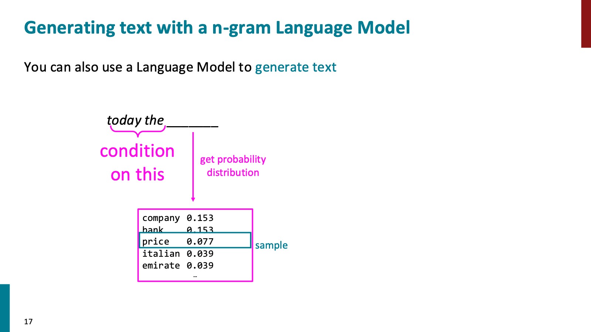
*Slide 15: "Generating text with a n-gram Language Model": condition on "today the", get the distribution, and sample "price" (0.077).*

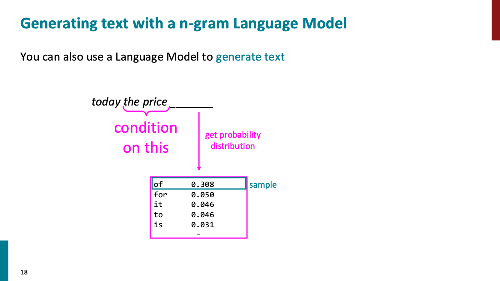
*Slide 16: condition on "the price" and sample "of" (0.308, ahead of for 0.050, it 0.046, to 0.046, is 0.031).*

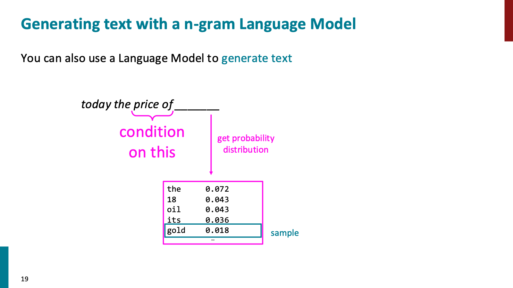
*Slide 17: condition on "price of" and sample "gold" (0.018, from the 0.072, 18 0.043, oil 0.043, its 0.036, gold 0.018).*

"You can also use a Language Model to generate text": condition on the context, get the probability distribution, sample a word, append it, repeat. Slides 15–17 do it three times. From "today the", sample "price" (0.077; not the most likely word, which is fine, because sampling is not choosing the maximum). The trigram then looks only at the last two words, "the price", and samples "of" (0.308). Then "price of" gives "gold" at 0.018, a long shot, which sampling happily takes. The conditioning bracket slides one word to the right at every step, and everything older falls off the back.

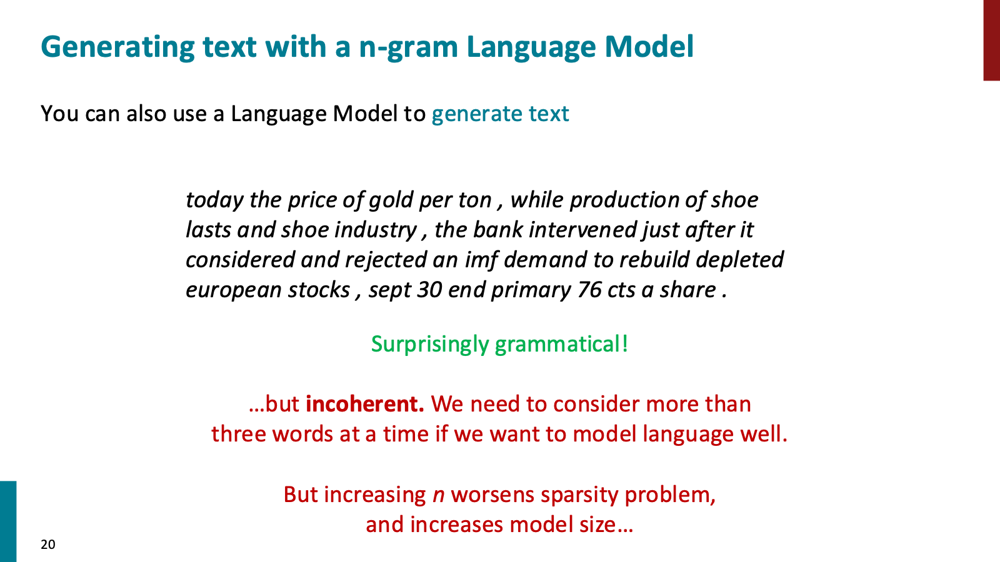
*Slide 18: the trigram's output: "today the price of gold per ton , while production of shoe lasts and shoe industry , the bank intervened just after it considered and rejected an imf demand to rebuild depleted european stocks , sept 30 end primary 76 cts a share ."*

Keep going and you get slide 18's paragraph, which is worth reading aloud: "today the price of gold per ton , while production of shoe lasts and shoe industry , the bank intervened just after it considered and rejected an imf demand to rebuild depleted european stocks , sept 30 end primary 76 cts a share ." The verdict: "Surprisingly grammatical! …but incoherent." Every three-word stretch is plausible financial English; the whole thing is about gold, shoes, a bank and the IMF at once. "We need to consider more than three words at a time if we want to model language well. But increasing n worsens sparsity problem, and increases model size…" That is the trap in one sentence: n-grams can't see far, and making them see farther makes them worse.

**So far, and next.** n-gram models estimate next-word probabilities by counting, under a Markov assumption that throws away all but the last n − 1 words. They suffer sparsity (patched by smoothing and backoff) and storage, and their output is locally fluent but globally lost. The first neural fix keeps the fixed window but replaces counting with a network.

## 4. A fixed-window neural language model

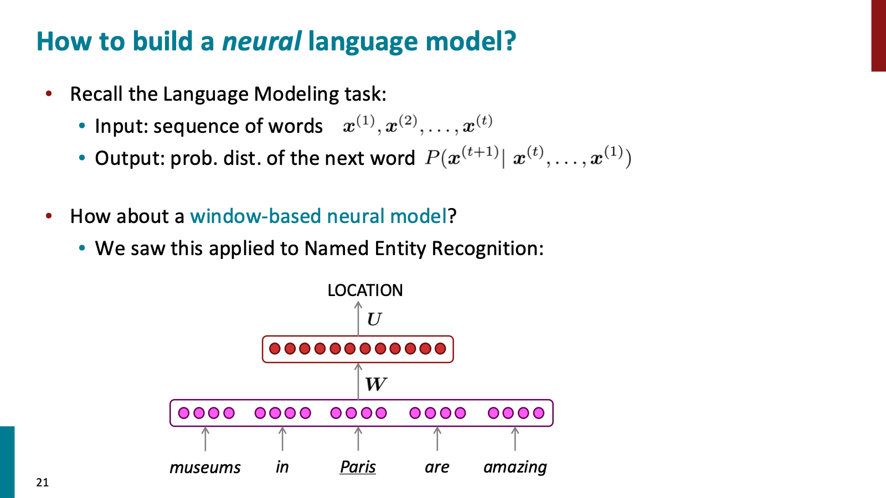
*Slide 19: "How to build a neural language model?": input a word sequence, output the next-word distribution; "How about a window-based neural model? We saw this applied to Named Entity Recognition".*

"How about a window-based neural model? We saw this applied to Named Entity Recognition". You did: [Lecture 3, section 3](../03-backpropagation/README.md#3-a-neural-network-for-named-entities) classified "Paris" from a window of word vectors with one hidden layer. A language model needs the same machinery with a different output: not "is this a location?", but "which of the |V| words comes next?".

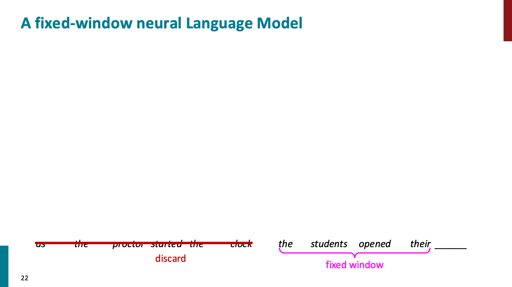
*Slide 20: "A fixed-window neural Language Model": keep the fixed window "the students opened their", discard "as the proctor started the clock".*

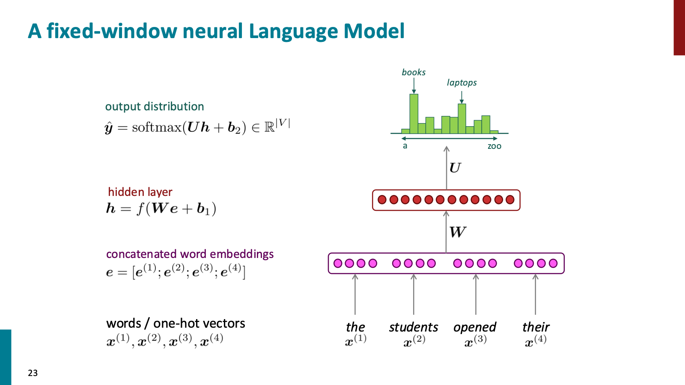
*Slide 21: one-hot words x^(1)…x^(4), concatenated embeddings e = [e^(1); e^(2); e^(3); e^(4)], hidden layer h = f(We + b₁), output distribution ŷ = softmax(Uh + b₂) ∈ ℝ^|V|.*

Slide 20 keeps a fixed window ("the students opened their") and still discards the proctor. Slide 21 builds the model from the bottom up:

- words as one-hot vectors x^(1), x^(2), x^(3), x^(4);
- their **concatenated word embeddings**, e = [e^(1); e^(2); e^(3); e^(4)];
- a **hidden layer**, h = f(We + b₁);
- an **output distribution**, ŷ = softmax(Uh + b₂) ∈ ℝ^|V|.

The output is a softmax over the whole vocabulary, from "a" to "zoo", with "books" and "laptops" tall in the histogram. Everything here is a piece you already have: embeddings from Lecture 2, the hidden layer and softmax from Lecture 3. The new idea is only where the pieces point.

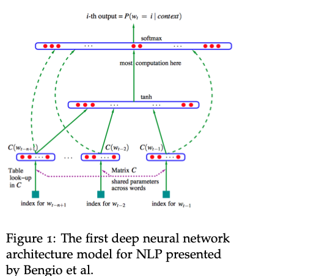
*Notes 5, Figure 1: "The first deep neural network architecture model for NLP presented by Bengio et al.": each previous word is looked up in a shared matrix C, the vectors feed a tanh layer, and a softmax gives P(w_t = i | context); dashed arrows connect the word vectors straight to the output.*

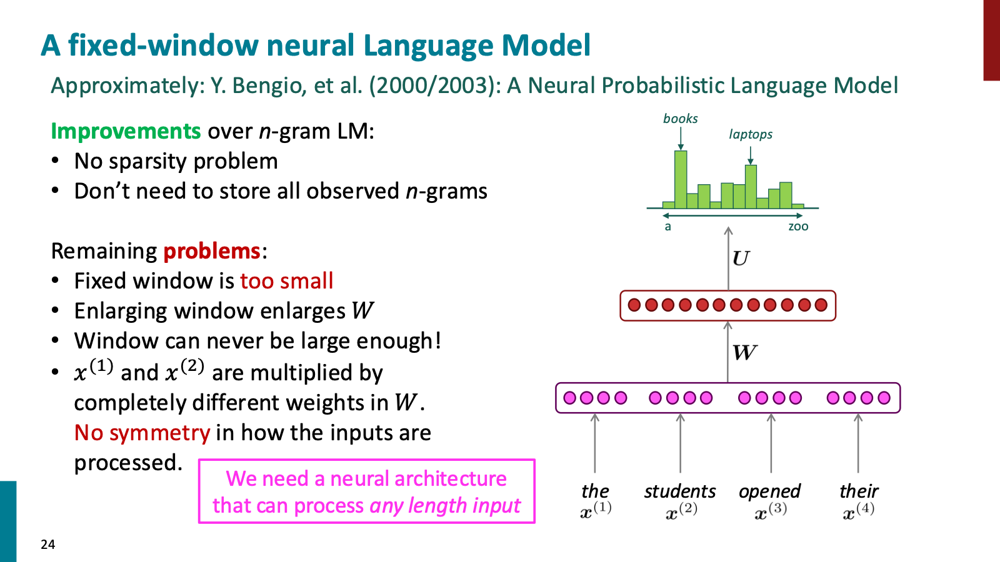
*Slide 22: "Approximately: Y. Bengio, et al. (2000/2003): A Neural Probabilistic Language Model"; improvements over n-gram LMs and remaining problems; "We need a neural architecture that can process any length input".*

Slide 22 credits the design, "Approximately", to Bengio et al.'s "A Neural Probabilistic Language Model" (2000/2003). Notes 5 §1.3 calls it the "first large-scale deep learning for natural language processing model", one that "learns a distributed representation of words, along with the probability function for word sequences expressed in terms of these representations". The original (notes 5 Figure 1, Eq. 4) has one extra feature, direct connections from the word vectors to the output:

ŷ = softmax(W^(2) tanh(W^(1)x + b^(1)) + W^(3)x + b^(3))

with W^(1) on the word vectors, W^(2) on the hidden layer, and W^(3) the dashed shortcut from the words to the softmax. Drop W^(3) and you have slide 21 (the notes' Figure 2 is exactly that "simplified representation").

> **Note:** Bengio, Ducharme, Vincent and Jauvin's [paper](https://www.jmlr.org/papers/v3/bengio03a.html) (JMLR 2003, after a NIPS 2000 version) frames the whole problem in its first lines. Language modeling "is intrinsically difficult because of the curse of dimensionality: a word sequence on which the model will be tested is likely to be different from all the word sequences seen during training". Their fix was to "fight the curse of dimensionality by learning a distributed representation for words", so a sentence teaches the model about all the similar sentences too. It worked. On the Brown corpus the best n-gram model's test perplexity (section 7) was 312 against the network's 252, a difference the paper reports as 24%; on AP News, 117 against 109, about 8%. (The best network rows mix its output probabilities with a trigram's, "with a weight of 0.5 on each".) It was also expensive. The AP News run managed 5 epochs "over 3 weeks using 40 CPUs".

What does the window buy? Two "Improvements over n-gram LM": "No sparsity problem", because similar words have similar embeddings and nothing is a raw count; and "Don't need to store all observed n-grams", only the weights. What remains? Four "Remaining problems":

- "Fixed window is too small".
- "Enlarging window enlarges W", since each extra word adds a block of columns to W.
- "Window can never be large enough!"
- "x^(1) and x^(2) are multiplied by completely different weights in W. No symmetry in how the inputs are processed."

The last one is subtle and important. Because e is a concatenation, the word in position 1 meets one block of W and the word in position 2 meets a different block. The embeddings are shared ("students" has one vector wherever it appears), but the W blocks are not tied, so a transformation learned in one position's block need not transfer to another's. The conclusion, in the pink box: "We need a neural architecture that can process any length input".

> **Check your understanding.** A window of 4 words, embeddings of size d = 100 and a hidden layer of 500 units. How many weights are in W, and what happens if the window grows to 8? *Answer: e has 4 × 100 = 400 entries, so W is 500 × 400 = 200,000 weights. A window of 8 doubles e to 800 and W to 400,000. The model grows with the window, which is the problem slide 22 names.*

**So far, and next.** A fixed-window neural LM replaces counts with embeddings and a hidden layer, which cures sparsity and storage. But its window is fixed, grows W when widened, and treats each position with separate weights. The fix is to reuse one set of weights at every position, as many times as the text is long: a recurrent neural network.

## 5. Recurrent neural networks: one set of weights, any length

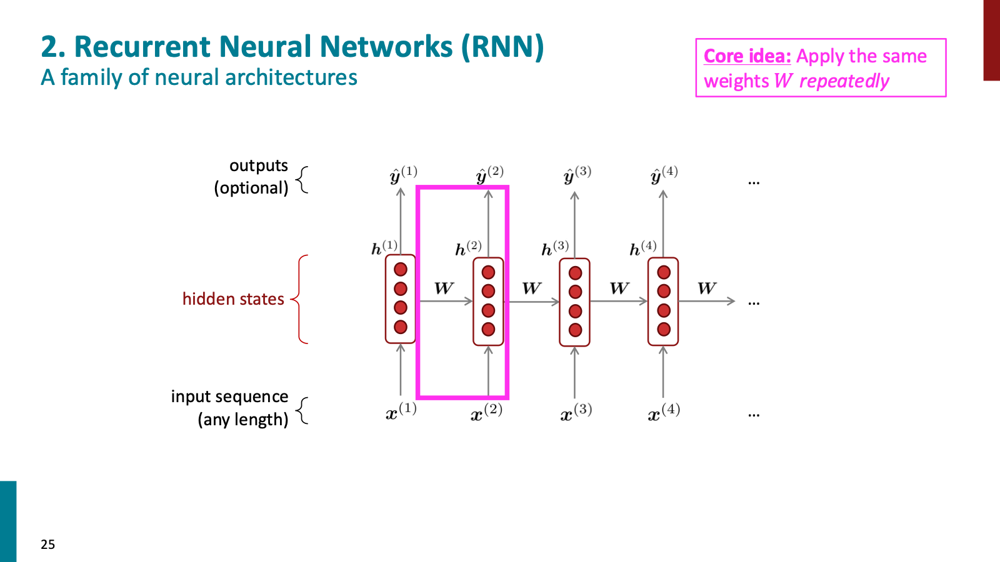
*Slide 23: "2. Recurrent Neural Networks (RNN)": an input sequence of any length, hidden states h^(1), h^(2), … joined by the same W, optional outputs ŷ^(t); "Core idea: Apply the same weights W repeatedly".*

Here is the whole idea of an RNN in five words, from the pink box on slide 23: "Apply the same weights W repeatedly". A **recurrent neural network** is "A family of neural architectures": it reads an "input sequence (any length)" one item at a time and keeps a **hidden state** h^(t), a running summary of everything read so far. At each step the new state is computed from the previous state and the new input, using the same W every time, and the network may emit an output ŷ^(t) ("outputs (optional)").

Compare that with section 4's window. There, each position had its own block of W; here, the same input-to-hidden weights act at every timestep, whether a word arrives first or fortieth. (The word's resulting hidden state still differs with its context, because it also depends on h^(t−1); what's shared is the transformation, not the outcome.) And since the weights are reused, the network has no maximum length. Notes 5 §2 says it with some relish: because "the same weights W^(hh) and W^(hx) are applied repeatedly at each timestep", the number of parameters "is independent of the length of the input sequence - thus defeating the curse of dimensionality!"

> **Note:** Notes 5 draws the same network a second way (its Figure 6): one hidden layer with an arrow curling back into itself, "an alternative representation of RNNs used in some publications". The loop and slide 23's long chain are the same thing. The chain is the loop "unrolled" through time, one copy per step, all sharing weights. Chris Olah's much-loved [Understanding LSTM Networks](https://colah.github.io/posts/2015-08-Understanding-LSTMs/) (2015), which slide 50 links, makes the same move: "A recurrent neural network can be thought of as multiple copies of the same network, each passing a message to a successor."

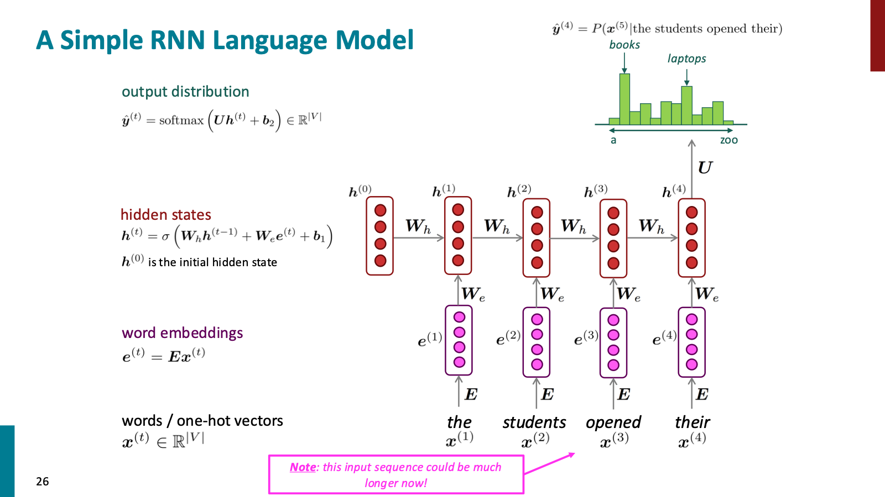
*Slide 24: "A Simple RNN Language Model": one-hot words, embeddings e^(t) = Ex^(t), hidden states h^(t) = σ(W_h h^(t−1) + W_e e^(t) + b₁) from an initial h^(0), and outputs ŷ^(t) = softmax(Uh^(t) + b₂); ŷ^(4) = P(x^(5) | the students opened their).*

Slide 24 makes it a language model. Read it from the bottom up:

- **words / one-hot vectors**, x^(t) ∈ ℝ^|V|;
- **word embeddings**, e^(t) = Ex^(t);
- **hidden states**, h^(t) = σ(W_h h^(t−1) + W_e e^(t) + b₁), where "h^(0) is the initial hidden state";
- **output distribution**, ŷ^(t) = softmax(Uh^(t) + b₂) ∈ ℝ^|V|.

At every step the model makes a prediction. After reading "the students opened their", ŷ^(4) = P(x^(5) | the students opened their), and once again "books" and "laptops" stand tall. And the pink note at the bottom is the whole point of this section: "Note: this input sequence could be much longer now!"

Notes 5 writes the same model without the embedding step and with its own names, h_t = σ(W^(hh)h_{t−1} + W^(hx)x_t) (Eq. 5) and ŷ_t = softmax(W^(S)h_t) (Eq. 6), and translates between the two: W^(hh) is the slide's W_h, W^(hx) is W_e, and W^(S) is U. It also lists every shape, which is the best way to check you understand the model:

| Symbol | Shape | What it is |
|---|---|---|
| x_t | ℝ^d | the input word vector at time t |
| W^(hx) | ℝ^{D_h×d} | input-to-hidden weights |
| W^(hh) | ℝ^{D_h×D_h} | hidden-to-hidden weights, the ones reused through time |
| h_t, h_0 | ℝ^{D_h} | the hidden state; h_0 is "an initialization vector" |
| W^(S) | ℝ^{\|V\|×D_h} | hidden-to-output weights |
| ŷ_t | ℝ^{\|V\|} | the predicted distribution over the vocabulary |

> **Check your understanding.** With d = 300, D_h = 512 and |V| = 50,000, how many weights are in W^(hx), W^(hh) and W^(S), and how does that change if the input text is ten times longer? *Answer: 512 × 300 = 153,600; 512 × 512 = 262,144; and 50,000 × 512 = 25,600,000. Nothing changes with the text's length: the same three matrices are used at every step. Notice where the parameters live, too: the output layer dwarfs the recurrence, because it has to score every word in the vocabulary.*

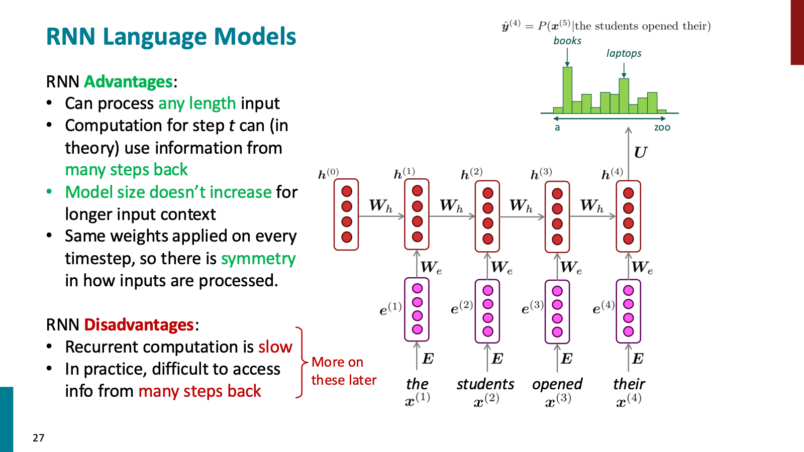
*Slide 25: "RNN Language Models": four advantages (any length input, information from many steps back, fixed model size, symmetry) and two disadvantages (slow, hard to use information from many steps back), "More on these later".*

Slide 25 keeps the books. The advantages:

- "Can process any length input".
- "Computation for step t can (in theory) use information from many steps back".
- "Model size doesn't increase for longer input context".
- "Same weights applied on every timestep, so there is symmetry in how inputs are processed".

Three of these answer section 4's remaining problems directly. The disadvantages:

- "Recurrent computation is slow". Notes 5 §2.2 says why: "because it is sequential, it cannot be parallelized". You can't compute h^(10) until you have h^(9).
- "In practice, difficult to access info from many steps back".

Both come with "More on these later". Notice the quiet "(in theory)" in the second advantage and the "In practice" in the second disadvantage. They are the same claim seen from two sides, and section 8 is about the gap between them.

> **Note:** Notes 5 §2.2 adds a memory remark that needs a careful reading. It says "The amount of memory required to run a layer of RNN is proportional to the number of words in the corpus", then immediately narrows it: treat a sentence as a minibatch, and "a sentence with k words would have k word vectors to be stored in memory". It also says "For a RNN with 1000 recurrent layers, the matrix would be 1000 × 1000 regardless of the corpus size", which only makes sense with 1000 hidden units, not 1000 layers. The point stands: the weight matrices don't grow with the data.

RNNs aren't only for language models. Notes 5 §2.2 lists "tagging (e.g. part-of-speech, named entity recognition), sentence classification (e.g. sentiment classification), and encoder modules (e.g. questiton answering, machine translation, and many other tasks)". For a whole-sentence task, "we want a representation for the sentence, which we can obtain by taking the element-wise max or mean of all hidden states of the timesteps in that sentence". Keep "encoder module" in mind: it returns in section 10.

**So far, and next.** An RNN reuses one set of weights at every step and carries a hidden state forward, so it handles text of any length with a fixed model size. As an LM, it predicts the next word at every step. Next: how to train it, and what backpropagation has to do when the same weight appears at every step.

## 6. Training an RNN language model, and backpropagation through time

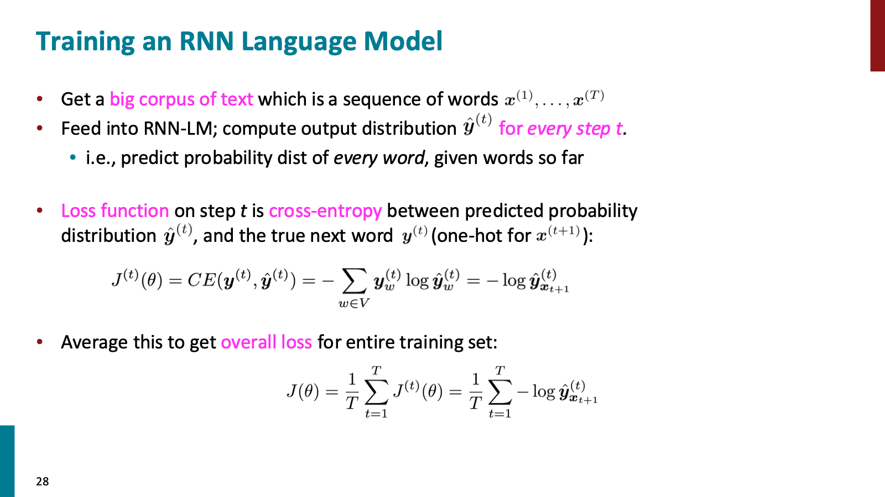
*Slide 26: "Training an RNN Language Model": a big corpus, a prediction at every step, per-step cross-entropy J^(t)(θ) = −log ŷ^(t)_{x_{t+1}}, averaged into J(θ).*

Training follows the recipe from Lectures 2 and 3. "Get a big corpus of text which is a sequence of words x^(1), …, x^(T)". "Feed into RNN-LM; compute output distribution ŷ^(t) for every step t", "i.e., predict probability dist of every word, given words so far". The "Loss function on step t is cross-entropy between predicted probability distribution ŷ^(t), and the true next word y^(t) (one-hot for x^(t+1))":

J^(t)(θ) = CE(y^(t), ŷ^(t)) = −Σ_{w∈V} y_w^(t) log ŷ_w^(t) = −log ŷ^(t)_{x_{t+1}}

Because y^(t) is one-hot, the sum collapses to one term: the negative log probability the model gave the word that actually came next. "Average this to get overall loss for entire training set":

J(θ) = (1/T) Σ_{t=1}^{T} J^(t)(θ) = (1/T) Σ_{t=1}^{T} −log ŷ^(t)_{x_{t+1}}

> **Note:** A small bookkeeping slip on slide 26: a corpus of T words x^(1), …, x^(T) has only T − 1 "next words" to predict, unless you add a target x^(T+1) the slide doesn't mention (an end-of-text token, say). With T words and no terminal target, the average is over T − 1 losses. The idea is unaffected; just don't let the indices convince you otherwise.

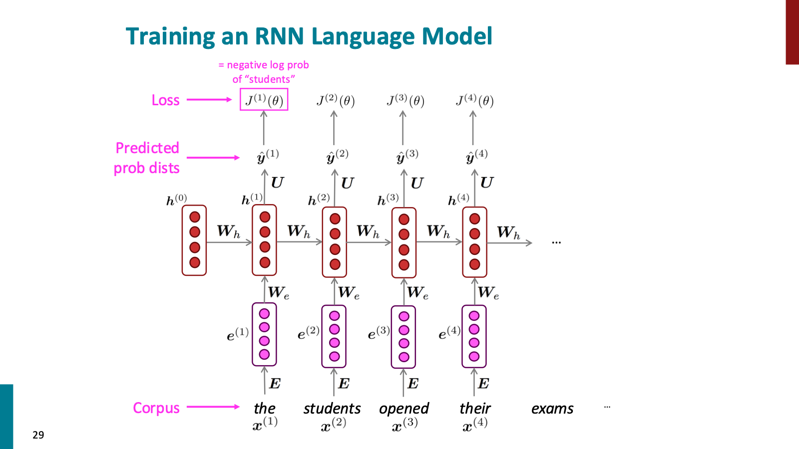
*Slide 27: on the corpus "the students opened their exams …", J^(1)(θ) is the "negative log prob of 'students'".*

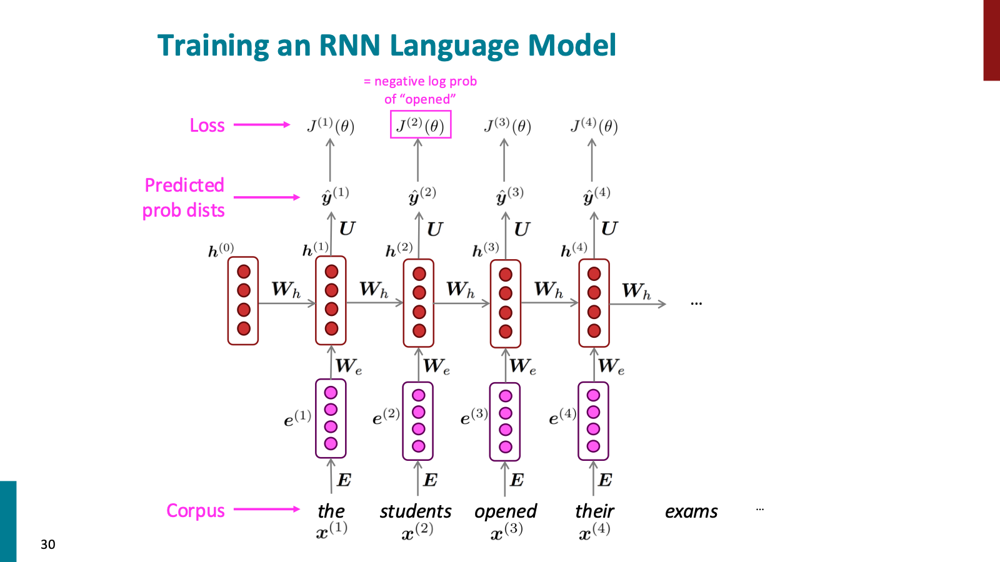
*Slide 28: J^(2)(θ), the "negative log prob of 'opened'".*

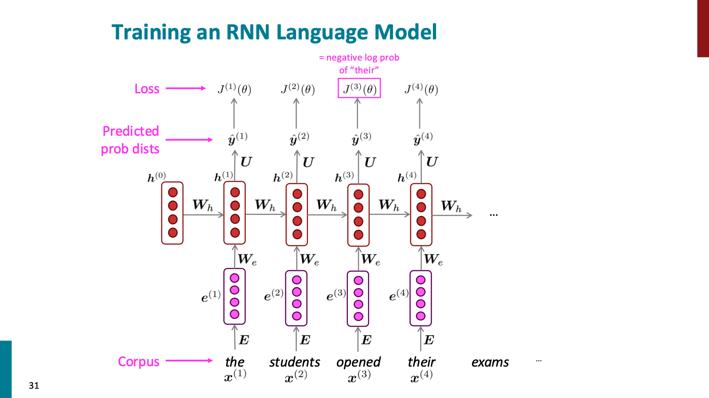
*Slide 29: J^(3)(θ), the "negative log prob of 'their'".*

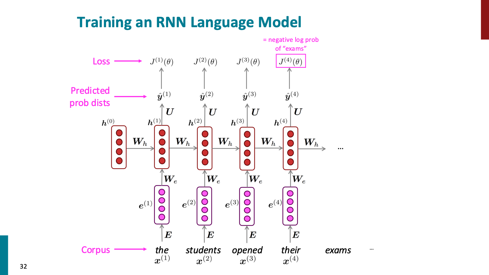
*Slide 30: J^(4)(θ), the "negative log prob of 'exams'".*

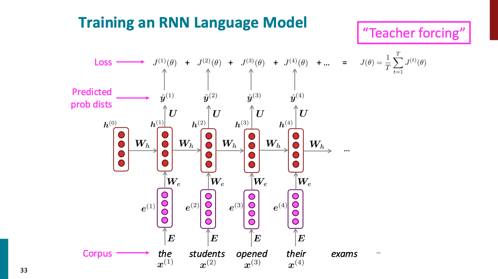
*Slide 31: the per-step losses J^(1)(θ), J^(2)(θ), J^(3)(θ), J^(4)(θ), … combined into the average J(θ) = (1/T) Σ_{t=1}^{T} J^(t)(θ), labelled "Teacher forcing".*

Slides 27–31 build the sum one term at a time on "the students opened their exams …". After reading "the", the model is charged the negative log probability of "students"; after "the students", that of "opened"; then "their"; then "exams". Add them up and average.

Slide 31 names what's happening with a single label: **"Teacher forcing"**. Look at what goes into the network at each step: always the true corpus word, never the model's own guess. If the model predicted "laptops" after "opened their", it still reads "exams" next, because that's what the corpus says. The teacher keeps putting the right word in front of the student. (That reading is ours: the slide gives only the label. It matters because generation, in section 7, does the opposite.)

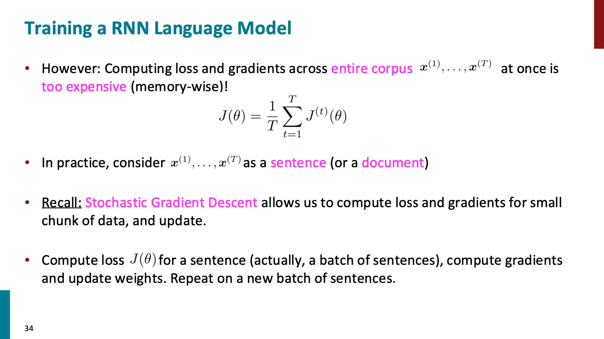
*Slide 32: "Computing loss and gradients across entire corpus at once is too expensive (memory-wise)!": treat x^(1), …, x^(T) as a sentence or document, and use stochastic gradient descent on batches of sentences.*

One practical correction: "Computing loss and gradients across entire corpus at once is too expensive (memory-wise)!" So "In practice, consider x^(1), …, x^(T) as a sentence (or a document)", and recall from [Lecture 2](../02-word-vectors/README.md#5-walking-downhill-gradient-descent-and-sgd) that "Stochastic Gradient Descent allows us to compute loss and gradients for small chunk of data, and update": "Compute loss for a sentence (actually, a batch of sentences), compute gradients and update weights. Repeat on a new batch of sentences."

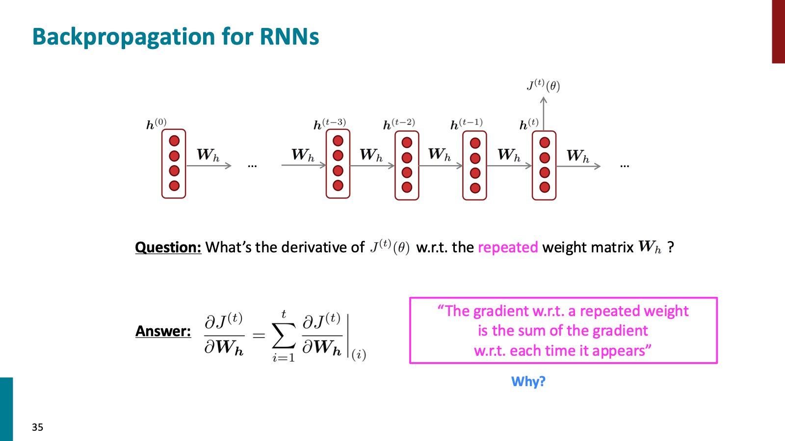
*Slide 33: "Backpropagation for RNNs": what is the derivative of J^(t)(θ) with respect to the repeated weight matrix W_h? "The gradient w.r.t. a repeated weight is the sum of the gradient w.r.t. each time it appears".*

Now the one genuinely new piece of training. In Lecture 3's networks, each weight matrix appeared once in the computation graph. In an RNN, W_h appears at every step. So: "What's the derivative of J^(t)(θ) w.r.t. the repeated weight matrix W_h?" The answer comes in pink and is worth memorising:

∂J^(t)/∂W_h = Σ_{i=1}^{t} ∂J^(t)/∂W_h |_(i)

"The gradient w.r.t. a repeated weight is the sum of the gradient w.r.t. each time it appears". Here ∂J^(t)/∂W_h |_(i) means the gradient through W_h's appearance at step i only. "Why?"

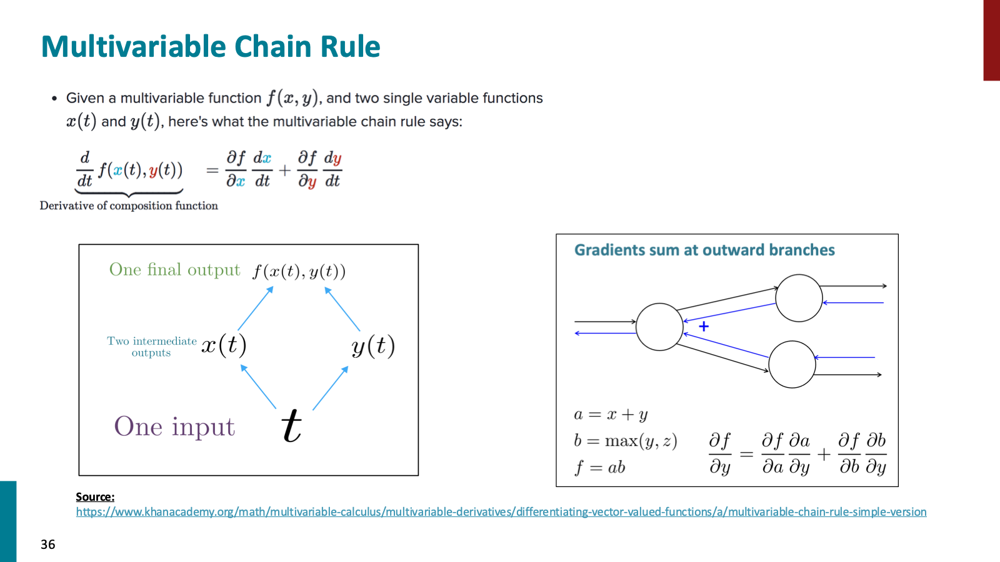
*Slide 34: "Multivariable Chain Rule": d/dt f(x(t), y(t)) = (∂f/∂x)(dx/dt) + (∂f/∂y)(dy/dt), drawn as one input, two intermediate outputs and one final output, beside Lecture 3's "Gradients sum at outward branches".*

Because of the multivariable chain rule. If one input t affects the output through two paths, x(t) and y(t), then

d/dt f(x(t), y(t)) = (∂f/∂x)(dx/dt) + (∂f/∂y)(dy/dt)

one term per path, added. Slide 34 puts Lecture 3's picture beside it, "Gradients sum at outward branches" ([Lecture 3, section 8](../03-backpropagation/README.md#8-backpropagation-the-chain-rule-as-an-algorithm)). A repeated weight is just an input with many outward branches, one per time step.

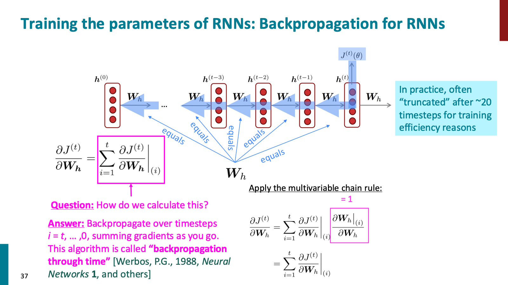
*Slide 35: "Training the parameters of RNNs: Backpropagation for RNNs": each copy W_h|_(i) "equals" W_h, so ∂W_h|_(i)/∂W_h = 1; "Backpropagate over timesteps i = t, … ,0, summing gradients as you go. This algorithm is called 'backpropagation through time'"; often "truncated" after ~20 timesteps.*

Slide 35 makes the argument concrete. Pretend each step has its own copy W_h|_(i) of the weight matrix, and that every copy "equals" the real W_h. Then the multivariable chain rule gives

∂J^(t)/∂W_h = Σ_{i=1}^{t} (∂J^(t)/∂W_h |_(i)) (∂W_h |_(i)/∂W_h) = Σ_{i=1}^{t} ∂J^(t)/∂W_h |_(i)

since each ∂W_h|_(i)/∂W_h = 1. In practice: "Backpropagate over timesteps i = t, … ,0, summing gradients as you go. This algorithm is called 'backpropagation through time' [Werbos, P.G., 1988, Neural Networks 1, and others]". And because going all the way back to the start of a long document is expensive: "In practice, often 'truncated' after ~20 timesteps for training efficiency reasons".

**Backpropagation through time (BPTT)** is not a new algorithm. It's ordinary backpropagation on the unrolled chain, with one bookkeeping rule: gradients for a shared weight add up.

> **Note:** Two small slips on slide 35: the text runs the timesteps "i = t, … ,0", while the sum runs over i = 1, …, t. Read both as "every step at which W_h was used".

> **Note:** The citation hides a nice detail. Paul Werbos's 1988 paper is called [Generalization of Backpropagation with Application to a Recurrent Gas Market Model](https://doi.org/10.1016/0893-6080(88)90007-X) (*Neural Networks* 1(4)). Its abstract says the recurrent generalization "was applied in 1981 to a model of natural gas markets, where it located sources of forecast uncertainty". Werbos wrote it at the U.S. Department of Energy, so the algorithm that trains this lecture's RNNs had, by its author's account, an early job forecasting natural gas.

> **Check your understanding.** In a 3-step RNN the loss at step 3 depends on W_h through steps 1, 2 and 3, and suppose the three per-appearance gradients are G₁, G₂ and G₃. What is ∂J^(3)/∂W_h, and what does truncating BPTT to 2 steps give? *Answer: G₁ + G₂ + G₃. Truncating to the last 2 steps keeps G₂ + G₃ and drops G₁: cheaper, but the model gets no signal about how W_h's use at step 1 affected the loss at step 3.*

**So far, and next.** An RNN-LM is trained with cross-entropy at every step, averaged, feeding the true words in ("teacher forcing"), on batches of sentences. Its gradients come from backpropagation through time, which sums the gradient of each shared weight over the steps where it appears. With a trained model in hand, we can do two things with it: generate text, and measure how good it is.

## 7. Generating text, and measuring a language model

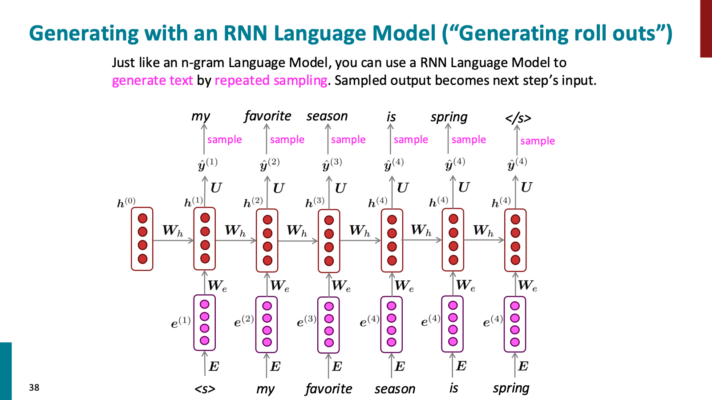
*Slide 36: "Generating with an RNN Language Model ('Generating roll outs')": from `<s>`, sample "my", feed it back, and continue to "my favorite season is spring `</s>`".*

Generation works exactly as it did for n-grams in section 3: "Just like an n-gram Language Model, you can use a RNN Language Model to generate text by repeated sampling. Sampled output becomes next step's input." Start with a start token `<s>`, sample "my", feed "my" back in, sample "favorite", and so on to "my favorite season is spring `</s>`". The difference is invisible on the slide and enormous in practice: the hidden state carries the whole history, not just the last two words.

Notice that this is the mirror image of training. In training (section 6, "Teacher forcing"), the input at each step is the true word. In generation there is no true word, so the input is the model's own sample, and any mistake it makes becomes part of its own input from then on.

> **Note:** A small labelling slip in slide 36's figure: the hidden states and outputs after the fourth step are all labelled h^(4), ŷ^(4) and e^(4), instead of continuing to h^(5), h^(6) and so on. Each step has its own state; read the superscripts as counting up.

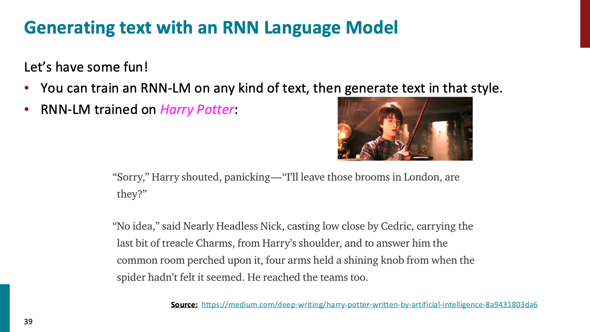
*Slide 37: "Let's have some fun!": text generated by an RNN-LM trained on Harry Potter.*

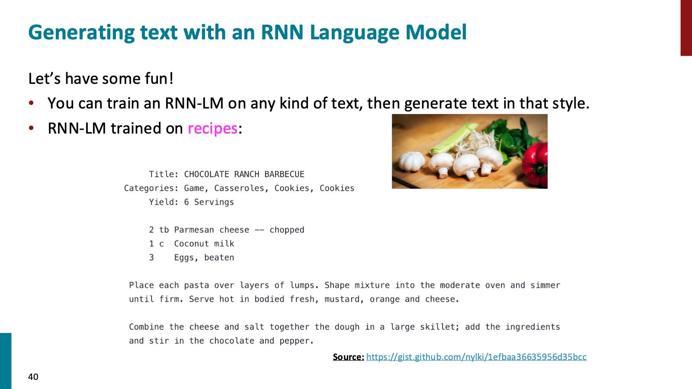
*Slide 38: text generated by an RNN-LM trained on recipes: "CHOCOLATE RANCH BARBECUE".*

"Let's have some fun! You can train an RNN-LM on any kind of text, then generate text in that style." Slide 37's model read Harry Potter and wrote "'Sorry,' Harry shouted, panicking—'I'll leave those brooms in London, are they?'" Slide 38's read recipes and produced "Title: CHOCOLATE RANCH BARBECUE", in "Categories: Game, Casseroles, Cookies, Cookies", with the instruction "Place each pasta over layers of lumps." Both are exactly the n-gram story of slide 18 one level up: the style is right, the punctuation is right, and the content wanders. "Cookies, Cookies" is a model that knows a category list looks like that, without knowing what's in it.

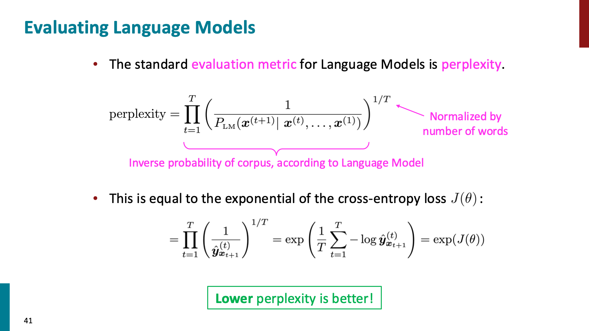
*Slide 39: "Evaluating Language Models": perplexity as the inverse probability of the corpus normalized by the number of words, equal to exp(J(θ)); "Lower perplexity is better!"*

How do you score a language model? "The standard evaluation metric for Language Models is perplexity":

perplexity = ∏_{t=1}^{T} (1 / P_LM(x^(t+1) | x^(t), …, x^(1)))^{1/T}

It is the "Inverse probability of corpus, according to Language Model", raised to 1/T, "Normalized by number of words". And then the payoff: "This is equal to the exponential of the cross-entropy loss J(θ)":

∏_{t=1}^{T} (1/ŷ^(t)_{x_{t+1}})^{1/T} = exp((1/T) Σ_{t=1}^{T} −log ŷ^(t)_{x_{t+1}}) = exp(J(θ))

"Lower perplexity is better!" So the number you minimise in training and the number you report at test time are the same quantity, one exponentiated. A good intuition: a model with perplexity 50 gives the true next words, on (geometric) average, probability 1/50, as if each time it had been picking among 50 equally likely words.

> **Check your understanding.** A model gives the three true next words of a test text probabilities 1/2, 1/4 and 1/8. What is its perplexity? And what is the perplexity of a model that spreads probability uniformly over a vocabulary of size |V|? *Answer: the inverse probabilities are 2, 4 and 8, whose geometric mean is (2 × 4 × 8)^{1/3} = 64^{1/3} = 4. A uniform model gives every word 1/|V|, so its perplexity is exactly |V|. This is the uniform baseline, not the largest possible perplexity; a model that gives the true words still lower probabilities can do worse. Any useful model should beat it by a wide margin.*

> **Note:** Notes 5 §2.1 writes "Perplexity = 2^J" (Eq. 9). That agrees with the slide only when J is measured in bits, with base-2 logarithms; the slide's exp(J) uses natural logs. The value of the perplexity is the same either way, as long as the base of the exponential matches the base of the logarithm. (The notes' own wording, "2 to the power of the negative log probability of the cross entropy error function", is garbled: 2^J is 2 to the power of the cross-entropy itself.) Bengio et al. 2003 (§2, p. 1141) define it the same way: "the geometric average of 1/P̂(w_t | w_1^{t−1}), also known as perplexity, which is also the exponential of the average negative log-likelihood."

**So far, and next.** A trained RNN-LM generates by feeding its own samples back in, which gives style without much sense, and it is measured by perplexity, the exponentiated cross-entropy. The deck now turns to the "(in theory)" of slide 25: why RNNs in practice struggle to use information from many steps back.

## 8. Vanishing and exploding gradients

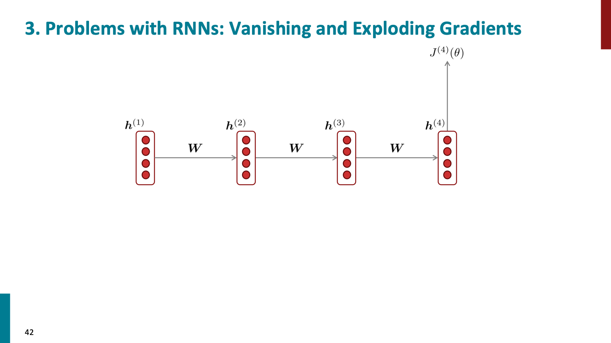
*Slide 40: "3. Problems with RNNs: Vanishing and Exploding Gradients".*

Lecture 3's last slide promised this: "Example in future lecture: exploding and vanishing gradients" ([Lecture 3, section 9](../03-backpropagation/README.md#9-backprop-in-practice-code-checks-and-leaks)). Here it is. The setting is backpropagation through time, and the problem is what happens to a gradient that has to travel back across many steps.

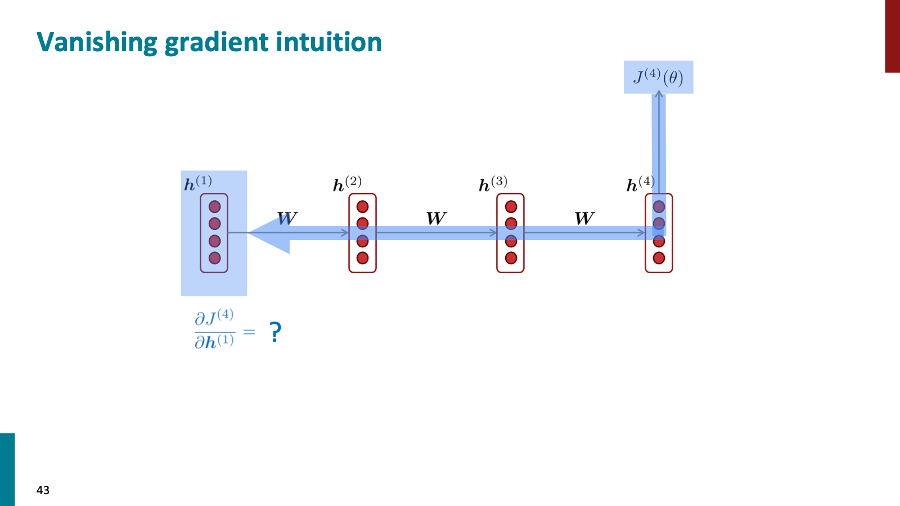
*Slide 41: "Vanishing gradient intuition": the loss J^(4)(θ) sits on top of h^(4); h^(1) to h^(4) are joined by W.*

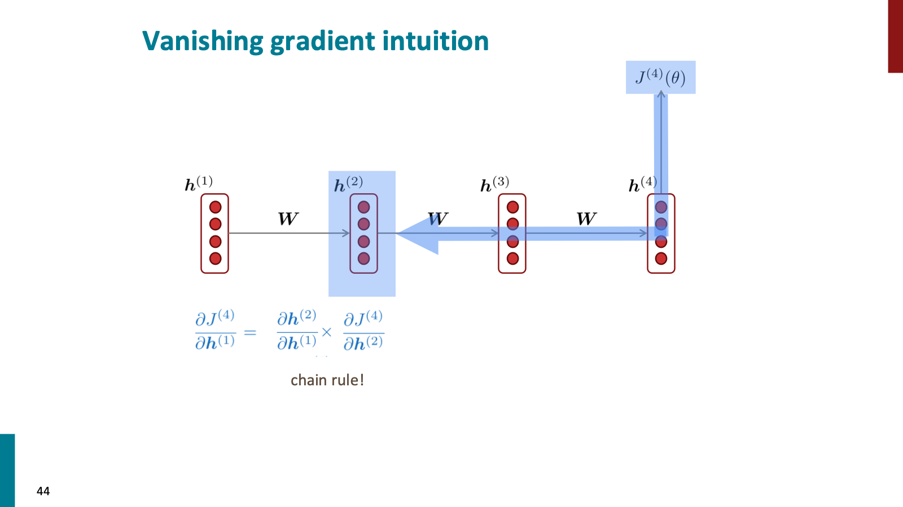
*Slide 42: the chain rule, first split: ∂J^(4)/∂h^(1) = (∂h^(2)/∂h^(1)) × (∂J^(4)/∂h^(2)).*

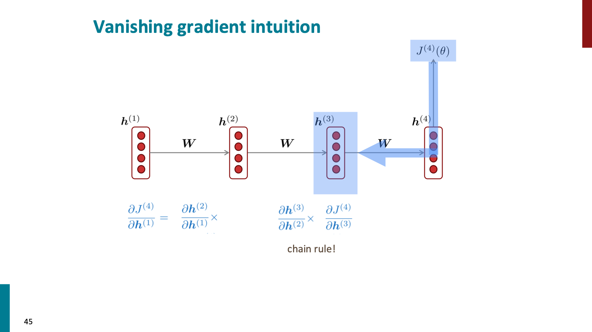
*Slide 43: the remaining gradient expanded through h^(3): ∂h^(2)/∂h^(1) × ∂h^(3)/∂h^(2) × ∂J^(4)/∂h^(3).*

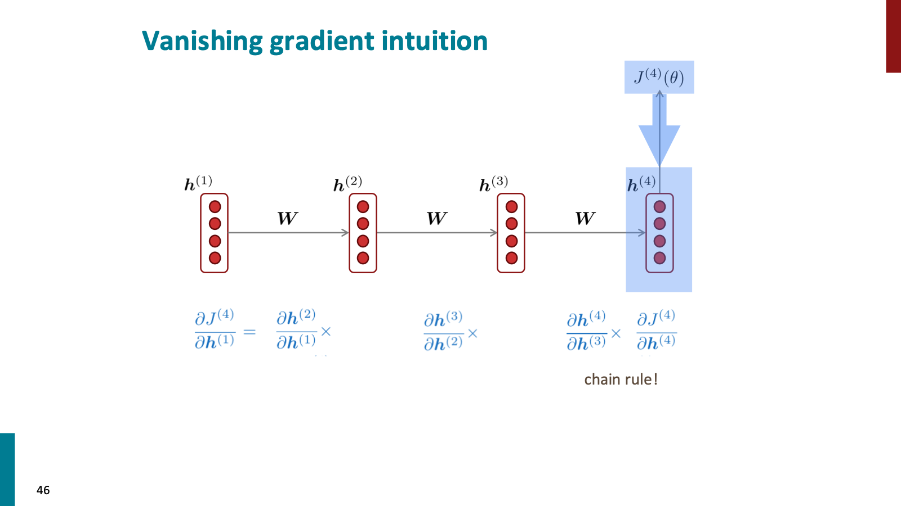
*Slide 44: the full chain, ∂J^(4)/∂h^(1) = ∂h^(2)/∂h^(1) × ∂h^(3)/∂h^(2) × ∂h^(4)/∂h^(3) × ∂J^(4)/∂h^(4), "chain rule!"*

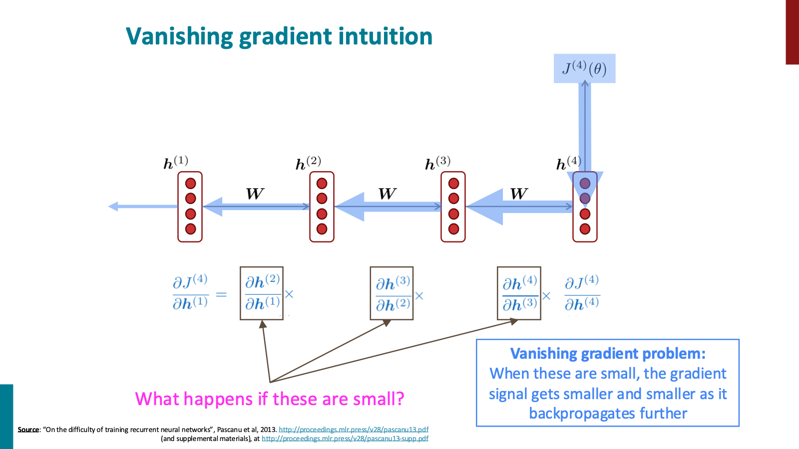
*Slide 45: "What happens if these are small?": the vanishing gradient problem, "the gradient signal gets smaller and smaller as it backpropagates further" (source: Pascanu et al. 2013).*

Slides 41–45 are an animation, one factor at a time. How does the loss at step 4 depend on the hidden state at step 1? Through h^(2), then h^(3), then h^(4). The chain rule writes that as a product with one factor per step:

∂J^(4)/∂h^(1) = ∂h^(2)/∂h^(1) × ∂h^(3)/∂h^(2) × ∂h^(4)/∂h^(3) × ∂J^(4)/∂h^(4)

Then the question in pink: "What happens if these are small?" The answer is the **vanishing gradient problem**: "When these are small, the gradient signal gets smaller and smaller as it backpropagates further." Multiply enough numbers below 1 together and you get almost nothing.

> **Check your understanding.** If each step's factor were a plain number 0.5, how much of the gradient would survive 20 steps? What if it were 1.5? *Answer: 0.5²⁰ ≈ 0.00000095, about a millionth. 1.5²⁰ ≈ 3,325. Twenty steps is roughly one long sentence, so a gradient can shrink to nothing or blow up within a single sentence.*

> **Note:** For the careful reader, a word on the order of that product. With h_j = σ(W_h h_{j−1} + W_e e^(j) + b₁), the Jacobian of one step is A_j = ∂h_j/∂h_{j−1} = diag(σ′(z_j)) W_h, where z_j is step j's pre-activation, and the chain from step k to step t is ∂h_t/∂h_k = A_t A_{t−1} ⋯ A_{k+1}. If you keep gradients as column vectors, as in [Lecture 3's shape convention](../03-backpropagation/README.md#7-the-worked-gradient-from-score-to-weights), the gradient comes back through the transposes: ∇_{h^(1)}J^(4) = A_2ᵀ A_3ᵀ A_4ᵀ ∇_{h^(4)}J^(4). Slides 42–45 write the factors left to right as fractions, which is the right intuition but needs those transposes to be read literally. Either way the lesson is the same: one factor per step, multiplied.

Notes 5 §2.3 does the multiplication properly, with norms instead of single numbers. The total gradient sums over time steps, ∂E/∂W = Σ_t ∂E_t/∂W (Eq. 10), and each term sums over the earlier steps k that W touched:

∂E_t/∂W = Σ_{k=1}^{t} (∂E_t/∂y_t)(∂y_t/∂h_t)(∂h_t/∂h_k)(∂h_k/∂W)   (Eq. 11)

Here ∂h_k/∂W means W's *immediate* effect at step k, holding h_{k−1} fixed: the gradient through step k's copy of W, exactly section 6's ∂J/∂W_h|_(k). (A total derivative there would count the earlier steps twice; Pascanu et al. write it ∂⁺ for this reason.) The long-range part is ∂h_t/∂h_k = ∏_{j=k+1}^{t} ∂h_j/∂h_{j−1} (Eq. 12), a product of Jacobians (Eq. 13). Bound each factor's size, ‖∂h_j/∂h_{j−1}‖ ≤ ‖W‖ ‖diag[f′]‖ ≤ β_W β_h (Eq. 15), and the product obeys

‖∂h_t/∂h_k‖ ≤ (β_W β_h)^{t−k}   (Eq. 16)

which "can easily become a very small or large number when β_W β_h is much smaller or larger than 1 and t−k is sufficiently large".

Read Eq. 16 with care, because it is one-sided. If β_W β_h < 1, the bound decays exponentially, and the gradient from far away must vanish. If β_W β_h > 1, the bound grows, which makes explosion *possible* but does not prove it happens; Pascanu et al. ([On the difficulty of training Recurrent Neural Networks](https://arxiv.org/abs/1211.5063v2), ICML 2013), the source of these slides, call the first condition sufficient for vanishing and the second only necessary for exploding.

> **Note:** Notes 5's version of this derivation has a few slips worth knowing before you copy it. Eq. 12's right-hand side reads "f′(j_{j−1})", a typo. For h_j = σ(W^(hh)h_{j−1} + W^(hx)x_j) the one-step Jacobian is diag(σ′(z_j)) W^(hh), with σ′ taken at step j's pre-activation, not the notes' Wᵀ × diag[f′(h_{j−1})]. "The norm of f′(h_{j−1}) can only be as large as 1 given the sigmoid" is a true bound but a loose one: the sigmoid's derivative never exceeds 1/4, which makes vanishing even easier. And Eq. 13 calls the hidden size D_n where §2 called it D_h.

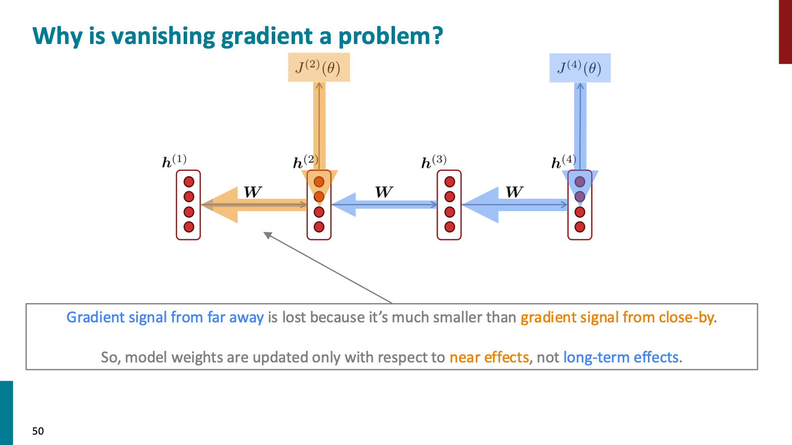
*Slide 46: "Why is vanishing gradient a problem?": the gradient from J^(2) reaches h^(1) strongly, the gradient from J^(4) arrives faint; "model weights are updated only with respect to near effects, not long-term effects".*

Why does it matter? Slide 46 draws two losses sending gradient back to h^(1): a fat orange arrow from J^(2), nearby, and a thin blue one from J^(4), far away. "Gradient signal from far away is lost because it's much smaller than gradient signal from close-by. So, model weights are updated only with respect to near effects, not long-term effects." The model isn't told that what it did at step 1 mattered at step 4, so it never learns to carry that information.

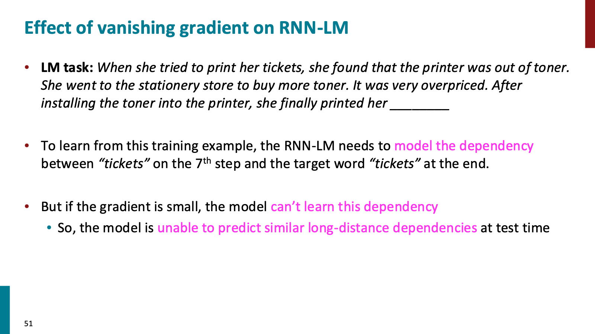
*Slide 47: "Effect of vanishing gradient on RNN-LM": the printer-and-toner sentence ending "she finally printed her ___".*

Slide 47 makes it a language-modeling failure. "When she tried to print her tickets, she found that the printer was out of toner. She went to the stationery store to buy more toner. It was very overpriced. After installing the toner into the printer, she finally printed her ___". The answer is "tickets", and the clue is the seventh word. "To learn from this training example, the RNN-LM needs to model the dependency between 'tickets' on the 7th step and the target word 'tickets' at the end. But if the gradient is small, the model can't learn this dependency. So, the model is unable to predict similar long-distance dependencies at test time." A model that can't learn the long dependency might favour a recent word such as "toner", which has appeared three times. (That's an illustration, not a reported output: the slide gives no model's actual prediction.)

> **Note:** Notes 5 §2.3 tells the same story with Jane and John. "Jane walked into the room. John walked in too. Jane said hi to ___" is easy; insert a sentence about it being late and everyone walking home, and RNNs "are more likely to correctly predict the blank spot in Sentence 1 than in Sentence 2". The notes add the uncomfortable consequence: "we don't know whether there is no dependency between steps t and t + n in the data, or we just cannot capture the true dependency due to this issue." A vanished gradient looks exactly like "there was nothing to learn".

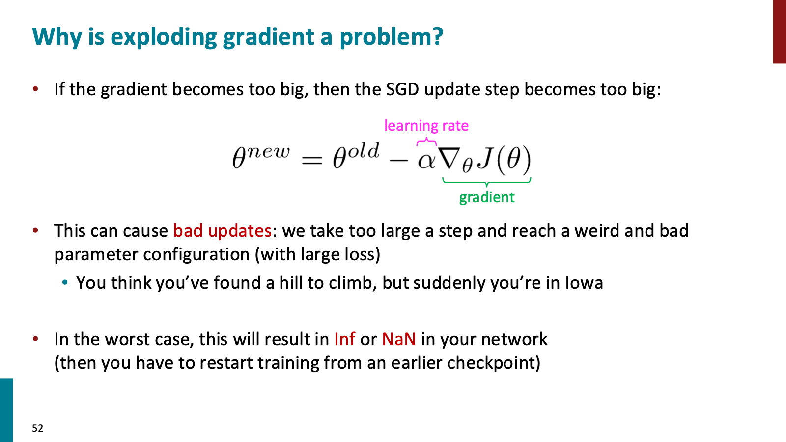
*Slide 48: "Why is exploding gradient a problem?": θ^new = θ^old − α∇_θJ(θ) with a huge gradient; "You think you've found a hill to climb, but suddenly you're in Iowa".*

The opposite failure is the **exploding gradient**. "If the gradient becomes too big, then the SGD update step becomes too big": in θ^new = θ^old − α∇_θJ(θ), a huge gradient times even a modest learning rate is a huge step. "This can cause bad updates: we take too large a step and reach a weird and bad parameter configuration (with large loss)". The slide's gloss is the best line in the deck: "You think you've found a hill to climb, but suddenly you're in Iowa". "In the worst case, this will result in Inf or NaN in your network (then you have to restart training from an earlier checkpoint)".

> **Note:** The two failures differ in how loudly they fail. Notes 5 §2.3: an exploding gradient "causes an overflow (i.e. NaN) which is easily detectable at runtime", while a vanishing gradient "can go undetected while drastically reducing the learning quality of the model for far-away words in the corpus". Exploding gradients crash your training; vanishing gradients quietly make your model worse.

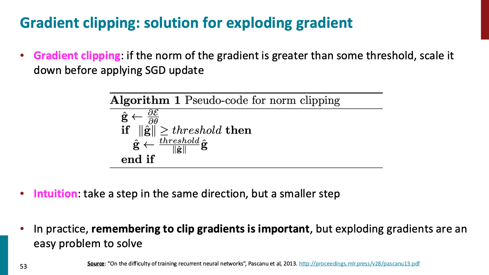
*Slide 49: "Gradient clipping: solution for exploding gradient": Algorithm 1, norm clipping; "take a step in the same direction, but a smaller step" (source: Pascanu et al. 2013).*

The fix for exploding gradients is almost embarrassingly simple: **gradient clipping**. "If the norm of the gradient is greater than some threshold, scale it down before applying SGD update". Algorithm 1:

```
ĝ ← ∂ℰ/∂θ
if ‖ĝ‖ ≥ threshold then
    ĝ ← (threshold / ‖ĝ‖) ĝ
end if
```

"Intuition: take a step in the same direction, but a smaller step". The direction is kept; only the length is capped at the threshold. "In practice, remembering to clip gradients is important, but exploding gradients are an easy problem to solve".


*Notes 5, Figure 7: "Gradient explosion clipping visualization": a one-unit RNN's error surface over w and b; the solid arrow is thrown far away by the error wall, the dashed path is clipped and stays near.*

Notes 5's Figure 7 shows why it works. It's the error surface of a tiny recurrent network over its weight w and bias b, with a sheer cliff, "the high error wall". Ordinary gradient descent walks into the wall, gets an enormous gradient, and "is pushed off to a far-away location" (the solid arrow). The clipped version, the dashed line, "pulls back the error gradient to somewhere close to the original gradient landscape".

> **Note:** Notes 5 §2.4 credits the idea to "Thomas Mikolov", who "first introduced a simple heuristic solution that clips gradients". His 2012 PhD thesis ([Statistical Language Models Based on Neural Networks](https://www.fit.vut.cz/study/phd-thesis/283/), Brno) describes his version: "A simple solution to the exploding gradient problem is to truncate values of the gradients. In my experiments, I did limit maximum size of gradients of errors that get accumulated in the hidden neurons to be in a range <−15; 15>. This greatly increases stability of the training, and otherwise it would not be possible to train RNN LMs successfully on large data sets." Mikolov clipped each value; slide 49's Algorithm 1 rescales the whole gradient vector. Notes 5's own phrase, gradients are "set back to a small number", undersells that: Algorithm 1 sets the gradient's length to the threshold and keeps its direction.


*Slide 50: "How to fix the vanishing gradient problem?": the hidden state is "constantly being rewritten"; first, an RNN with separate memory (LSTM); then more direct and linear pass-through connections (attention, residual connections).*

Vanishing gradients are harder, because there is no single number to cap. Slide 50 names the real problem: "it's too difficult for the RNN to learn to preserve information over many timesteps. In a vanilla RNN, the hidden state is constantly being rewritten." Every step squashes the old state through a matrix and a non-linearity, whether or not it should. The fixes change the architecture:

- "First: How about an RNN with separate memory which is added to? Long Short-Term Memory (LSTM)", which the slide links to Olah's post and notes 5 teaches in §4 (section 11 of these notes).
- "And then: Creating more direct and linear pass-through connections in model": "Attention, residual connections, etc.", for later lectures.

Notes 5 §2.4 adds two cheaper tricks. "Instead of initializing W^(hh) randomly, start off from an identity matrix initialization", so that the recurrent linear transform at first copies h_{t−1}. (The input term and the activation can still change the state; identity initialization doesn't by itself make the whole update an identity map.) And "use the Rectified Linear Units (ReLU) instead of the sigmoid function. The derivative for the ReLU is either 0 or 1. This way, gradients would flow through the neurons whose derivative is 1 without getting attenuated while propagating back through time-steps."

> **Note:** The course's [vanishing-gradient notebook](materials/vanishing_grad_example.html) (Winter 2017, one of the suggested readings) shows the sigmoid-versus-ReLU point on a toy 3-class spiral, with a two-hidden-layer feed-forward net rather than an RNN. Same data, same 50,000 iterations: the sigmoid net ends at a loss of 0.433 and 97% training accuracy, the ReLU net at 0.115 and 99%. It measures "the sum of the magnitude of gradients for the weights between hidden layers as a cheap heuristic to measure speed of learning", and suggests adding layers to see "how early layers continue to train slowly for the sigmoid net". The problem was named long before. Bengio, Simard and Frasconi's [Learning Long-Term Dependencies with Gradient Descent is Difficult](https://ieeexplore.ieee.org/document/279181) (1994; [authors' manuscript](https://www.iro.umontreal.ca/~lisa/pointeurs/ieeetrnn94.pdf)) is "one of the original vanishing gradient papers", in the schedule's words. Its title is the whole section in eight words.

**So far, and next.** Backpropagation through time multiplies one Jacobian per step. When those factors are small, gradients from far away vanish, and the model learns only near effects. When they are large, gradients can explode, which clipping fixes easily. Vanishing needs a change of architecture: gated memory, then attention and residual connections. Before the gates, notes 5 widens the RNN family in two other directions.

## 9. Bidirectional and deep RNNs

So far the RNN has read left to right with one layer. Notes 5 §2.5 (there are no slides on this) relaxes both.


*Notes 5, Figure 8: "A bi-directional RNN model": a left-to-right chain of hidden states (solid orange) and a right-to-left chain (dotted), both feeding each output.*

A **bidirectional RNN** runs two RNNs over the same sentence, one forwards and one backwards. "Irsoy et al. shows a bi-directional deep neural network; at each time-step, t, this network maintains two hidden layers, one for the left-to-right propagation and another for the right-to-left propagation":

→h_t = f(→W x_t + →V →h_{t−1} + →b)   (Eq. 17)

←h_t = f(←W x_t + ←V ←h_{t+1} + ←b)   (Eq. 18)

"The only difference between these two relationships is in the direction of recursing through the corpus". The output uses both, concatenated: ŷ_t = g(U[→h_t; ←h_t] + c) (Eq. 19). So the representation of word t knows about the words before it *and* after it. The price: it "consumes twice as much memory space for its weight and bias parameters".

> **Note:** Notes 5 calls Eq. 19 "the classification relationship used for predicting the next word via summarizing past and future word representations". Be careful with that. A model that has read the future words can't be a next-word language model: the right-to-left chain would already have seen the answer. A bidirectional RNN is for tasks where the whole sentence is given in advance, like tagging each word, classifying a sentence, or encoding the source sentence in translation (Extension IV in section 10). The paper the notes cite is İrsoy and Cardie's [Opinion Mining with Deep Recurrent Neural Networks](https://aclanthology.org/D14-1080/) (EMNLP 2014), which applied deep bidirectional RNNs to "opinion expression extraction formulated as a token-level sequence-labeling task": a tagging problem, where the whole sentence is available.


*Notes 5, Figure 9: "A deep bi-directional RNN with three RNN layers": three stacked bidirectional layers h^(1), h^(2), h^(3) between the input x and the output y.*

A **deep (multi-layer) RNN** stacks RNNs: "each lower layer feeds the next layer", and "the input to each intermediate neuron at level i is the output of the RNN at layer i−1 at the same time-step, t". For the deep bidirectional version,

→h_t^(i) = f(→W^(i) h_t^(i−1) + →V^(i) →h_{t−1}^(i) + →b^(i))   (Eq. 20)

with the mirror image for ←h_t^(i) (Eq. 21), where the input from below is the concatenation h_t^(i−1) = [→h_t^(i−1); ←h_t^(i−1)]. The output reads the top layer, ŷ_t = g(U[→h_t^(L); ←h_t^(L)] + c) (Eq. 22). In Figure 9 each unit "receives one set of parameters from the previous time-step (in the same RNN layer), and two sets of parameters from the previous RNN hidden layer". Read "parameters" there as "activations": what flows along the arrows is hidden states, not weights.

Why stack? For the same reason as in any deep network: lower layers can build simple features and higher layers combine them. İrsoy and Cardie call it "depth in space", as opposed to the "depth in time" every RNN already has, and report that "deep, narrow RNNs outperform traditional shallow, wide RNNs with the same number of parameters". Section 10's translation system uses exactly this stacking.

> **Check your understanding.** In a bidirectional RNN with a hidden size of 256 in each direction, what is the size of the vector the output layer reads at each step? And if you stack a second bidirectional layer on top, what is the size of its input at each step? *Answer: 512, the concatenation [→h_t; ←h_t]. The second layer's input is that same 512-vector, h_t^(1) = [→h_t^(1); ←h_t^(1)].*

**So far, and next.** RNNs can read both ways (bidirectional, for when the whole input is available) and be stacked (deep). With those tools, the deck turns to the application that made neural NLP famous: machine translation.

## 10. Machine translation and sequence-to-sequence models


*Slide 51: "5. Machine Translation": translating a sentence x in the source language to a sentence y in the target language; "I like deep learning" → "我喜欢深度学习".*

"Machine Translation (MT) is the task of translating a sentence x from one language (the source language) to a sentence y in another language (the target language)". Slide 51's example: x = "I like deep learning", y = "我喜欢深度学习". Lecture 1 told the long history of the task, from translation-as-code-breaking in the 1940s to statistical MT ([Lecture 1, section 3](../01-history-of-nlp/README.md#3-era-1-part-one-translation-as-code-breaking)). Notes 5 §2.6 sums up the old way: "Traditional translation models are quite complex; they consist of numerous machine learning algorithms applied to different stages of the language translation pipeline."


*Slide 52: "NMT: the first big success story of NLP Deep Learning": from "a fringe research attempt in 2014 to the leading standard method in 2016".*

Then the deep learning version swept the field. "Neural Machine Translation went from a fringe research attempt in 2014 to the leading standard method in 2016":

- "2014: First seq2seq paper published [Sutskever et al. 2014]".
- "2016: Google Translate switches from SMT to NMT – and by 2018 everyone has".
- "This is amazing!" "SMT systems, built by hundreds of engineers over many years, outperformed by NMT systems trained by small groups of engineers in a few months".

> **Note:** "First seq2seq paper" is the slide's wording, and the history is a little more crowded than that. Cho et al.'s [Learning Phrase Representations using RNN Encoder–Decoder for Statistical Machine Translation](https://arxiv.org/abs/1406.1078) (arXiv, 3 June 2014; EMNLP 2014), the paper that introduced the GRU of section 11, already mapped one sequence into another with an encoder–decoder. Sutskever, Vinyals and Le's [Sequence to Sequence Learning with Neural Networks](https://arxiv.org/abs/1409.3215) (arXiv, 10 September 2014; NIPS 2014) presented the influential seq2seq result. On WMT-14 English-to-French, an ensemble of five four-layer LSTMs, with reversed source sentences and a beam of size 12, reached 34.81 BLEU, against 33.30 for a phrase-based statistical system on the same data; using the five-model ensemble to rescore that system's 1000-best lists reached 36.5.


*Slide 53: "Neural Machine Translation (NMT): The sequence-to-sequence model": an encoder RNN reads "il m' a entarté"; its last state is the encoding; a decoder RNN, started from that encoding, generates "he hit me with a pie `<END>`", feeding each argmax word back in.*

The model is the **sequence-to-sequence (seq2seq)** model, also called an **encoder–decoder**. Two RNNs, in series:

- The "Encoder RNN produces an encoding of the source sentence". It reads "il m' a entarté" and its last hidden state is the "Encoding of the source sentence".
- That encoding "Provides initial hidden state for Decoder RNN".
- The "Decoder RNN is a Language Model that generates target sentence, conditioned on encoding". From `<START>` it produces "he", then "hit", "me", "with", "a", "pie", "`<END>`".

"Note: This diagram shows test time behavior: decoder output is fed in as next step's input". At each step it takes the argmax, the most likely word, and feeds it back in, exactly as generation did in section 7 (with argmax where section 7 sampled). The decoder is nothing new: it's section 5's RNN language model, with one change, that its first hidden state comes from the encoder instead of from h^(0).

> **Note:** "Il m'a entarté" is a lovely choice of example: French has a single verb, [*entarter*](https://www.larousse.fr/dictionnaires/francais/entarter/186349), for hitting someone in the face with a cream pie. Four French input tokens (il, m', a, entarté) become six English words plus an end marker. Source and target token counts need not match, which is exactly what an encoder–decoder allows: it reads the whole source before it writes anything.


*Slide 54: "Sequence-to-sequence is versatile!": the general encoder–decoder notion, and seq2seq for summarization, dialogue, parsing and code generation.*

The idea is bigger than translation. "The general notion here is an encoder-decoder model": "One neural network takes input and produces a neural representation"; "Another network produces output based on that neural representation"; "If the input and output are sequences, we call it a seq2seq model". "Many NLP tasks can be phrased as sequence-to-sequence":

- "Summarization (long text → short text)"
- "Dialogue (previous utterances → next utterance)"
- "Parsing (input text → output parse as sequence)"
- "Code generation (natural language → Python code)"


*Slide 55: "The sequence-to-sequence model is an example of a Conditional Language Model": P(y|x) = P(y₁|x) P(y₂|y₁, x) … P(y_T|y₁, …, y_{T−1}, x); "Get a big parallel corpus…".*

Slide 55 puts seq2seq back inside this lecture's main idea. "The sequence-to-sequence model is an example of a Conditional Language Model": it's a "Language Model because the decoder is predicting the next word of the target sentence y", and "Conditional because its predictions are also conditioned on the source sentence x". "NMT directly calculates P(y|x)", by section 2's chain rule with x added to every condition:

P(y|x) = P(y₁|x) P(y₂|y₁, x) P(y₃|y₁, y₂, x) … P(y_T|y₁, …, y_{T−1}, x)

each factor the "Probability of next target word, given target words so far and source sentence x". How to train it? "(Easy) Answer: Get a big parallel corpus…", pairs of sentences and their translations, "But there is now exciting work on 'unsupervised NMT', data augmentation, etc."


*Slide 56: "Training a Neural Machine Translation system": the loss J = (1/T) Σ J_t over the target words, each J_t a negative log probability; "Seq2seq is optimized as a single system. Backpropagation operates 'end-to-end'".*

Training is section 6 again. Feed the source sentence "from corpus" to the encoder and the target sentence "from corpus" to the decoder (teacher forcing again: the decoder reads the true target words), charge the negative log probability of each true next target word ("he", …, "with", …, `<END>`), and average: J = (1/T) Σ_{t=1}^{T} J_t. The important sentence is in the blue box: "Seq2seq is optimized as a single system. Backpropagation operates 'end-to-end'." The gradient of the decoder's loss flows back through the decoder, through the encoding, and into the encoder, so the encoder learns to produce exactly the encoding the decoder needs. Notes 5 writes the same objective as max_θ (1/N) Σ_{n=1}^{N} log p_θ(y^(n)|x^(n)) (Eq. 26), the average log-likelihood of each translation given its source.


*Notes 5, Figure 10: "A RNN-based translation model": three encoder steps read x₁, x₂, x₃ (the German "Echt dicke Kiste") and two decoder steps produce "Awesome sauce".*

Notes 5 §2.6 builds the same model from equations, translating the German "Echt dicke Kiste" into "Awesome sauce" (Figure 10). The encoder is h_t = φ(h_{t−1}, x_t) = f(W^(hh)h_{t−1} + W^(hx)x_t) (Eq. 23); the decoder, in its plainest form, is h_t = φ(h_{t−1}) = f(W^(hh)h_{t−1}) (Eq. 24) with y_t = softmax(W^(S)h_t) (Eq. 25). "One may naively assume this RNN model along with the cross-entropy function shown in Equation 26 can produce high-accuracy translation results. In practice, however, several extensions are to be added", five of them:

- **Extension I:** "train different RNN weights for encoding and decoding", so the two jobs don't share one W^(hh).
- **Extension II:** compute every decoder state from three inputs, "The previous hidden state", the "Last hidden layer of the encoder (c = h_T in Figure 11)" and the "Previous predicted output word, ŷ_{t−1}": h_t = φ(h_{t−1}, c, y_{t−1}) (Eq. 27). The decoder now sees the encoding at every step, not just the first.
- **Extension III:** deep RNNs, "using multiple RNN layers as discussed earlier in this chapter" (section 9).
- **Extension IV:** "bi-directional encoders" (section 9).
- **Extension V:** train on C B A → X Y instead of A B C → X Y. "The intution behind this technique is that A is more likely to be translated to X. Thus, given the vanishing gradient problem discussed earlier, reversing the order of the input words can help reduce the error rate in generating the output phrase."


*Notes 5, Figure 11: "Language model with three inputs to each decoder neuron: (h_{t−1}, c, y_{t−1})": the encoder's summary c feeds every decoder step.*

> **Note:** Extension V is straight from Sutskever et al.: "we found it extremely valuable to reverse the order of the words of the input sentence", which "improved the LSTM's performance markedly, because doing so introduced many short term dependencies between the source and the target sentence which made the optimization problem easier". It's a trick that only makes sense because of section 8. Reversing puts the first source word right next to the first target word, so the gradient connecting them has only a short way to travel.


*Slide 57: "Multi-layer deep encoder-decoder machine translation net" [Sutskever et al. 2014; Luong et al. 2015]: three stacked recurrent layers translating "Die Proteste waren am Wochenende eskaliert"; "Conditioning = Bottleneck".*

Real systems stack layers (section 9's deep RNN): "The hidden states from RNN layer i are the inputs to RNN layer i+1". Slide 57 shows a three-layer diagram translating "Die Proteste waren am Wochenende eskaliert" into "The protests escalated over the weekend". The "Encoder: Builds up sentence meaning"; the decoder works by "Feeding in last word" and the "Translation generated" comes out the top. Lecture 1 showed this same picture as history ([Lecture 1, section 8](../01-history-of-nlp/README.md#8-era-4a-neural-nlp)); now you can read every arrow. And in the middle, at the hand-off from encoder to decoder, a label: "Conditioning = Bottleneck".


*Slide 58: "The final piece: the bottleneck problem in RNNs": the whole source reaches the decoder through one "Encoding of the source sentence"; "Problems with this architecture?"*

The lecture ends on a question. "The final piece: the bottleneck problem in RNNs" highlights the encoder's last state, the "Encoding of the source sentence", and asks: "Problems with this architecture?" The deck leaves it open, but the picture says it. Everything the decoder will ever know about the source, every word, its order, its meaning, has to pass through that one fixed-size vector. A four-word sentence and a forty-word one get the same amount of room. That is the bottleneck, and its fix, attention, is what the next lecture's Transformers are built on.

> **Note:** A small slip: slide 58 writes the source sentence as "il a m' entarté", while slide 53 has the correct "il m' a entarté".


*Slide 59: the lecture plan of slide 2, repeated at the end.*

Slide 59 repeats the plan, and it's worth looking at once more now that every line has content: language modeling, RNNs, their gradient problems, and machine translation as the payoff.

> **Check your understanding.** In a seq2seq model, which parts are trained to minimise the decoder's loss: the decoder only, or the encoder too? And what does the decoder read as input at each step during training, and at test time? *Answer: both, end to end; the gradient flows back from the decoder's loss through the encoding into the encoder. During training it reads the true previous target word (teacher forcing); at test time it reads its own previous output, the argmax on slide 53.*

**So far, and next.** Machine translation is the task; seq2seq is the model, an encoder RNN that encodes the source and a decoder RNN that is a conditional language model over the target. It's trained end to end on parallel text, works for many tasks beyond translation, and has one weak point the deck leaves as a question, the bottleneck. One thread is still open from section 8: the LSTM, slide 50's first fix. Notes 5 teaches it, together with its simpler cousin, the GRU.

## 11. Gated units: GRUs and LSTMs

Section 8 ended with the diagnosis: in a vanilla RNN "the hidden state is constantly being rewritten" (slide 50), so information and gradients both fade. Notes 5 §3–4 gives the cure the slide pointed to, units with **gates**: small learned switches, each a sigmoid between 0 and 1, that decide how much of something to let through.

### The gated recurrent unit (GRU)

"Although RNNs can theoretically capture long-term dependencies, they are very hard to actually train to do this. Gated recurrent units are designed in a manner to have more persistent memory thereby making it easier for RNNs to capture long-term dependencies" (notes 5 §3). A **GRU** replaces the RNN's one-line update with four:

z_t = σ(W^(z)x_t + U^(z)h_{t−1})   (Update gate)

r_t = σ(W^(r)x_t + U^(r)h_{t−1})   (Reset gate)

h̃_t = tanh(r_t ∘ Uh_{t−1} + Wx_t)   (New memory)

h_t = (1 − z_t) ∘ h̃_t + z_t ∘ h_{t−1}   (Hidden state)

where ∘ is the element-wise product of [Lecture 3](../03-backpropagation/README.md#7-the-worked-gradient-from-score-to-weights).


*Notes 5, Figure 12, the detailed internals of a GRU: the reset gate r^(t) ("Include h^(t−1) in new memory?"), the update gate z^(t) ("How much h^(t−1) in next state?"), and the new memory h̃^(t) mixed with h^(t−1) to give h^(t).*

The notes read the four lines as four stages:

1. **New memory generation.** The candidate h̃_t "is the consolidation of a new input word x_t with the past hidden state h_{t−1}". (In the notes' words, "Anthropomorphically, this stage is the one who knows the recipe".)
2. **Reset gate.** r_t is "responsible for determining how important h_{t−1} is to the summarization h̃_t". It "has the ability to completely diminish past hidden state if it finds that h_{t−1} is irrelevant to the computation of the new memory".
3. **Update gate.** z_t is "responsible for determining how much of h_{t−1} should be carried forward to the next state". "If z_t ≈ 1, then h_{t−1} is almost entirely copied out to h_t. Conversely, if z_t ≈ 0, then mostly the new memory h̃_t is forwarded to the next hidden state."
4. **Hidden state.** h_t combines h_{t−1} and h̃_t "with the advice of the update gate".

The update gate is where the cure for vanishing lives. When z_t ≈ 1, h_t ≈ h_{t−1}: the state is copied, not rewritten, and along that path the gradient is copied back too, instead of being squashed at every step. The network can now *choose* to remember. And training needs nothing new: "we need to learn all the different parameters: W, U, W^(r), U^(r), W^(z), U^(z). These follow the same backpropagation procedure we have seen in the past."

> **Note:** The original GRU is Cho et al. 2014 (the same paper as section 10's note), introduced as "a new type of hidden unit … motivated by the LSTM unit but is much simpler to compute and implement". One detail differs between the paper and notes 5: Cho et al. apply the reset gate *before* the recurrent matrix, h̃ = φ(Wx + U(r ⊙ h_{t−1})), while the notes apply it after, r_t ∘ Uh_{t−1}. Both versions are in use, and they share the same update convention, h_t = z ∘ h_{t−1} + (1 − z) ∘ h̃. Also, the notes' equations leave out the bias terms a real implementation would have.

> **Check your understanding.** In a GRU, what are h_t when z_t is all ones, and when z_t is all zeros and r_t is all zeros? *Answer: with z_t = 1, h_t = h_{t−1}, a perfect copy that ignores the input. With z_t = 0 and r_t = 0, h̃_t = tanh(Wx_t) and h_t = h̃_t: the past is thrown away and the state is rebuilt from the current word alone.*

### Long short-term memory (LSTM)

"Long-Short-Term-Memories are another type of complex activation unit that differ a little from GRUs. The motivation for using these is similar to those for GRUs however the architecture of such units does differ" (notes 5 §4). The **LSTM** keeps two vectors per step, a hidden state h_t and a separate **memory cell** c_t, and uses three gates:

i_t = σ(W^(i)x_t + U^(i)h_{t−1})   (Input gate)

f_t = σ(W^(f)x_t + U^(f)h_{t−1})   (Forget gate)

o_t = σ(W^(o)x_t + U^(o)h_{t−1})   (Output/Exposure gate)

c̃_t = tanh(W^(c)x_t + U^(c)h_{t−1})   (New memory cell)

c_t = f_t ∘ c_{t−1} + i_t ∘ c̃_t   (Final memory cell)

h_t = o_t ∘ tanh(c_t)


*Notes 5, Figure 13: "The detailed internals of a LSTM": the input gate ("Does x^(t) matter?"), the new memory c̃^(t), the forget gate ("Should c^(t−1) be forgotten?") and the output gate ("How much c^(t) should be exposed?") around the memory cell c^(t).*

The notes' five stages:

1. **New memory generation**, "analogous to the new memory generation stage we saw in GRUs": a candidate c̃_t from the new word and the past hidden state.
2. **Input gate.** The new memory "doesn't check if the new word is even important", so the input gate decides "whether or not the input is worth preserving".
3. **Forget gate.** It "makes an assessment on whether the past memory cell is useful for the computation of the current memory cell".
4. **Final memory generation.** "This stage first takes the advice of the forget gate f_t and accordingly forgets the past memory c_{t−1}. Similarly, it takes the advice of the input gate i_t and accordingly gates the new memory c̃_t. It then sums these two results to produce the final memory c_t."
5. **Output/Exposure gate.** "This is a gate that does not explicitly exist in GRUs. It's purpose is to separate the final memory from the hidden state." It decides "what parts of the memory c_t needs to be exposed/present in the hidden state h_t".

Now reread slide 50's phrase, "an RNN with separate memory which is added to". That is the line c_t = f_t ∘ c_{t−1} + i_t ∘ c̃_t. The cell is not squashed through a matrix and a non-linearity at every step; it is scaled by the forget gate and *added to*. When the forget gate stays near 1, the cell carries its contents, and its gradient, across many steps nearly untouched. The GRU's copy-through and the LSTM's add-to are the same move: a path through time that doesn't multiply by W at every step.

> **Note:** The LSTM is older than you might think. Hochreiter and Schmidhuber's [Long Short-Term Memory](https://doi.org/10.1162/neco.1997.9.8.1735) (*Neural Computation*, 1997; [authors' copy](http://www.bioinf.jku.at/publications/older/2604.pdf)) starts from exactly section 8's problem: with backpropagation through time, "error signals flowing backwards in time tend to either blow up or vanish". Their cell is "built around a central linear unit with a fixed self-connection", which they call the "constant error carrousel", protected by "a multiplicative input gate unit" and "a multiplicative output gate unit". The 1997 paper has no forget gate (the word never appears in it). The forget gate in notes 5's equations was a later addition, which makes the cell able to clear itself instead of only ever accumulating.

> **Note:** For pictures of all of this, Olah's [Understanding LSTM Networks](https://colah.github.io/posts/2015-08-Understanding-LSTMs/), which slide 50 links, draws all of this step by step. "The cell state is kind of like a conveyor belt. It runs straight down the entire chain, with only some minor linear interactions. It's very easy for information to just flow along it unchanged." Gates "are a way to optionally let information through". It also covers the GRU, which "combines the forget and input gates into a single 'update gate'", and observes that "almost every paper involving LSTMs uses a slightly different version", a fair warning before you compare equations across sources.

> **Check your understanding.** In an LSTM, suppose f_t = 1 and i_t = 0 at every step. What happens to the memory cell, and why does that help with vanishing gradients? *Answer: c_t = c_{t−1}: the cell copies its contents forward unchanged. Along that path ∂c_t/∂c_{t−1} = diag(f_t) = I, so the gradient passes back across the steps without shrinking, unlike section 8's product of W's and σ′'s.*

**So far, and next.** Gated units give the RNN a memory it controls. The GRU mixes old state and new candidate with an update gate; the LSTM keeps a separate cell that is added to, with input, forget and output gates. Both make "remember this" a path the gradient can travel. That finishes the lecture: language models, from counting to recurrence, the gradient problems recurrence brings, translation as its showcase, and gates as the first fix.

## Across the sections

Lecture 4 is one question answered four times. **What comes next?** A language model gives a probability distribution over the next word, and by the chain rule of probability that is the same as a probability for any whole text (section 2). Predicting well needs grammar, facts and some reasoning, which is why this task "Leads to most of modern NLP".

**Counting** (section 3) estimates the next-word distribution from n-gram frequencies under a Markov assumption. It is fast and locally fluent, but sparse (smoothing and backoff are patches), large, and blind beyond its last few words. **A fixed-window network** (section 4) swaps counts for embeddings and a hidden layer, curing sparsity and storage, but its window is fixed and each position has its own weights. **A recurrent network** (section 5) reuses one set of weights at every step and carries a hidden state, so it reads text of any length with a fixed model size. It is trained with per-step cross-entropy and teacher forcing, by backpropagation through time, where the gradients of a shared weight add up over its uses (section 6). It generates text by feeding its samples back in, and it is scored by perplexity, the exponentiated cross-entropy (section 7).

**Recurrence has a price** (section 8). Backpropagation through time multiplies one Jacobian per step, so gradients from far away vanish (and the model learns only short-range effects) or explode (fixed by clipping). RNNs can read both ways and be stacked (section 9). Two RNNs in series make a sequence-to-sequence model (section 10): an encoder that summarises the source and a decoder that is a conditional language model over the target, trained end to end. It made neural machine translation the standard in two years, and it ends on one weakness, the bottleneck. Gated units (section 11), the GRU and the LSTM, give the RNN a memory that is copied or added to instead of rewritten, which is the first real fix for vanishing gradients.

Lectures 2 and 3 supplied every tool used here: embeddings, softmax, cross-entropy, SGD, the chain rule and backpropagation. Lecture 4 adds time. The next lecture takes up the two threads this one leaves hanging, slide 50's "more direct and linear pass-through connections" and slide 58's bottleneck, with attention and the Transformer.

## Glossary

- **Backoff:** when a context was never seen, estimate the next word from a shorter context instead.
- **Backpropagation through time (BPTT):** backpropagation on an RNN unrolled over time; the gradient of a shared weight is the sum of its gradients at each step. Often truncated after about 20 steps.
- **Bidirectional RNN:** two RNNs over the same sequence, left to right and right to left, whose states are concatenated at each position; for tasks where the whole input is available.
- **Bottleneck problem:** in a basic seq2seq model, the whole source sentence reaches the decoder through one fixed-size encoding.
- **Conditional language model:** a language model whose predictions are also conditioned on another input, such as a source sentence: P(y|x) = ∏ P(y_t | y_{<t}, x).
- **Deep (multi-layer) RNN:** stacked RNNs in which the hidden states of layer i are the inputs to layer i + 1.
- **Encoder–decoder (seq2seq) model:** an encoder network that turns the input into a representation and a decoder network that generates the output from it; with RNNs, the decoder is a conditional language model.
- **Exploding gradient:** gradients that grow very large as they are backpropagated through many steps, causing huge, destructive updates.
- **Gated recurrent unit (GRU):** a recurrent unit with an update gate and a reset gate that mix the previous state with a new candidate state.
- **Gradient clipping:** if the gradient's norm exceeds a threshold, rescale it to the threshold before the update, keeping its direction.
- **Language model:** a model of P(next word | previous words), equivalently a probability for any text.
- **Long short-term memory (LSTM):** a recurrent unit with a separate memory cell that is scaled by a forget gate and added to through an input gate, read out through an output gate.
- **Markov assumption:** the next word depends only on the previous n − 1 words.
- **n-gram:** a sequence of n consecutive words.
- **n-gram language model:** a language model that estimates next-word probabilities from n-gram counts.
- **Perplexity:** the inverse probability of a text under the model, normalized by its length; equal to exp(cross-entropy). Lower is better.
- **Recurrent neural network (RNN):** a network that applies the same weights at every step of a sequence, carrying a hidden state forward.
- **Smoothing:** adding a small count to every word so that unseen n-grams don't get probability zero.
- **Sparsity:** most long word sequences never appear in a corpus, so their counts are zero.
- **Teacher forcing:** during training, feeding the true previous word as the input at each step rather than the model's own prediction.
- **Vanishing gradient:** gradients that shrink toward zero as they are backpropagated through many steps, so the model learns only short-range dependencies.

## Open questions

- **How much does a "sufficiently strong" language model know?** Slide 8 lists trivia, syntax, coreference, sentiment, reasoning and arithmetic as things next-word prediction can require. Where does that stop? Which kinds of knowledge can be learned from predicting text alone, and which can't?
- **Does perplexity measure what we care about?** It rewards assigning high probability to the actual next word. Is a model with lower perplexity always more useful, for translation, dialogue or reasoning, and how would you find out?
- **Sampling or argmax?** Generation in section 7 samples, which gives variety; the NMT decoder in section 10 takes the most likely next word at each step. But picking the best word at each step does not guarantee the most likely whole translation: a first word at 0.6 followed by one at 0.5 gives 0.3, below an alternative of 0.4 followed by 0.99, which gives 0.396. What decoding behaviour do you actually want, for translation, where many translations are correct?
- **What is the right fix for the bottleneck?** The deck leaves "Problems with this architecture?" open. Notes 5's Extension II feeds the encoding into every decoder step; is that enough, or does the decoder need to look back at every source word? The next lecture's answer is attention.
- **Are gates still needed?** The LSTM was the standard sequence model for years. Once attention and residual connections give "more direct and linear pass-through connections" (slide 50), do recurrent gates still earn their cost?
