# Attention and Transformers: Every Word, One Hop from Every Other

Lecture 5 of CS224N (Winter 2026) builds the architecture the rest of the course runs on. It starts where Lecture 4 stopped, with recurrent networks whose gradients fade over long distances and a translation model that squeezes a whole sentence through one vector. **Attention** fixes the second problem by letting the decoder look back at every source word, weighted by relevance. Then the lecture asks whether the recurrence is needed at all. **Self-attention** lets a sentence attend to itself; **position representations**, a **feed-forward network** and a **causal mask** turn it into a working language model; **multi-head attention**, **scaling**, **residual connections** and **layer normalization** make it the **Transformer**, in decoder, encoder and encoder-decoder forms. It closes with the results that made the Transformer standard and the cost it still carries: attention grows with the square of the sequence length. These notes follow the [Winter 2026 slides](materials/cs224n-2026-lecture05-transformers.pdf) in order (cited "slide N" by position in the PDF; every slide appears below), with the course notes the syllabus assigns, [Note 10](materials/cs224n-self-attention-transformers-2023_draft.pdf) (Winter 2023 draft, "Self-Attention & Transformers", cited "notes §N"), and the suggested readings, chiefly [Jurafsky and Martin's Chapter 7](materials/jm-slp3-ch07-transformers-pretraining-aug2026.pdf) (August 2026 draft, cited "J&M §N"), which supply the language-modeling head, training, decoding and the KV cache (section 10), and the Image and Music Transformer papers (section 12). There is no public recording of the Winter 2026 lecture, so everything here comes from these documents and the papers they cite. A recorded lecture on this topic: [Winter 2023, Lecture 8, "Self-Attention and Transformers"](https://www.youtube.com/watch?v=LWMzyfvuehA).

*The overview of this lecture's concept map, metamatx's chapter view, will appear here. Until then, the [interactive concept map](concept-map.html) shows all 28 concepts the lecture teaches and the links between them, and [concept-map.md](concept-map.md) is the same map as text.*

## Contents

- [1. The plan, and a fast rewind through vanishing gradients](#1-the-plan-and-a-fast-rewind-through-vanishing-gradients)
- [2. Rewind, part two: translation and the bottleneck](#2-rewind-part-two-translation-and-the-bottleneck)
- [3. Attention: let the decoder look back](#3-attention-let-the-decoder-look-back)
- [4. Do we even need recurrence? Self-attention](#4-do-we-even-need-recurrence-self-attention)
- [5. Barrier one: order, and position representations](#5-barrier-one-order-and-position-representations)
- [6. Barriers two and three: nonlinearity and masking](#6-barriers-two-and-three-nonlinearity-and-masking)
- [7. The Transformer decoder: many heads, two matrix products and a scale factor](#7-the-transformer-decoder-many-heads-two-matrix-products-and-a-scale-factor)
- [8. Add & Norm: residual connections and layer normalization](#8-add--norm-residual-connections-and-layer-normalization)
- [9. Decoder, encoder, encoder-decoder](#9-decoder-encoder-encoder-decoder)
- [10. From decoder to language model: the head, training, and choosing words](#10-from-decoder-to-language-model-the-head-training-and-choosing-words)
- [11. Great results, and what we'd like to fix](#11-great-results-and-what-wed-like-to-fix)
- [12. Beyond text: images and music](#12-beyond-text-images-and-music)
- [13. A short prehistory of the pretrained language model](#13-a-short-prehistory-of-the-pretrained-language-model)
- [Across the sections](#across-the-sections)
- [Glossary](#glossary)
- [Open questions](#open-questions)

## 1. The plan, and a fast rewind through vanishing gradients

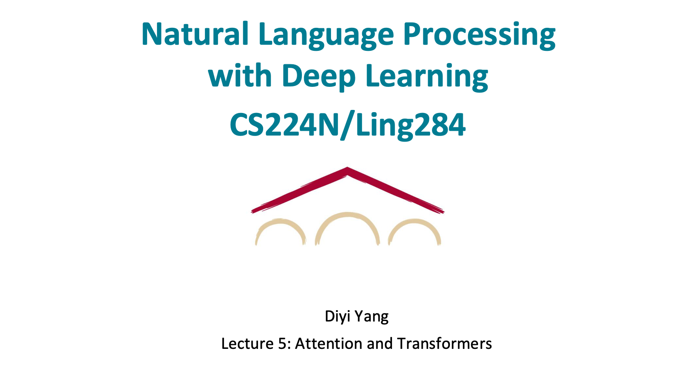
*Slide 1: "Natural Language Processing with Deep Learning, CS224N/Ling284", Diyi Yang, "Lecture 5: Attention and Transformers".*

The title says "Attention and Transformers"; the syllabus calls the day just "Transformers". Either way, this is the lecture where the course meets the architecture that every later lecture, from pretraining to reasoning, takes for granted. Lecture 1 already teased it: its intro slide 15 has a robot holding a single box labelled ATTENTION while a boy staggers under RECURRENCE, FORGETTING and a stack of gates ([Lecture 1, section 1](../01-history-of-nlp/README.md#1-the-course-and-the-one-idea-to-carry-out-of-it)). Today the boy puts the boxes down.

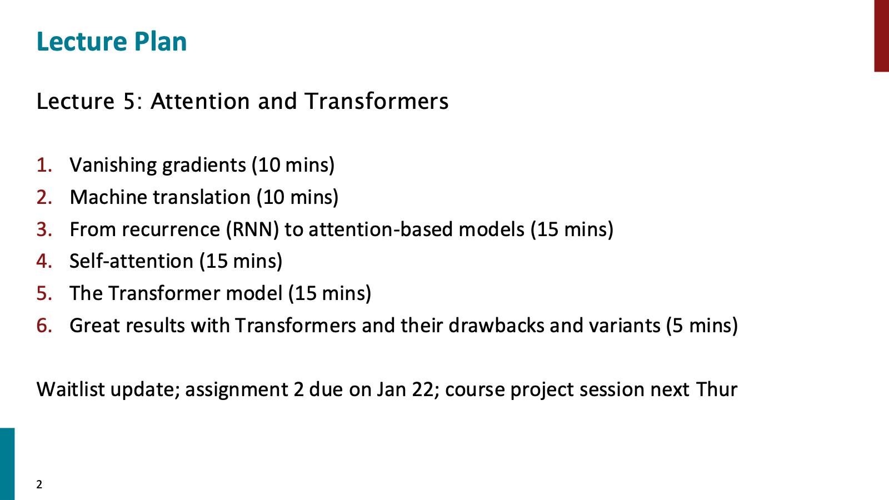
*Slide 2: the plan: "1. Vanishing gradients (10 mins)", "2. Machine translation (10 mins)", "3. From recurrence (RNN) to attention-based models (15 mins)", "4. Self-attention (15 mins)", "5. The Transformer model (15 mins)", "6. Great results with Transformers and their drawbacks and variants (5 mins)"; "Waitlist update; assignment 2 due on Jan 22; course project session next Thur".*

Six parts, and the first two are a rewind. Lecture 4 ended on two cliffhangers, slide 50's "more direct and linear pass-through connections" and slide 58's "Problems with this architecture?", and this lecture opens by replaying both before it resolves them. Then come attention (part 3), self-attention (part 4), the Transformer itself (part 5) and a short look at results and remaining problems (part 6). Assignment 2 is due on Thursday.

> **Note:** How to count slides here. From slide 39 on, the number printed in each slide's corner is one more than its position in the PDF (slide 39 says "40"). These notes count by position in the PDF, so "slide 59" is the one printed "60". And slides 3–21 are Lecture 4's slides 40–58 shown again, almost word for word; where they are, the caption says so and the prose points back to [Lecture 4's notes](../04-language-models-rnns/README.md) rather than teaching them twice.

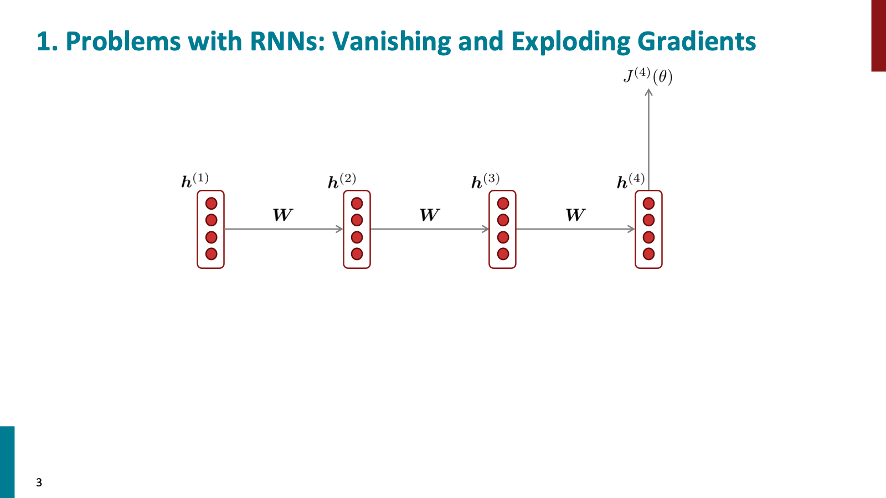
*Slide 3: "1. Problems with RNNs: Vanishing and Exploding Gradients" (Lecture 4's slide 40).*

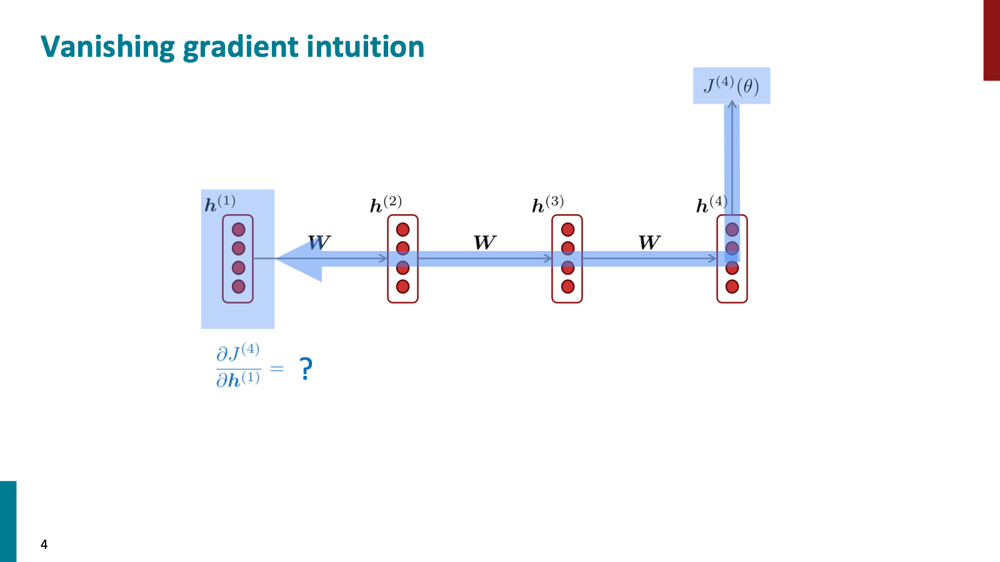
*Slide 4: "Vanishing gradient intuition": the loss J^(4)(θ) on top of h^(4), and a "?" for its gradient with respect to h^(1) (Lecture 4's slide 41).*

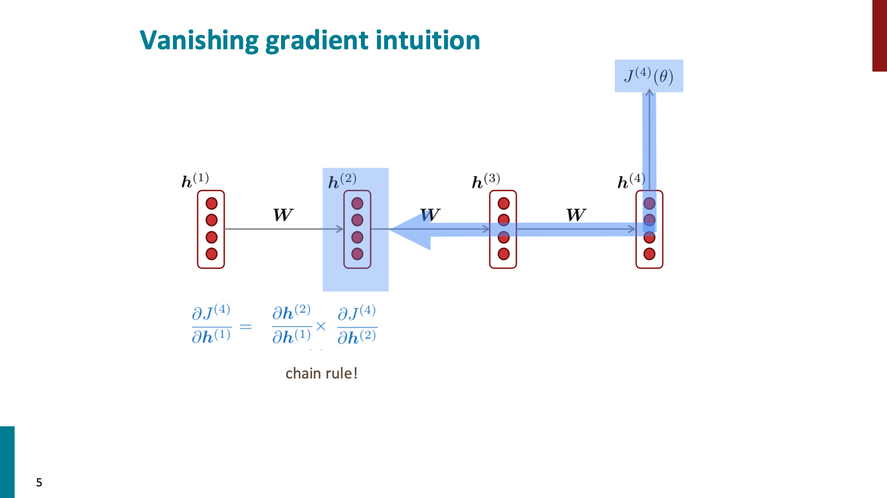
*Slide 5: the chain rule, first split: ∂J^(4)/∂h^(1) = (∂h^(2)/∂h^(1)) × (∂J^(4)/∂h^(2)) (Lecture 4's slide 42).*

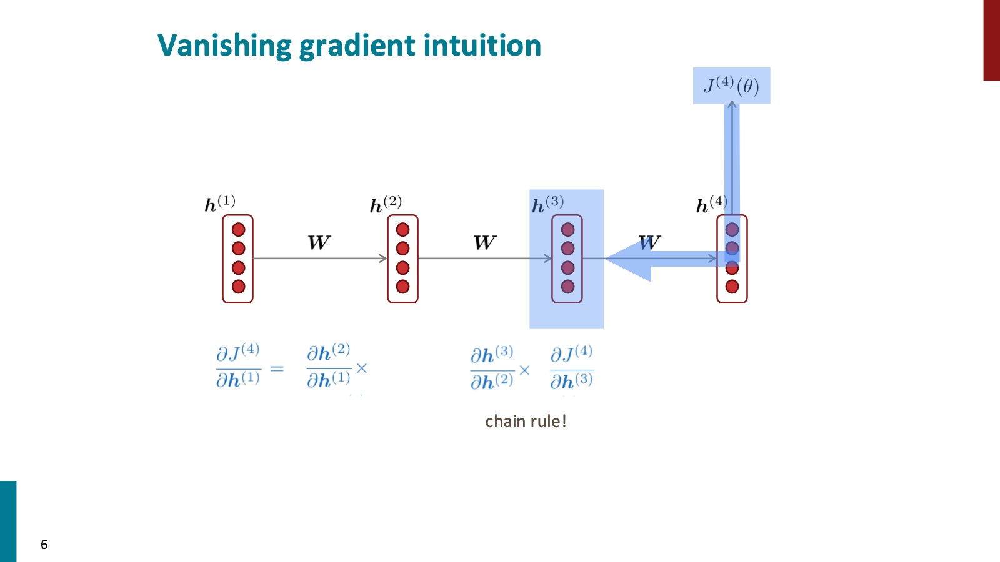
*Slide 6: the remaining gradient expanded through h^(3) (Lecture 4's slide 43).*

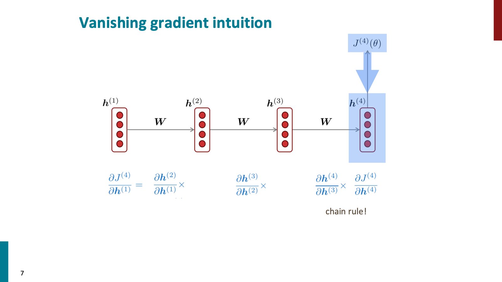
*Slide 7: the full chain, ∂J^(4)/∂h^(1) = ∂h^(2)/∂h^(1) × ∂h^(3)/∂h^(2) × ∂h^(4)/∂h^(3) × ∂J^(4)/∂h^(4), "chain rule!" (Lecture 4's slide 44).*

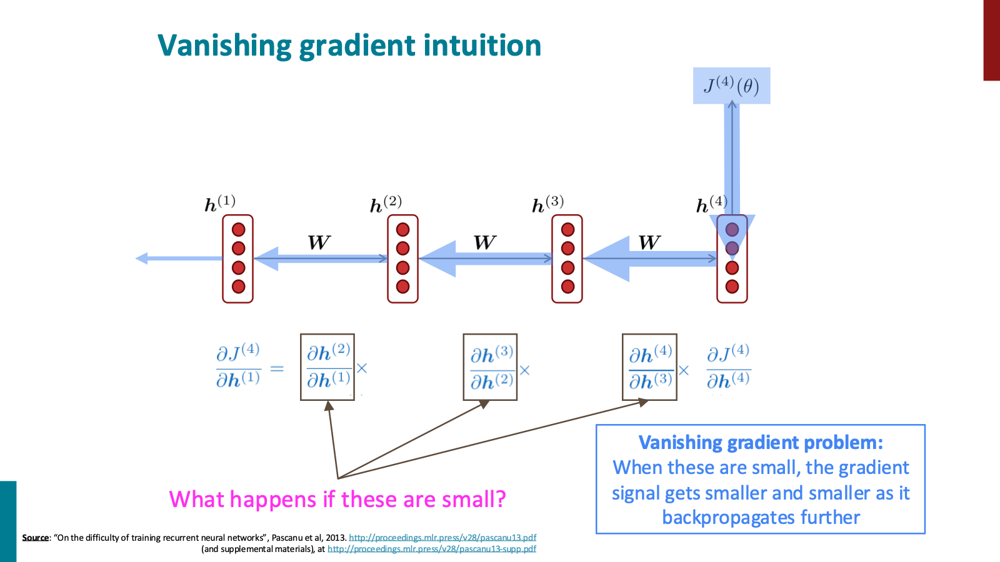
*Slide 8: "What happens if these are small?": the vanishing gradient problem, "the gradient signal gets smaller and smaller as it backpropagates further" (source: Pascanu et al. 2013; Lecture 4's slide 45).*

Slides 4–8 are the same five-frame animation as last time. The gradient that tells h^(1) how it affected the loss at step 4 is a product with one factor per step in between, and "What happens if these are small?" The answer is the **vanishing gradient problem**: "When these are small, the gradient signal gets smaller and smaller as it backpropagates further." Multiply twenty numbers like 0.5 and you are left with about a millionth. [Lecture 4, section 8](../04-language-models-rnns/README.md#8-vanishing-and-exploding-gradients) has the full derivation, Jacobians and all.

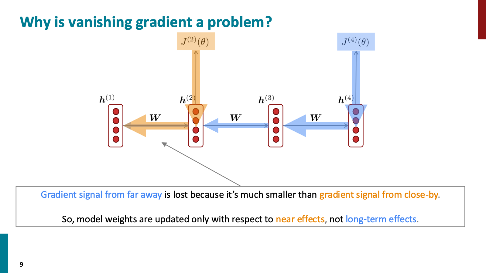
*Slide 9: "Why is vanishing gradient a problem?": the signal from J^(2) reaches h^(1) strongly, the signal from J^(4) arrives faint; "model weights are updated only with respect to near effects, not long-term effects" (Lecture 4's slide 46).*

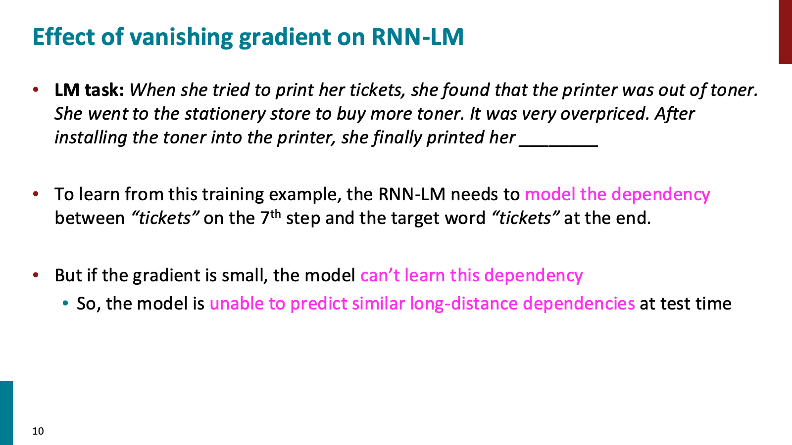
*Slide 10: "Effect of vanishing gradient on RNN-LM": "When she tried to print her tickets, … she finally printed her ________" (Lecture 4's slide 47).*

Why care? "Gradient signal from far away is lost because it's much smaller than gradient signal from close-by." Slide 10's example is the one to remember: the answer to "she finally printed her ___" is "tickets", and the clue sits at "the 7th step", a whole toner-shopping saga earlier. "But if the gradient is small, the model can't learn this dependency". Keep that sentence in mind. It is the exact job attention is about to take on: connect the end of a sentence to its seventh word *directly*, instead of by a chain of thirty multiplications.

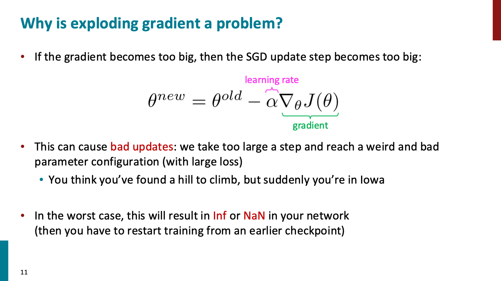
*Slide 11: "Why is exploding gradient a problem?": a huge gradient times the learning rate makes a huge SGD step; "You think you've found a hill to climb, but suddenly you're in Iowa" (Lecture 4's slide 48).*

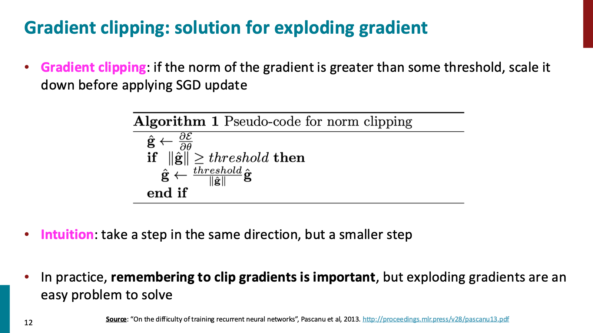
*Slide 12: "Gradient clipping: solution for exploding gradient": if the gradient's norm exceeds a threshold, scale it down; "take a step in the same direction, but a smaller step" (Lecture 4's slide 49).*

The opposite failure gets two slides and is fixed in one line. Too big a gradient means too big a step, and you land somewhere "weird and bad", possibly Iowa, possibly NaN. **Gradient clipping** caps the step's length and keeps its direction, and "exploding gradients are an easy problem to solve".

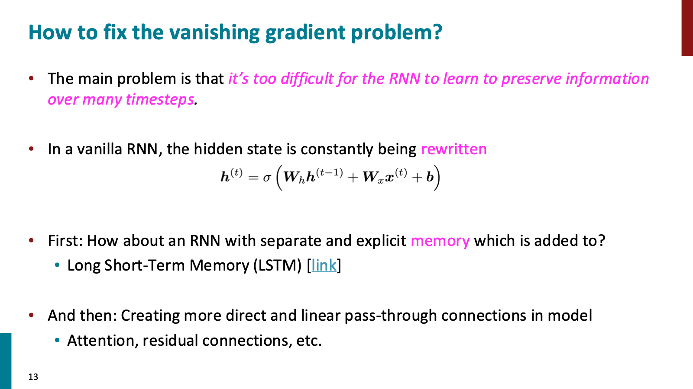
*Slide 13: "How to fix the vanishing gradient problem?": the hidden state is "constantly being rewritten", h^(t) = σ(W_h h^(t−1) + W_x x^(t) + b); first, "an RNN with separate and explicit memory which is added to" (LSTM, with a link); "And then: Creating more direct and linear pass-through connections in model", "Attention, residual connections, etc." (Lecture 4's slide 50, with "and explicit" added).*

Slide 13 is where the rewind turns into a promise. The diagnosis: "it's too difficult for the RNN to learn to preserve information over many timesteps", because "In a vanilla RNN, the hidden state is constantly being rewritten", every step pushing the old state through W_h and a squashing σ. The first cure was an architecture with "separate and explicit memory which is added to", the LSTM, which [Lecture 4, section 11](../04-language-models-rnns/README.md#11-gated-units-grus-and-lstms) took apart gate by gate (the slide's "[link]" goes to Chris Olah's LSTM post). The second cure is today's: "Creating more direct and linear pass-through connections in model", and the slide names two, "Attention, residual connections". Both will be in the Transformer. Attention gives every word a direct line to every other word; residual connections (section 8) give the gradient a straight road through the depth of the network.

**So far, and next.** Recurrence multiplies one factor per step, so long-range gradients vanish (or explode, which clipping handles). The fix the deck promises is direct connections. Before building them, one more rewind: the task where the lack of a direct connection hurt most.

## 2. Rewind, part two: translation and the bottleneck

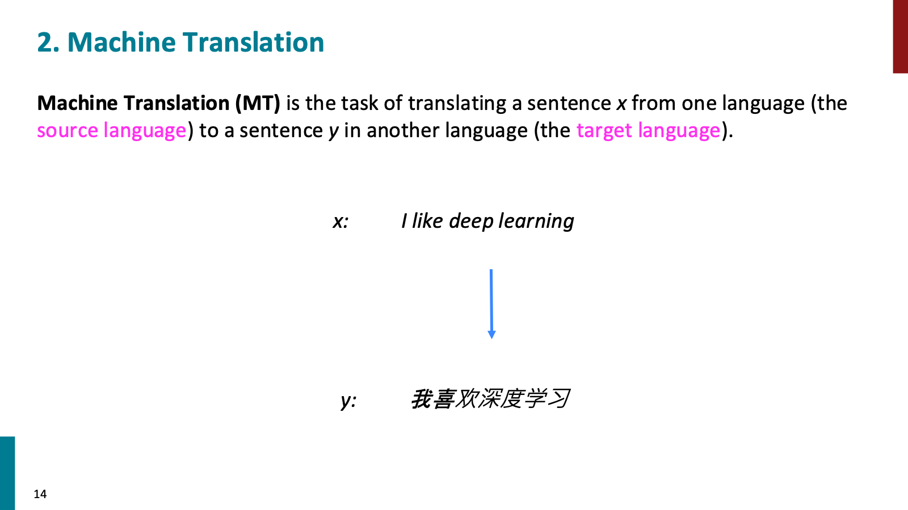
*Slide 14: "2. Machine Translation": translating a sentence x in the source language into a sentence y in the target language; "I like deep learning" → "我喜欢深度学习" (Lecture 4's slide 51).*

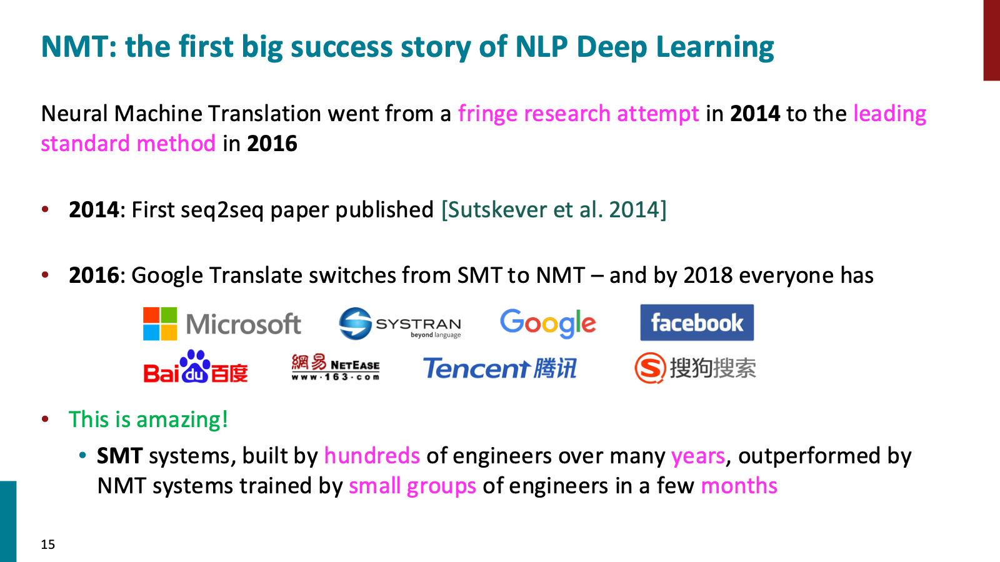
*Slide 15: "NMT: the first big success story of NLP Deep Learning": "from a fringe research attempt in 2014 to the leading standard method in 2016" (Lecture 4's slide 52).*

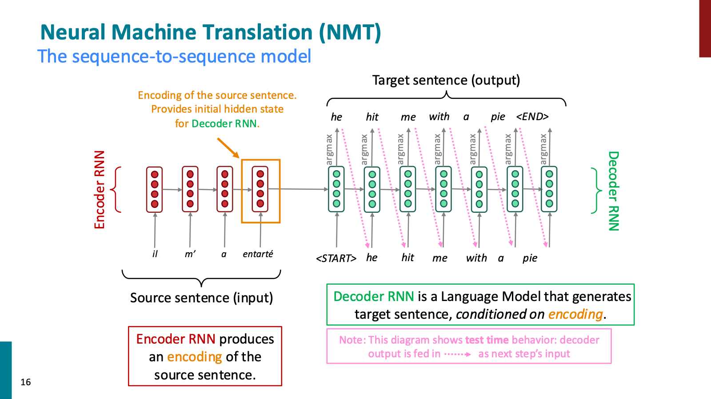
*Slide 16: "Neural Machine Translation (NMT): The sequence-to-sequence model": an encoder RNN reads "il m' a entarté"; its encoding "Provides initial hidden state for Decoder RNN"; the decoder generates "he hit me with a pie `<END>`", feeding each argmax word back in (Lecture 4's slide 53).*

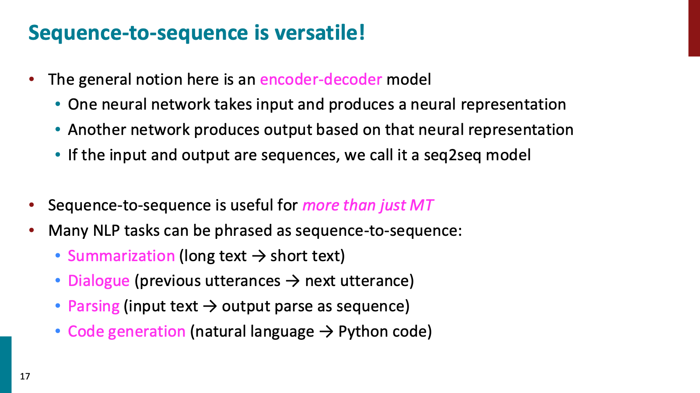
*Slide 17: "Sequence-to-sequence is versatile!": summarization, dialogue, parsing and code generation as seq2seq (Lecture 4's slide 54).*

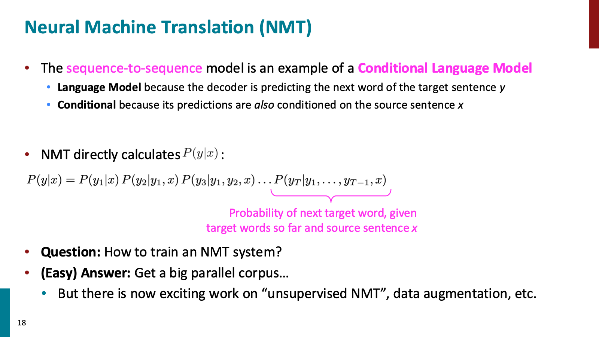
*Slide 18: "The sequence-to-sequence model is an example of a Conditional Language Model": P(y|x) = P(y₁|x) P(y₂|y₁, x) … P(y_T|y₁, …, y_{T−1}, x) (Lecture 4's slide 55).*

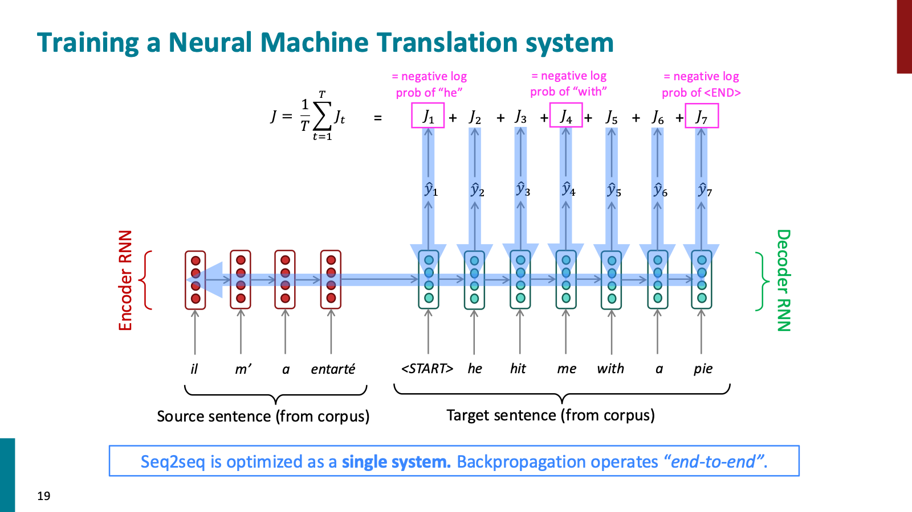
*Slide 19: "Training a Neural Machine Translation system": J = (1/T) Σ J_t over the target words; "Seq2seq is optimized as a single system. Backpropagation operates 'end-to-end'" (Lecture 4's slide 56).*

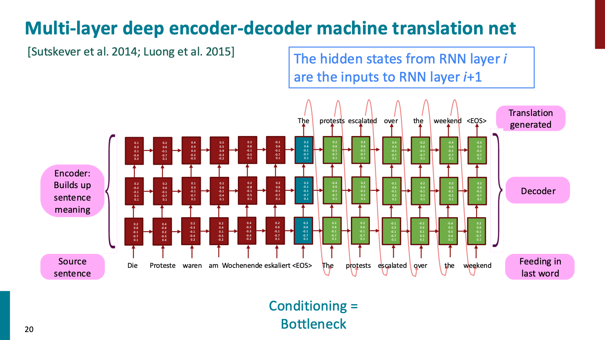
*Slide 20: "Multi-layer deep encoder-decoder machine translation net" [Sutskever et al. 2014; Luong et al. 2015], translating "Die Proteste waren am Wochenende eskaliert"; "Conditioning = Bottleneck" (Lecture 4's slide 57).*

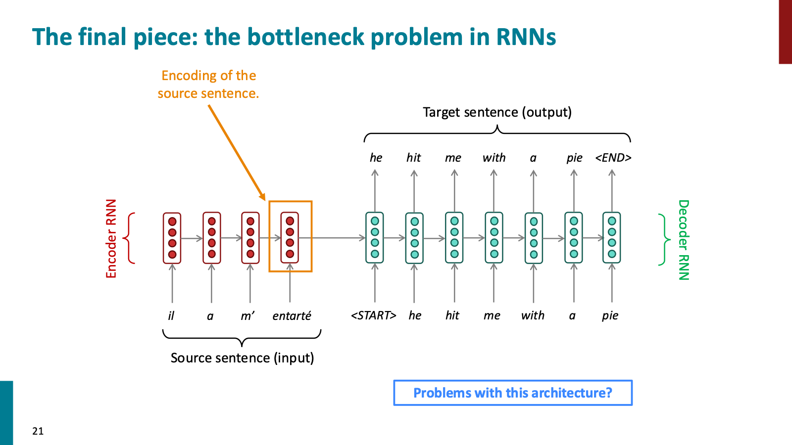
*Slide 21: "The final piece: the bottleneck problem in RNNs": the whole source reaches the decoder through one "Encoding of the source sentence"; "Problems with this architecture?" (Lecture 4's slide 58).*

Slides 14–21 replay [Lecture 4, section 10](../04-language-models-rnns/README.md#10-machine-translation-and-sequence-to-sequence-models) in eight frames. **Machine translation** maps a source sentence x to a target sentence y. The **sequence-to-sequence** model does it with two RNNs: an encoder that reads "il m' a entarté" (French has one verb for hitting someone with a cream pie) and a decoder that is a **conditional language model**, writing "he hit me with a pie" one word at a time, each word conditioned on the words so far and on the source. It is trained end to end on parallel text, and it carried neural MT from "a fringe research attempt in 2014 to the leading standard method in 2016".

Then the cliffhanger, slide 21, now with an answer coming. Everything the decoder knows about the source arrives through one fixed-size vector, the encoder's last state, whether the sentence has four words or forty. Slide 20 put a label on that handoff: "Conditioning = Bottleneck".

> **Note:** Slide 21 (like Lecture 4's slide 58) writes the source as "il a m' entarté", and the attention slides that follow (25–36) draw it in the same order, while slide 16 has the correct French, "il m' a entarté". Nothing in the mechanism depends on the order, and slide 37's alignment grid keeps the same labels, so "m'" still lines up with "me". Just don't learn your French from these diagrams.

**So far, and next.** The seq2seq model squeezes a whole sentence through one vector. The obvious question is why the decoder can't just look back at the source words it needs, when it needs them. That's attention.

## 3. Attention: let the decoder look back

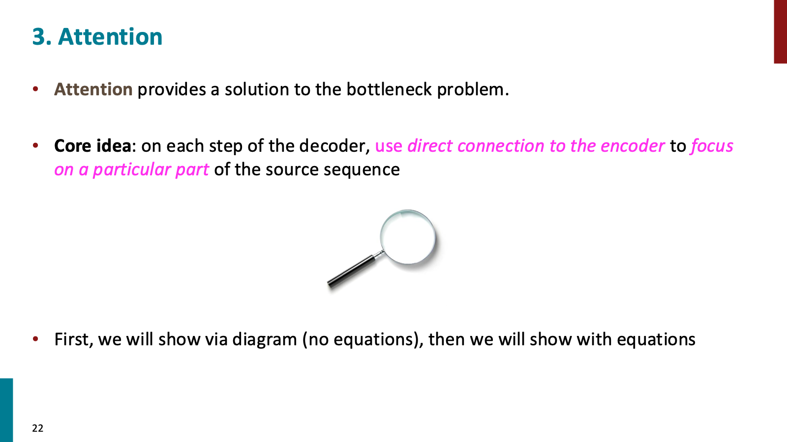
*Slide 22: "3. Attention": "Attention provides a solution to the bottleneck problem"; "Core idea: on each step of the decoder, use direct connection to the encoder to focus on a particular part of the source sequence"; "First, we will show via diagram (no equations), then we will show with equations".*

"Attention provides a solution to the bottleneck problem." The core idea fits in one line: "on each step of the decoder, use direct connection to the encoder to focus on a particular part of the source sequence". Instead of one summary handed over at the start, the decoder gets to consult the whole source at every step, and to consult it *differently* each time. The magnifying glass is the right picture: the source is all there, and the decoder decides where to point the lens.

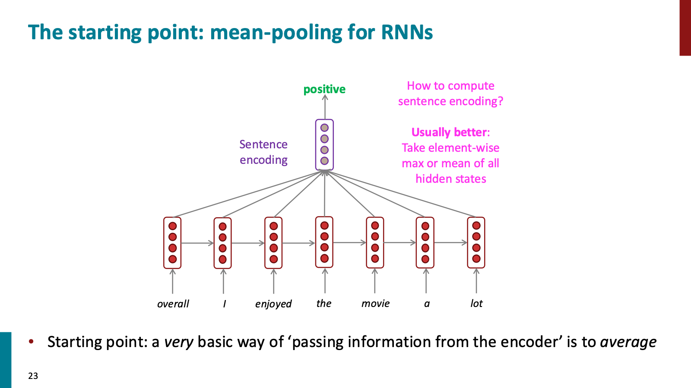
*Slide 23: "The starting point: mean-pooling for RNNs": the hidden states for "overall I enjoyed the movie a lot" all feed one "Sentence encoding", which predicts "positive"; "Usually better: Take element-wise max or mean of all hidden states".*

Start with the crudest way to use all the hidden states, not just the last: average them. Slide 23 asks "How to compute sentence encoding?" for a sentiment classifier reading "overall I enjoyed the movie a lot", and answers "Usually better: Take element-wise max or mean of all hidden states". This is **pooling**: the mean h̄ = (1/n) Σ_j h_j, or the element-wise max, h̄_r = max_j h_{j,r}, one maximum per coordinate. "Starting point: a *very* basic way of 'passing information from the encoder' is to *average*". It already beats the last-state bottleneck in one way: every word gets a direct path to the output, so "enjoyed" doesn't have to survive four more recurrent steps to be heard.

But notice what pooling can't do. The average is the same no matter what you want to know. A translator producing "pie" and a translator producing "he" would get the identical summary. What we want is an average whose weights depend on the question being asked.

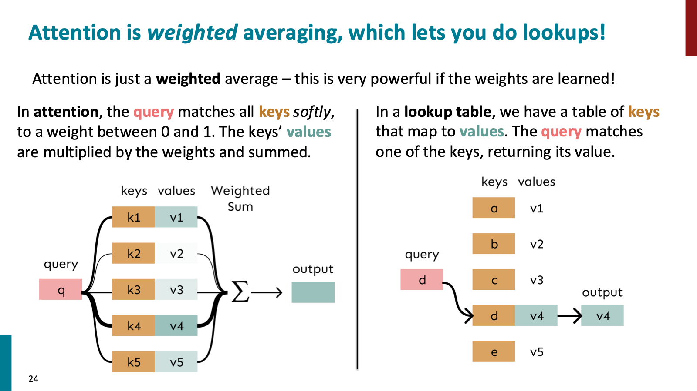
*Slide 24: "Attention is weighted averaging, which lets you do lookups!": a query q matched softly against keys k1–k5, their values v1–v5 weighted and summed into one output, beside a lookup table where query d matches key d exactly and returns v4.*

That's slide 24, the most important picture in the first half of the lecture. "Attention is just a weighted average – this is very powerful if the weights are learned!" It compares two ways of looking something up.

- "In a lookup table, we have a table of keys that map to values. The query matches one of the keys, returning its value." Query "d" finds key "d" and returns v4. Exact match, one answer.
- "In attention, the query matches all keys softly, to a weight between 0 and 1. The keys' values are multiplied by the weights and summed." The query q scores every key; key k4 matches best (the thick line), so v4 dominates the output, but v1 and v3 contribute a little too.

So **attention is a query-dependent soft lookup**. In symbols, which the lecture reaches in section 4: score each key against the query, e_j = score(q, k_j); turn the scores into weights with a softmax, α_j = exp(e_j) / Σ_l exp(e_l), the same softmax as word2vec's in [Lecture 2, section 3](../02-word-vectors/README.md#3-word2vec-learn-a-word-by-guessing-its-neighbours); and return c = Σ_j α_j v_j. The weights are positive and sum to 1, so the output is a weighted average of the values. Keys decide *how relevant* each item is; values carry *what it contributes*. The two can come from the same hidden states, as they do in a moment, and still play different roles.

> **Note:** Why "soft"? Because a hard lookup (argmax over the scores, return one value) has no useful gradient: nudge a score slightly and the answer either doesn't change or jumps. A softmax-weighted average changes smoothly with every score, so backpropagation can teach the network *where* to look. It's the same move as replacing argmax with softmax for classification ([Lecture 2's note on the name](../02-word-vectors/README.md#3-word2vec-learn-a-word-by-guessing-its-neighbours)): "soft arg max", applied to memory.

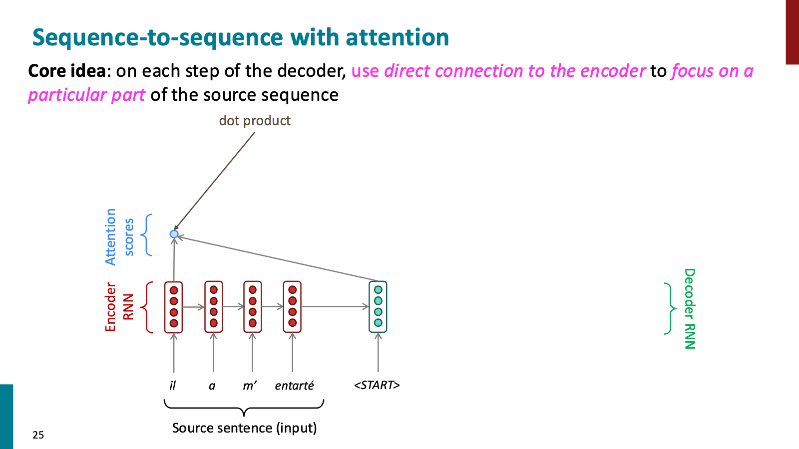
*Slide 25: "Sequence-to-sequence with attention": the decoder's first hidden state, at `<START>`, takes a "dot product" with the first encoder hidden state, giving one "Attention score".*

*Slide 26: the same decoder state takes a dot product with the second encoder state.*

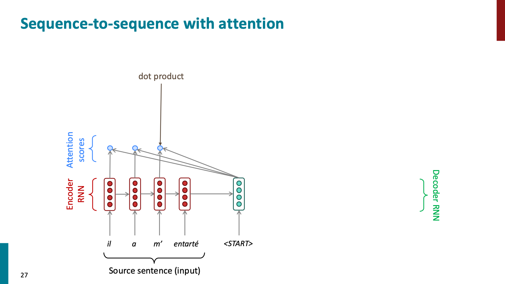
*Slide 27: the dot product with the third encoder state.*

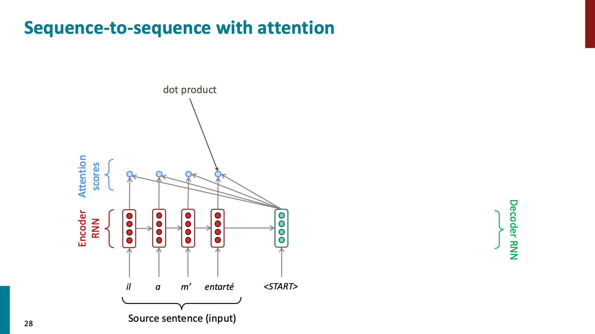
*Slide 28: the dot product with the fourth encoder state: four attention scores, one per source word.*

Now the real thing, in diagram form, on the pie sentence. The encoder RNN has read the source and left a hidden state over each word. The decoder RNN has read `<START>` and has its first hidden state, the **query**. Slides 25–28 compute one **attention score** per source word, each a "dot product" between the decoder's state and that word's encoder state. A big dot product means the two vectors point the same way: this source position looks relevant to what the decoder is about to say.

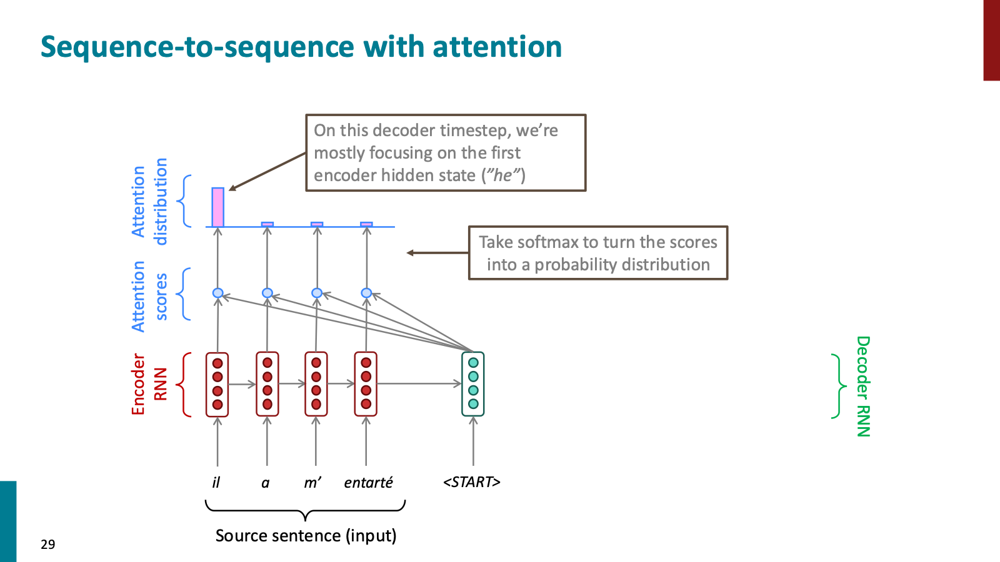
*Slide 29: "Take softmax to turn the scores into a probability distribution"; "On this decoder timestep, we're mostly focusing on the first encoder hidden state ("he")".*

"Take softmax to turn the scores into a probability distribution": the **attention distribution**, one weight per source word, summing to 1. Here almost all of it lands on the first source position. Which makes sense, since the first English word is about to be "he", and the first French word is "il".

> **Note:** The callout's "("he")" names the English word this step will produce, but the encoder state it points at is the one over the French input "il". Encoder states sit over source words; target words come out of the decoder.

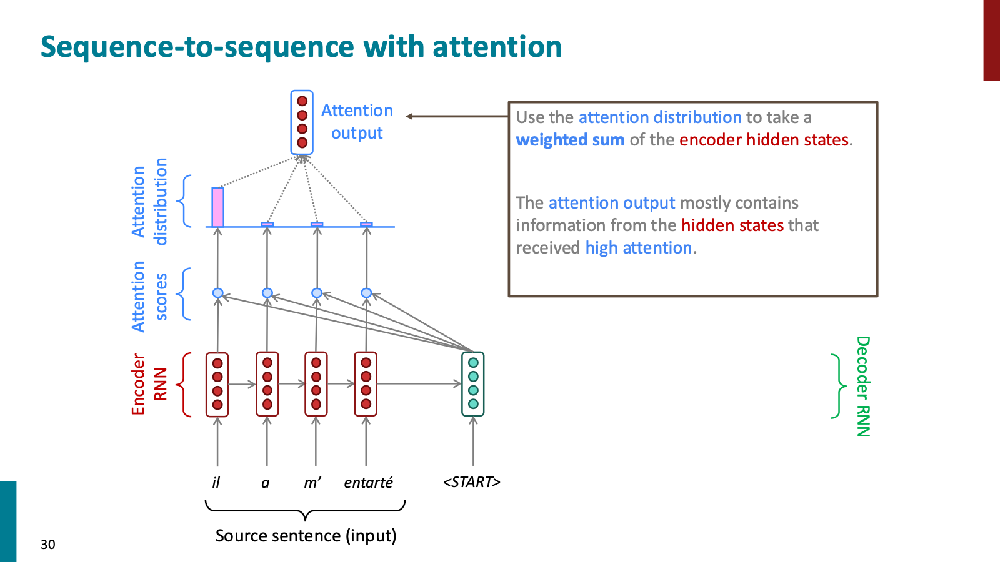
*Slide 30: "Use the attention distribution to take a weighted sum of the encoder hidden states. The attention output mostly contains information from the hidden states that received high attention."*

"Use the attention distribution to take a weighted sum of the encoder hidden states." The result, the **attention output** (often called the *context vector*), "mostly contains information from the hidden states that received high attention". Here the encoder states play both roles from slide 24: they are the keys the query was scored against, and the values that get averaged.

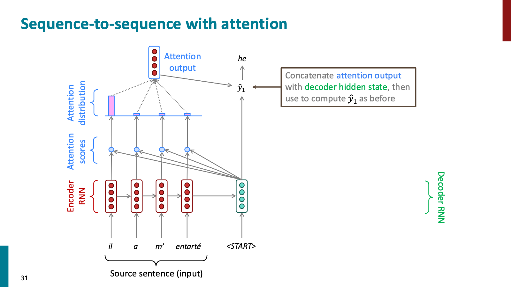
*Slide 31: "Concatenate attention output with decoder hidden state, then use to compute ŷ₁ as before": the first output is "he".*

"Concatenate attention output with decoder hidden state, then use to compute ŷ₁ as before". The decoder now predicts from two things: its own state (what it has said so far) and the attention output (the part of the source it is looking at). Out comes "he".

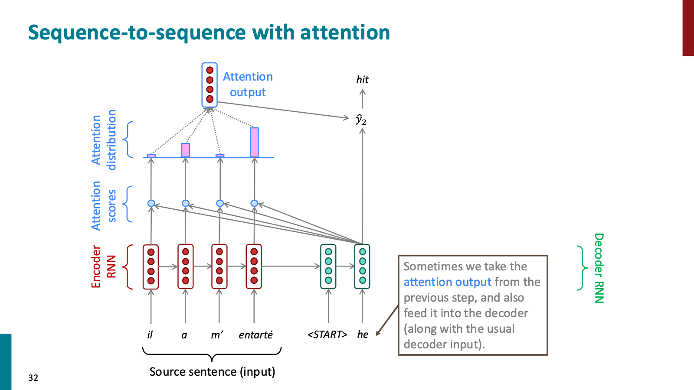
*Slide 32: the decoder reads "he" and produces "hit", attending mostly to the last source word, "entarté", with some weight on "a"; "Sometimes we take the attention output from the previous step, and also feed it into the decoder (along with the usual decoder input)".*

*Slide 33: after "hit", the decoder attends mostly to "m'" and produces "me".*

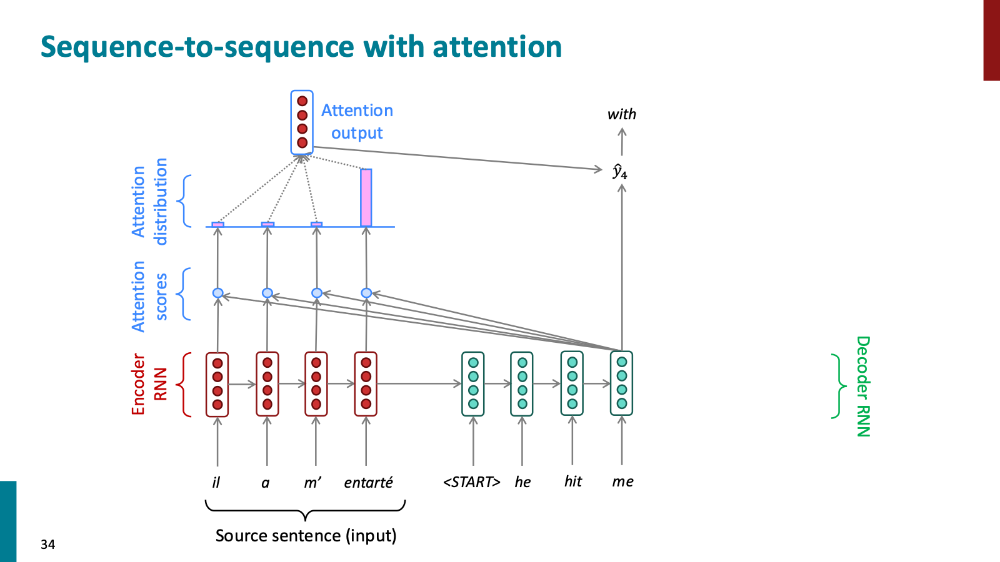
*Slide 34: after "me", attention goes to "entarté" and the output is "with".*

*Slide 35: after "with", attention stays on "entarté" and the output is "a".*

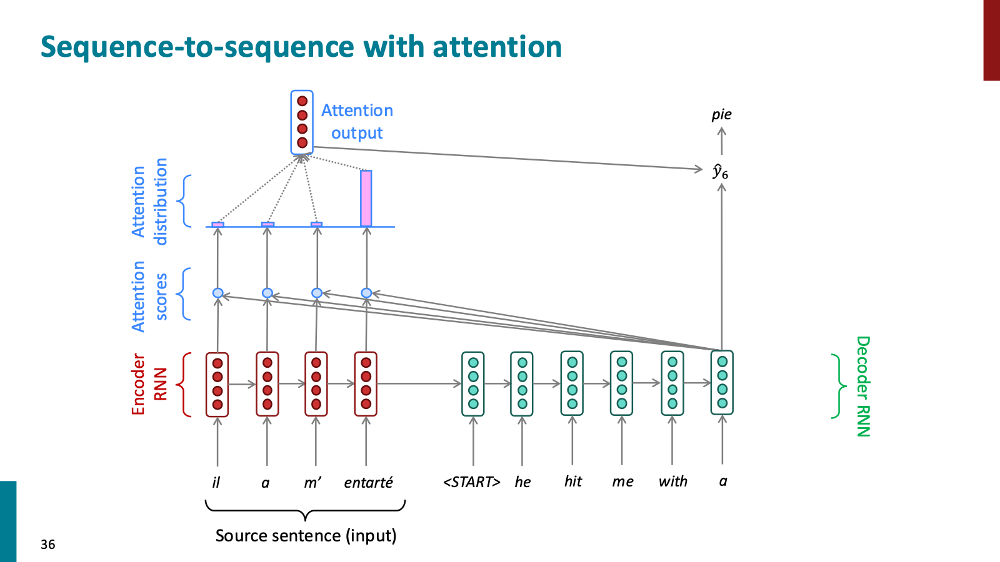
*Slide 36: after "a", attention is still on "entarté" and the output is "pie".*

Slides 32–36 repeat the cycle for every target word: new decoder state, new scores against the *same* encoder states, new distribution, new weighted sum, next word. Watch the pink bar move. For "hit" it jumps to "entarté"; for "me" it lands on "m'"; and for "with", "a" and "pie" it sits on "entarté" again. That's the translation problem in miniature: one French verb, *entarter*, has to be spelled out in English as "hit … with a pie", so the decoder keeps returning to it for four different English words.

Slide 32 adds an optional wire: "Sometimes we take the attention output from the previous step, and also feed it into the decoder (along with the usual decoder input)". The slide shows feeding the previous context vector. Luong et al. (2015), who call their version the "input-feeding approach", instead feed the previous *attentional vector* h̃_t = tanh(W_c[c_t; h_t]), which combines the context and the decoder state, into the next step, "to inform the model about past alignment decisions", much as statistical MT systems kept track of which source words had already been translated.

In equations, with decoder state s_t and encoder states h_1, …, h_n, one step of the decoder computes

e_{t,j} = s_tᵀ h_j   (scores)
α_t = softmax(e_t)   (attention distribution)
c_t = Σ_j α_{t,j} h_j   (attention output)

and predicts from the concatenation [s_t; c_t]. Each target step scores all n source states, so a target of length m costs n × m scores in all: when both lengths grow together, that's quadratic.

> **Check your understanding.** A decoder state s = (1, 0) attends over three encoder states h₁ = (2, 0), h₂ = (0, 1), h₃ = (−1, 0), with dot-product scores. What are the attention weights and the attention output? *Answer: the scores are 2, 0 and −1. The softmax gives e² : e⁰ : e⁻¹ = 7.39 : 1 : 0.37, so the weights are about 0.84, 0.11 and 0.04 (they sum to 1). The output is 0.84 × (2, 0) + 0.11 × (0, 1) + 0.04 × (−1, 0) ≈ (1.65, 0.11): mostly h₁, with a little of everything else. No state is ignored completely, which is what "soft" means.*

> **Note:** The idea has a precise birthday. Bahdanau, Cho and Bengio's [Neural Machine Translation by Jointly Learning to Align and Translate](https://arxiv.org/abs/1409.0473) (arXiv, September 2014; ICLR 2015; the course collects v7 of May 2016) put the diagnosis in its abstract: "we conjecture that the use of a fixed-length vector is a bottleneck in improving the performance of this basic encoder–decoder architecture", and proposed letting the model "automatically (soft-)search for parts of a source sentence that are relevant to predicting a target word". Their scoring function wasn't a dot product. They "parametrize the alignment model a as a feedforward neural network" (now called *additive* attention). The plain dot product the slides use is one of the three scores Luong, Pham and Manning compared a year later in [Effective Approaches to Attention-based Neural Machine Translation](https://aclanthology.org/D15-1166/) (EMNLP 2015): "dot", "general" (h_tᵀ W_a h̄_s) and "concat". The third author is the course's Chris Manning.

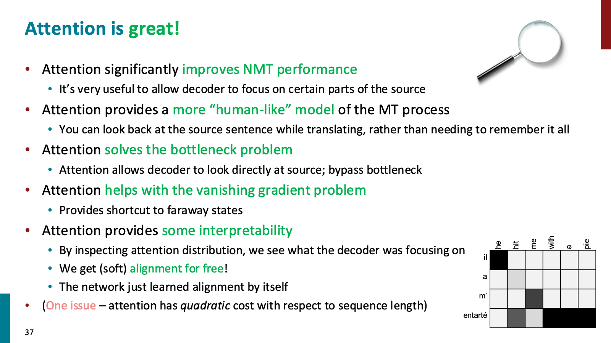
*Slide 37: "Attention is great!": it "significantly improves NMT performance", gives "a more 'human-like' model of the MT process", "solves the bottleneck problem", "helps with the vanishing gradient problem", and "provides some interpretability"; a grid aligns il, a, m', entarté with he, hit, me, with, a, pie; "(One issue – attention has quadratic cost with respect to sequence length)".*

Slide 37 is the scorecard, and each line answers something from the rewind.

- "Attention significantly improves NMT performance": "It's very useful to allow decoder to focus on certain parts of the source".
- "Attention provides a more 'human-like' model of the MT process": "You can look back at the source sentence while translating, rather than needing to remember it all". (Nobody translates a long sentence by memorising it and then reciting the translation with eyes shut.)
- "Attention solves the bottleneck problem": "Attention allows decoder to look directly at source; bypass bottleneck". That's slide 21 answered.
- "Attention helps with the vanishing gradient problem": "Provides shortcut to faraway states". That's slide 13's "direct and linear pass-through connections", delivered. The gradient from a target word reaches any source word in one hop through the weighted sum, not through a chain of recurrent steps.
- "Attention provides some interpretability": "By inspecting attention distribution, we see what the decoder was focusing on", and "We get (soft) alignment for free! The network just learned alignment by itself".

The grid in the corner is that alignment: each column is an English word, each row a French one, dark where attention was high. "il" lines up with "he", "m'" with "me", and "entarté" soaks up "with a pie" (and some of "hit"). Nobody told the network which words correspond; it learned that to translate well. Old statistical MT systems spent whole pipelines estimating such alignments.

Read "some interpretability" as carefully as the slide wrote it. The weights show where the decoder looked, which is useful; they don't by themselves prove why it produced a word. And note the last bullet, in pink: "(One issue – attention has quadratic cost with respect to sequence length)". It will be back on slides 69 and 70.

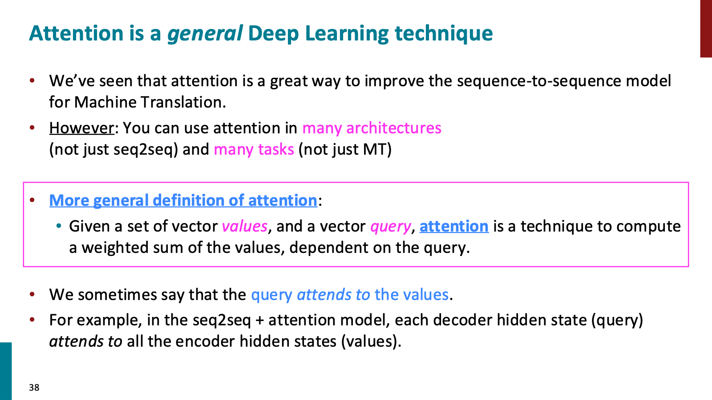
*Slide 38: "Attention is a general Deep Learning technique": "Given a set of vector values, and a vector query, attention is a technique to compute a weighted sum of the values, dependent on the query"; "the query attends to the values".*

Slide 38 lifts attention out of translation. "You can use attention in many architectures (not just seq2seq) and many tasks (not just MT)". The general definition, boxed: "Given a set of vector *values*, and a vector *query*, *attention* is a technique to compute a weighted sum of the values, dependent on the query." "We sometimes say that the query *attends to* the values." In seq2seq, "each decoder hidden state (query) *attends to* all the encoder hidden states (values)".

**So far, and next.** Attention is a soft lookup: score every key against a query, softmax the scores, average the values. Added to seq2seq, it removes the bottleneck, shortens gradient paths and learns alignments on its own. But the encoder and decoder are still RNNs, still reading one word at a time. Part 4 asks the obvious, slightly reckless question: if attention can pass information around, do we need the recurrence at all?

## 4. Do we even need recurrence? Self-attention

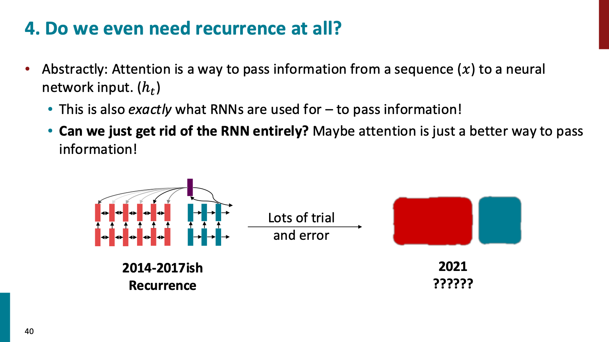
*Slide 39: "4. Do we even need recurrence at all?": "Attention is a way to pass information from a sequence (x) to a neural network input (h_t)"; "Can we just get rid of the RNN entirely?"; a stacked bidirectional RNN labelled "2014-2017ish Recurrence", an arrow "Lots of trial and error", and two blocks labelled "2021 ??????".*

Here is the turn of the whole course. "Abstractly: Attention is a way to pass information from a sequence (x) to a neural network input. (h_t)". And "This is also *exactly* what RNNs are used for – to pass information!" So: "**Can we just get rid of the RNN entirely?** Maybe attention is just a better way to pass information!" The cartoon tells the history as a joke with a straight face: years of recurrent models ("2014-2017ish"), then "Lots of trial and error", then two featureless blocks and a row of question marks. The blocks are about to get a name.

Why would anyone want to drop recurrence, when the LSTM worked? The course notes for this lecture, John Hewitt's [Note 10](materials/cs224n-self-attention-transformers-2023_draft.pdf) (Winter 2023 draft, cited "notes §N"), make the case before the slides do. Start with what we want. A word's embedding Ew_i is a **non-contextual** representation: "despite w_i appearing in a sequence, the representation Ew_i is independent of context" (notes §1.1). The goal is **contextual representations**: a vector h_i "that represents w_i but is a function of the entire sequence x_{1:n} (or a prefix x_{1:i}, as in the case of language modeling.)" "Bank" in "river bank" and in "bank loan" should come out different. Lecture 2's word vectors gave each word one vector ([Lecture 2, section 2](../02-word-vectors/README.md#2-what-does-a-word-mean)); from here on, a word's vector depends on its company.

An RNN builds contextual vectors, but notes §1.2 names two costs, both from "the dependence on the sequence index" in h_t = σ(Wh_{t−1} + Ux_t).

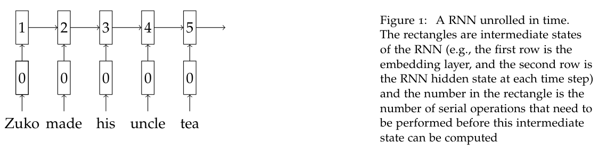
*Notes, Figure 1: an RNN unrolled over "Zuko made his uncle tea"; each hidden state is labelled with "the number of serial operations that need to be performed before this intermediate state can be computed": 1, 2, 3, 4, 5.*

- **Parallelization.** GPUs are fast at work that doesn't wait for other work, like the many independent multiply-adds in a matrix product. But "I can't compute h_2 until I know the value of h_1", and h_3 waits for h_2, and so on. Figure 1 counts the wait: the fifth hidden state needs five operations in series, whatever hardware you own. "As the sequence gets longer, there is only so much I can parallelize".

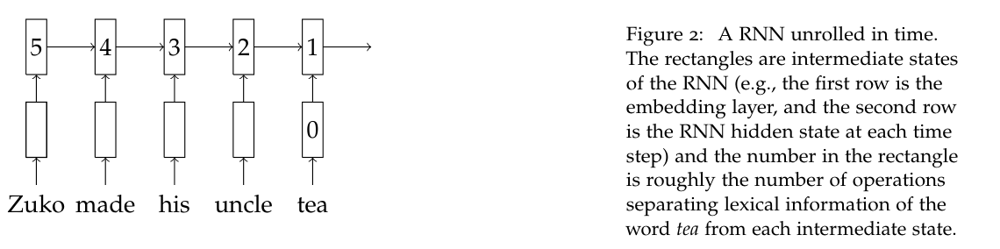
*Notes, Figure 2: the same RNN, labelled with "roughly the number of operations separating lexical information of the word tea from each intermediate state": 5 at the first position down to 1 at the last.*

- **Linear interaction distance.** In "The chef who ran out of blackberries and went to the stores is", the verb "is" must agree with "chef", and "the number of intermediate computations—matrix multiplies and nonlinearities, for example—that separate chef from is scales with the number of words between them." Figure 2 shows the distance growing step by step. Researchers believe that "it can be difficult for networks to precisely 'recall' the presence of a word when a large number of operations occur after observing that word."

The second cost is slide 10's printer story again, and attention in seq2seq already fixed it for the source sentence. The notes' proposal is to fix it everywhere: "an entire replacement for recurrent neural networks just based on attention. This will solve both the parallelization issues and the linear interaction distance issues".

> **Note:** "Zuko made his uncle tea" is not a random sentence. In the animated series *Avatar: The Last Airbender*, Zuko's uncle Iroh is famously devoted to tea (Lecture 4's slide 8 had the same pair in the kitchen). CS224N has a running Zuko habit; enjoy it.

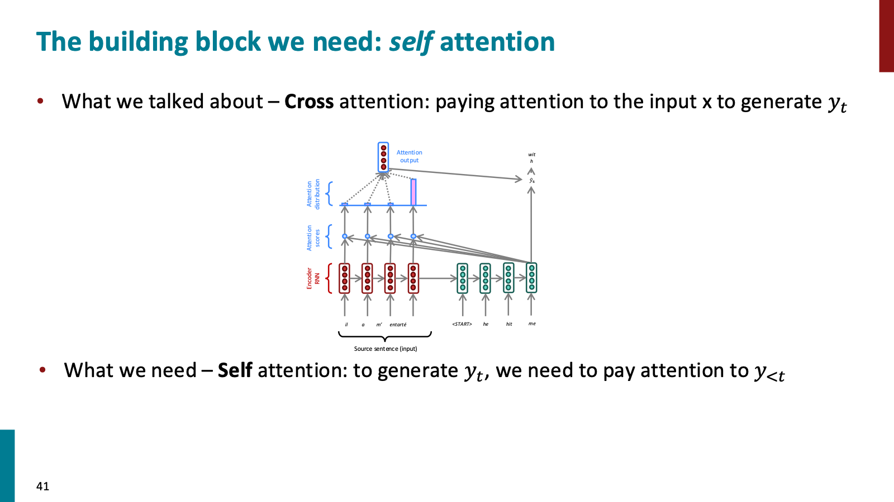
*Slide 40: "The building block we need: self attention": "What we talked about – Cross attention: paying attention to the input x to generate y_t" (the seq2seq-with-attention diagram); "What we need – Self attention: to generate y_t, we need to pay attention to y_{<t}".*

Slide 40 names the difference. What section 3 built is **cross-attention**: the decoder (one sequence) attends to the encoder (another). Throw away the RNN and the decoder loses its memory of what it has written so far, so it must get that by attention too: "to generate y_t, we need to pay attention to y_{<t}". When a sequence attends to itself, that's **self-attention**.

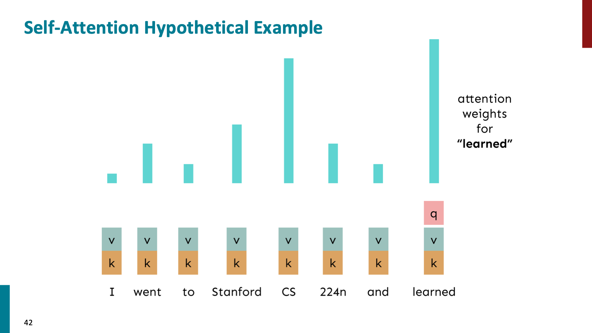
*Slide 41: "Self-Attention Hypothetical Example": each word of "I went to Stanford CS 224n and learned" has a key k and a value v; "learned" also has a query q; bars show the "attention weights for 'learned'", highest on "learned" and "CS", then "Stanford".*

Slide 41 shows the idea before the algebra. Every word in "I went to Stanford CS 224n and learned" offers a key (what I am) and a value (what I'll contribute). The word "learned" asks a question with its query, and the bars are its attention weights over the whole sentence, itself included. In this made-up example it cares most about itself and "CS", then "Stanford": what was learned, and where. The new representation of "learned" is the weighted average of everyone's values, so it now carries a bit of "CS" in it.

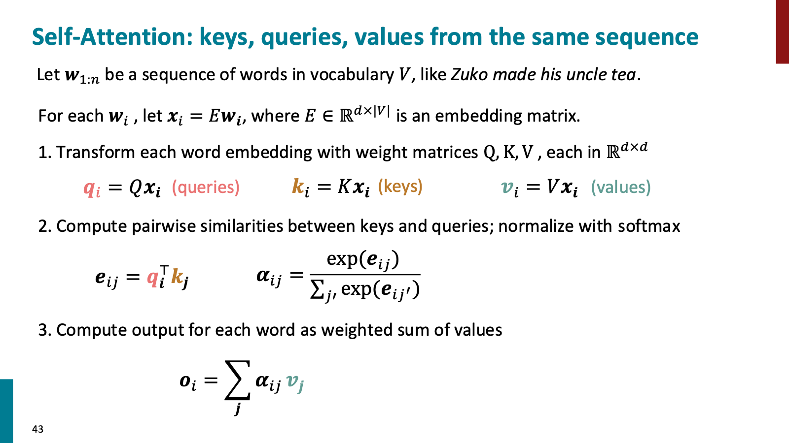
*Slide 42: "Self-Attention: keys, queries, values from the same sequence": x_i = Ew_i; q_i = Qx_i, k_i = Kx_i, v_i = Vx_i with Q, K, V each in ℝ^(d×d); e_ij = q_iᵀk_j; α_ij = exp(e_ij)/Σ_j′ exp(e_ij′); o_i = Σ_j α_ij v_j.*

Slide 42 is the algebra, and it's short. Take a sequence w_{1:n}, "like *Zuko made his uncle tea*", and embed each word, x_i = Ew_i with E ∈ ℝ^(d×|V|).

1. "Transform each word embedding with weight matrices Q, K, V, each in ℝ^(d×d)": q_i = Qx_i (queries), k_i = Kx_i (keys), v_i = Vx_i (values).
2. "Compute pairwise similarities between keys and queries; normalize with softmax": e_ij = q_iᵀk_j, α_ij = exp(e_ij) / Σ_j′ exp(e_ij′).
3. "Compute output for each word as weighted sum of values": o_i = Σ_j α_ij v_j.

That's **key-query-value self-attention**, the operation the rest of the lecture decorates. It is exactly slide 24's soft lookup, with one twist: the queries, keys and values all come from the same sequence, through three different learned matrices. Why three? "The use of matrices K, Q, V intuitively allow us to use different views of the x_i for the different roles of key, query, and value" (notes §2.1). What a word is looking for, what it advertises, and what it hands over can all differ.

> **Check your understanding.** Suppose we skipped the matrices and used q_i = k_i = v_i = x_i, with every embedding the same length. Which word would each word attend to most? *Answer: its own vector has a maximal score (the Cauchy–Schwarz inequality), possibly tied with another identical vector. That does not guarantee most of the attention mass: with ten orthonormal unit embeddings, its self-weight is only e/(e + 9) ≈ 0.23. Separate Q and K remove that forced, symmetric similarity rule and let the model learn which other tokens matter, so "learned" can look for "CS". They also make the relation one-way: q_iᵀk_j need not equal q_jᵀk_i, so "it" can look for its antecedent without the antecedent looking back.*

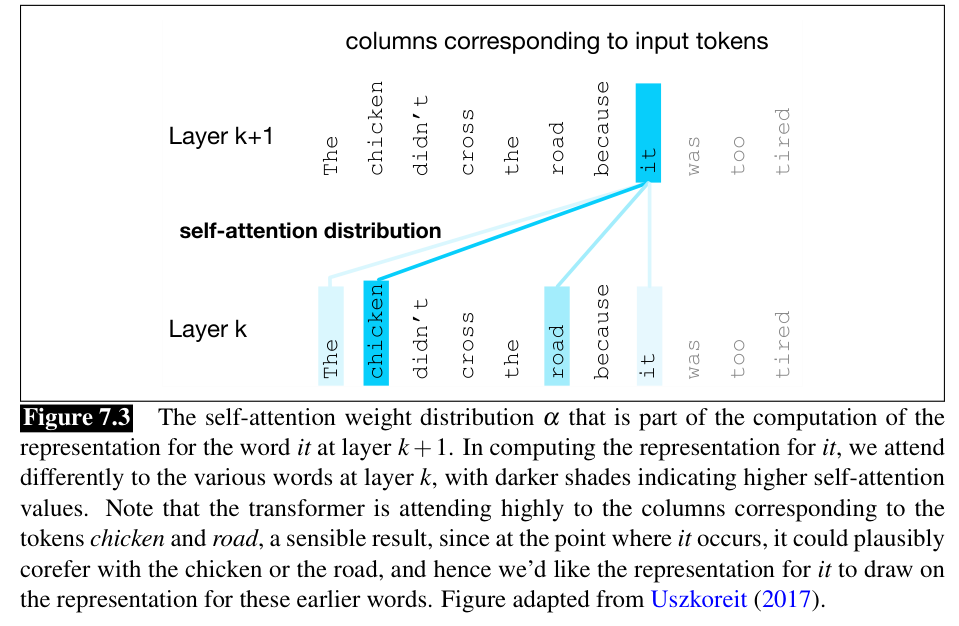
*J&M, Figure 7.3: in "The chicken didn't cross the road because it was too tired", the self-attention distribution for "it" at layer k+1 puts most weight on "chicken" and "road" at layer k (Jurafsky and Martin, Speech and Language Processing, Chapter 7, August 2026 draft).*

Here is what that buys, from the course's suggested reading, Jurafsky and Martin's [Chapter 7, "Transformers and Pretraining"](materials/jm-slp3-ch07-transformers-pretraining-aug2026.pdf) (the August 19, 2026 draft, cited "J&M §N"). Representing "it" in "The chicken didn't cross the road because it…", one layer of self-attention leans on "chicken" and "road", the two things "it" could be. At this point the model can't know which; "was too tired" (chicken) or "was too wide" (road) hasn't arrived yet. The representation of "it" can carry both candidates, but no deeper causal layer at that position can use the unseen continuation. Representations at later token positions can use that continuation when it arrives.

> **Note:** A useful way to see what changed. In Note 10's Figures 1 and 2 the counts grow with position. In self-attention, every o_i is computed from the layer below in one step, so the count of serial operations per layer is 1 for every position, and "tea" is one hop from "Zuko". All n outputs can be computed at once (section 7 shows it as two matrix products). This is the parallelism argument from notes §1.2, cashed in. One caveat stays: when *generating*, a model still produces one token at a time, because the next token doesn't exist until it's sampled. Self-attention parallelizes training and reading, not writing.

**So far, and next.** Self-attention gives every word a contextual vector by a soft lookup over its own sentence, with learned queries, keys and values, and no recurrence. As a replacement for an RNN, though, it has holes. The next slides list three "barriers", and the first is that this operation has no idea what order the words are in.

## 5. Barrier one: order, and position representations

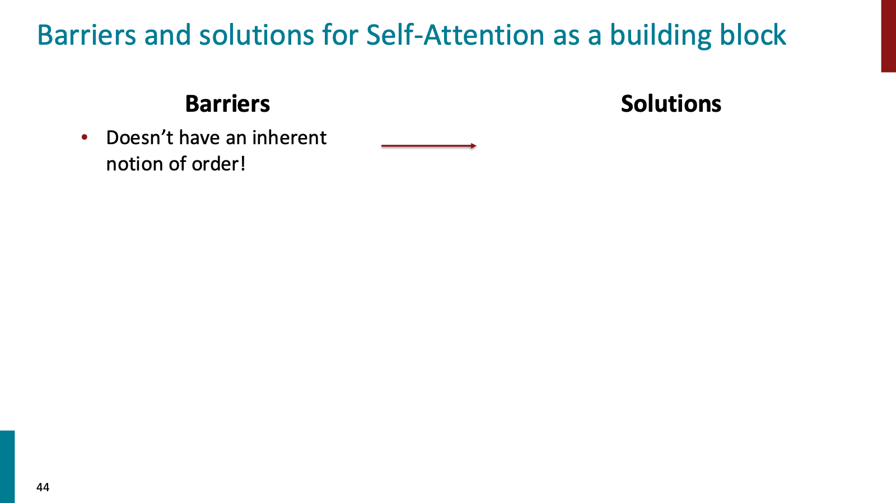
*Slide 43: "Barriers and solutions for Self-Attention as a building block": Barriers, "Doesn't have an inherent notion of order!", with an arrow to an empty Solutions column.*

Slides 43, 47, 49 and 51 are one table filling in: barriers on the left, solutions on the right. First barrier: self-attention "Doesn't have an inherent notion of order!"

Notes §2.2 shows why with a sentence pair: "the oven cooked the bread so" and "the bread cooked the oven so". One is a baking success; the other, in the notes' words, has "the bread somehow breaking the oven". An RNN tells them apart because it reads in order. Self-attention doesn't. Take the representation of "so". Its weights are a softmax over q_soᵀk_the, q_soᵀk_oven, q_soᵀk_cooked, and so on, and swapping "oven" and "bread" just swaps two terms in the sum. "The numerator hasn't changed, and the denominator hasn't changed; we've just rearranged terms in the sum." Every weight on a word stays the same, the weighted average of values stays the same, and h_so comes out identical for both sentences. The reason is simple: the embedding x = Ew depends only on the word, and nothing in the attention arithmetic depends on where it sits.

> **Note:** Two small slips in notes §2.2. Eq. 9 lists six word vectors for "the oven cooked the bread so" but gives the matrix as ℝ^(5×d); it's 6 × d. And Eq. 11's denominator stops at "exp(q_soᵀk_bread)", leaving out the sixth term, exp(q_soᵀk_so); the normalizer runs over all six keys. The argument is unaffected.

> **Check your understanding.** If you shuffle the words of a sentence, what happens to the self-attention outputs (with no position information)? *Answer: they get shuffled the same way and are otherwise unchanged. Each word's output depends on the set of (key, value) pairs it attends over, not their order. Mathematicians call this permutation-equivariant: permute the input, and the output is permuted in the same way. A bag of words in a fancy coat.*

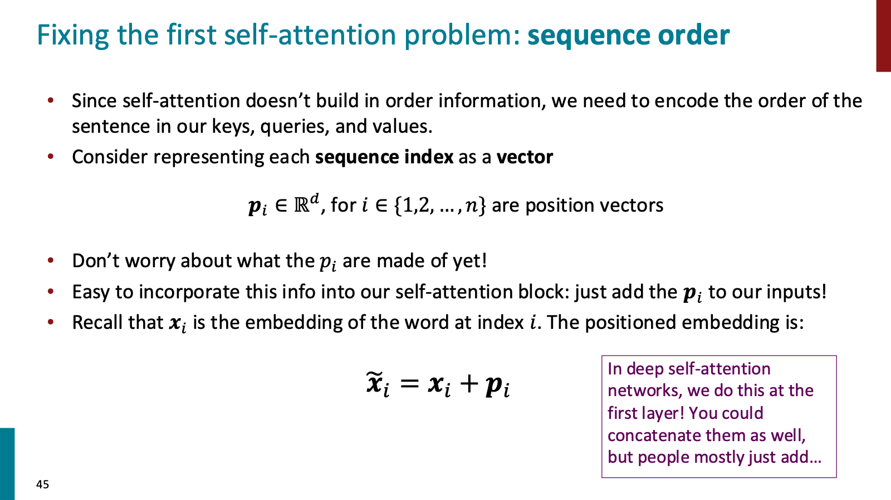
*Slide 44: "Fixing the first self-attention problem: sequence order": "p_i ∈ ℝ^d, for i ∈ {1, 2, …, n} are position vectors"; "just add the p_i to our inputs!": x̃_i = x_i + p_i; "In deep self-attention networks, we do this at the first layer! You could concatenate them as well, but people mostly just add…".*

The fix: give each position its own vector and mix it into the input. "Consider representing each sequence index as a vector", p_i ∈ ℝ^d for i ∈ {1, 2, …, n}. "Don't worry about what the p_i are made of yet!" Then "just add the p_i to our inputs!": the **positioned embedding** x̃_i = x_i + p_i. Now "oven" in position 2 and "oven" in position 5 are different vectors, and the queries, keys and values computed from them differ too. The box in the corner adds two practical notes: in a deep network this happens once, "at the first layer", and "You could concatenate them as well, but people mostly just add…".

Adding seems careless (won't the word and the position smudge into each other?), but in a few hundred dimensions there's room for both, and the network learns to read them apart.

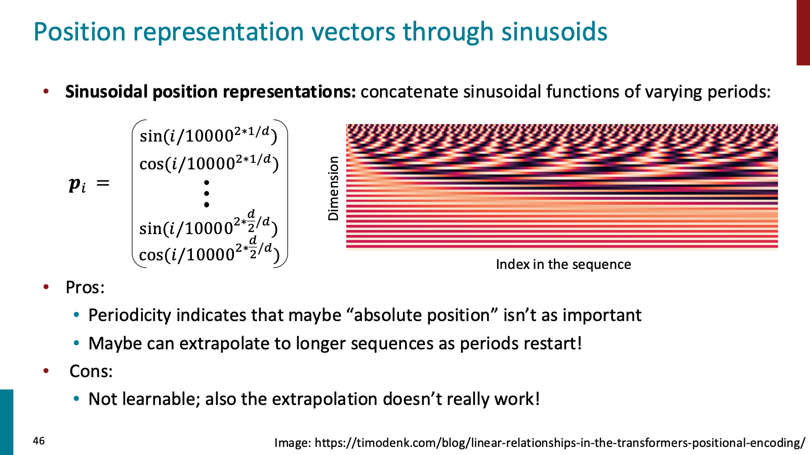
*Slide 45: "Position representation vectors through sinusoids": p_i stacks sin(i/10000^(2·j/d)) and cos(i/10000^(2·j/d)) for j = 1, …, d/2; a heat map of the vectors (dimension against "Index in the sequence"); pros, "Periodicity indicates that maybe 'absolute position' isn't as important" and "Maybe can extrapolate to longer sequences as periods restart!"; cons, "Not learnable; also the extrapolation doesn't really work!" (image: timodenk.com).*

What should p_i be? Option one, from the original Transformer paper: **sinusoidal position representations**, "concatenate sinusoidal functions of varying periods". Each pair of dimensions is a sine and a cosine of the position at one frequency, and the frequencies fall off geometrically across the vector. The heat map shows the result: some dimensions flicker fast as the position grows (the jagged band at the top) and others change slowly (the smooth stripes below). It's a clock with many hands: the second hand tells you the fine position, the hour hand the coarse one, and together they pin down the time.

The slide is candid about pros and cons. "Periodicity indicates that maybe 'absolute position' isn't as important", and "Maybe can extrapolate to longer sequences as periods restart!" But: "Not learnable; also the extrapolation doesn't really work!"

> **Note:** The original wording is worth having. Vaswani et al. (§3.5) write PE(pos, 2i) = sin(pos/10000^(2i/d_model)) and PE(pos, 2i+1) = cos(pos/10000^(2i/d_model)), with i counting from 0, so the first pair has period 2π and "the wavelengths form a geometric progression from 2π to 10000 · 2π". (The slide counts its pairs from 1, a shift of one pair.) The reason they gave was a hypothesis: "it would allow the model to easily learn to attend by relative positions, since for any fixed offset k, PE_{pos+k} can be represented as a linear function of PE_pos." That is trigonometry you already know: shifting an angle is a rotation, and sin(a + b), cos(a + b) are linear in sin a, cos a. And they chose the sinusoids over learned vectors "because it may allow the model to extrapolate to sequence lengths longer than the ones encountered during training." Slide 45's last line is the verdict of the years since: being *able* to compute the vector for position 10,000 doesn't mean the model knows what to do with it.

> **Note:** If you read the assigned [Illustrated Transformer](materials/alammar2018-illustrated-transformer/index.html) (Jay Alammar, 2018), its colour plot of positional encodings is "split in half down the center", sines on the left and cosines on the right. Its own "July 2020 Update" explains: that plot is "from the Tensor2Tensor implementation of the Transformer. The method shown in the paper is slightly different in that it doesn't directly concatenate, but interweaves the two signals." Same idea, different arrangement of the coordinates.

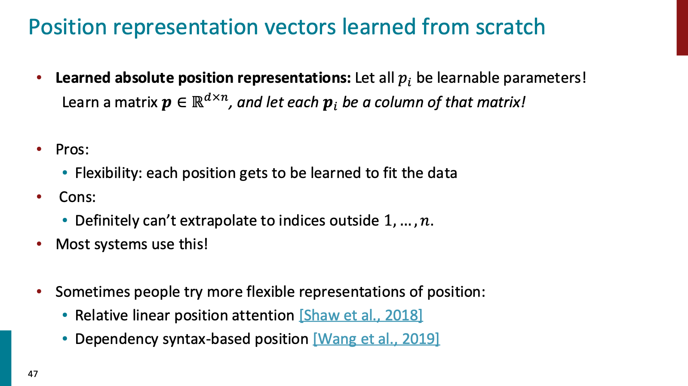
*Slide 46: "Position representation vectors learned from scratch": "Learned absolute position representations: Let all p_i be learnable parameters! Learn a matrix p ∈ ℝ^(d×n), and let each p_i be a column of that matrix!"; pro, flexibility; con, "Definitely can't extrapolate to indices outside 1, …, n"; "Most systems use this!"; more flexible options: "Relative linear position attention [Shaw et al., 2018]", "Dependency syntax-based position [Wang et al., 2019]".*

Option two: don't design the vectors, learn them. **Learned absolute position representations** make p a d × n matrix of parameters, one column per position, trained with everything else. "Flexibility: each position gets to be learned to fit the data". The cost is a hard ceiling: "Definitely can't extrapolate to indices outside 1, …, n." There is simply no column for position n + 1. (Notes §2.2 writes the same table as P ∈ ℝ^(N×d), one row per position up to the maximum length N, and names BERT as a model that uses it.)

"Most systems use this!", says the slide, and it lists two "more flexible" directions: attention that depends on the *relative* distance between two words (Shaw, Uszkoreit and Vaswani, 2018) and positions defined by the sentence's dependency tree rather than its word order (Wang et al., 2019).

Notes §2.2 sketches the relative idea in one line. Instead of changing the inputs, change the attention scores: subtract the distance, so that α_i = softmax(q_iᵀk_j − |i − j|) over j. The intuition: "all else held equal, self-attention should look at 'nearby' words more than 'far' words." This is the intuition behind ALiBi, Attention with Linear Biases (Press, Smith and Lewis, ICLR 2022), and the notes add, with refreshing honesty, "In some sense, it's odd that this works; but interesting!"

> **Note:** Notes Eq. 13 writes the bias vector as [−i, …, −1, 0, −1, …, −(n − i)]. The first entry should be −(i − 1), since the first word is i − 1 positions away from word i; with distances written as −|i − j| it comes out right. And ALiBi proper scales the penalty by a different slope in each attention head, which the one-line version leaves out.

Which scheme do current models use? Here the slide and the newest reading differ. Slide 46 says most systems learn absolute positions, which was the standard in the BERT and GPT-2 era. J&M's August 2026 chapter (§7.8) lists, among the settings "current transformer language models use", "rotary position embeddings (RoPE)", a relative scheme that rotates queries and keys by angles that depend on position, so that their dot product depends on the offset between them. The chapter names it without deriving it; for these notes, it's enough to know that position handling moved from adding a vector at the bottom toward building relative position into the attention score itself, exactly the direction slide 46's last bullets point.

**So far, and next.** Self-attention can't see order, so we add position vectors to the inputs: fixed sinusoids, learned tables, or relative schemes inside attention. Two barriers remain.

## 6. Barriers two and three: nonlinearity and masking

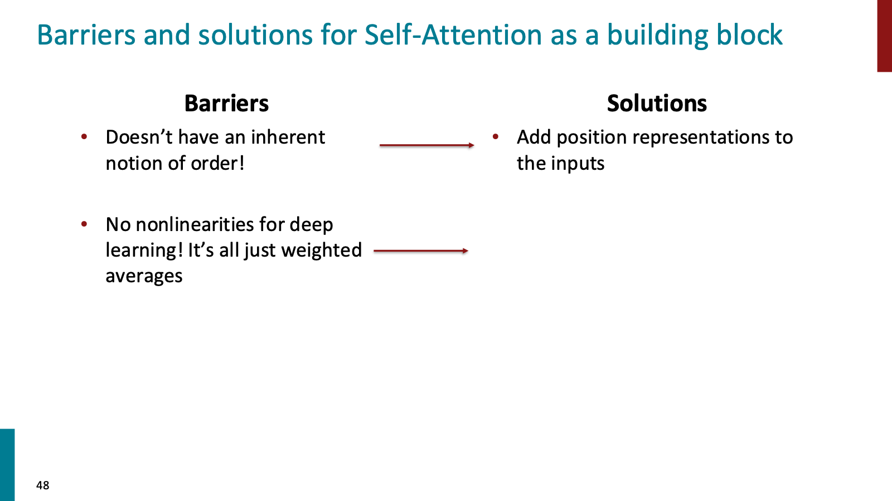
*Slide 47: the barriers table again: order is solved by "Add position representations to the inputs"; new barrier: "No nonlinearities for deep learning! It's all just weighted averages".*

Second barrier: "No nonlinearities for deep learning! It's all just weighted averages".

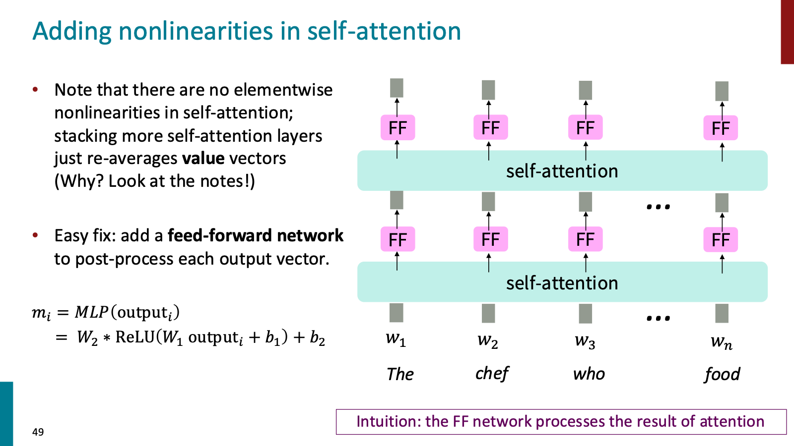
*Slide 48: "Adding nonlinearities in self-attention": "stacking more self-attention layers just re-averages value vectors (Why? Look at the notes!)"; "Easy fix: add a feed-forward network to post-process each output vector": m_i = MLP(output_i) = W₂ ∗ ReLU(W₁ output_i + b₁) + b₂; two layers of self-attention, each followed by an FF box per word of "The chef who … food"; "Intuition: the FF network processes the result of attention".*

"Note that there are no elementwise nonlinearities in self-attention; stacking more self-attention layers just re-averages **value** vectors (Why? Look at the notes!)". So let's look at the notes (§2.3). Stack two self-attention layers with value matrices V^(1) and V^(2) and weights α^(1), α^(2):

o_i = Σ_j α^(2)_ij V^(2) (Σ_k α^(1)_jk V^(1) x_k) = Σ_k β_ik V^(2)V^(1) x_k,   where β_ik = Σ_j α^(2)_ij α^(1)_jk.

The output is still a weighted average of the inputs, passed through one combined matrix V^(2)V^(1): "So, this is just a linear combination of a linear transformation of the input, much like a single layer of self-attention!" Two layers of averaging are one layer of averaging with fancier weights.

> **Note:** Notes Eqs. 15–16 garble the indices: they pull α_jk outside a sum over j and write the combined weight as "α*_ij". The correct combined weight is β_ik = Σ_j α^(2)_ij α^(1)_jk, as above. One more precision: the softmax weights themselves depend nonlinearly on the input, so attention is not literally a linear function. What's missing is an elementwise nonlinearity applied to the *values*, the thing that lets an MLP build new features. Whether attention-only stacks would be "good enough" anyway, the notes leave in a margin: "This question ends up having a nuanced answer that's out-of-scope for this note".

The "Easy fix: add a **feed-forward network** to post-process each output vector":

m_i = MLP(output_i) = W₂ ReLU(W₁ output_i + b₁) + b₂

the two-layer network with a ReLU from [Lecture 3, section 4](../03-backpropagation/README.md#4-non-linearities-old-and-new). The picture shows the pattern: self-attention, then an FF box on every word, then self-attention again. The same W₁ and W₂ are used at every position in a layer (a fresh pair in each layer), and the FF network sees one word at a time. The division of labour is the slide's last line: "the FF network processes the result of attention". Attention moves information *between* positions; the feed-forward network thinks about what has arrived, *at* each position.

How big is it? Notes Eq. 17 takes W₁ ∈ ℝ^(5d×d), a hidden layer five times wider than the model, because "this matrix multiply is an efficiently parallelizable operation, so it's an efficient place to put a lot of computation and parameters". (The original Transformer used d = 512 and an inner width of 2048, four times wider; the multiple is a design choice.)

> **Note:** J&M (§7.2.1) adds two facts worth knowing. First, these position-wise networks hold most of a transformer's parameters, and "these feed-forward network parameters seem to encode most of the factual knowledge in the transformer", citing Geva et al. (2021), who describe FFN layers as key–value memories, and Meng et al. (2022), who locate and edit facts in GPT. Read "seem to" as the authors meant it: a well-supported finding, not a closed case. Second, "Most LLMs now actually use gated feedforward layers", with an activation called SwiGLU: one projection of the input, passed through a Swish nonlinearity, multiplies another, element by element, before the output projection.

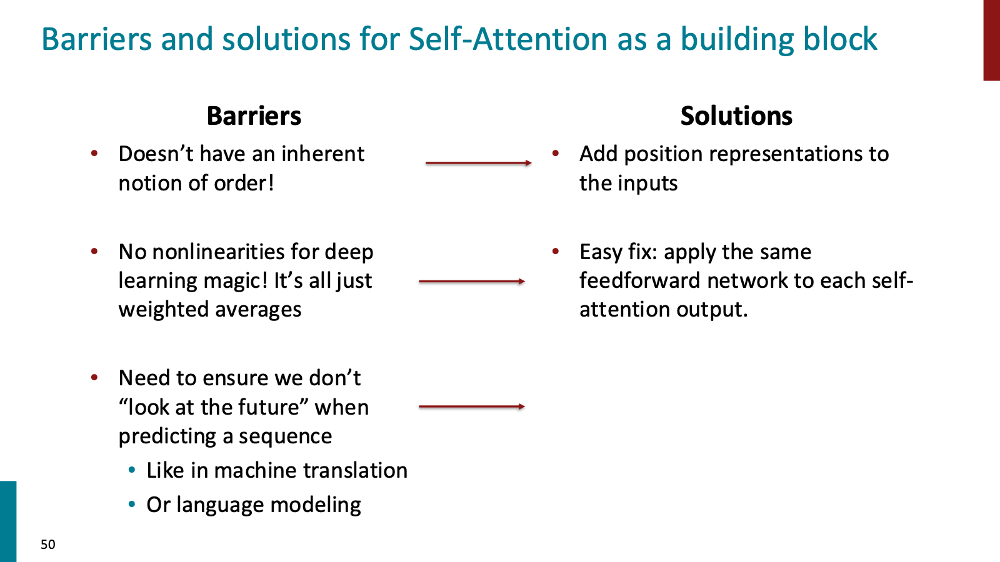
*Slide 49: the barriers table: nonlinearities are solved by "Easy fix: apply the same feedforward network to each self-attention output"; new barrier: "Need to ensure we don't 'look at the future' when predicting a sequence", "Like in machine translation", "Or language modeling".*

Third barrier: "Need to ensure we don't 'look at the future' when predicting a sequence", "Like in machine translation", "Or language modeling". A language model trained to predict word t + 1 that can attend to word t + 1 has nothing to learn except "copy". An RNN obeys this by construction, since it hasn't read the future yet. Self-attention, as defined on slide 42, attends to every position, including the ones it's supposed to predict.

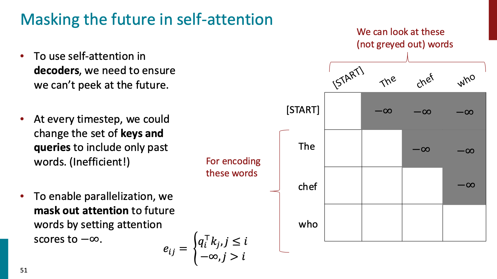
*Slide 50: "Masking the future in self-attention": "At every timestep, we could change the set of keys and queries to include only past words. (Inefficient!)"; "To enable parallelization, we mask out attention to future words by setting attention scores to −∞": e_ij = q_iᵀk_j for j ≤ i, −∞ for j > i; a grid over [START], The, chef, who with −∞ above the diagonal.*

"To use self-attention in **decoders**, we need to ensure we can't peek at the future." One way: at each step, attend only over the past words. That works but means a different computation at every step: "(Inefficient!)". The trick that keeps everything parallel: compute *all* the scores, then overwrite the forbidden ones. "To enable parallelization, we **mask out attention** to future words by setting attention scores to −∞":

e_ij = q_iᵀk_j if j ≤ i,   −∞ if j > i.

Since exp(−∞) = 0, the softmax gives the future words weight exactly zero, and the remaining weights still sum to 1 over the allowed words. In the grid, the row for each word being encoded can see the white cells, itself and everything before it ("We can look at these (not greyed out) words"), and the grey −∞ cells above the diagonal are the future. Note that the diagonal is allowed: the representation at "chef" can use "chef", because its job is to predict the word *after* "chef".

*Notes, Figure 3: "Diagram of autoregressive future masking in self-attention" over "Zuko made his uncle tea": "Zuko" can only attend to "Zuko", while "made" can attend to "Zuko" and "made".*

Here's why this matters so much for speed. With the mask, one pass over a training sentence of n words computes all n next-word predictions at once, each one seeing exactly its own prefix. An RNN needs n steps in a row for the same n predictions. That's the parallelism promised in section 4, and it's the reason transformers could be trained on far more text than RNNs.

> **Check your understanding.** A sentence of n = 4 tokens. How many of the 16 attention scores survive the causal mask, and what weight does "[START]" give itself? *Answer: 4 + 3 + 2 + 1 = 10 survive (n(n+1)/2). "[START]" can only see itself, so its single weight is 1. What would go wrong if the masked scores were set to 0 instead of −∞? exp(0) = 1, so the future words would still get weight, as much as a word with score 0; the mask must push them to minus infinity (or a very large negative number) to remove them.*

> **Note:** Notes §2.4 (marginal note 4) says libraries avoid a literal −∞ because "Using infinity can lead to NaNs", and use "a modest constant within even the float range of the 'float16' encoding … like −10^5". Two cautions. The largest finite float16 magnitude is 65,504, so −10^5 is *outside* float16's range; implementations pick a constant suited to the number format (or use the format's own most negative value). And notes Eq. 21, "setting α_ij = 0 where j > i", is equivalent only if the remaining weights are renormalized; masking the *scores* before the softmax does that automatically.

*Slide 51: all three barriers with their solutions: position representations; "apply the same feedforward network to each self-attention output"; "Mask out the future by artificially setting attention weights!"*

*Slide 52: "Necessities for a self-attention building block": self-attention, "the basis of the method"; position representations; nonlinearities, "Frequently implemented as a simple feed-forward network"; masking, "Keeps information about the future from 'leaking' to the past"; a diagram of Inputs → Embeddings → Add Position Embeddings → a Block of Masked Self-Attention and Feed-Forward → Linear → Softmax → Probabilities.*

Slide 51 completes the table, and slide 52 assembles the result, the **minimal self-attention architecture** (notes §2.5):

- "**Self-attention**: the basis of the method."
- "**Position representations**: Specify the sequence order, since self-attention is an unordered function of its inputs."
- "**Nonlinearities**: At the output of the self-attention block. Frequently implemented as a simple feed-forward network."
- "**Masking**: In order to parallelize operations while not looking at the future. Keeps information about the future from 'leaking' to the past."

The diagram is already almost a Transformer decoder: embed, add positions, then a block of masked self-attention and feed-forward, repeated, then a linear layer and a softmax to get next-word probabilities. (The repeat label says "Repeat for number of encoder blocks" on this decoder diagram and the ones that follow, as does notes Figure 4; read "blocks".)

**So far, and next.** Three barriers, three fixes: positions for order, a feed-forward network for nonlinearity, a mask for the future. Together they make a working language model with no recurrence. The real Transformer adds four more parts, and part 5 of the lecture installs them one at a time.

## 7. The Transformer decoder: many heads, two matrix products and a scale factor

*Slide 53: "5. The Transformer Decoder": "A Transformer decoder is how we'll build systems like language models"; "It's a lot like our minimal self-attention architecture, but with a few more components"; "We'll next replace our self-attention with multi-head self-attention"; the decoder diagram, faded except for Embeddings, Add Position Embeddings and Masked Multi-Head Attention.*

"A Transformer decoder is how we'll build systems like **language models**." It's "a lot like our minimal self-attention architecture, but with a few more components". "The embeddings and position embeddings are identical." The first upgrade: "replace our self-attention with **multi-head self-attention**." The diagram is the decoder you'll see all day, faded so that only the parts installed so far are bright; watch it fill in over the next slides.

*Slide 54: "Recall the Self-Attention Hypothetical Example": slide 41's attention weights for "learned".*

*Slide 55: "Hypothetical Example of Multi-Head Attention": for "learned" in "I went to Stanford CS 224n and learned", "Attention head 1 attends to entities" (Stanford, CS, 224n) and "Attention head 2 attends to syntactically relevant words" (I, went, learned).*

Slide 54 recalls the single attention distribution for "learned"; slide 55 splits it in two. One head, "attends to entities": Stanford, CS, 224n, *what* was learned and where. Another "attends to syntactically relevant words": I, went, learned, *who* did the learning. One softmax has to spread a single budget of weight over everything it cares about; two heads can each concentrate on one thing.

Both are labelled "Hypothetical", and that's important. Real trained heads do sometimes show readable patterns like these, but nothing makes a head pick a role a human would name. (Lecture 15, on interpretability, is where that question gets serious.)

*Slide 56: "Sequence-Stacked form of Attention": X = [x₁; …; x_n] ∈ ℝ^(n×d); XK, XQ, XV ∈ ℝ^(n×d); output = softmax(XQ(XK)ᵀ)XV ∈ ℝ^(n×d); "First, take the query-key dot products in one matrix multiplication: XQ(XK)ᵀ", giving XQKᵀXᵀ ∈ ℝ^(n×n), "All pairs of attention scores!"; "Next, softmax, and compute the weighted average with another matrix multiplication".*

Before multiplying heads, slide 56 writes one head the way a GPU sees it. Stack the n input vectors as rows of X ∈ ℝ^(n×d). Then all the queries are XQ, all the keys XK and all the values XV, each n × d, and the whole of slide 42 becomes

output = softmax(XQ (XK)ᵀ) XV ∈ ℝ^(n×d).

Two matrix multiplications and a softmax. "First, take the query-key dot products in one matrix multiplication": XQ(XK)ᵀ = XQKᵀXᵀ is an n × n matrix, "All pairs of attention scores!", row i holding word i's scores against every word. "Next, softmax" (row by row, so each word's weights sum to 1), "and compute the weighted average with another matrix multiplication", by XV. No loop over positions anywhere: this is the parallelism of section 4, written as linear algebra.

> **Note:** Notation shifts here, so read carefully. On slide 42 the vectors were columns and the matrices acted from the left, q_i = Qx_i. On slide 56 the vectors are rows of X and the matrices act from the right, XQ, so this Q is the transpose of slide 42's. Same operation, different bookkeeping. Also, the slide's "∈∈" is a typo for "∈", and the softmax is over each row. With the causal mask of section 6, the formula becomes softmax(XQKᵀXᵀ + M)XV, where M holds 0 on and below the diagonal and −∞ above it.

*Slide 57: "Multi-headed attention": "What if we want to look in multiple places in the sentence at once?"; Q_ℓ, K_ℓ, V_ℓ ∈ ℝ^(d×d/h) for heads ℓ = 1 … h; output_ℓ = softmax(XQ_ℓK_ℓᵀXᵀ) ∗ XV_ℓ ∈ ℝ^(n×d/h); output = [output₁, …, output_h]Y, with Y ∈ ℝ^(d×d); "Each head gets to 'look' at different things, and construct value vectors differently".*

Now the heads. "For word i, self-attention 'looks' where x_iᵀQᵀKx_j is high, but maybe we want to focus on different j for different reasons?" So "define multiple attention 'heads' through multiple Q, K, V matrices". With h heads, each gets its own Q_ℓ, K_ℓ, V_ℓ ∈ ℝ^(d×d/h), narrower than before. "Each attention head performs attention independently":

output_ℓ = softmax(XQ_ℓ K_ℓᵀ Xᵀ) XV_ℓ ∈ ℝ^(n×d/h).

"Then the outputs of all the heads are combined!": concatenate them side by side, back to width h · d/h = d, and mix with one more matrix, output = [output₁, …, output_h] Y, with Y ∈ ℝ^(d×d). "Each head gets to 'look' at different things, and construct value vectors differently." That's **multi-head attention**.

Notes §3.1 gives the intuition for why one head isn't enough: a single attention "is best at picking out a single value (on average) from the input value set", and averaging two things carefully "requires a balancing game in the key-query dot products". Heads let the model look up several things at once without that juggling.

> **Note:** Notes Eq. 24 writes the combined output as O[v_i^(1); …; v_i^(k)], concatenating the per-head *values*. It should concatenate the per-head *outputs*, h_i^(1), …, h_i^(k), the attention-weighted averages. And each of those is a vector of length d/k for one token, so the concatenation is a d-vector, not the "d × d/k" and "d × d" the sentence after it says.

*Slide 58: "Multi-head self-attention is computationally efficient": "We compute XQ ∈ ℝ^(n×d), and then reshape to ℝ^(n×h×d/h)"; "Then we transpose to ℝ^(h×n×d/h); now the head axis is like a batch axis"; "Almost everything else is identical, and the matrices are the same sizes"; a diagram with "3 sets of all pairs of attention scores!" ∈ ℝ^(3×n×n) and a final "mix" matrix P.*

"Even though we compute h many attention heads, it's not really more costly." The implementation trick: compute XQ once, as a single n × d matrix (all heads' query matrices side by side), then "reshape to ℝ^(n×h×d/h)" and "transpose to ℝ^(h×n×d/h); now the head axis is like a batch axis". Every head runs the same two matrix products in parallel, each on vectors of width d/h. The diagram draws h = 3: three stacked n × n score matrices, three weighted averages, then the "mix" matrix (the Y of slide 57).

Is it really free? The projections cost exactly what one full-width head's would, and the score computation does the same number of multiply-adds in total (h heads at width d/h instead of one at width d). One thing does grow: there are now h attention matrices of size n × n instead of one, so storing the weights takes h times the memory. "The matrices are the same sizes" is true of the weight matrices, not of the attention maps.

> **Check your understanding.** The original Transformer has d = 512 and h = 8 heads. What is d/h, and how many weights do one layer's query, key, value and mixing matrices hold in total (ignoring biases)? *Answer: d/h = 64. Each head's Q_ℓ is 512 × 64, and the 8 of them together make a 512 × 512 matrix; the same goes for K and V, and the mix Y is 512 × 512. That's 4 × 512² = 1,048,576 weights, exactly what a single full-width head (plus Y) would have. Heads cost no extra parameters.*

*Slide 59: "Scaled Dot Product [Vaswani et al., 2017]": "When dimensionality d becomes large, dot products between vectors tend to become large"; "inputs to the softmax function can be large, making the gradients small"; "We divide the attention scores by √(d/h)": output_ℓ = softmax(XQ_ℓK_ℓᵀXᵀ / √(d/h)) ∗ XV_ℓ.*

One more change, small but load-bearing. "'Scaled Dot Product' attention aids in training." "When dimensionality d becomes large, dot products between vectors tend to become large. Because of this, inputs to the softmax function can be large, making the gradients small." So "We divide the attention scores by √(d/h), to stop the scores from becoming large just as a function of d/h (The dimensionality divided by the number of heads.)":

output_ℓ = softmax(XQ_ℓ K_ℓᵀ Xᵀ / √(d/h)) XV_ℓ.

Why the square root? Vaswani et al. give the argument in a footnote: "assume that the components of q and k are independent random variables with mean 0 and variance 1. Then their dot product, q · k = Σ q_i k_i, has mean 0 and variance d_k." A sum of d_k independent terms of variance 1 has variance d_k, so its typical size (the standard deviation) is √d_k, and dividing by √d_k brings it back to about 1. With several heads, the vectors being dotted have width d/h, which is why the slide divides by √(d/h) and not √d. (Notes §3.4 writes √d, for the single-head case.) This is **scaled dot-product attention**, and in the paper's notation it's the famous softmax(QKᵀ/√d_k)V.

> **Check your understanding.** Why are large scores bad for learning? Take two keys with scores 8 and 0. What are the softmax weights, before and after dividing by √64 = 8? *Answer: before, e⁸ : e⁰ ≈ 2981 : 1, so the weights are about 0.9997 and 0.0003: the softmax has saturated into a near-hard choice. After scaling, the scores are 1 and 0 and the weights are about 0.73 and 0.27. The softmax's gradient with respect to a score is p(1 − p), about 0.0003 in the first case and 0.20 in the second. A saturated softmax barely learns, which is the paper's "pushing the softmax function into regions where it has extremely small gradients".*

**So far, and next.** Attention in matrix form is two matrix products and a row-wise softmax. Multi-head attention runs h narrower attentions in parallel and mixes them, at no extra cost in parameters, and scaling by √(d/h) keeps the softmax out of saturation. Two "optimization tricks" remain before the decoder block is complete.

## 8. Add & Norm: residual connections and layer normalization

*Slide 60: "The Transformer Decoder": "Now that we've replaced self-attention with multi-head self-attention, we'll go through two optimization tricks that end up being :", "Residual Connections", "Layer Normalization"; "In most Transformer diagrams, these are often written together as 'Add & Norm'"; the decoder diagram with the Add & Norm boxes highlighted.*

"Two **optimization tricks** that end up being :" (the slide's sentence trails off, and we'll never know what they ended up being; *essential* is a good guess) "Residual Connections" and "Layer Normalization", "often written together as 'Add & Norm'". The diagram now has an Add & Norm after the attention and another after the feed-forward network. These components change the block's computation and are introduced here to make deep stacks easier to optimize.

*Slide 61: "The Transformer Encoder: Residual connections [He et al., 2016]": instead of X^(i) = Layer(X^(i−1)), "We let X^(i) = X^(i−1) + Layer(X^(i−1)) (so we only have to learn 'the residual' from the previous layer)"; "Gradient is great through the residual connection; it's 1!"; "Bias towards the identity function!"; two loss-landscape surfaces, jagged "[no residuals]" and smooth "[residuals]" ("Loss landscape visualization, Li et al., 2018, on a ResNet").*

"**Residual connections** are a trick to help models train better." Instead of replacing the input with the layer's output, X^(i) = Layer(X^(i−1)), add the output to the input:

X^(i) = X^(i−1) + Layer(X^(i−1))

"so we only have to learn 'the residual' from the previous layer". The layer no longer has to reproduce everything it was given plus its improvement; it only computes the improvement, the change, and the input rides along for free on the skip connection.

Two benefits are on the slide. "Gradient is great through the residual connection; it's 1!" The derivative of X^(i) with respect to X^(i−1) is I + ∂Layer/∂X^(i−1): an identity matrix plus whatever the layer contributes. That identity is slide 13's "direct and linear pass-through connection" again. However many layers you stack, the gradient has a path back to the bottom that isn't a product of many small factors, which is the vanishing-gradient cure, applied through depth instead of through time. (The slide's "it's 1" is the identity part; the full Jacobian also has the layer's term.) And "Bias towards the identity function!": a layer whose weights are near zero leaves its input almost unchanged, so a deep stack starts out close to doing no harm.

The two landscapes make the point visually, though be careful what they prove. Li et al. (2018) plotted the loss surface of a deep image network (a ResNet) without and with skip connections: one a jagged mountain range, the other a smooth bowl. It is an illustration from one family of networks, not a theorem about every transformer, but it's a memorable picture of why residual networks are easier to optimize.

> **Note:** The citation is to Kaiming He and colleagues' [Deep Residual Learning for Image Recognition](https://arxiv.org/abs/1512.03385) (arXiv December 2015; CVPR 2016), a computer-vision paper. It trained networks "with a depth of up to 152 layers—8× deeper than VGG nets" and won "1st place on the ILSVRC 2015 classification task". The Transformer adopted residual connections in 2017 (they had already appeared in NLP, for example in Google's neural machine translation system, GNMT, Wu et al., 2016), and today it's hard to find a deep network of any kind without them. The slide's title calls this "The Transformer Encoder" (as does the next one) though we're building the decoder; both stacks use the same Add & Norm.

*Slide 62: "The Transformer Encoder: Layer normalization [Ba et al., 2016]": "Idea: cut down on uninformative variation in hidden vector values by normalizing to unit mean and standard deviation within each layer"; "LayerNorm's success may be due to its normalizing gradients [Xu et al., 2019]"; for one word vector x ∈ ℝ^d, μ = (1/d) Σ_j x_j, σ = (1/d) Σ_j (x_j − μ)², learned "gain" γ and "bias" β ("Can omit!"); output = (x − μ)/√(σ + ε) ∗ γ + β.*

"**Layer normalization** is a trick to help models train faster." "Idea: cut down on uninformative variation in hidden vector values" by normalizing each vector. For one word's vector x ∈ ℝ^d:

μ = (1/d) Σ_{j=1}^{d} x_j   (the mean),   σ = (1/d) Σ_{j=1}^{d} (x_j − μ)²   (the variance),

output = γ ⊙ (x − μ)/√(σ + ε) + β.

"Normalize by scalar mean and variance", then "Modulate by learned elementwise gain and bias", γ and β ∈ ℝ^d. The small ε keeps the division safe when the variance is near zero.

Three things to get exactly right, because they are where students slip:

- **What gets normalized.** The statistics are taken over the d features of *one token's vector*, separately for every token and every example. Notes §3.2: "the statistics for the token at index i won't affect the token at index j ≠ i." Nothing is averaged across the sentence or across the batch.
- **To what.** The slide says "unit mean"; it means *zero* mean and unit standard deviation. After subtracting μ and dividing by the standard deviation, the vector has mean 0 and variance 1 (before γ and β, which can move it anywhere they like).
- **The σ.** On the slide, σ is the *variance*, which is why it appears under a square root. Notes Eq. 27 uses σ̂ for the *standard deviation* and divides by it directly. Same computation, different letter; check which one a source means.

> **Check your understanding.** Layer-normalize x = (1, 2, 3, 6), ignoring γ, β and ε. *Answer: μ = 12/4 = 3. The deviations are −2, −1, 0, 3, their squares 4, 1, 0, 9, so the variance is 14/4 = 3.5 and the standard deviation about 1.87. The output is (−1.07, −0.53, 0, 1.60): mean 0, variance 1, and the same shape as before (6 is still the outlier), just on a standard scale.*

> **Note:** Why "layer" normalization? It was named against *batch* normalization, which normalizes each feature using statistics across the examples in a mini-batch. Ba, Kiros and Hinton's [Layer Normalization](https://arxiv.org/abs/1607.06450) (2016, a suggested reading) point out that "the effect of batch normalization is dependent on the mini-batch size and it is not obvious how to apply it to recurrent neural networks", and instead compute the statistics "from all of the summed inputs to the neurons in a layer on a single training case". One example at a time means no dependence on batch size and the same computation at training and test time, which suits sequences of varying length. Why it helps is still debated: slide 62 cites Xu et al. (2019) for the view that its benefit may come from normalizing gradients in the backward pass, and notes §3.2 says of the learned gain and bias that this part "seems not to be crucial, and may even be harmful" [Xu et al., 2019].

Where exactly does the norm go? "Add & Norm" hides a choice, which notes §3.3 spells out. **Post-norm**, the original Transformer's order, adds first and normalizes the sum: h = LN(f(h) + h). **Pre-norm** normalizes the input to the sublayer and adds the raw input back: h = f(LN(h)) + h. The notes report that "the gradients of pre-normalization are much better at initialization, leading to much faster training" (Xiong et al., 2020), and J&M's chapter uses the pre-norm version throughout. In J&M's pre-norm stack, one final layer norm is applied after the last block and before the output head, so the vector the head reads is the normalized final state. The slides' diagrams, like the original paper's, are post-norm, and have no such extra norm.

*J&M, Figure 7.7: a pre-norm transformer block drawn as a residual stream: token i's vector flows straight up, Layer Norm → MultiHead Attention and Layer Norm → Feedforward each read from it and add their result back in (the ⊕), and the attention reads from the streams of earlier tokens too.*

J&M's picture is the best way to hold all of this in your head: the **residual stream**. Follow one token straight up through the stack. Its vector is a stream; each sublayer reads from the stream (after a layer norm), computes something, and *adds* it back. Attention is the only part that reads from *other* tokens' streams; the feed-forward network and the norms work on this token alone. A transformer layer, seen this way, is a series of edits to a running document per token, with attention as the one channel for passing notes between documents.

> **Note:** J&M (§7.2.2) also mentions that "many modern networks use a simpler norm, called RMSNorm (Zhang and Sennrich, 2019), which rescales the vectors by dividing by the root-mean-square statistic, but skips the mean-centering step." In the example above, RMSNorm would divide (1, 2, 3, 6) by √((1 + 4 + 9 + 36)/4) = √12.5 ≈ 3.54 and leave the mean alone.

**So far, and next.** Residual connections let each sublayer learn a change and give gradients a straight path through depth; layer normalization puts each token's vector on a standard scale. Written together as Add & Norm, they complete the decoder block. Now the lecture assembles the full stack, then shows two variations on it.

## 9. Decoder, encoder, encoder-decoder

*Slide 63: "The Transformer Decoder": "a stack of Transformer Decoder Blocks"; "Each Block consists of: Self-attention, Add & Norm, Feed-Forward, Add & Norm"; "That's it! We've gone through the Transformer Decoder"; the full diagram: Decoder Inputs → Embeddings → Add Position Embeddings → [Masked Multi-Head Attention → Add & Norm → Feed-Forward → Add & Norm], repeated → Linear → Softmax → Probabilities.*

"That's it! We've gone through the Transformer Decoder." Read the diagram from the bottom, and every box is now a section of these notes:

1. **Embeddings** of the input tokens, plus **position embeddings** (section 5).
2. A **block**, repeated: **masked multi-head attention** (sections 6–7), **Add & Norm** (section 8), a position-wise **feed-forward** network (section 6), **Add & Norm** again.
3. A **linear** layer and a **softmax**, giving next-token **probabilities** at every position.

That's the **Transformer decoder**, the decoder-only causal language model. Each block takes an n × d matrix and returns an n × d matrix, which is why they stack like bricks. The blocks share a design, not weights: notes §3.5 calls them "independently parameterized", so a 12-block model has 12 separate sets of attention and feed-forward matrices. Notes §3.6 names the famous examples, GPT-2, GPT-3 and BLOOM: as of the notes' 2023 writing, the large language models you've heard of were built from this one diagram, made very large.

> **Note:** The original paper's own name for its two halves is plain: "The encoder is composed of a stack of N = 6 identical layers" (Vaswani §3.1), and the decoder likewise. Today's models stack many more. In J&M's table of configurations (§7.8, Figure 7.24), GPT-2 XL (2019) has 48 layers of width 1600 and GPT-3 (2020) has 96 layers of width 12,288; Llama 3.1 405B (2024) has 126 layers of width 16,384 and 128 heads. Same blocks, many more of them.

*Slide 64: "The Transformer Encoder": "The Transformer Decoder constrains to unidirectional context, as for language models"; "What if we want bidirectional context, like in a bidirectional RNN?"; "The only difference is that we remove the masking in the self-attention"; the same diagram with plain Multi-Head Attention and an arrow labelled "No Masking!".*

"The Transformer Decoder constrains to **unidirectional context**, as for **language models**." But many tasks give you the whole input at once (classify this review; tag every word in this sentence), and then hiding the right-hand context is just throwing information away. "What if we want **bidirectional context**, like in a bidirectional RNN?" "This is the **Transformer Encoder**. The only difference is that we **remove the masking** in the self-attention." One deleted mask, and every token sees the whole sequence. (The diagram's bottom label still says "Decoder Inputs", left over from the previous slide; read "Encoder Inputs".)

What is an encoder *for*, if it can't generate left to right? Notes §3.5: it is "great in contexts where you aren't trying to generate text autoregressively … and want strong representations for the whole sequence". You can still put a linear layer and softmax on top to get per-token probabilities, "as in masked language modeling for BERT", which the notes leave for later in the course.

*Slide 65: "The Transformer Encoder-Decoder": "in machine translation, we processed the source sentence with a bidirectional model and generated the target with a unidirectional model"; "We use a normal Transformer Encoder"; "Our Transformer Decoder is modified to perform cross-attention to the output of the Encoder"; an encoder stack beside a decoder stack whose blocks have Masked Multi-Head Attention, Add & Norm, Multi-Head Attention (fed from the encoder), Add & Norm, Feed-Forward, Add & Norm.*

Back to translation. "Recall that in machine translation, we processed the source sentence with a **bidirectional** model and generated the target with a **unidirectional model**." The Transformer version is the **Transformer encoder–decoder**: "a normal Transformer Encoder" reads the source with no mask, and the decoder, "modified to perform **cross-attention** to the output of the Encoder", writes the target. Each decoder block now has three sublayers: masked self-attention over the target so far, cross-attention to the source, and the feed-forward network, each with its own Add & Norm.

*Slide 66: "Cross-attention (details)": "Let h₁, …, h_n be output vectors from the Transformer encoder"; "Let z₁, …, z_n be input vectors from the Transformer decoder"; "keys and values are drawn from the encoder (like a memory): k_i = Kh_i, v_i = Vh_i"; "And the queries are drawn from the decoder, q_i = Qz_i".*

"We saw that self-attention is when keys, queries, and values come from the same source." Cross-attention is section 3's attention again, with learned projections: "keys and values are drawn from the encoder (like a memory)", k_i = Kh_i and v_i = Vh_i, "And the queries are drawn from the decoder", q_i = Qz_i. The decoder asks; the source answers. In matrix form, with decoder states Z (m × d), final encoder outputs H (n × d), and this head's projections Q, K ∈ ℝ^(d×d_k) and V ∈ ℝ^(d×d_v), the attention matrix is A = softmax(ZQ (HK)ᵀ / √d_k) ∈ ℝ^(m×n), one row per target position over every source position, and the head's output is A(HV) ∈ ℝ^(m×d_v). No causal mask is needed here, because the whole source is known in advance.

> **Note:** Three small things on slide 66. The slide calls this "attention that looks more like what we saw last week"; in this offering the recurrent version was earlier in this same lecture (slides 25–36). It writes "x_i ∈ ℝ^d" for the encoder outputs it has just called h_i. And it uses n for both sequences, but source and target lengths needn't match (four French tokens, six English words): notes §3.7 uses x_{1:n} and y_{1:m}. Also, as the notes' encoder-decoder diagram (on its first page) labels it, decoder blocks "Attend only to output of last Encoder Block": every cross-attention layer reads the encoder's *final* output, each with its own K, Q and V.

Which one should you use? Notes §3.7: an encoder–decoder fits when "we'd like bidirectional context on something (like an article to summarize) … but then generate an output according to an autoregressive decomposition". It "has been found to provide better performance than decoder-only models at modest scale [Raffel et al., 2020]", but "it involves splitting parameters between encoder and decoder, and most of the largest Transformers are decoder-only."

> **Check your understanding.** Which of the three would you reach for to (a) label the sentiment of a product review, (b) continue a story from a prompt, (c) summarize a news article into a headline? *Answer: (a) an encoder, since the whole review is given and both directions help; (b) a decoder, since generation must not peek ahead; (c) an encoder–decoder fits naturally (read the article bidirectionally, write the headline causally), though at the largest scales people often use a decoder-only model for this too, with the article as the prompt.*

**So far, and next.** The decoder is a stack of masked attention and feed-forward blocks with Add & Norm; delete the mask and you have an encoder; join the two with cross-attention and you have an encoder–decoder. The slides go straight from here to results. But a decoder isn't yet a language model you can use: it needs an output head, a training objective and a way to pick words. The assigned J&M chapter supplies those, and they're worth a section before the results.

## 10. From decoder to language model: the head, training, and choosing words

This section comes from the readings, mostly J&M Chapter 7 (§7.5–7.8), and fills in what slide 63's "Linear → Softmax → Probabilities" leaves implicit.

*J&M, Figure 7.15: "The language modeling head": the last layer's output for token N, h^L_N (1 × d), multiplies an "Unembedding layer U = Eᵀ" (d × |V|) to give logits u (1 × |V|), and a softmax turns them into word probabilities y.*

**The language-modeling head.** Take the final layer's vector for a position, h^L_i (1 × d; in J&M's pre-norm model, after the final layer norm of section 8), and score every word in the vocabulary: logits u_i = h^L_i U, with U a d × |V| matrix, then y_i = softmax(u_i). That's the **language-modeling head**, the "Linear" and "Softmax" boxes of slide 63. J&M points out that U "can be learned, but it is also very common to tie this matrix to (the transpose of) the embedding matrix E": **weight tying**. Watch the shapes. Here J&M stores token embeddings as rows, E ∈ ℝ^(|V|×d), the transpose of section 4's convention (slide 42's E ∈ ℝ^(d×|V|) has one word per column). Thus U = Eᵀ ∈ ℝ^(d×|V|). The same table that turns a word into a vector on the way in turns a vector back into word scores on the way out, which is why J&M calls U the *unembedding*. (Don't confuse this head with an attention head; same word, different thing.)

> **Note:** Lecture 4's RNN language model had exactly this output layer, ŷ = softmax(Uh + b₂) ([Lecture 4, section 5](../04-language-models-rnns/README.md#5-recurrent-neural-networks-one-set-of-weights-any-length)), and its parameter count showed the output layer dwarfing the recurrence, because it scores every word in the vocabulary. Tying U to E removes one of those two |V| × d tables.

*J&M, Figure 7.22: "Pretraining an LLM": the input tokens "So long and thanks for" go in; at each position the model's ŷ is scored against the true next token ("long", "and", "thanks", "for", "all") with a loss −log ŷ, and backpropagation updates "all the weights, including the embeddings".*

**Training.** It is Lecture 4's recipe, made parallel. Feed in a text; at every position, the head predicts the next token; the loss is the negative log probability of the true next token, averaged:

L = −(1/T) Σ_t log p(w_{t+1} | w_{≤t}).

The model always reads the true previous tokens, never its own guesses: "This idea that we always give the model the correct history sequence to predict the next word (rather than feeding the model its best guess from the previous time step) is called teacher forcing" (J&M §7.7), as on Lecture 4's slide 31. The difference from the RNN is speed. Thanks to the causal mask (section 6), one forward pass scores every position at once, each seeing only its own prefix. Because the targets are just the text shifted by one, any text is training data: this is **self-supervised pretraining**, and Lecture 7 is devoted to doing it at scale. J&M adds the practicalities: documents shorter than the context window are packed together "with a special end-of-text token between them", and batches are huge ("the largest GPT-3 model uses a batch size of 3.2 million tokens").

> **Note:** The original Transformer was trained differently, because it was a translation model learning from **paired** sentences, not a language model reading raw text. Vaswani et al. (§§3.4, 5) record the settings of that experiment: the embedding weights are multiplied by √d_model; the optimizer is Adam, with a learning rate that rises linearly for the first 4000 steps and then decays with the inverse square root of the step number, lrate = d_model^(−0.5) · min(step^(−0.5), step · 4000^(−1.5)); dropout (rate 0.1 for the base model) is applied to each sublayer's output and to the sums of embeddings and positional encodings; and the targets use label smoothing of 0.1, spreading a little probability away from the correct word. The paper reports that label smoothing "hurts perplexity, as the model learns to be more unsure, but improves accuracy and BLEU score", showing that perplexity and translation quality can move in opposite directions. These are that experiment's settings, not requirements of every Transformer.

> **Note:** J&M's running example, "So long and thanks for … all", is the title of the fourth *Hitchhiker's Guide to the Galaxy* novel, Douglas Adams's *So Long, and Thanks for All the Fish* (1984). A language model that has read enough English should find "fish" a very likely next word after "all the".

**Perplexity.** Evaluation is also Lecture 4's: perplexity is the exponentiated average negative log-likelihood on held-out text, PPL = exp(−(1/T) Σ_t ln p(w_t | w_{<t})) = P(w_{1:T})^(−1/T), and lower is better ([Lecture 4, section 7](../04-language-models-rnns/README.md#7-generating-text-and-measuring-a-language-model)). J&M adds a caveat that matters once models use different tokenizers: "because perplexity depends on the number of tokens n in a text, it is very sensitive to differences in the tokenization algorithm", so "perplexity is best used when comparing language models that use the same tokenizer." A model that splits text into more, smaller pieces makes more, easier predictions. And "Perplexity measures one kind of accuracy: accuracy at predicting words": it is not a score for helpfulness or truth.

**Choosing words.** A trained model gives a distribution over the next token. Generation needs a rule for picking one, appending it, and repeating until an end token or a length limit. J&M's toy example: after "So long and thanks for", the model gives *all* .44, *the* .33, *your* .15, *that* .08.

- **Greedy decoding** takes the most probable token every time: *all*. It's "locally optimal, whether or not it will turn out to have been the best choice with hindsight", and it's deterministic, which makes the text "generic and often quite repetitive". J&M notes that an extension, **beam search**, which keeps several partial candidates alive at once, "works well in tasks like machine translation" (J&M defers it to Chapter 13; Lecture 4's open questions showed why the greedy choice at each step needn't give the most probable whole sentence).
- **Random sampling** draws the next token in proportion to its probability: *all* 44% of the time, *that* 8%. It's varied, but over a long text the many tiny probabilities in a 50,000-word tail add up, and sooner or later it picks something absurd.

The fixes trade quality against diversity. In J&M's words, "Methods that give a bit more weight to the middle-probability words tend to be more creative and more diverse, but less factual and more likely to be incoherent or otherwise low-quality."

*J&M, Figure 7.21: "Temperature sampling": logits 1.2, 0.9, 0.1, −0.5 for all, the, your, that give probabilities .95/.05/0/0 at τ = 0.1, .59/.32/.07/.02 at τ = 0.5, .44/.33/.15/.08 at τ = 1, .27/.26/.24/.23 at τ = 10 and .25 each at τ = 100.*

- **Temperature sampling** divides the logits by τ before the softmax: p_τ(w) = exp(u_w/τ) / Σ_v exp(u_v/τ). At τ = 1 nothing changes; τ < 1 sharpens the distribution toward greedy; τ > 1 flattens it toward uniform. The figure shows the whole dial on four words: at τ = 0.1, *all* gets .95; at τ = 100, every word gets .25.
- **Top-k sampling** keeps only the k most probable tokens, renormalizes, and samples (k = 1 is greedy).
- **Top-p (nucleus) sampling** (Holtzman et al., 2020) keeps the smallest set of top tokens whose probabilities add up to at least p, renormalizes, and samples. "By measuring probability rather than the number of words", the set grows when the model is unsure and shrinks when it's confident. J&M mentions combining the two, top-k then top-p.

> **Check your understanding.** (1) Logits 2, 1, 0. What are the probabilities at τ = 1 and at τ = 0.5? (2) With J&M's distribution .44, .33, .15, .08, which tokens does top-p with p = 0.9 keep, and with what probabilities? *Answer: (1) At τ = 1, e² : e¹ : e⁰ = 7.39 : 2.72 : 1, giving about .67, .24, .09. At τ = 0.5 the logits become 4, 2, 0: 54.6 : 7.39 : 1, giving about .87, .12, .02. Halving the temperature made the favourite much more of a favourite. (2) .44 + .33 = .77 is below .9, and adding .15 gives .92, so it keeps all, the and your, and renormalizes by .92: about .48, .36 and .16. "that" can no longer be sampled.*

> **Note:** The name "temperature" is borrowed from physics. In statistical mechanics, the Boltzmann distribution gives a state of energy E probability proportional to exp(−E/kT): at low temperature a system sits in its lowest-energy state, at high temperature every state becomes nearly equally likely. Read a logit as a negative energy and the softmax with τ is the same formula, which is why cooling a language model makes it predictable and heating it makes it wild.

*J&M, Figure 7.23: attention for the 4th token: the query q4 is multiplied by the keys k1…k4 and the result by the values v1…v4; the past keys k1–k3 and values v1–v3, in black, "can be stored in the cache rather than recomputed".*

**The KV cache.** Training is parallel, but generation is one token at a time, and done naively it's wasteful: to produce token 5 you'd rerun the network over tokens 1–4, then over 1–5 for token 6, and so on. J&M §7.8 introduces the standard fix. Because of the causal mask, the keys and values computed for earlier tokens never change when a new token arrives (they can't see it). So each layer keeps them in a **KV cache**; for the new token it computes only its own query, key and value, appends the key and value to the cache, and attends over everything stored. Figure 7.23 shows the fourth step: q4 against cached k1–k3 plus the new k4. That saves the recomputation, but not everything: each new token still attends over the whole growing prefix, and the cache itself grows with every token, layer and head. It's the main reason long contexts are memory-hungry at inference time.

**So far, and next.** A decoder becomes a language model with an output head (often tied to the embeddings), trained by teacher-forced next-token prediction on raw text, all positions in parallel; it's measured by perplexity (with the same tokenizer); and it generates by a decoding rule (greedy, sampling, temperature, top-k, top-p), sped up by caching keys and values. Back to the slides: did all this work?

## 11. Great results, and what we'd like to fix

*Slide 67: "6. Great Results with Transformers": "First, Machine Translation from the original Transformers paper!"; BLEU on EN-DE and EN-FR and training cost in FLOPs for ByteNet, Deep-Att + PosUnk, GNMT + RL, ConvS2S and MoE, and three ensembles; "[Test sets: WMT 2014 English-German and English-French]", "[Vaswani et al., 2017]".*

First, translation, from the paper that started it. Slide 67 shows Table 2 of "Attention Is All You Need", but the crop stops before the punchline: every row on the slide is a *previous* system. The rows it leaves out are the Transformer's own (Vaswani et al., Table 2):

| Model | BLEU EN-DE | BLEU EN-FR | Training cost (FLOPs) EN-DE | EN-FR |
|---|---|---|---|---|
| Best previous single model on the slide (MoE) | 26.03 | 40.56 | 2.0 · 10¹⁹ | 1.2 · 10²⁰ |
| Best previous ensemble on the slide (ConvS2S Ensemble) | 26.36 | 41.29 | 7.7 · 10¹⁹ | 1.2 · 10²¹ |
| **Transformer (base model)** | 27.3 | 38.1 | 3.3 · 10¹⁸ (one figure for both) | |
| **Transformer (big)** | **28.4** | **41.8** | 2.3 · 10¹⁹ (one figure for both) | |

On English–German, even the base model beats every earlier system, ensembles included, and the big model beats the best ensemble by about 2 BLEU. On English–French, the big model edges past the best ensemble. And look at the cost column: the base model used a fraction of the compute of any competitor (the paper gives a single cost for each Transformer, covering both pairs). The big model reached its English–French score "after training for 3.5 days on eight GPUs"; the base models trained for 12 hours. Better and cheaper at once is rare; it's why the paper changed the field.

> **Note:** Two footnotes on that table. The paper's text (§6.1) says the big model "achieves a BLEU score of 41.0" on English–French, while its table and abstract say 41.8; the discrepancy is in the paper itself. And the author list is famous for its footnote: "Equal contribution. Listing order is random." The contribution notes credit "Jakob proposed replacing RNNs with self-attention and started the effort to evaluate this idea", and "Ashish, with Illia, designed and implemented the first Transformer models". The Jakob is Jakob Uszkoreit, whose Google blog post about the paper is one of this lecture's suggested readings.

*Slide 68: "Great Results with Transformers": "Next, document generation!": test perplexity and ROUGE-L on WikiSum [Liu et al., 2018] for seq2seq-attention (L = 500; 5.04952, 12.7), labelled "The old standard", Transformer-ED (L = 500; 2.46645, 34.2), Transformer-D (L = 4000; 2.22216, 33.6) and three Transformer-DMCA variants up to MoE-256 (L = 7500; 1.90325, 38.8), labelled "Transformers all the way down."*

Second, "document generation!": WikiSum (Liu et al., 2018), which generates the lead sections of Wikipedia articles from collected sources, the articles' cited documents plus web-search result pages, after an extractive stage ranks their paragraphs and selects the text given to the generator. "The old standard", an RNN seq2seq with attention reading 500 input tokens, gets a test perplexity of about 5.05 and a ROUGE-L (overlap with the real article) of 12.7. A Transformer encoder–decoder on the same 500 tokens halves the perplexity and nearly triples ROUGE-L, to 34.2. Then a decoder-only Transformer (Transformer-D) reads 4000 tokens, and memory-saving variants (DMCA, with mixture-of-experts layers) read up to 11,000; the best row reaches 1.90 and 38.8. "Transformers all the way down."

Read the table with one caution: L here is the *input-token budget*, the number of tokens the extractive stage selects for the generator, not the number of layers, and it changes along with the model. The rows show that transformers could use far longer inputs than the RNN, and that this paid off; they don't isolate the effect of the architecture alone. (Notice, too, that Transformer-D has a better perplexity than Transformer-ED but a slightly lower ROUGE-L: the two metrics needn't agree.)

*Slide 69: "What would we like to fix about the Transformer?": "Quadratic compute in self-attention (today)": "Computing all pairs of interactions means our computation grows quadratically with the sequence length!", "What if the seq length n ≥ 50,000? E.g., to work on long documents"; "Position representations": "Are simple absolute indices the best we can do to represent position?", with relative linear position attention [Shaw et al., 2018] and dependency syntax-based position [Wang et al., 2019].*

Now the bill. "Computing all pairs of interactions means our computation grows **quadratically** with the sequence length!" Self-attention scores every pair: n² scores per head per layer. At n = 1,000 that's a million; at the slide's n = 50,000, two and a half billion, per head, per layer. The second item reopens section 5: "Are simple absolute indices the best we can do to represent position?"

> **Note:** The original paper compares layer types in its Table 1. Per layer, self-attention costs O(n² · d), with O(1) sequential operations and a maximum path length of O(1) between any two positions; a recurrent layer costs O(n · d²), with O(n) sequential operations and an O(n) path. So the trade is exact: attention buys constant depth and one-hop paths (sections 4 and 6) and pays with the n². When the sequence is shorter than the model width (n < d, true of most sentences in 2017), self-attention is even cheaper per layer than recurrence. For 50,000-token documents, it isn't. (The table counts only the attention operation; the projections and feed-forward layers add costs that grow like n · d² and n · d · d_ff.)

*Slide 70: "Do we even need to remove the quadratic cost of attention?": "As Transformers grow larger, a larger and larger percent of compute is outside the self-attention portion, despite the quadratic cost"; "In practice, almost no large Transformer language models use anything but the quadratic cost attention we've presented here"; "The cheaper methods tend not to work as well at scale"; "Or would we unlock much better models with much longer contexts (>100k tokens?) if we were to do it right?"*

And then the lecture ends by arguing with itself. "As Transformers grow larger, a larger and larger percent of compute is outside the self-attention portion, despite the quadratic cost": in a wide model, the d² terms (projections, feed-forward networks) grow faster with width than the n² · d term does. "In practice, almost no large Transformer language models use anything but the quadratic cost attention we've presented here." "The cheaper methods tend not to work as well at scale." So is the n² worth fighting? "Or would we unlock much better models with much longer contexts (>100k tokens?) if we were to do it right?" The deck ends on the question mark.

> **Note:** The newest reading gives a partial answer to the ">100k tokens?" in slide 70. In J&M's August 2026 table of configurations (Figure 7.24), Llama 3.1 8B and 405B (2024) and Qwen3-32B (2025) all have context lengths of 128K tokens, and the efficiency techniques the chapter names (§7.8), such as the KV cache, make standard attention cheaper to run rather than replacing it. So contexts beyond 100K became ordinary, while the slide's question, whether a fundamentally cheaper attention would do better still, remains open.

**So far, and next.** Transformers beat the best translation systems at a fraction of the cost, and made long-input generation work where RNNs struggled. Their price is attention's n², and whether to engineer around it or replace it is still an open question. The slides end here; two of the suggested readings show the same architecture leaving language entirely.

## 12. Beyond text: images and music

Two suggested readings apply the Transformer to things that aren't sentences. Both turn their data into a sequence and model it autoregressively, exactly as a language model does, and both run straight into slide 69's quadratic cost.

**The Image Transformer** (Parmar et al., [arXiv 1802.05751](https://arxiv.org/abs/1802.05751), ICML 2018; v3 of June 2018). An image is a sequence of pixel intensities, read in raster order, and the model predicts each from the ones before: log p(x) = Σ_t log p(x_t | x_{<t}). The catch is length: a 32 × 32 colour image is 3,072 values, and full attention over all of them is expensive. The paper's answer is **local self-attention**.

*Image Transformer, Figure 2: "The two different conditional factorizations used in our experiments, with 1D and 2D local attention on the left and right": the image is split into query blocks, each attending to a larger memory block around and above it; future pixels (white) are masked (Parmar et al., 2018).*

Split the image into non-overlapping *query blocks*; each block attends only to a fixed *memory block* around and above it, with not-yet-generated pixels masked. "1D local" attention takes blocks in raster order; "2D local" uses rectangles, which give a more even mix of context from above and to the side. With n positions and a memory of fixed size r, the cost is about O(n · r · d), linear in n (it's Vaswani Table 1's "restricted" self-attention row). The results: on ImageNet the model improved "the best published negative log-likelihood on ImageNet from 3.83 to 3.77" bits per dimension, and for 8 × 8 → 32 × 32 super-resolution of celebrity faces (CelebA), in a human study where people chose between a real and a generated image, its outputs were picked as real about 36% of the time, against 11% for the previous best model, "three times more often than the previous state of the art". (Those are the details a super-resolution model *invents*, not the true face: from 8 × 8 pixels it can't recover what isn't there.)

**The Music Transformer** (Huang et al., [arXiv 1809.04281](https://arxiv.org/abs/1809.04281), ICLR 2019; v3 of December 2018). Music is full of repetition at fixed distances: a motif returns two bars later, a rhythm repeats every beat. That's what **relative position** is good at (section 5): attention that knows "this note is 16 steps before that one", whatever the absolute positions. The obstacle was memory. Shaw et al.'s relative attention built an intermediate tensor of size L × L × D (sequence length squared, times width), "prohibitive for long sequences such as those found in the Piano-e-Competition dataset".

*Music Transformer, Figure 1: "Relative global attention: the bottom row describes our memory-efficient 'skewing' algorithm, which does not require instantiating R (top row, which is O(L²D))": multiply the queries by the relative embeddings directly, then pad, reshape and slice to move each relative distance into place (Huang et al., 2018).*

The paper's trick is a piece of index gymnastics: multiply the queries by one embedding per relative *distance* (an L × L matrix), then pad, reshape and slice it so each entry lands in the right (query, key) cell, the "skewing" in Figure 1. The intermediate memory falls from O(L²D) to O(LD); the attention logits themselves are still L × L. The data are performances recorded as events, with "a vocabulary of 128 NOTE_ON events, 128 NOTE_OFFs, 100 TIME_SHIFTs allowing for expressive timing at 10ms and 32 VELOCITY bins", so "distance" in the sequence is a count of events, not of seconds. On Piano-e-Competition the relative model reached a validation negative log-likelihood of 1.835 against the baseline Transformer's 1.861, and the authors report "minute-long compositions (thousands of steps, four times the length modeled in Oore et al. (2018)) with compelling structure".

> **Note:** The two papers share a pattern you'll see again: when attention's n² gets in the way, either restrict who attends to whom (the Image Transformer's local blocks) or find a cheaper way to compute the part that's expensive (the Music Transformer's skewing). Both are answers to slide 69, from 2018.

**So far, and next.** One architecture, three media: words, pixels and notes, each made into a sequence and modelled one step at a time, with local or relative attention to handle the length. One more look, this time backwards: where did the pretrained language model come from?

## 13. A short prehistory of the pretrained language model

J&M's Historical Notes trace the transformer language model to several roots, and two of them reach back further than Lecture 4 did.

The first is in IBM's speech group, the same lab that named the "language model" ([Lecture 1, section 9](../01-history-of-nlp/README.md#9-era-4b-large-language-models)). "Roni Rosenfeld in his dissertation (Rosenfeld, 1994) first applied logistic regression (under the name maximum entropy or maxent models) to language modeling in that IBM lab", with "a more fully formed version in Rosenfeld (1996)". His **maximum-entropy language model** "integrated various sorts of information in a logistic regression predictor, including n-gram information along with other features from the context, including distant n-grams and pairs of associated words called trigger pairs". A trigger pair is an association like "bank" → "loan": seeing one raises the odds of the other later on (an illustrative pair). Rosenfeld's trigger pairs were mined from corpus statistics. These word associations let a maxent predictor use distant context. Like attention, they can exploit information beyond adjacent words, but they do so through explicit features rather than a query-dependent weighted read. And J&M's verdict is the reason it belongs here: "Rosenfeld's model prefigured modern language models by being a statistical word predictor trained in a self-supervised manner simply by learning to predict upcoming words in a corpus." It wasn't neural and had no embeddings, but the objective was already the one in section 10.

The second root is pretrained representations. J&M follows them from LSA's embeddings (via SVD, as in [Lecture 2, section 7](../02-word-vectors/README.md#7-counting-instead-co-occurrence-matrices-and-svd)), through Bengio et al.'s neural language model that learned embeddings and next-word prediction together (Lecture 4, section 4), to word2vec. Those pretrained *word vectors* were reused as inputs for other tasks. The step after that was to reuse the whole pretrained *model*, contextual representations and all, frozen or fine-tuned for a task, which led to GPT-2 being used for tasks with no fine-tuning at all. Lecture 1's reading told the same story from the other end ([Lecture 1, section 10](../01-history-of-nlp/README.md#10-the-reading-what-pretraining-changed)); this lecture supplied the architecture it runs on.

**So far.** The ingredients of a modern LLM are older than the Transformer: next-word prediction from raw text (Rosenfeld), learned embeddings (LSA, Bengio, word2vec), reusing a pretrained model (ELMo, GPT). What the Transformer added was a way to train such a model on vastly more text, in parallel, with every word one hop from every other.

## Across the sections

Lecture 5 removes the recurrence from Lecture 4's models and keeps everything else. It starts from Lecture 4's two loose ends (sections 1–2): gradients that vanish over long distances, and a seq2seq model that squeezes its whole source through one vector. Both come from the same thing, information that has to travel through a long chain of steps, and slide 13 names the cure: "more direct and linear pass-through connections".

**Attention** (section 3) is the first direct connection. It is a soft lookup: score a query against every key, softmax the scores, take the weighted average of the values. Added to seq2seq, it lets the decoder consult the whole source at every step, removes the bottleneck, shortens gradient paths and learns word alignments by itself.

**Self-attention** (section 4) points the lookup at the sequence's own words, with learned queries, keys and values, and asks whether recurrence is needed at all. It isn't, once three barriers are handled (sections 5–6): it can't see order (add **position representations**), it only averages (add a position-wise **feed-forward network**), and it can see the future (apply a **causal mask**). The **Transformer decoder** (sections 7–9) adds **multi-head attention**, **scaled dot products**, **residual connections** and **layer normalization**, and stacks the block; delete the mask for an **encoder**, add **cross-attention** for an **encoder–decoder**. With an output head, teacher-forced next-token training, perplexity and a decoding rule (section 10), it is a language model, and every position trains in parallel. The results (section 11) were better translations at a fraction of the cost and far longer inputs; the price is attention's n², which is still being argued over. The same machine models pixels and music (section 12), and its training objective is older than it is (section 13).

What carries forward: from Lecture 2, embeddings and the softmax; from Lecture 3, feed-forward layers, ReLU and backpropagation; from Lecture 4, the language-modeling objective, teacher forcing, perplexity and seq2seq. What the next lectures need from this one: the decoder-only Transformer as *the* language model architecture, and self-supervised next-token training as the way to fill it with knowledge. Lecture 6 turns to final projects and practical tips; Lecture 7, pretraining, scales up exactly the model built here.

## Glossary

- **Attention:** given a query and a set of key–value pairs, a weighted average of the values, with weights from a softmax over query–key scores; "the query attends to the values".
- **Attention distribution:** the softmax-normalized weights a query gives to each position.
- **Attention output (context vector):** the weighted sum of values that attention returns.
- **Beam search:** decoding that keeps several partial outputs at each step and extends the best ones; used in translation.
- **Causal (future) mask:** setting attention scores for later positions to −∞ before the softmax, so each position attends only to itself and earlier positions.
- **Contextual representation:** a token's vector computed from the whole sequence (or its prefix), so the same word gets different vectors in different contexts.
- **Cross-attention:** attention whose queries come from one sequence (the decoder) and keys and values from another (the encoder).
- **Feed-forward (position-wise) network:** a small MLP applied separately, with the same weights, to each position's vector after attention.
- **Greedy decoding:** always choosing the most probable next token.
- **Input feeding:** in recurrent seq2seq with attention, feeding the previous step's attention output into the decoder's next step.
- **KV cache:** storing the keys and values of earlier tokens during generation so they aren't recomputed for each new token.
- **Language-modeling head:** the final linear layer (often tied to the embedding matrix) and softmax that turn a token's last-layer vector into next-token probabilities.
- **Layer normalization:** rescaling each token's vector to zero mean and unit variance across its features, then applying a learned gain and bias.
- **Multi-head attention:** several attentions with separate, narrower query/key/value projections run in parallel, concatenated and mixed by one more matrix.
- **Nucleus (top-p) sampling:** sampling from the smallest set of most-probable tokens whose probabilities total at least p, renormalized.
- **Pooling:** collapsing a sequence of hidden states into one vector by an element-wise mean or max.
- **Position representation:** a vector added to each input embedding (fixed sinusoids or learned), or a change to attention scores (relative schemes), that tells self-attention where each token is.
- **Post-norm / pre-norm:** layer normalization applied after adding a sublayer's output to its input, or to the input before the sublayer.
- **Query, key, value:** three learned projections of a token's vector: what it looks for, what it offers to be matched against, and what it contributes when attended to.
- **Residual connection:** adding a layer's input to its output, x + f(x), so the layer learns a change and gradients have a direct path.
- **Residual stream:** J&M's view of a transformer as each token's vector flowing up through the stack, with every sublayer reading from it and adding to it.
- **Scaled dot-product attention:** attention whose query–key scores are divided by the square root of the key width, softmax(QKᵀ/√d_k)V.
- **Self-attention:** attention in which queries, keys and values all come from the same sequence.
- **Temperature sampling:** dividing logits by τ before the softmax; τ < 1 sharpens, τ > 1 flattens.
- **Top-k sampling:** sampling from the k most probable tokens, renormalized.
- **Transformer decoder:** a stack of blocks of masked multi-head self-attention and feed-forward layers with Add & Norm, plus embeddings, positions and an output head; a causal language model.
- **Transformer encoder:** the same stack without the causal mask, giving bidirectional contextual representations.
- **Transformer encoder–decoder:** an encoder over the source and a decoder over the target whose blocks add cross-attention to the encoder's final outputs.
- **Weight tying:** using the transpose of the input embedding matrix as the output (unembedding) matrix.

## Open questions

- **Do we need to remove attention's quadratic cost?** Slide 70 leaves it open. Large models spend most of their compute outside attention, cheaper approximations have tended to lose at scale, and yet contexts keep growing. What would settle it: a cheaper method that matches standard attention at scale, or a task that only very long contexts can solve?
- **What is the right way to encode position?** Sinusoids don't extrapolate in practice, learned tables can't, and relative schemes (ALiBi, RoPE) changed the default. Is position something a model should be told, or something it should infer from content?
- **Do attention weights explain anything?** Slide 37 offers "some interpretability" and slide 55's heads are "hypothetical". When a head's weights look like an alignment or a syntactic relation, how would you test whether the model actually uses that information?
- **Is attention plus feed-forward enough?** Notes §2.3 leaves the question of attention-only stacks to a margin note, and J&M reports that the feed-forward layers seem to hold most factual knowledge. What does each part contribute, and could either be replaced?
- **Encoder–decoder or decoder-only?** Notes §3.7 reports encoder–decoders doing better at modest scale, yet the largest models are decoder-only. Is that a fact about the architectures, or about how models are trained and used at scale?
